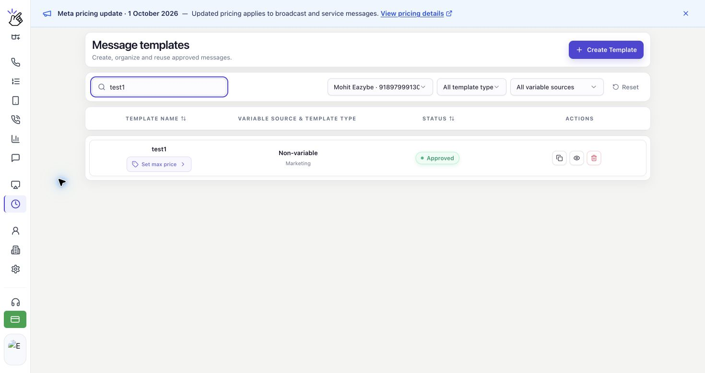
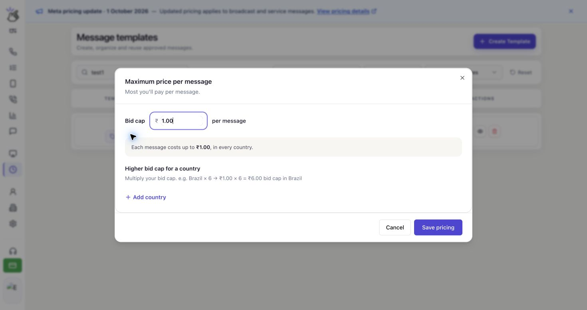
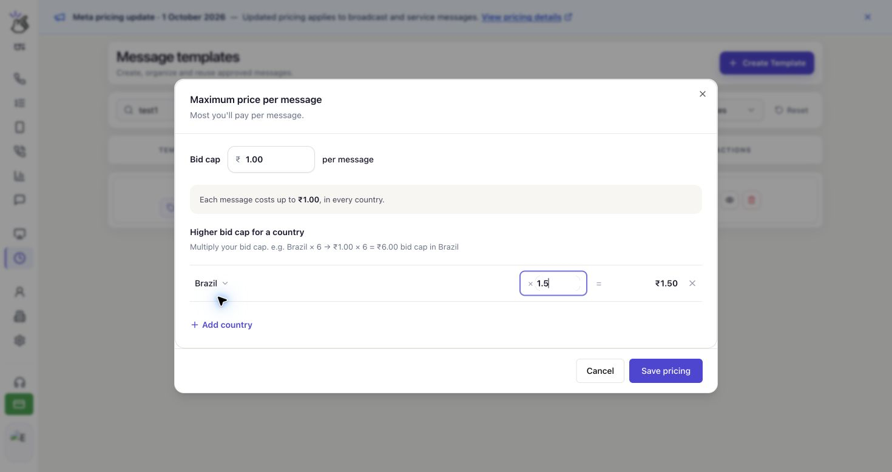

Define cuánto estás dispuesto a pagar como máximo por cada mensaje de marketing entregado en WhatsApp. Guarda este límite de puja (**Bid cap**) en tu plantilla y úsala para tu difusión.

## Cómo Funciona el Precio Máximo

El límite se aplica a cada mensaje entregado; no es el presupuesto total de la campaña ni un cargo fijo. El coste real puede ser menor y establecer un límite no garantiza la entrega.

Puedes usar el mismo límite para todos los países o ajustarlo por país con un multiplicador. Los países sin ajustes mantienen el límite base.

<Note>
  El precio máximo está disponible para plantillas de **Marketing** en cuentas de WhatsApp elegibles con MM Lite habilitado. Solo se admiten **INR (rupias indias)** y **USD (dólares estadounidenses)**. Las plantillas de utilidad y autenticación no tienen esta opción.
</Note>

## Configurar el Límite de la Plantilla

<Warning>
  El límite de ₹1.00 y el multiplicador para Brasil que aparecen a continuación son ejemplos, no precios recomendados. Elige los importes para tu campaña y comprueba la moneda de tu cuenta.
</Warning>

Las capturas muestran la interfaz en inglés. Conservamos los nombres de los controles para que puedas encontrarlos en pantalla.

<Steps>
  <Step title="Abre los precios de tu plantilla de marketing">
    Abre **Templates** en la barra lateral de Eazybe. En **Message templates**, elige tu número de WhatsApp y usa **Search templates** para buscar la plantilla.

    Haz clic en **Set max price** debajo de su nombre. Si ya tiene un límite, haz clic en **Max … / delivery** para revisarlo o modificarlo.

    

    <Note>
      La plantilla debe tener el estado **Approved** antes de poder usarla en una difusión.
    </Note>
  </Step>

  <Step title="Introduce el límite de puja">
    En **Maximum price per message**, introduce un importe positivo en **Bid cap**. Es el precio de un mensaje entregado, en la moneda indicada junto al campo.

    - **INR:** Introduce el importe en rupias indias. Por ejemplo, **1.00** establece un límite de **INR 1.00** por mensaje entregado.
    - **USD:** Introduce el importe en dólares estadounidenses. Por ejemplo, **1.00** establece un límite de **USD 1.00** por mensaje entregado.

    El resumen debajo del campo se actualiza mientras escribes.

    

    <Note>
      El texto de ejemplo **1.00** del campo no es un precio guardado. Introduce tu importe antes de guardar. No necesitas convertirlo a un precio por cada 1.000 mensajes.
    </Note>
  </Step>

  <Step title="Ajusta el límite por país si lo necesitas">
    Omite este ajuste para mantener el mismo límite en todos los países. Para usar otro límite en un destino, haz clic en **Add country**, debajo de **Higher bid cap for a country**.

    Selecciona el país e introduce un multiplicador en el campo junto a **×**. El importe después de **=** es el límite resultante para ese país.

    

    Con un límite base de ₹1.00, **1.5** establece un límite de ₹1.50 para Brasil. Un multiplicador de **1** mantiene el límite base; un valor inferior a **1**, como **0.8**, lo reduce.

    Los multiplicadores deben ser mayores que **0** y no superar **10**. Puedes añadir hasta **50** países. Haz clic en el botón **×** al final de una fila para eliminar el ajuste de ese país y volver a aplicar el límite base.

    <Warning>
      Un multiplicador superior a 1 aumenta el importe máximo que permites por cada entrega a ese país. Revisa el importe calculado antes de guardar.
    </Warning>
  </Step>

  <Step title="Revisa y guarda los precios">
    Comprueba **Bid cap** y el importe de cada país. Haz clic en **Save pricing** y espera la confirmación: **Pricing saved. Refresh before sending a campaign.**

    

    Haz clic en **Cancel** para cerrar sin guardar los cambios. Guardar los precios actualiza la plantilla; no envía una difusión.

    <Warning>
      Esta configuración pertenece a la plantilla y puede afectar a las difusiones que la usan. Evita cambiar sus precios mientras se están enviando difusiones con ella.
    </Warning>
  </Step>
</Steps>

## Antes de Enviar una Difusión

Sigue la guía [Crear una nueva difusión](/es/broadcasts/create-broadcast) para elegir el número de envío, la plantilla aprobada y los destinatarios.

Para una plantilla con precio máximo, revisa **Marketing delivery pricing** y haz clic en **Refresh pricing** para cargar la configuración actual. Una vez seleccionados los destinatarios, **Maximum Meta delivery cost** muestra el coste máximo de entrega para esa audiencia. El desglose por país muestra la cantidad de destinatarios, el precio máximo por entrega y el coste máximo por país.

<Warning>
  Un coste máximo o una estimación no es el cargo final. Para los mensajes con precio máximo, los cargos de la billetera se liquidan cuando Meta comunica el coste de entrega. Si el coste aún no ha llegado, está pendiente; no significa que la entrega sea gratuita. No sumes **Estimated wallet deduction** y **Maximum Meta delivery cost**: son vistas separadas, no dos cargos que debas sumar.
</Warning>

## Preguntas Frecuentes

### ¿Por qué no puedo establecer un precio máximo?

Comprueba que has elegido el número de WhatsApp correcto y una plantilla de **Marketing**. El editor solo está disponible cuando tu cuenta, proveedor y moneda admiten precios máximos. Si aparece **Maximum pricing changes are unavailable for this account, provider, or currency.**, no puedes modificar el límite para esa selección.

Si aparece **Pricing is unavailable.**, haz clic en **Retry** para volver a cargar los precios.

### ¿Por qué no se guarda mi importe?

Usa un número decimal positivo, sin símbolo de moneda en el campo. Si el precio tiene más decimales de los que admite tu cuenta, introduce un importe con menos decimales y vuelve a intentarlo. Los multiplicadores por país deben ser mayores que 0 y como máximo 10.

### ¿Qué ocurre si los precios cambian después de preparar una difusión?

Eazybe vuelve a comprobar los precios de la plantilla antes de enviar. Si han cambiado, los mensajes afectados no se envían con la configuración anterior. Revisa el precio actualizado y crea una nueva difusión si Eazybe te pide que vuelvas a crear la campaña.

### ¿Qué ocurre si se guardó el precio pero falló la sincronización?

Si aparece **Saved at Meta. Local pricing synchronization failed; refresh before sending.**, el precio se guardó en Meta. Actualiza los precios de la plantilla y verifica los importes antes de preparar una difusión.

### ¿Un límite más alto garantiza más entregas?

No. Un límite más alto permite pagar un precio mayor por entrega, pero no garantiza que todos los destinatarios reciban el mensaje.
