> **Indice de documentacao**
> Antes de explorar paginas individuais, consulte o indice completo em [https://help.eazybe.com/llms.txt](https://help.eazybe.com/llms.txt) para conhecer os topicos disponiveis.

# Conectar o Servidor MCP da Eazybe com Ferramentas de IA

> Conecte seu workspace da Eazybe ao Claude Code, Claude Desktop, ChatGPT, OpenAI Codex ou qualquer ferramenta de IA compativel com MCP, dando acesso direto ao seu CRM, conversas do WhatsApp, analiticas de equipe, campanhas e mais.

O servidor MCP (Model Context Protocol) da Eazybe permite consultar e gerenciar seu workspace da Eazybe diretamente de qualquer ferramenta de IA que suporte o padrao MCP. Uma vez conectado, voce pode pesquisar registros de CRM, ler conversas com clientes, consultar analiticas de equipe, inspecionar campanhas e realizar operacoes do workspace, tudo atraves de linguagem natural.

## Ferramentas de IA Compativeis

O servidor MCP da Eazybe funciona com qualquer ferramenta que suporte o Model Context Protocol, incluindo:

- **Claude Code** — Assistente de IA da Anthropic para programacao (app de desktop ou extensao do VS Code)
- **Claude Desktop** — App de desktop da Anthropic para Claude com suporte MCP
- **ChatGPT** — Assistente de IA da OpenAI com suporte a conectores MCP
- **OpenAI Codex** — Assistente de programacao da OpenAI com suporte MCP
- **Qualquer cliente compativel com MCP** — Cursor, Windsurf, Cline e outras ferramentas que suportem servidores MCP

> [!NOTE]
> Os passos de configuracao sao semelhantes em todas as ferramentas. Escolha sua ferramenta de IA abaixo para ver as instrucoes especificas.

---

<Tabs>

  <Tab title="Claude Code">

## O que Voce Precisa Antes de Comecar

Certifique-se de ter o seguinte pronto:

- **Claude Code** — o app de desktop ou a extensao do VS Code, instalado e funcionando
- **Uma conta de workspace da Eazybe** — com acesso de administrador ou usuario autorizado
- **Sua URL do servidor MCP da Eazybe** — sua equipe de desenvolvimento ou administrador do workspace fornecera

---

## Passo 1: Abrir as Configuracoes do Servidor MCP no Claude Code

**1. Abra o Claude Code** no seu computador (app de desktop ou VS Code).

**2. Abra o painel de servidores MCP.** Voce pode encontra-lo clicando no **icone MCP** na barra lateral, ou atraves de **Settings > MCP Servers**.

Voce vera uma lista de servidores MCP. Se for sua primeira vez, a lista pode estar vazia ou mostrar apenas os servidores padrao do Claude (Claude Docs, Google Drive, Notion).

---

## Passo 2: Adicionar o Servidor da Eazybe

**1. Clique em "Add MCP Server"** (ou o botao **+**) para adicionar um novo servidor.

**2. Insira os detalhes do servidor:**

| Campo | O que Inserir |
|---|---|
| **Server name** | `eazybe` |
| **Server URL** | A URL do endpoint MCP fornecida pela sua equipe de desenvolvimento |

> [!NOTE]
> A URL do servidor depende do seu ambiente. Sua equipe de desenvolvimento fornecera a URL correta. Geralmente termina em `/sse`. Se nao tiver certeza, pergunte ao administrador do workspace antes de continuar.

**3. Clique em Save.**

O servidor aparece na sua lista de servidores MCP. Voce vera um selo de status **"Connecting..."** ao lado dele.

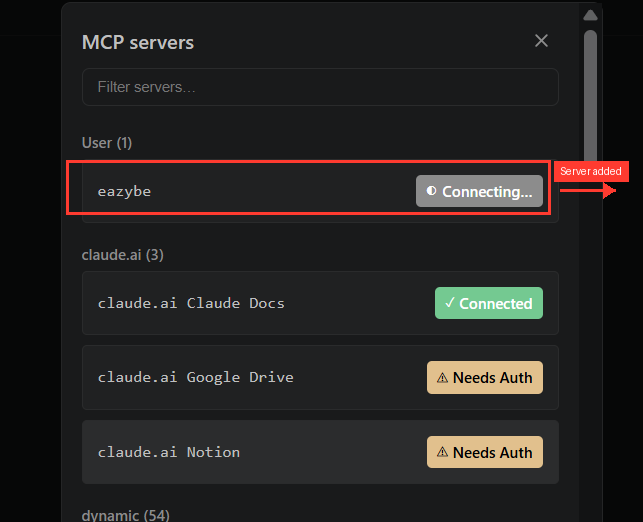

*O servidor da Eazybe aparece em "User" com um selo amarelo "Connecting...".*

---

## Passo 3: Autenticar sua Conexao

A primeira tentativa de conexao geralmente **expirara apos 30 segundos**. Isso e esperado — o servidor precisa que voce faca login antes de poder conectar.

**1. Voce vera um status "Failed"** com uma mensagem de erro: *"MCP server eazybe connection timed out after 30000ms"*.

**2. Clique no botao "Authenticating...".** Isso abre uma janela do navegador onde voce pode fazer login.

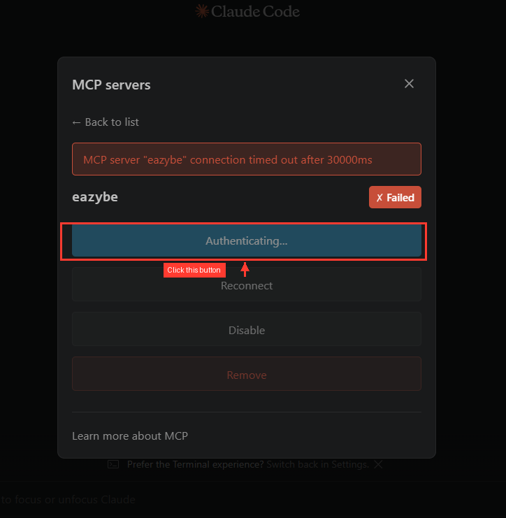

*Clique no botao amarelo "Authenticating..." para abrir a pagina de login no seu navegador.*

**3. Faca login com suas credenciais da Eazybe** na janela do navegador que se abre. Use o mesmo email e senha que voce usa para fazer login no seu workspace da Eazybe.

**4. Voce vera uma pagina de confirmacao de sucesso** uma vez que a autenticacao esteja completa.

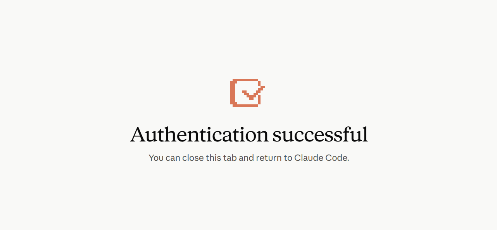

*"Authentication successful" — agora voce pode fechar esta aba do navegador e voltar ao Claude Code.*

**5. Feche a aba do navegador** e volte ao Claude Code.

---

## Passo 4: Reconectar e Confirmar

**1. De volta no Claude Code**, o servidor pode ainda mostrar **Failed**. Clique em **"Reconnect"**.

**2. O servidor agora deve mostrar um selo verde "Connected".**

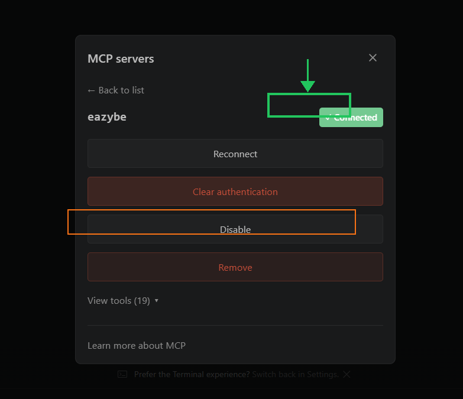

*O selo verde "Connected" confirma que o servidor esta pronto. Voce tambem vera opcoes para Reconnect, Clear authentication, Disable e Remove.*

> [!NOTE]
> Se Reconnect nao funcionar, clique em **"Clear authentication"** e repita o Passo 3 desde o inicio. Certifique-se de estar usando as credenciais corretas do seu workspace da Eazybe.

---

## Passo 5: Verificar se suas Ferramentas estao Carregadas

**1. Clique em "View tools"** na parte inferior do painel de detalhes do servidor.

**2. Voce deve ver 19 ou mais ferramentas listadas.** Estas sao as operacoes MCP que o Claude pode usar no seu workspace.

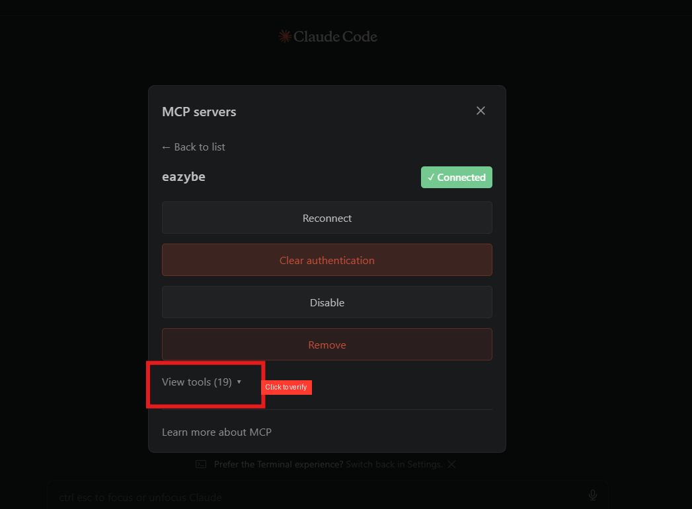

*Clique em "View tools (19)" para confirmar que todas as ferramentas foram carregadas corretamente. Se voce vir 0 ferramentas, desconecte e reconecte o servidor.*

---

## Passo 6: Executar sua Primeira Consulta

**1. Abra um novo chat** no Claude Code.

**2. Digite esta consulta de teste:**

```
What services does Eazybe provide for this workspace? List every available operation grouped by category.
```

**3. O Claude chamara a ferramenta `business_capabilities`** e retornara a lista completa de operacoes do seu workspace.

**4. Uma resposta bem-sucedida mostra:**

- Seu ID de organizacao e detalhes do plano
- Provedores conectados (ex., HubSpot, Google Calendar)
- Numero total de operacoes disponiveis
- Quaisquer limitacoes de disponibilidade

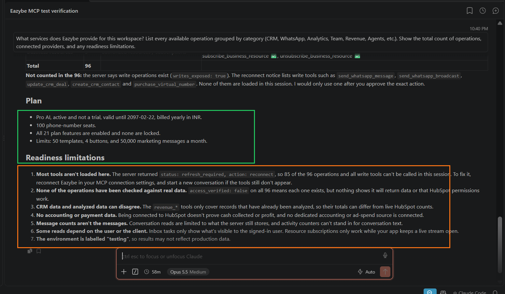

*Uma primeira consulta bem-sucedida confirma que sua conexao MCP esta funcionando completamente.*

Se voce vir esta resposta, sua configuracao esta completa. Agora voce pode usar o Claude para consultar seu workspace da Eazybe.

  </Tab>

  <Tab title="Claude Desktop">

## O que Voce Precisa Antes de Comecar

Certifique-se de ter o seguinte pronto:

- **Claude Desktop app** — instalado no seu computador Mac ou Windows
- **Uma conta de workspace da Eazybe** — com acesso de administrador ou usuario autorizado
- **Sua URL do servidor MCP da Eazybe** — sua equipe de desenvolvimento ou administrador do workspace fornecera

---

## Passo 1: Abrir as Configuracoes de Desenvolvedor

**1. Abra o Claude Desktop** no seu computador.

**2. Va para Settings** — clique no icone de menu no canto superior esquerdo, depois selecione **Settings**.

**3. Navegue ate a aba Developer** na barra lateral esquerda.

**4. Voce vera a secao de configuracao do servidor MCP** com opcoes para editar o arquivo de configuracao e gerenciar servidores conectados.

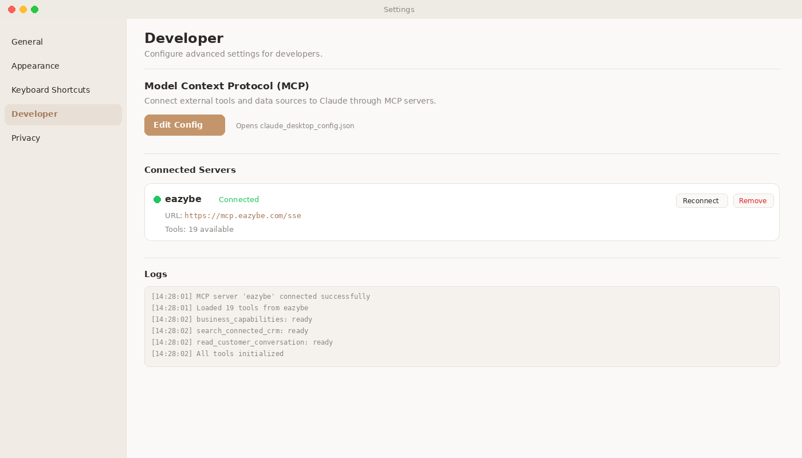

*O painel de configuracoes Developer mostra a secao MCP com um botao "Edit Config" e quaisquer servidores conectados.*

---

## Passo 2: Editar o Arquivo de Configuracao

**1. Clique em "Edit Config"** para abrir o arquivo `claude_desktop_config.json`.

**2. Adicione a configuracao do servidor da Eazybe** usando a ponte `mcp-remote`:

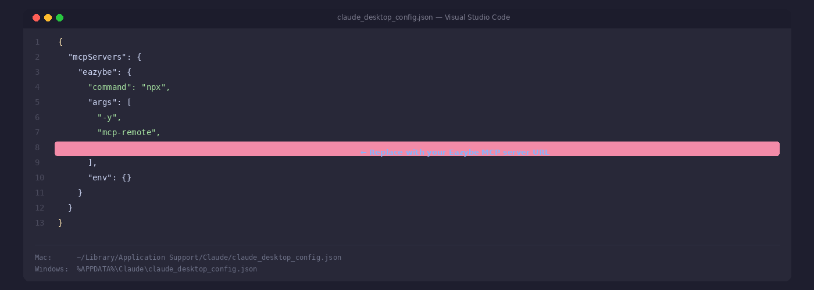

*Adicione a entrada do servidor MCP da Eazybe ao seu arquivo de configuracao. Substitua YOUR_MCP_SERVER_URL pela URL da sua equipe de desenvolvimento.*

```json
{
  "mcpServers": {
    "eazybe": {
      "command": "npx",
      "args": [
        "-y",
        "mcp-remote",
        "YOUR_MCP_SERVER_URL"
      ],
      "env": {}
    }
  }
}
```

> [!NOTE]
> Localizacao do arquivo de configuracao:
> - **Mac:** `~/Library/Application Support/Claude/claude_desktop_config.json`
> - **Windows:** `%APPDATA%\Claude\claude_desktop_config.json`
>
> Substitua `YOUR_MCP_SERVER_URL` pela URL do endpoint MCP da sua equipe de desenvolvimento (geralmente termina em `/sse`).

**3. Salve o arquivo** e reinicie o Claude Desktop.

---

## Passo 3: Autenticar sua Conexao

**1. Apos reiniciar, o Claude Desktop tentara conectar** ao servidor MCP da Eazybe.

**2. Uma janela do navegador sera aberta automaticamente** para autenticacao. Faca login com suas credenciais do workspace da Eazybe.

**3. Voce vera uma pagina de confirmacao "Authentication Successful".**

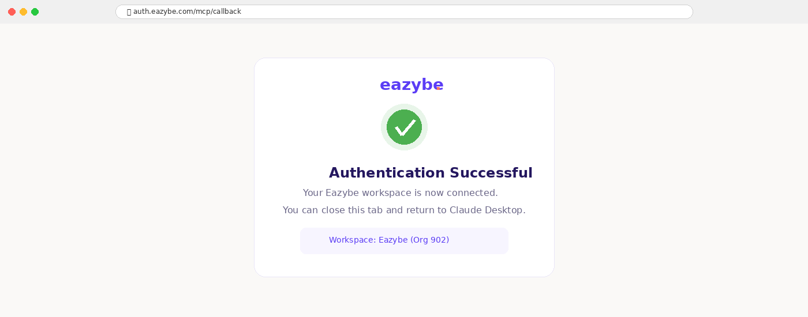

*"Authentication Successful" — seu workspace da Eazybe esta agora conectado. Feche esta aba e volte ao Claude Desktop.*

**4. Feche a aba do navegador** e volte ao Claude Desktop.

> [!NOTE]
> Se a conexao expirar antes de voce se autenticar, simplesmente reinicie o Claude Desktop e tente novamente. O passo de autenticacao so precisa ser feito uma vez.

---

## Passo 4: Verificar e Executar sua Primeira Consulta

**1. Abra uma nova conversa** no Claude Desktop.

**2. Clique no botao "+"** ao lado da entrada de mensagem para ver seus conectores disponiveis. Voce deve ver o servidor da Eazybe listado com suas ferramentas.

**3. Digite esta consulta de teste:**

```
What services does Eazybe provide for this workspace? List every available operation grouped by category.
```

**4. O Claude chamara a ferramenta `business_capabilities`** e retornara a lista completa de operacoes do seu workspace.

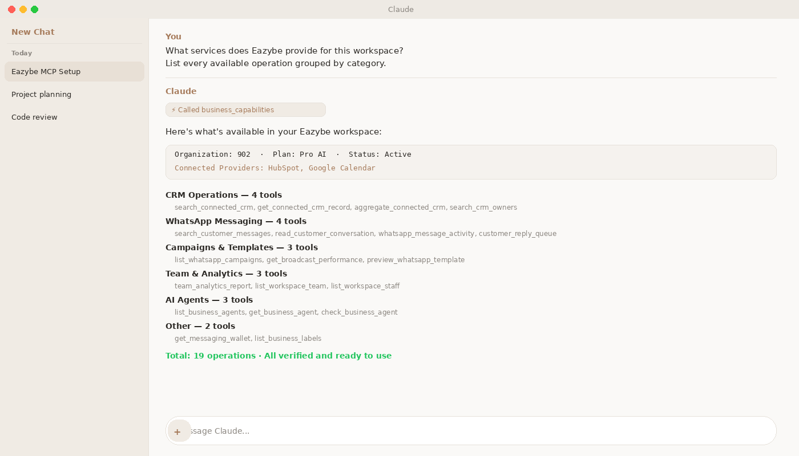

*Uma primeira consulta bem-sucedida mostra todas as 19 ferramentas agrupadas por categoria — CRM, WhatsApp, Campanhas, Analiticas, Agentes e mais.*

Se voce vir esta resposta, sua configuracao esta completa. Agora voce pode usar o Claude Desktop para consultar seu workspace da Eazybe.

  </Tab>

  <Tab title="ChatGPT">

## O que Voce Precisa Antes de Comecar

Certifique-se de ter o seguinte pronto:

- **Conta do ChatGPT** — com acesso ao ChatGPT Plus ou plano Team
- **Uma conta de workspace da Eazybe** — com acesso de administrador ou usuario autorizado
- **Sua URL do servidor MCP da Eazybe** — sua equipe de desenvolvimento ou administrador do workspace fornecera

---

## Passo 1: Ativar o Modo Desenvolvedor

**1. Abra o ChatGPT** no seu navegador em [chat.openai.com](https://chat.openai.com).

**2. Va para Settings** — clique no icone do seu perfil no canto inferior esquerdo, depois selecione **Settings**.

**3. Navegue ate a aba Advanced.**

**4. Ative "Developer Mode"** ligando o interruptor. Isso desbloqueia o recurso de Apps and Connectors necessario para conexoes MCP.

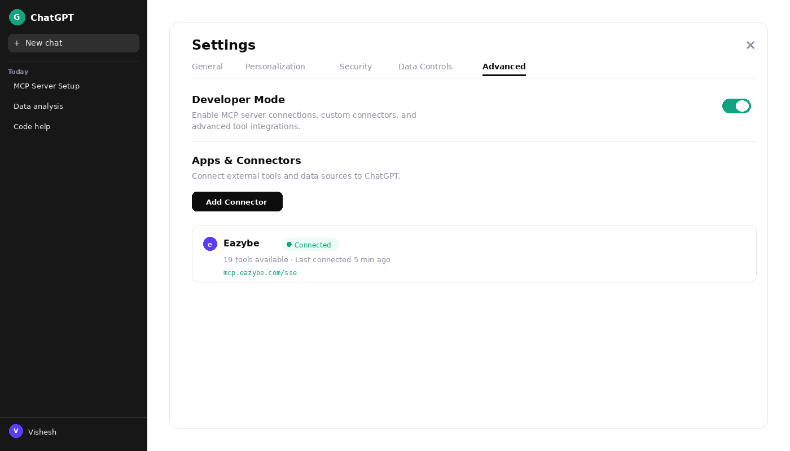

*Ative Developer Mode na aba Advanced para desbloquear o suporte a conectores MCP.*

---

## Passo 2: Adicionar o Conector da Eazybe

**1. No painel de Settings**, role para baixo ate a secao **Apps and Connectors**.

**2. Clique em "Add Connector"** para abrir o formulario de criacao de conectores.

**3. Preencha os detalhes do conector:**

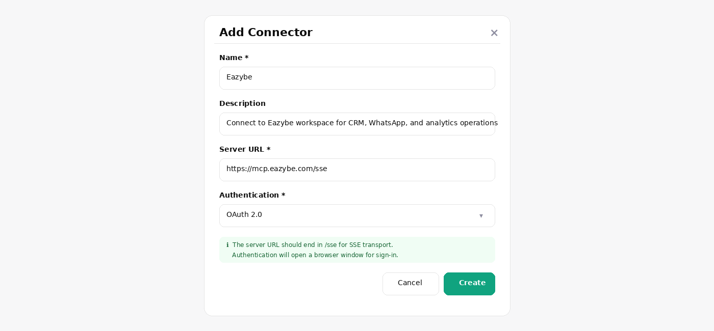

*Preencha o nome, a URL do servidor e selecione autenticacao OAuth 2.0.*

| Campo | O que Inserir |
|---|---|
| **Name** | `Eazybe` |
| **Description** | Conectar ao workspace da Eazybe para CRM, WhatsApp e analiticas |
| **Server URL** | A URL do endpoint MCP fornecida pela sua equipe de desenvolvimento (termina em `/sse`) |
| **Authentication** | OAuth 2.0 |

**4. Clique em "Create"** para salvar o conector.

---

## Passo 3: Autenticar sua Conexao

**1. Apos criar o conector**, o ChatGPT abrira uma janela do navegador para autenticacao.

**2. Faca login com suas credenciais do workspace da Eazybe** (o mesmo email e senha que voce usa para fazer login na Eazybe).

**3. Voce vera uma pagina de confirmacao "Authentication Successful".**

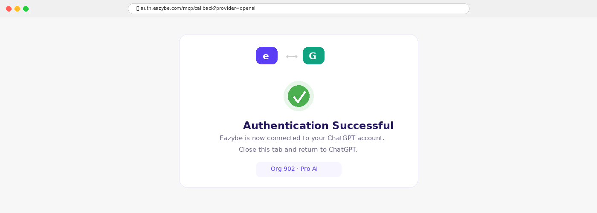

*"Authentication Successful" — a Eazybe esta agora conectada a sua conta do ChatGPT. Feche esta aba e volte ao ChatGPT.*

**4. Feche a aba do navegador** e volte ao ChatGPT.

> [!NOTE]
> Se a autenticacao expirar, volte para Settings, encontre o conector da Eazybe e clique em "Reconnect" para tentar novamente.

---

## Passo 4: Verificar e Executar sua Primeira Consulta

**1. Abra uma nova conversa** no ChatGPT.

**2. Digite esta consulta de teste:**

```
What services does Eazybe provide for this workspace? List every available operation grouped by category.
```

**3. O ChatGPT chamara a ferramenta `business_capabilities`** e retornara a lista de operacoes do seu workspace.

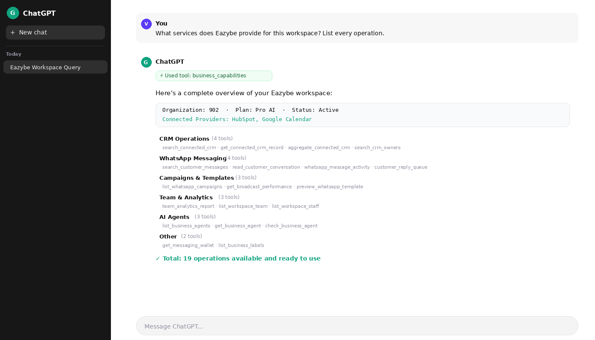

*Uma consulta bem-sucedida confirma que a conexao esta funcionando — todas as 19 operacoes estao disponiveis e agrupadas por categoria.*

**4. Uma resposta bem-sucedida mostra:**

- Seu ID de organizacao e detalhes do plano
- Provedores conectados (ex., HubSpot, Google Calendar)
- Numero total de operacoes disponiveis (19+)

Se voce vir esta resposta, sua configuracao esta completa. Agora voce pode usar o ChatGPT para consultar seu workspace da Eazybe.

  </Tab>

  <Tab title="OpenAI Codex">

## O que Voce Precisa Antes de Comecar

Certifique-se de ter o seguinte pronto:

- **OpenAI Codex CLI** — instalado na sua maquina (`npm install -g @openai/codex`)
- **Uma conta de workspace da Eazybe** — com acesso de administrador ou usuario autorizado
- **Sua URL do servidor MCP da Eazybe** — sua equipe de desenvolvimento ou administrador do workspace fornecera

---

## Passo 1: Criar o Arquivo de Configuracao

O OpenAI Codex usa um arquivo de configuracao JSON para conectar a servidores MCP.

**1. Abra seu terminal** e crie o diretorio de configuracao:

```bash
mkdir -p ~/.codex
```

**2. Crie ou edite o arquivo de configuracao** em `~/.codex/config.json` (Mac/Linux) ou `%USERPROFILE%\.codex\config.json` (Windows):

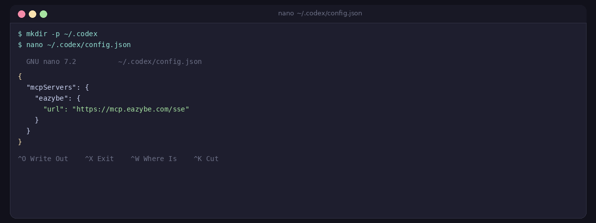

*Adicione a URL do servidor MCP da Eazybe ao seu arquivo de configuracao do Codex.*

**3. Adicione a configuracao do servidor da Eazybe:**

```json
{
  "mcpServers": {
    "eazybe": {
      "url": "YOUR_EAZYBE_MCP_SERVER_URL"
    }
  }
}
```

> [!NOTE]
> Substitua `YOUR_EAZYBE_MCP_SERVER_URL` pela URL do endpoint MCP fornecida pela sua equipe de desenvolvimento. Geralmente termina em `/sse`.

**4. Salve o arquivo.**

---

## Passo 2: Iniciar o Codex e Autenticar

**1. Abra seu terminal e execute:**

```bash
codex
```

**2. O Codex tentara conectar ao servidor MCP da Eazybe.** A primeira conexao expirara apos 30 segundos — isso e esperado e normal.

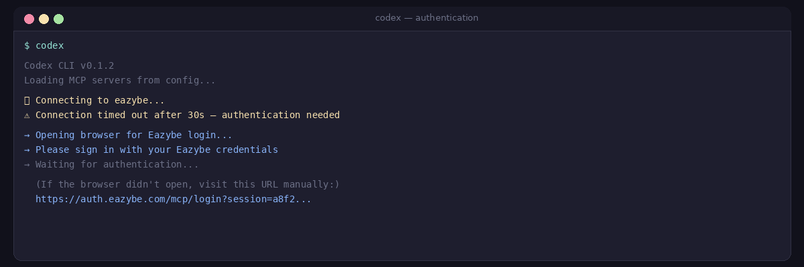

*A expiracao e esperada. O Codex abrira seu navegador para autenticacao.*

**3. Uma janela do navegador sera aberta automaticamente para autenticacao.** Faca login com suas credenciais do workspace da Eazybe (o mesmo email e senha que voce usa para fazer login na Eazybe).

**4. Voce vera uma pagina de confirmacao "Authentication successful".**

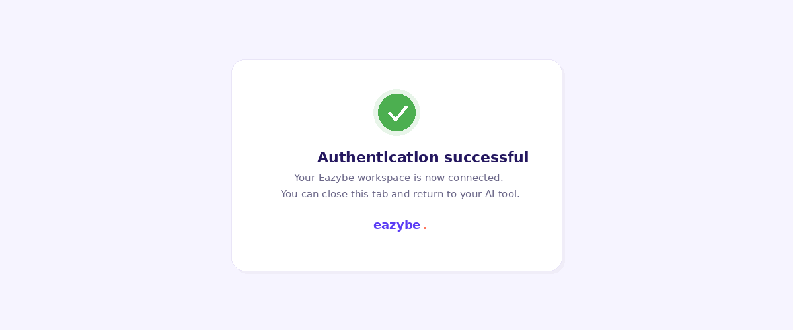

*"Authentication successful" — feche esta aba e volte ao seu terminal.*

**5. Feche a aba do navegador** e volte ao terminal. O Codex se reconectara automaticamente.

---

## Passo 3: Verificar sua Conexao

Uma vez autenticado, o Codex mostrara um resumo da conexao com todas as ferramentas disponiveis.

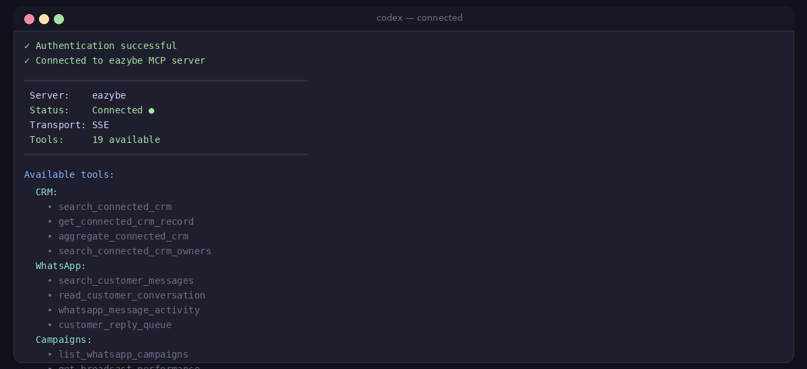

*O Codex esta conectado a Eazybe com 19 ferramentas carregadas em CRM, WhatsApp, Campanhas, Analiticas e Agentes.*

---

## Passo 4: Executar sua Primeira Consulta

**1. No terminal do Codex, digite:**

```
What services does Eazybe provide for this workspace? List every available operation grouped by category.
```

**2. O Codex chamara a ferramenta `business_capabilities`** e retornara a lista de operacoes do seu workspace.

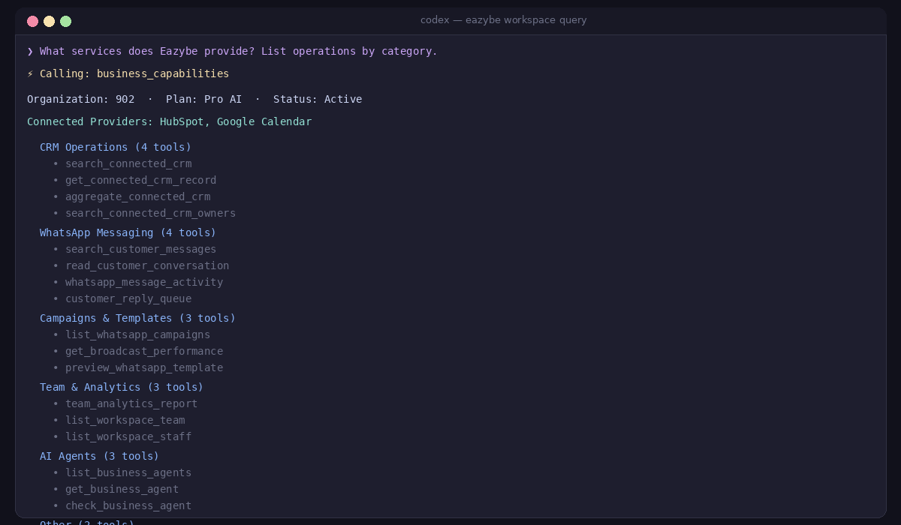

*Uma consulta bem-sucedida mostra seu ID de organizacao, plano, provedores conectados e todas as 19 operacoes agrupadas por categoria.*

**3. Uma resposta bem-sucedida mostra:**

- Seu ID de organizacao e detalhes do plano
- Provedores conectados (ex., HubSpot, Google Calendar)
- Numero total de operacoes disponiveis

Se voce vir esta resposta, sua configuracao esta completa.

  </Tab>

  <Tab title="Other AI Tools">

## Conectar com Qualquer Ferramenta Compativel com MCP

O servidor MCP da Eazybe funciona com qualquer ferramenta de IA que suporte o padrao Model Context Protocol. Isso inclui ferramentas como **Cursor**, **Windsurf**, **Cline** e outras.

---

## O que Voce Precisa

- **Uma ferramenta de IA compativel com MCP** — instalada e funcionando
- **Uma conta de workspace da Eazybe** — com acesso de administrador ou usuario autorizado
- **Sua URL do servidor MCP da Eazybe** — sua equipe de desenvolvimento ou administrador do workspace fornecera (termina em `/sse`)

---

## Passos Gerais de Configuracao

**1. Abra as configuracoes de servidores MCP da sua ferramenta de IA.** A maioria das ferramentas tem isso em Settings, Extensions ou um painel dedicado de MCP.

**2. Adicione um novo servidor MCP com estes detalhes:**

| Campo | O que Inserir |
|---|---|
| **Server name** | `eazybe` |
| **Server URL / Endpoint** | A URL do endpoint MCP fornecida pela sua equipe de desenvolvimento |
| **Transport** | SSE (Server-Sent Events) |

**3. Salve e conecte.** A primeira tentativa geralmente expirara enquanto espera a autenticacao.

**4. Autentique-se.** Uma janela do navegador sera aberta — faca login com suas credenciais do workspace da Eazybe.


*"Authentication successful" — feche esta aba e volte a sua ferramenta de IA.*

**5. Reconecte** apos a autenticacao. O servidor deve mostrar como conectado.

**6. Verifique** executando esta consulta de teste:

```
What services does Eazybe provide for this workspace? List every available operation grouped by category.
```

Uma resposta bem-sucedida mostra seu ID de organizacao, detalhes do plano, provedores conectados e operacoes disponiveis.

> [!NOTE]
> Se sua ferramenta de IA requer um formato de configuracao especifico (JSON, YAML, TOML), consulte a documentacao dessa ferramenta para saber como adicionar um servidor MCP. A URL do servidor e o fluxo de autenticacao sao os mesmos em todas as ferramentas.

---

## Guias de Configuracao por Ferramenta

### Cursor

Abra o painel de configuracao MCP do Cursor ou crie o arquivo de configuracao em `~/.cursor/mcp.json`:

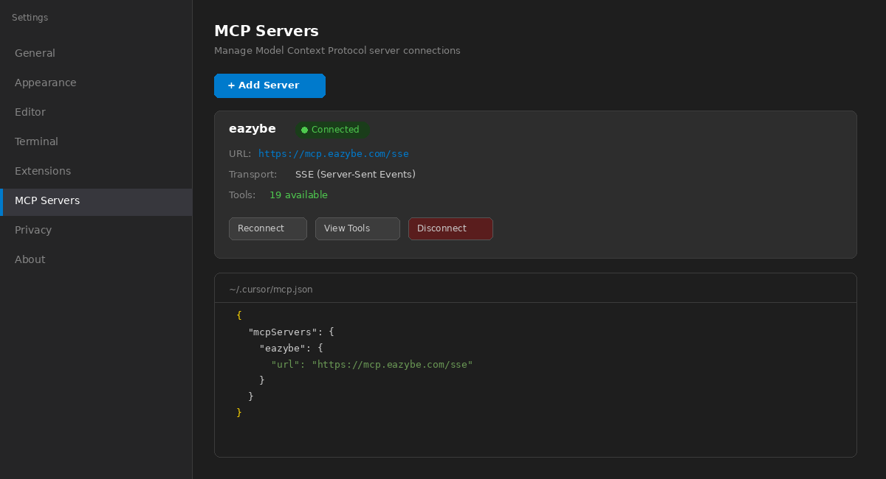

*Painel de configuracao MCP do Cursor mostrando o servidor da Eazybe conectado com 19 ferramentas disponiveis.*

```json
{
  "mcpServers": {
    "eazybe": {
      "url": "YOUR_EAZYBE_MCP_SERVER_URL"
    }
  }
}
```

### Windsurf

Abra o painel de configuracao MCP do Windsurf ou crie o arquivo de configuracao em `~/.windsurf/mcp_config.json`:

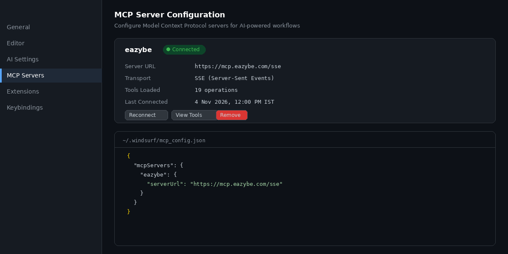

*Painel de configuracao de servidores MCP do Windsurf mostrando o servidor da Eazybe conectado e ativo.*

```json
{
  "mcpServers": {
    "eazybe": {
      "serverUrl": "YOUR_EAZYBE_MCP_SERVER_URL"
    }
  }
}
```

### Cline (Extensao do VS Code)

No VS Code com Cline instalado, abra o painel MCP do Cline na barra lateral:

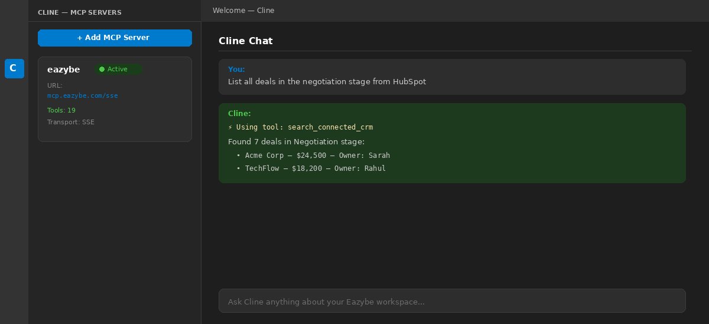

*Painel MCP do Cline no VS Code mostrando o servidor da Eazybe conectado e uma consulta de CRM em execucao.*

Clique em **"+ Add MCP Server"** depois insira `eazybe` como nome e sua URL do endpoint MCP depois autentique no navegador quando solicitado.

  </Tab>

</Tabs>

---

## O que Voce Pode Fazer uma vez Conectado

Uma vez conectado o servidor MCP, voce pode pedir a sua ferramenta de IA para:

- **Pesquisar registros de CRM** — encontre deals, contatos, empresas ou tickets por qualquer campo, proprietario, data ou estagio
- **Consultar analiticas de equipe** — veja atividade de mensagens, desempenho de representantes e comparacoes semana a semana
- **Ler conversas com clientes** — pesquise mensagens do WhatsApp em varios idiomas, leia threads completas, verifique quem esta esperando resposta
- **Inspecionar campanhas e broadcasts** — liste campanhas, verifique taxas de entrega e leitura, veja status individuais de destinatarios
- **Previsualizar templates** — veja mensagens de template renderizadas com valores de teste, sem enviar nada
- **Consultar saldo do wallet** — veja seu saldo de creditos de mensagens e moeda
- **Listar agentes e etiquetas** — inspecione agentes de IA, sua disponibilidade, versoes e etiquetas de negocio com estruturas de funil
- **Gerenciar registros de CRM** — crie, atualize ou arquive deals, contatos, empresas e tickets (requer sua aprovacao explicita)

> [!NOTE]
> **Todas as operacoes de escrita requerem sua aprovacao explicita.** Sua ferramenta de IA sempre mostrara a acao exata (o que sera criado, alterado ou excluido) e esperara voce confirmar antes de fazer qualquer alteracao. Nenhuma mensagem e enviada e nenhum registro e modificado sem sua permissao.

---

## Solucao de Problemas

**A conexao expira apos 30 segundos**

Isso significa que a autenticacao e necessaria. Procure um botao "Authenticating" ou uma janela do navegador. Faca login com suas credenciais da Eazybe, depois reconecte.

**O servidor mostra "Failed" apos a autenticacao**

Clique em **Reconnect**. Se continuar falhando, limpe qualquer autenticacao salva e repita os passos de login. Certifique-se de estar usando as credenciais corretas do seu workspace da Eazybe.

**As ferramentas mostram 0 ou nao estao carregando**

O servidor pode precisar de uma atualizacao. Desconecte o servidor da Eazybe, reconecte-o e inicie uma **nova conversa**. Se as ferramentas ainda nao aparecerem, verifique com sua equipe de desenvolvimento se o servidor MCP esta funcionando.

**"access_verified: false" em todas as operacoes**

Isso e normal e esperado. Significa que a conexao existe, mas cada fonte de dados e verificada na primeira vez que voce executa uma consulta contra ela. Se uma consulta especifica falhar com erro de permissoes, verifique as permissoes do seu cargo na Eazybe ou conta do HubSpot.

**Erro "connection_store_unavailable" em uma consulta**

Este e um problema intermitente do backend. Simplesmente tente novamente a mesma consulta — geralmente funciona na segunda tentativa. Se continuar acontecendo, o servidor MCP pode precisar de um reinicio pela equipe de desenvolvimento.

**Google Calendar mostra "connected" mas consultas de calendario falham**

A ferramenta `read_calendar_events` nao esta atualmente exposta atraves do conector MCP. Consultas relacionadas ao calendario (disponibilidade de reunioes, demos agendadas) nao funcionarao ate que esta ferramenta seja adicionada. Contate a equipe de desenvolvimento para solicita-la.

**Sua ferramenta de IA diz "most tools aren't loaded" ou "status: refresh_required"**

Desconecte o servidor MCP da Eazybe nas suas configuracoes, reconecte-o e inicie uma nova conversa. Isso acontece quando o token de sessao expirou e precisa de uma conexao nova.

---

*Ultima atualizacao: Novembro 2026*
