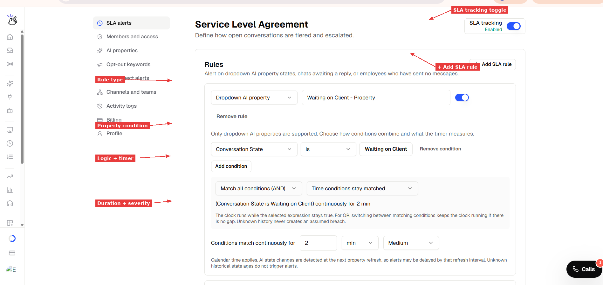
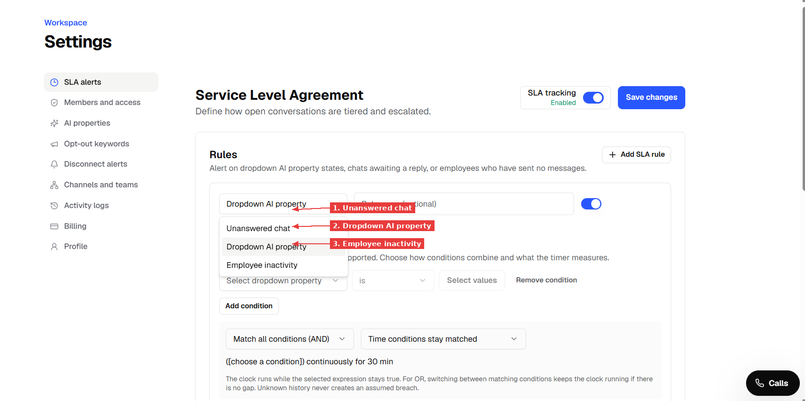
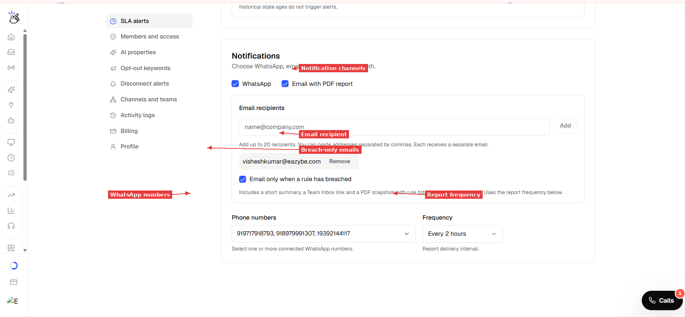

> **Diretório de Documentação**
> Antes de explorar páginas individuais, consulte o índice completo em [https://help.eazybe.com/llms.txt](https://help.eazybe.com/llms.txt) para todos os tópicos disponíveis.

# Alertas de SLA — Monitore Tempos de Resposta e Estados de Propriedades

> Defina regras baseadas em tempo para suas propriedades de IA, chats sem resposta e atividade dos funcionários. Quando uma regra é violada, o Eazybe envia um relatório para seu WhatsApp e e-mail — para que sua equipe possa agir antes que os clientes esperem demais.

Os alertas de SLA (Service Level Agreement) ajudam a identificar conversas que estão paradas há muito tempo sem atenção. Você define as regras — o Eazybe monitora seus chats e notifica quando algo precisa de ação.

## O que os Alertas de SLA Podem Monitorar?

Os alertas de SLA suportam três tipos de regras:

- **Propriedade de IA do tipo dropdown** — Alerta quando uma conversa permanece em um estado específico de propriedade de IA por muito tempo. Por exemplo: "Estado da Conversa é Aguardando Cliente há mais de 2 horas."
- **Chat sem resposta** — Alerta quando um cliente está esperando uma resposta da equipe além do limite definido. Por exemplo: "Sem resposta da equipe há 30 minutos."
- **Inatividade do funcionário** — Alerta quando um funcionário não enviou nenhuma mensagem qualificada dentro do limite definido. Por exemplo: "Funcionário não enviou mensagem há 4 horas."

Você também pode combinar condições. Por exemplo: "Estado da Conversa é Aguardando Cliente **AND** Idioma Preferido é Inglês — há mais de 5 minutos."

> [!NOTE]
> Apenas propriedades de IA do tipo **dropdown** são suportadas nas regras de SLA. Propriedades de texto e número ainda não podem ser usadas como condições.

---

## O que Você Precisa Antes de Começar

- **Acesso de administrador ou autorizado** ao seu workspace do Eazybe
- **Pelo menos uma propriedade de IA** definida em Configurações → AI Properties (tipo dropdown)
- **Um número de WhatsApp** conectado ao workspace (para relatórios via WhatsApp)
- **Um endereço de e-mail** para receber relatórios em PDF (opcional)

---

## Passo 1: Abrir Configurações de SLA

**1.** Vá para **Settings** na barra lateral esquerda do painel do Eazybe.

**2.** Clique em **SLA alerts** no menu de configurações.

**3.** Você verá a página de Service Level Agreement com a seção de regras e configurações de notificação.

*A página de alertas de SLA. O toggle de SLA tracking está no canto superior direito. Clique em "+ Add SLA rule" para criar sua primeira regra.*

---

## Passo 2: Criar Sua Primeira Regra

**1.** Clique em **"+ Add SLA rule"** para adicionar uma nova regra.

**2.** Escolha o tipo de regra no dropdown:

| Tipo | O que Monitora |
|---|---|
| **Dropdown AI property** | Um valor específico de propriedade de IA que permanece por muito tempo (ex.: Conversation State = Waiting on Client) |
| **Unanswered chat** | Tempo desde a última mensagem do cliente sem resposta da equipe |
| **Employee inactivity** | Tempo desde que um funcionário enviou sua última mensagem qualificada |

*Escolha o tipo de regra. Cada tipo mede um tipo diferente de atraso.*

**3.** Dê um **nome** à sua regra (opcional, mas recomendado para clareza nos relatórios).

---

## Passo 3: Configurar as Condições da Regra

### Para Regras de Propriedade de IA (Dropdown)

**1.** Selecione a **propriedade dropdown** da lista (ex.: Conversation State).

**2.** Escolha o **operador** (ex.: "is").

**3.** Selecione o **valor** a monitorar (ex.: "Waiting on Client").

**4.** Opcionalmente, clique em **"Add condition"** para adicionar uma segunda condição. Por exemplo, adicione "Preferred Lang is English" para criar uma regra combinada.

**5.** Escolha como as condições se combinam:
- **Match all conditions (AND)** — todas as condições devem ser verdadeiras
- **Match any condition (OR)** — pelo menos uma condição deve ser verdadeira

**6.** Escolha o que o temporizador mede:
- **Time conditions stay matched** — há quanto tempo a propriedade tem esse valor
- **No team reply** — há quanto tempo desde a última mensagem não respondida do cliente, enquanto a condição se mantém

*Uma regra de propriedade monitorando "Conversation State is Waiting on Client" continuamente por 2 minutos. O resumo na parte inferior confirma a lógica da regra.*

> [!NOTE]
> As propriedades de IA são reavaliadas em um cronograma de atualização (a cada 30 minutos para propriedades dropdown). Uma mudança de estado só é detectada na próxima atualização, então os alertas podem ser atrasados em até um intervalo de atualização. Se o temporizador da sua regra for menor que o intervalo de atualização, o alerta pode não disparar com a precisão esperada.

### Para Regras de Chat Sem Resposta

Não há condições para configurar — esta regra simplesmente monitora mensagens de clientes que não receberam resposta da equipe.

**1.** Defina o limite de duração (ex.: 5 minutos).

**2.** Escolha a severidade.

### Para Regras de Inatividade do Funcionário

**1.** Defina o limite de duração (ex.: 2 minutos).

**2.** Escolha a severidade.

> [!NOTE]
> Apenas mensagens diretas humanas registradas com um ID de remetente de funcionário reiniciam o temporizador de inatividade. Templates, automações, broadcasts e envios não atribuídos não contam.

---

## Passo 4: Definir o Temporizador e a Severidade

**1.** Defina **"Conditions match continuously for"** — insira um número e escolha a unidade (min, hours ou days).

**2.** Escolha o nível de **severidade**:

| Severidade | Quando Usar |
|---|---|
| **Critical** | Urgente — precisa de atenção imediata |
| **High** | Importante — deve ser tratado em breve |
| **Medium** | Monitoramento padrão |
| **Low** | Informativo — bom saber |

**3.** Certifique-se de que o **toggle** esteja **ON** (azul) para ativar a regra.

---

## Passo 5: Configurar Notificações

Role para baixo até a seção **Notifications**.

**1.** Escolha seus canais de notificação:
- **WhatsApp** — envia um relatório em texto para seus números conectados
- **Email with PDF report** — envia um e-mail resumido com um anexo em PDF

**2.** Para notificações por e-mail:
- Insira o endereço de e-mail no campo **Email recipients** e clique em **Add**
- Marque **"Email only when a rule has breached"** se você só quiser e-mails quando algo precisar de atenção (recomendado)

**3.** Para notificações por WhatsApp:
- Selecione um ou mais **números de telefone** dos seus números de WhatsApp conectados
- Escolha a **Frequency** — com que frequência os relatórios são enviados (Every 2 hours, 3 hours ou 4 hours)

*Configure notificações por WhatsApp e e-mail. O e-mail inclui um PDF com um resumo de todas as violações.*

> [!NOTE]
> A frequência controla com que frequência os relatórios são **entregues**, não com que frequência as regras são **verificadas**. Um chat pode violar uma regra de 2 minutos, mas só aparecer no próximo relatório agendado. Para maior agilidade, use intervalos de relatório mais curtos.

---

## Passo 6: Salvar e Ativar

**1.** Certifique-se de que o **SLA tracking** esteja **ON** (canto superior direito — mostra "Enabled" em verde).

**2.** Clique em **"Save changes"** (botão azul, canto superior direito).

**3.** Atualize a página (F5) para confirmar que suas regras foram salvas.

---

## Passo 7: Verificar na Team Inbox

**1.** Vá para **Team Inbox** na barra lateral esquerda.

**2.** Role para baixo no painel esquerdo para encontrar **SLA TRACKING**.

**3.** Você deve ver suas regras listadas com **contagens de violações em tempo real**.

*O SLA Tracking na Team Inbox mostra contagens em tempo real para cada regra. Clique no nome de uma regra para filtrar a lista de chats e ver apenas as conversas que violaram aquela regra.*

**4.** Clique no nome de qualquer regra para **filtrar a lista de chats** e ver apenas as conversas que violaram aquela regra.

**5.** Quando você responder a um chat em violação, a contagem é atualizada na próxima verificação.

> [!NOTE]
> Regras de inatividade de funcionário aparecem no relatório por e-mail, mas podem não aparecer na barra lateral da Team Inbox. Esta é uma limitação conhecida.

---

## Entendendo o Relatório por E-mail

Quando uma regra é violada, você recebe um e-mail com:

- **Contagem total de violações** — quantos chats ou funcionários ultrapassaram o limite
- **Detalhamento por regra** — cada regra listada com sua contagem de violações e severidade
- **Um anexo em PDF** — um resumo com exemplos das conversas em violação

O relatório é assim:

| Campo | Exemplo |
|---|---|
| Assunto | "SLA breaches need attention" |
| Workspace | Workspace 902 |
| Violações de chat | 211 |
| Violações de inatividade | 4 |
| Regras listadas | Todas as regras ativas com contagens individuais |

> [!NOTE]
> Um chat pode violar mais de uma regra, então o total conta correspondências de regras — não chats únicos. Se o mesmo chat corresponde a "Waiting on Client" e "Unanswered 5min", ele conta em ambas.

---

## O que Reinicia Cada Temporizador?

| Tipo de Temporizador | O que o Reinicia |
|---|---|
| **Estado da propriedade** | O valor da propriedade muda para algo que não corresponde mais à condição |
| **Chat sem resposta** | Qualquer membro da equipe responde ao chat. Mais mensagens do cliente **não** reiniciam o temporizador |
| **Inatividade do funcionário** | Aquele funcionário específico envia uma mensagem qualificada. Mensagens de outros funcionários ou automações não reiniciam |

---

## Dicas e Boas Práticas

- **Comece com limites mais longos** (30 min+) e reduza conforme sua equipe se adapta
- **Use regras combinadas** (AND) para focar alertas em segmentos de alto valor — ex.: "Waiting on Client AND Lead Stage is Negotiation"
- **Nomeie suas regras claramente** — o nome aparece na Team Inbox e nos relatórios por e-mail
- **Use "Email only when breached"** para evitar relatórios vazios lotando sua caixa de entrada
- **Verifique o intervalo de atualização** — um limite de SLA de 2 minutos em uma propriedade que atualiza a cada 30 minutos não vai disparar com precisão

---

## Solução de Problemas

**SLA Tracking mostra "SLA is disabled" na Team Inbox**

Certifique-se de que o SLA tracking esteja ativado em Settings → SLA alerts e que você tenha pelo menos uma regra ativa salva. Clique em Save changes e atualize a Team Inbox.

**A contagem da regra é 0, mas eu sei que chats deveriam corresponder**

Verifique se o valor da propriedade de IA corresponde exatamente. Vá a um chat que você espera que esteja em violação, verifique o painel de propriedades de IA e confirme que o valor corresponde à condição da sua regra.

**Relatório por e-mail não está chegando**

Verifique se o endereço de e-mail foi adicionado corretamente em Notifications. Verifique as pastas de spam/lixo eletrônico. O relatório só é enviado no intervalo de frequência configurado e somente quando "Email only when breached" tem violações para relatar.

**Relatório por WhatsApp não está chegando**

Confirme que os números de telefone em Notifications são números de WhatsApp Business conectados. Se a janela de mensagens estiver fechada, o relatório é enviado como o template `sla_notice` — o destinatário toca em "Send report" para receber o texto completo.

**Inatividade do funcionário mostra 0, mesmo com ninguém respondendo**

O temporizador só começa quando o SLA tracking é ativado. Ele não conta o tempo anterior à ativação. Aguarde a duração do limite após ativar.

---

*Última atualização: Novembro 2026*
