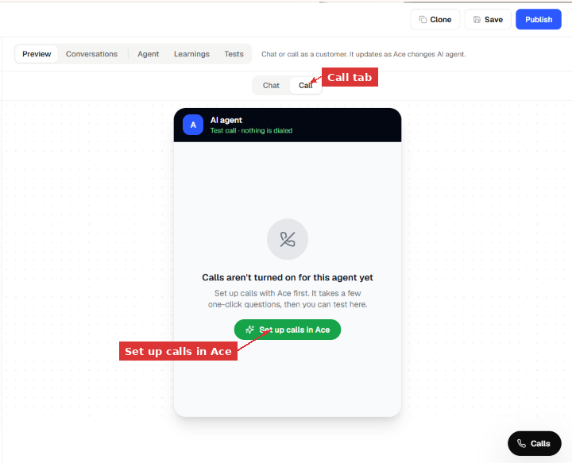
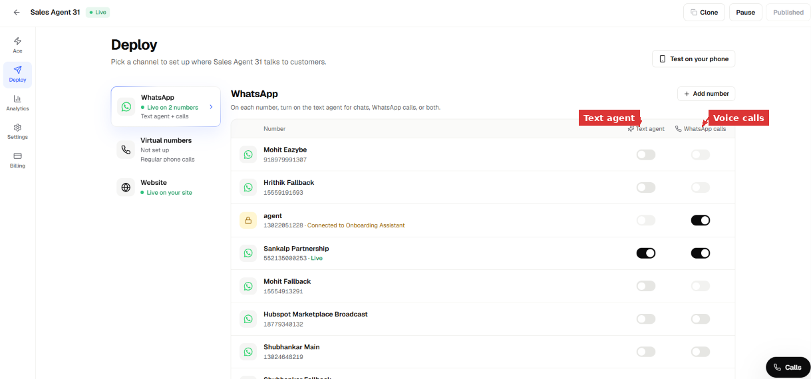
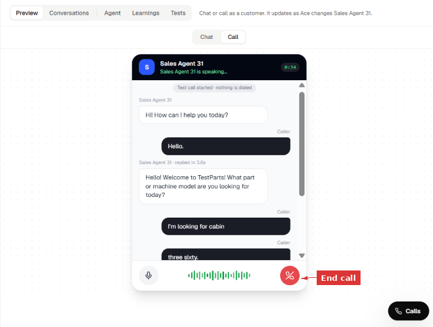
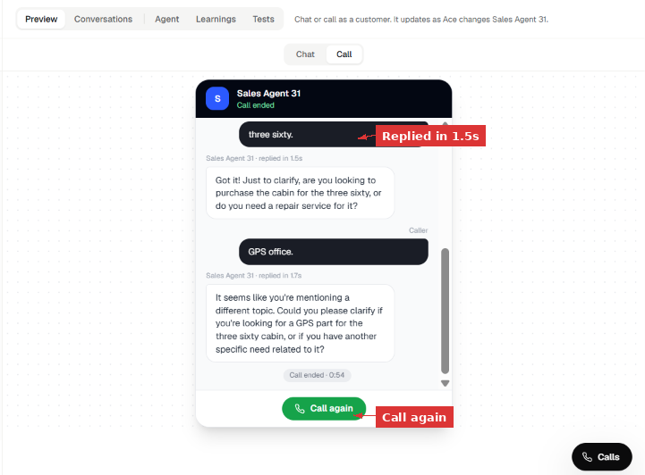

# Agente de Voz IA

> Ative chamadas de voz para que seu agente de IA possa atender conversas telefônicas no WhatsApp e em números virtuais.

Seu agente de IA usa o mesmo prompt, base de conhecimento e ferramentas para chamadas de voz e para chats de texto. Você ativa a camada de voz, implanta nos seus números e o agente atende as chamadas automaticamente.

---

## Como Funciona

Seu agente de IA já sabe como responder aos clientes por texto. Voice AI adiciona uma camada de voz por cima:

1. Um cliente liga para o seu número de WhatsApp ou número virtual.
2. O agente de IA ouve a voz do cliente e a converte em texto.
3. O agente processa a mensagem usando seu prompt, base de conhecimento e ferramentas — da mesma forma que lida com chats de texto.
4. A resposta do agente é convertida em fala com som natural e reproduzida para o cliente.

Toda a conversa também é registrada como transcrição de texto no seu Team Inbox, para que sua equipe possa revisar o que foi dito.

---

## Configurando Chamadas de Voz

### Passo 1: Ativar a voz no Ace

**1.** Abra seu agente e vá para a aba **Preview**.

**2.** Mude de **Chat** para **Call**.

**3.** Se as chamadas ainda não estiverem ativadas, você verá a mensagem: "Calls aren't turned on for this agent yet." Clique em **Set up calls in Ace**.

**4.** O Ace vai guiá-lo com algumas perguntas rápidas para configurar as opções de voz do seu agente.

*Mude para a aba Call no Preview. Clique em "Set up calls in Ace" para ativar a voz do seu agente.*

### Passo 2: Implantar a voz nos seus números

Depois de ativar a voz, vá para a aba **Deploy** para escolher quais números recebem chamadas de voz.

**1.** Clique em **Deploy** na barra lateral esquerda.

**2.** Em **WhatsApp**, você verá uma lista dos seus números conectados com duas colunas de alternância:
   - **Text agent** — ativa a IA para chats de texto nesse número.
   - **WhatsApp calls** — ativa a IA para chamadas de voz nesse número.

**3.** Ative **WhatsApp calls** nos números desejados. Você pode ativar apenas texto, apenas voz, ou ambos em cada número.

**4.** Em **Virtual numbers**, você pode configurar números de telefone regulares (não WhatsApp) para chamadas de voz. Isso é útil se você quiser uma linha telefônica dedicada para o seu agente de IA.

*A página Deploy. Cada número tem alternadores separados para texto e voz. Ative WhatsApp calls nos números onde você quer que a IA atenda.*

> [!NOTE]
> Você pode ativar a voz em vários números. Cada número pode ter texto, voz ou ambos ativados de forma independente. As alterações entram em vigor imediatamente — não é necessário republicar o agente.

---

## Testando Chamadas de Voz

Antes de ir ao vivo, teste a voz do seu agente na aba **Preview**.

**1.** Vá para **Preview** → **Call**.

**2.** A chamada de teste começa automaticamente — você verá "Test call - nothing is dialed" no topo. Isso significa que a chamada é simulada e não usa um número de telefone real.

**3.** Fale no seu microfone. O agente responderá em tempo real. Você pode ver a transcrição ao vivo da conversa enquanto ela acontece.

**4.** O status do agente é mostrado no topo — "is speaking..." quando o agente está falando, e o tempo de resposta (ex. "replied in 1.5s") aparece ao lado de cada mensagem.

*Uma chamada de teste em andamento. O agente responde em tempo real e você pode ver a transcrição completa. Os tempos de resposta são mostrados ao lado de cada resposta.*

**5.** Quando terminar, clique no botão vermelho de **encerrar chamada**. Você verá "Call ended" com a duração total e um botão **Call again** para iniciar um novo teste.

*Após encerrar uma chamada, revise a transcrição e clique em "Call again" para executar outro teste.*

---

## O Que Verificar ao Testar

Ao testar seu agente de voz, preste atenção em:

- **Velocidade de resposta** — quão rápido o agente responde após você terminar de falar. Mire em menos de 3 segundos.
- **Clareza da voz** — o agente soa natural? As palavras são pronunciadas corretamente?
- **Palavras de preenchimento** — o agente não deve adicionar sons desnecessários como "yeah", "okay" ou "hmm" antes de responder.
- **Ruído de fundo** — não deve haver sons de teclado, ruídos de digitação ou outros artefatos na voz do agente.
- **Fluxo da conversa** — o agente segue o seu prompt corretamente? Ele faz as perguntas certas na ordem certa?
- **Idioma** — se o seu agente suporta múltiplos idiomas, verifique se ele responde no idioma correto quando você fala nesse idioma.

---

## Dicas e Melhores Práticas

- **Mantenha seu prompt conciso** — conversas de voz são mais rápidas que texto. Prompts longos e complexos podem causar atrasos. Instruções mais curtas ajudam o agente a responder mais rápido.
- **Teste com cenários reais** — não diga apenas "olá." Percorra a jornada real do cliente que o seu agente lida (qualificação, agendamento, perguntas frequentes, etc.).
- **Ative em um número primeiro** — comece com voz em um único número, monitore as chamadas, e depois expanda para mais números quando estiver confiante.
- **Revise as transcrições regularmente** — cada chamada de voz é registrada no Team Inbox como transcrição de texto. Use-as para identificar problemas e melhorar o prompt do seu agente.
- **Use números virtuais para linhas de voz dedicadas** — se você quiser um número de telefone separado apenas para chamadas de IA (não WhatsApp), configure um número virtual na aba Deploy.

---

## Solução de Problemas

**"Calls aren't turned on for this agent yet"**

Vá para Preview → Call e clique em "Set up calls in Ace." O Ace vai guiá-lo para ativar a voz deste agente.

**O agente responde devagar**

Verifique o tamanho do seu prompt — prompts muito longos podem aumentar o tempo de resposta. Verifique também se você tem muitas ferramentas ativadas que o agente pesquisa antes de responder.

**O agente adiciona palavras de preenchimento ou sons de fundo**

Este é um problema conhecido com algumas configurações de voz. Reporte ao time da Eazybe para que eles possam ajustar as configurações de voz do seu agente.

**A voz está ativada mas as chamadas não são atendidas**

Certifique-se de que o alternador de WhatsApp calls esteja ativado para o número correto em Deploy. Verifique também se o agente está Published (não Paused ou Draft).

**O cliente não ouve nada quando liga**

Verifique se o número está conectado e ativo. Vá para Deploy → WhatsApp e confirme que o número mostra um status verde "Live".

