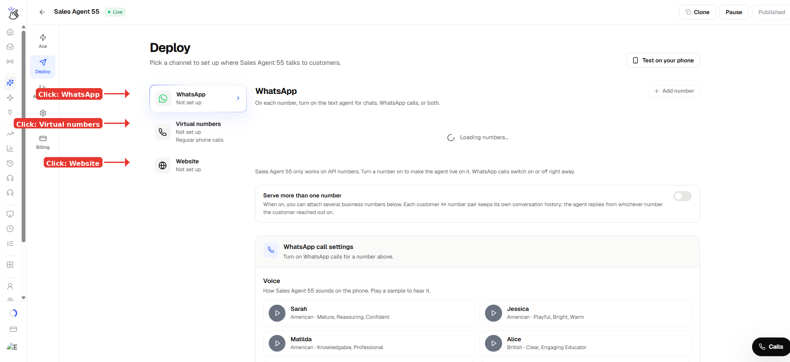
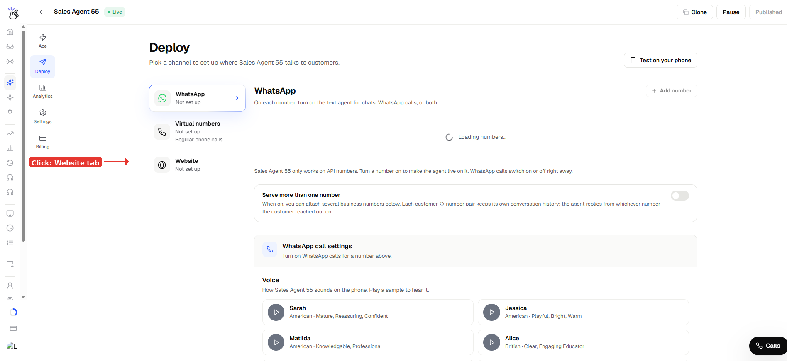
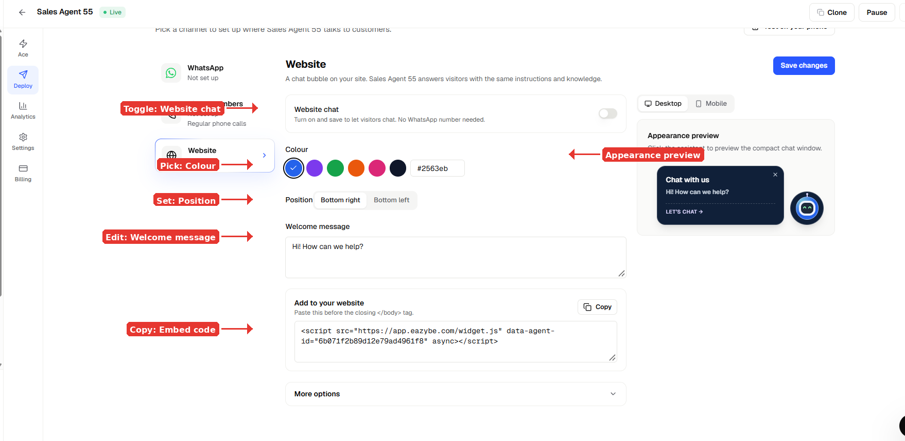
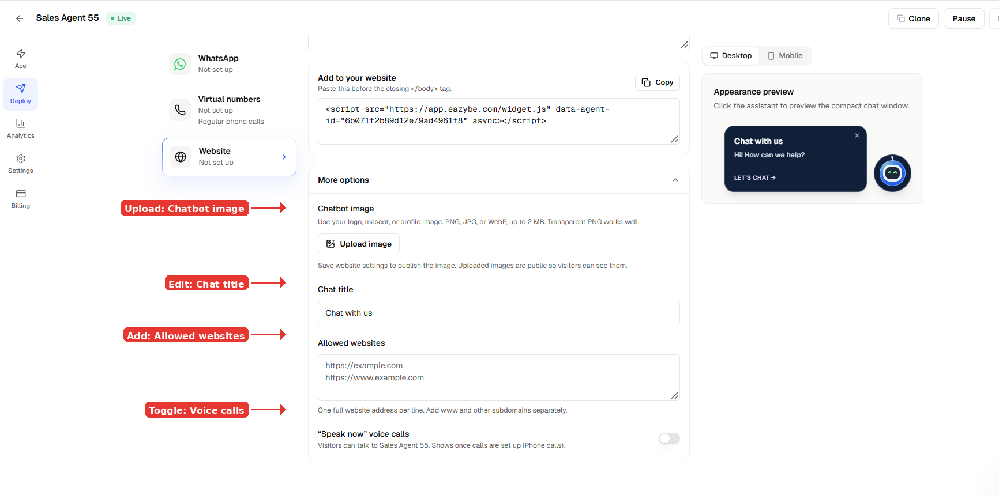
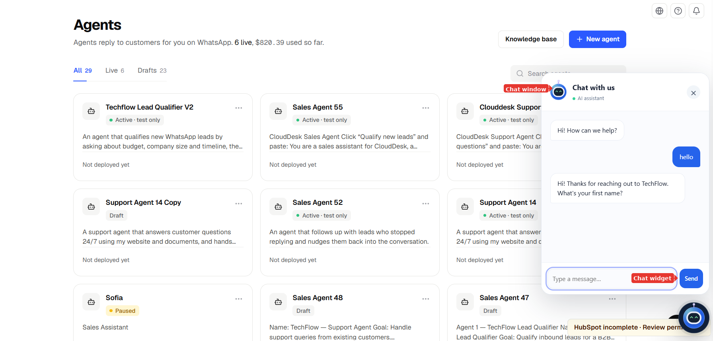

Seu agente de IA pode ser implantado além do WhatsApp — diretamente no seu site como um widget de chat. O mesmo agente, com as mesmas instruções e conhecimento, funciona em todos os canais: WhatsApp, números virtuais e seu site.

## Visão Geral dos Canais de Implantação

Seu agente de IA pode ser implantado em três canais na seção **Deploy**:



1. **WhatsApp** — Implante o agente nos seus números da API do WhatsApp Business para conversas por texto e voz.
2. **Números virtuais** — Implante o agente em números de chamadas telefônicas regulares (números virtuais).
3. **Site** — Adicione o agente como widget de chat no seu site. Os visitantes podem conversar por texto e, opcionalmente, ligar para o agente diretamente do seu site.

<Note>
O comportamento, as instruções e o conhecimento do agente permanecem os mesmos em todos os três canais. Você configura o agente uma vez e implanta em todos os lugares.
</Note>

## Configurando o Agente no Site

### Passo 1: Navegue até Deploy

Abra seu agente no painel e clique na aba **Deploy** na barra lateral.

### Passo 2: Selecione Website

Clique em **Website** na lista de canais no lado esquerdo.



### Passo 3: Ative o Chat do Site

Ative o botão **Website chat**. Isso ativa o widget de chat para o seu site — nenhum número do WhatsApp é necessário.

### Passo 4: Personalize a Aparência

Configure como o widget aparece no seu site:



1. **Cor** — Escolha uma cor de tema para o widget de chat. Selecione entre as cores predefinidas (azul, roxo, verde, laranja, rosa, preto) ou insira um código hexadecimal personalizado.
2. **Posição** — Defina onde o widget aparece: **Canto inferior direito** ou **Canto inferior esquerdo** da página.
3. **Mensagem de boas-vindas** — A primeira mensagem que os visitantes veem ao abrir o chat. Por exemplo: "Olá! Como podemos ajudar?"
4. **Código de incorporação** — Copie esta tag de script e cole no HTML do seu site antes da tag de fechamento `</body>`. Este código carrega o agente no seu site.

### Passo 5: Configure Mais Opções

Role para baixo e expanda **More options** para personalizar ainda mais:



1. **Imagem do chatbot** — Faça upload do seu logo, mascote ou imagem de perfil. Formato PNG, JPG ou WebP, até 2 MB. PNG transparente funciona melhor.
2. **Título do chat** — O título exibido no topo do widget de chat (ex: "Fale conosco").
3. **Sites permitidos** — Liste os sites onde o agente deve aparecer. Adicione uma URL completa por linha, incluindo `www` e outros subdomínios separadamente.
4. **Chamadas de voz "Speak now"** — Ative para permitir que os visitantes conversem com o agente por voz diretamente do site. As chamadas de voz precisam ser configuradas primeiro (requer um número de telefone conectado).

### Passo 6: Visualize o Widget

Use o painel **Appearance preview** à direita para ver como o widget de chat ficará:

- Clique em **Desktop** para visualizar o widget em uma tela de computador.
- Clique em **Mobile** para visualizar como ele aparece no celular.

Clique no ícone do assistente na visualização para expandir a janela de chat compacta e ver o widget completo.

### Passo 7: Adicione o Widget ao Seu Site

Copie o código de incorporação da seção **Add to your website**:

```html
<script src="https://app.eazybe.com/widget.js" data-agent-id="SEU_ID_DO_AGENTE" async></script>
```

Cole este código no HTML do seu site, logo antes da tag de fechamento `</body>`. O widget aparecerá em todas as páginas onde este código estiver incluído.

### Passo 8: Salve as Alterações

Clique em **Save changes** para publicar suas configurações. O widget ficará ativo nos sites permitidos.

## Widget Ativo no Seu Site

Após salvar suas configurações, o widget de chat aparece nos seus sites permitidos. Os visitantes podem clicar no botão do widget para abrir a janela de chat e iniciar uma conversa com seu agente de IA.



## Pontos Importantes

- **Mesmo agente, todos os canais** — Seu agente usa as mesmas instruções, conhecimento e fluxo, seja o cliente via WhatsApp, chamada telefônica ou seu site.
- **Nenhum número do WhatsApp necessário** — O chat do site funciona de forma independente. Você não precisa de um número do WhatsApp conectado para implantar o widget no site.
- **Voz no site** — Se você ativar as chamadas de voz "Speak now", os visitantes podem falar com o agente por voz diretamente do seu site, sem sair da página.
- **Múltiplos sites** — Você pode permitir o agente em vários sites adicionando cada URL à lista de Sites permitidos.
- **Números API** — O mesmo agente também pode ser implantado em números virtuais (API) para chamadas telefônicas regulares. Selecione o número na seção Deploy e o agente atende chamadas nesse número.
