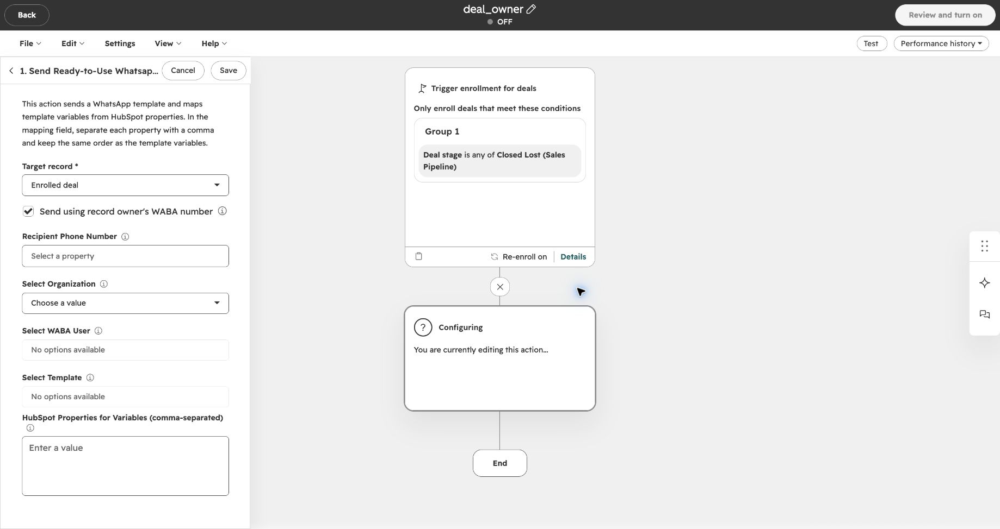
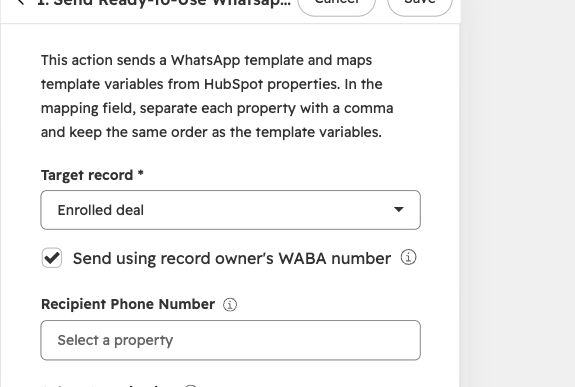
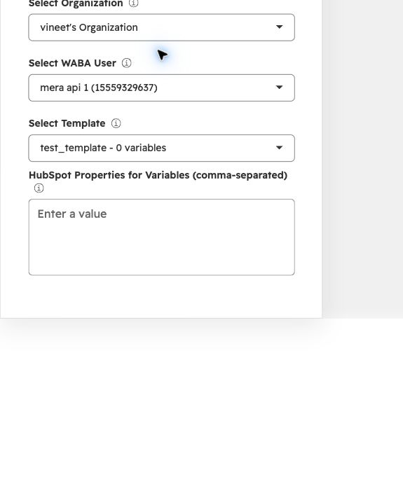
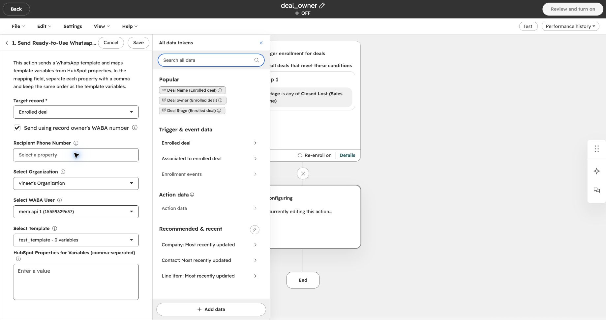
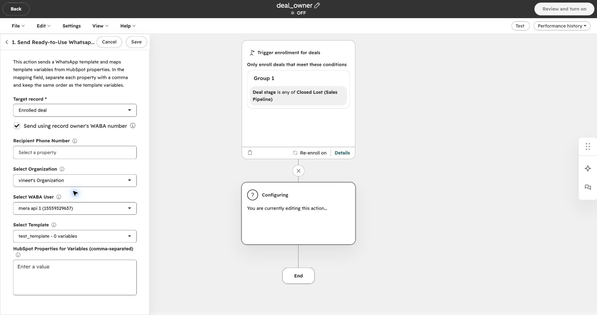

Envie um modelo do WhatsApp pelo número da pessoa responsável por um negócio ou contato do HubSpot. Ative **Send using record owner's WABA number** na ação do Eazybe para escolher automaticamente o remetente de cada registro inscrito.

## Antes de Começar

Confira estes requisitos para **cada proprietário** cujo número deve enviar mensagens:

| Verificação | O que você precisa |
| --- | --- |
| Proprietário do registro | O negócio inscrito tem um **Deal owner**, ou o contato inscrito tem um **Contact owner**. |
| Número WABA conectado | O número da API do WhatsApp Business (WABA / Meta API) do proprietário está conectado ao Eazybe. Uma conexão com o WhatsApp Web não é suficiente. Se não estiver conectado, consulte [Conectar WABA](https://help.eazybe.com/pt/waba/connect-waba). |
| Mapeamento do usuário do HubSpot | O usuário WABA está vinculado ao mesmo usuário do HubSpot que é proprietário do registro, na conta do HubSpot e na organização do Eazybe corretas. Se o vínculo não existir, consulte [Mapear usuários de números WABA API (em inglês)](https://help.eazybe.com/en/integrations/hubspot/waba-api-number-integration). |
| Um único usuário correspondente | O proprietário deve corresponder a um único usuário do Eazybe. Se o mesmo proprietário do HubSpot estiver vinculado a vários usuários do Eazybe, o remetente selecionado no workflow será mantido. |
| Modelo aprovado compatível | A conta do WhatsApp Business do proprietário tem um modelo **aprovado** com o mesmo nome e idioma do modelo selecionado na ação. A estrutura dos componentes, o formato do cabeçalho, as posições das variáveis e os tipos de botões também devem corresponder. |
| Acesso aos workflows | Você pode criar ou editar workflows do HubSpot e tem a **WhatsApp Integration by Eazybe** instalada. |
| Remetente padrão e destinatários | Você tem um usuário WABA conectado para usar como remetente alternativo, um modelo disponível e números de destinatários válidos. Em workflows de negócios, confira se há contatos associados ao negócio. |

<Warning>
  Essa configuração não exige que todas as mensagens sejam enviadas pelo proprietário. Se o Eazybe não puder usar o número dele ou um modelo compatível, usará os valores de **Select WABA User** e **Select Template** da ação. Escolha um número padrão adequado para enviar mensagens aos seus clientes.
</Warning>

## Qual Proprietário Envia a Mensagem?

| Tipo de workflow | Proprietário usado para escolher o remetente |
| --- | --- |
| Baseado em negócios | O proprietário do **negócio** inscrito, mesmo que os contatos associados tenham outros proprietários. |
| Baseado em contatos | O proprietário do **contato** inscrito. |

Por exemplo, se um negócio pertence a Priya e seu contato pertence a Alex, um workflow baseado em negócios usa o número WABA de Priya, desde que ele atenda aos requisitos. O cliente continua sendo o destinatário; essa opção não envia uma notificação para Priya.

<Note>
  O envio pelo proprietário está disponível em workflows de contatos e negócios. Workflows de empresas e leads mantêm o usuário WABA selecionado. Workflows existentes também mantêm o remetente selecionado até que você marque a caixa.
</Note>

## Configurar a Ação do Workflow

Se você ainda não criou um workflow, siga [Enviar um modelo pronto para uso em um workflow do HubSpot](https://help.eazybe.com/pt/waba/broadcasting/hubspot-workflow/send-ready-to-use-template) para criá-lo e definir as condições de inscrição. Esse guia mostra um workflow de contatos; use um workflow de negócios quando quiser que o **proprietário do negócio** determine o remetente.

Volte aqui quando chegar às configurações da ação do Eazybe. Os nomes dos campos estão em inglês para corresponder às capturas de tela.

<Steps>
  <Step title="Abra a ação de modelo do Eazybe">
    Abra **Send Ready-to-Use Whatsapp Template** no workflow. Confira se **Target record** é o registro inscrito que você deseja usar. Neste exemplo de negócio, é **Enrolled deal**.

    
  </Step>

  <Step title="Ative o envio pelo proprietário do registro">
    Marque **Send using record owner's WABA number**. Quando a ação é executada, o Eazybe verifica o proprietário do registro e tenta usar o número WABA vinculado e conectado desse proprietário.

    

    <Note>
      Ao desmarcar essa caixa, a ação usa o usuário WABA que você selecionar manualmente.
    </Note>
  </Step>

  <Step title="Selecione a organização, o remetente padrão e o modelo">
    Escolha **Select Organization**, depois **Select WABA User** e, por fim, **Select Template**. Mantenha esses campos configurados mesmo com o envio pelo proprietário ativado: eles definem o remetente alternativo e o modelo que deve corresponder na conta do proprietário.

    Se o modelo tiver variáveis, preencha **HubSpot Properties for Variables (comma-separated)** na mesma ordem das variáveis do modelo. A configuração de variáveis do workflow é mantida quando o Eazybe passa a usar o modelo compatível do proprietário.

    

      
    

    <Note>
      A captura usa um modelo de exemplo com **0 variables**, por isso o campo de variáveis está vazio. Selecione sua organização, seu número e seu modelo aprovado. Se a lista de usuários WABA ou modelos estiver vazia, confira primeiro a seleção anterior e a conexão WABA.
    </Note>
  </Step>

  <Step title="Escolha quem recebe a mensagem">
    Para um workflow de negócios:

    1. Clique em **Recipient Phone Number**.
    2. Em **All data tokens**, escolha **Contact: Most recently updated**.
    3. Selecione **Phone Number**. Confira se o campo contém o número de WhatsApp do cliente.

    

    <Note>
      Isso envia a mensagem para **um contato associado por negócio**: o contato cujo registro foi atualizado mais recentemente. Não envia para todos os contatos associados ao negócio.
    </Note>

    <Warning>
      - Selecione **Phone Number**, não **Deal owner**, **Contact owner** ou **Record ID**. Esses campos contêm IDs, não o telefone do cliente.
      - A caixa **Send using record owner's WABA number** determina quem envia a mensagem.
      - Mantenha **Recipient Phone Number** preenchido para enviar a um único contato. Se ficar vazio, os contatos com telefone entre os **cinco contatos associados atualizados mais recentemente** do negócio poderão receber a mensagem. Números duplicados nesse grupo recebem apenas uma mensagem.
    </Warning>
  </Step>

  <Step title="Revise e salve a ação">
    Confira a caixa do proprietário, o destinatário, a organização, o usuário WABA alternativo, o modelo e os valores das variáveis. Clique em **Save** para salvar a ação.

    

    <Note>
      Esta captura mostra um exemplo incompleto, com o campo do destinatário vazio e o workflow **OFF**. Preencha as configurações do destinatário antes de salvar. Salvar uma ação e ativar o workflow são operações separadas.
    </Note>

    Siga os [passos de revisão e ativação do workflow](https://help.eazybe.com/pt/waba/broadcasting/hubspot-workflow/send-ready-to-use-template) quando estiver pronto para ativá-lo. Antes de inscrever clientes em massa, verifique o remetente e a entrega com um registro de teste e um número de destinatário que você controla.

    <Warning>
      Ativar um workflow pode enviar mensagens reais do WhatsApp aos destinatários inscritos. Revise as configurações de inscrição e reinscrição antes de ativá-lo. As tarifas normais de mensagens se aplicam; consulte os [preços das mensagens do WhatsApp (em inglês)](/en/waba/broadcast-rate-list-1-october-2026).
    </Warning>
  </Step>
</Steps>

## O Que Acontece Quando a Ação É Executada?

O Eazybe consulta o proprietário do registro inscrito, verifica o vínculo com o HubSpot e a conexão WABA na organização selecionada e procura um modelo aprovado compatível na conta do proprietário. Se essas verificações forem bem-sucedidas, a mensagem usa o número e o modelo do proprietário.

Se alguma consulta ou verificação de proprietário, vínculo, conexão ou modelo não puder ser concluída, o Eazybe mantém o remetente e o modelo padrão selecionados. Esse remetente também precisa passar pelas verificações normais de conexão e modelo; usar o remetente alternativo não garante a entrega.

<Note>
  A caixa altera o **remetente**, não as regras de inscrição, a seleção do destinatário ou o mapeamento das variáveis. Se o proprietário já for o usuário WABA selecionado, o remetente permanece o mesmo.
</Note>

## Solução de Problemas

| O que você percebe | O que verificar |
| --- | --- |
| A mensagem veio do número padrão | Confirme que a caixa está marcada e que o registro tem um proprietário. Depois, confira a conexão WABA, o vínculo com o HubSpot e o modelo aprovado compatível desse proprietário. |
| O número WABA do proprietário está desconectado | [Conecte ou reconecte o WABA](https://help.eazybe.com/pt/waba/connect-waba). Até ele voltar a atender aos requisitos, a ação pode usar o remetente padrão. |
| O proprietário tem um número, mas ele não é usado | [Confira o mapeamento do usuário do HubSpot (em inglês)](https://help.eazybe.com/en/integrations/hubspot/waba-api-number-integration). Verifique o proprietário, a conta do HubSpot e a organização do Eazybe e corrija vínculos com vários usuários do Eazybe. |
| O modelo existe, mas o envio usa o número padrão | Confira a aprovação, o nome exato, o idioma, a estrutura, o cabeçalho, as variáveis e os botões na conta do proprietário. Só o nome igual não é suficiente. |
| Uma mensagem do negócio não usou o número do proprietário do contato | Workflows de negócios usam o **proprietário do negócio**. Confira quem é e seu vínculo. |
| Mais de um contato recebeu a mensagem | Confira se **Recipient Phone Number** ficou vazio. Nesse caso, workflows de negócios podem enviar a contatos associados. |
| Nenhuma mensagem foi entregue | Verifique a conexão e a disponibilidade do modelo do remetente usado, o telefone do destinatário e os contatos associados ao negócio. Consulte **Performance history** e as [análises de entrega de transmissões](/pt/broadcasts/view-analytics). |
| Você mudou a organização na ação | Selecione novamente o usuário WABA e o modelo para que pertençam à nova organização. |

## Guias Relacionados

- [Conectar WABA](https://help.eazybe.com/pt/waba/connect-waba)
- [Mapear usuários de números WABA API (em inglês)](https://help.eazybe.com/en/integrations/hubspot/waba-api-number-integration)
- [Criar e ativar um workflow de modelos do HubSpot](https://help.eazybe.com/pt/waba/broadcasting/hubspot-workflow/send-ready-to-use-template)
- [Resolver problemas de workflows do HubSpot](/pt/integrations/hubspot/workflow-troubleshoot)
