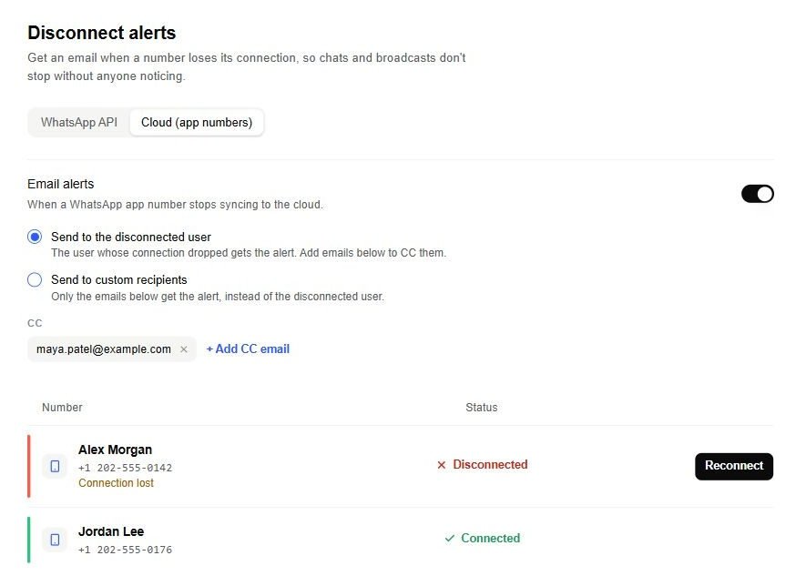
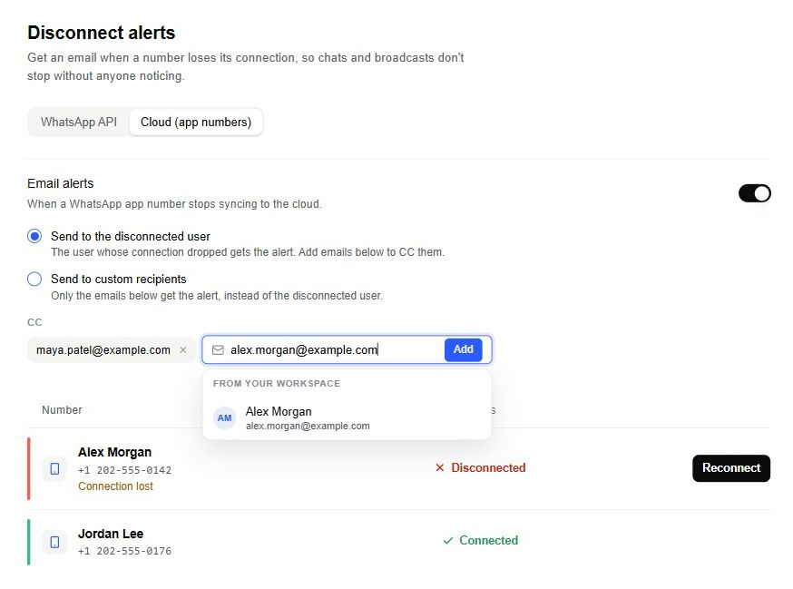
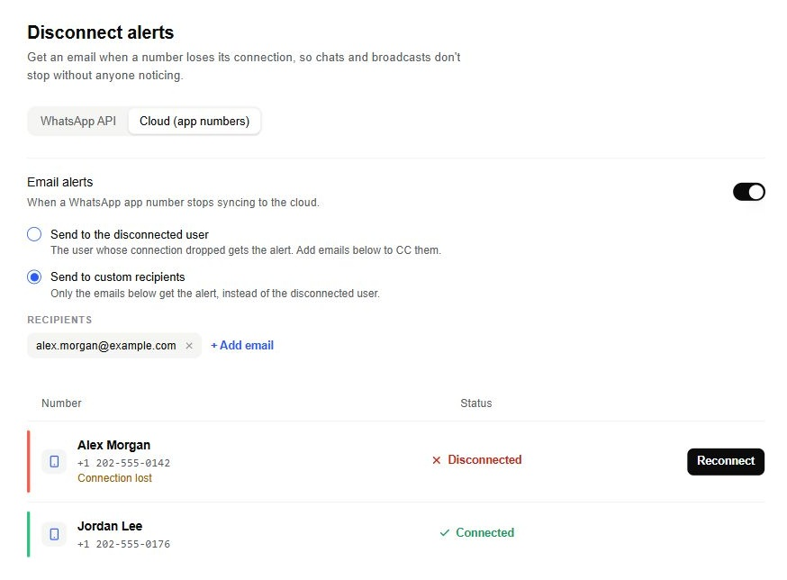

Notifique o usuário quando a conexão dele com o Cloud cair e adicione endereços em CC para manter a equipe informada. Você também pode enviar alertas a uma lista personalizada em **Settings → Disconnect alerts → Cloud (app numbers)**.

<Note>
Somente administradores do espaço de trabalho podem gerenciar esses alertas.
</Note>

## Configurar alertas do Cloud com e-mails em CC

<Steps>
  <Step title="Abrir os alertas do Cloud e ativar as notificações">
    Abra as [Settings do Eazybe](https://app.eazybe.com/settings), selecione **Disconnect alerts** e escolha **Cloud (app numbers)**.

    Ative **Email alerts** para exibir as opções de destinatários. Selecione **Send to the disconnected user**: o usuário cuja conexão caiu recebe o alerta, e os endereços em **CC** recebem uma cópia do mesmo e-mail.

    Essa é a opção padrão de destinatário. Confira se **Email alerts** está ativado; escolher o destinatário não ativa os alertas por si só.

    
  </Step>

  <Step title="Adicionar e-mails opcionais em CC">
    Em **CC**, selecione **+ Add CC email**. Escolha um colega em **FROM YOUR WORKSPACE** ou digite um e-mail e selecione **Add**. Você também pode adicionar endereços externos ao espaço de trabalho.

    Repita para cada pessoa que precisa receber uma cópia, como um gestor ou a equipe responsável por restabelecer a conexão. Os endereços salvos aparecem como etiquetas. Você pode adicionar até 10 endereços em CC.

    As alterações são salvas automaticamente. Aguarde cada salvamento terminar antes de fazer a próxima alteração. Se houver falha, tente novamente e confira se o endereço aparece na lista.

    

    <Note>
    CC é opcional. Quando está vazio, aparece *No one in CC. Only the disconnected user is notified.* Isso significa que apenas o usuário desconectado é notificado. Você não precisa adicionar o endereço dele em CC.
    </Note>
  </Step>

  <Step title="Escolher destinatários personalizados, se necessário">
    Para enviar alertas apenas a uma lista específica, selecione **Send to custom recipients**. Em **Recipients**, selecione **+ Add email**, escolha um colega ou digite um e-mail e selecione **Add**. Você pode adicionar até 10 destinatários.

    Revise os endereços exibidos, incluindo qualquer endereço de administrador preenchido previamente, para confirmar quem receberá os alertas.

    

    <Note>
    Nesse modo, o usuário desconectado não é notificado automaticamente. Inclua o endereço dele em **Recipients** se ele também precisar receber o alerta. CC só se aplica a **Send to the disconnected user**.
    </Note>
  </Step>
</Steps>

As listas de CC e de destinatários personalizados são salvas separadamente. Ao trocar de opção, a lista correspondente é exibida; os endereços não são transferidos entre as listas.

## Gerenciar destinatários ou interromper alertas

Use **×** ao lado de um e-mail para removê-lo. Se houver endereços ocultos, selecione **+N more** para visualizar e pesquisar a lista completa.

- Com **Send to the disconnected user**, você pode remover todos os endereços de CC. O usuário desconectado continuará recebendo alertas enquanto **Email alerts** estiver ativado.
- Com **Send to custom recipients**, mantenha pelo menos um destinatário enquanto os alertas estiverem ativados. Desative **Email alerts** antes de remover o último.

Para interromper os e-mails de desconexão do Cloud, desative **Email alerts**. As configurações dos destinatários ficam salvas para quando você reativar os alertas. Mantenha **Cloud (app numbers)** selecionado ao editar essas opções.

## Verificar e reconectar um número desconectado

Localize o número afetado na tabela abaixo dos alertas. Confira **Status**: **Disconnected** indica que a conexão precisa de atenção. Um motivo, como **Connection lost** (conexão perdida), pode aparecer abaixo do número.

Selecione **Reconnect** ao lado do número para abrir a [página Channels](https://app.eazybe.com/numbers-connected). Localize o número correspondente e siga o processo de conexão do Cloud. **Reconnect** abre Channels; essa ação, sozinha, não restabelece a conexão.

## Perguntas frequentes

<AccordionGroup>
  <Accordion title="Posso notificar apenas o usuário desconectado?">
    Sim. Ative **Email alerts**, selecione **Send to the disconnected user** e deixe **CC** vazio. Remover todos os endereços de CC não desativa os alertas.
  </Accordion>
  <Accordion title="Por que ninguém recebeu um alerta?">
    Confirme se **Email alerts** está ativado em **Cloud (app numbers)**. Confira a opção selecionada: no primeiro modo, o usuário afetado e os endereços de CC recebem o e-mail; no modo personalizado, apenas a lista **Recipients**. Verifique se as alterações foram salvas e peça ao destinatário para conferir a pasta de spam.
  </Accordion>
  <Accordion title="Por que não consigo alterar os destinatários?">
    Somente administradores podem gerenciar essas configurações. Se aparecer **Admin only**, peça a um administrador para atualizá-las. Se você for administrador, ative **Email alerts** para exibir as opções e aguarde qualquer salvamento em andamento terminar.
  </Accordion>
</AccordionGroup>
