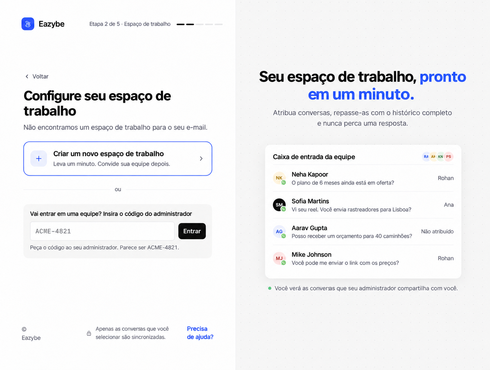
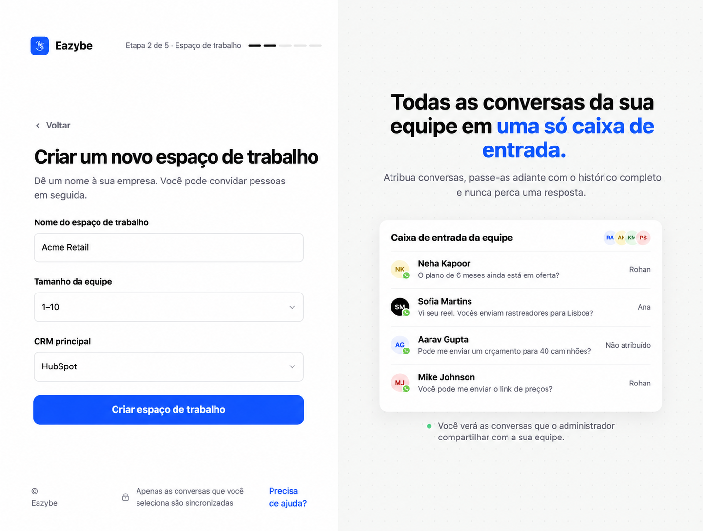

<Note>
Este guia segue o novo onboarding de dev. As telas após o login usam o protótipo como referência visual: nomes, números, preços, contadores de etapas e botões exclusivos do protótipo são ilustrativos. Siga os controles do seu aplicativo Eazybe.
</Note>

Conclua primeiro [o login e seu número de trabalho](/pt/getting-started/onboarding/overview). Crie um workspace apenas se estiver configurando uma nova equipe para a empresa.

<Steps>
<Step title="Selecione Criar um novo espaço de trabalho">
Em **Configure seu espaço de trabalho**, selecione **Criar um novo espaço de trabalho**. Se a empresa já tiver um workspace, peça o código ao administrador e use **Entrar**.

</Step>
<Step title="Preencha os dados do workspace">
Preencha **Nome do espaço de trabalho**, selecione **Tamanho da equipe** e escolha **CRM principal**. Depois, selecione **Criar espaço de trabalho**. Escolha a opção sem CRM se ainda não usar um. A seleção registra sua preferência; ela não autoriza nem conecta o CRM.

</Step>

</Steps>

## Continuar a configuração

[Instale a extensão e conecte WhatsApp ou chamadas →](/pt/getting-started/onboarding/crm)

## Convide sua equipe

Após o onboarding, use **Convide sua equipe** na lista de Início ou abra **Staff → Add Employee**. Informe nome, função e e-mail de trabalho do funcionário e selecione **Send Invite**. Ele pode abrir o link do convite ou fazer login em app.eazybe.com com esse e-mail.

Compartilhe o **Organization Code** do workspace principal em **Staff**. Os funcionários colam esse código no campo de entrada durante a configuração do workspace. Compartilhe o código da organização, não as credenciais separadas Access Code ou Auth Key.

[Envie o guia para os funcionários →](/pt/getting-started/onboarding/employee)

## Confira o mapeamento do CRM

No HubSpot, Salesforce ou Zoho, os funcionários podem ser mapeados automaticamente depois que o administrador conecta o CRM. Se faltar um mapeamento, abra **Settings → User Mapping** desse CRM e escolha o usuário correto. Funcionários que usam outros CRMs concluem a própria integração.
