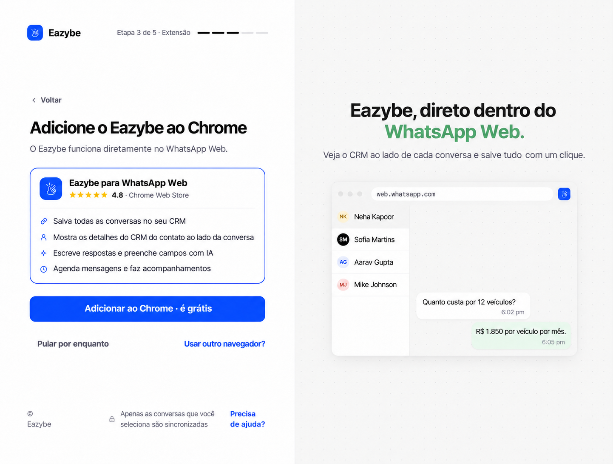
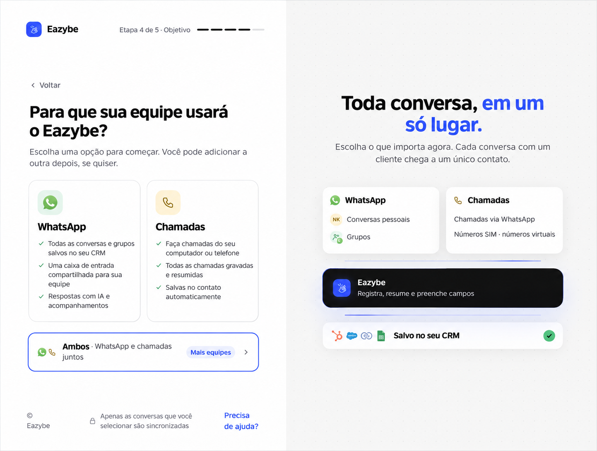
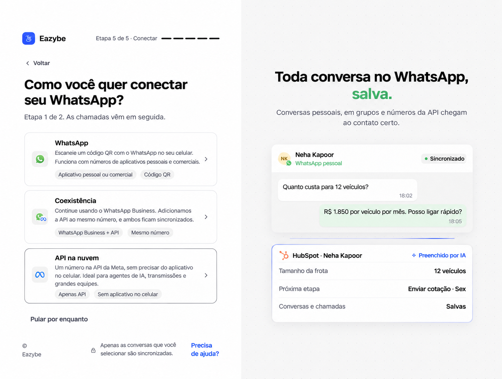
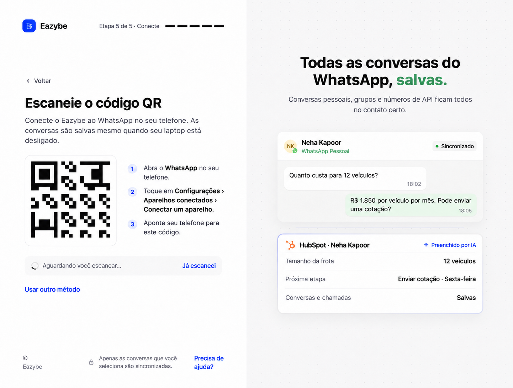
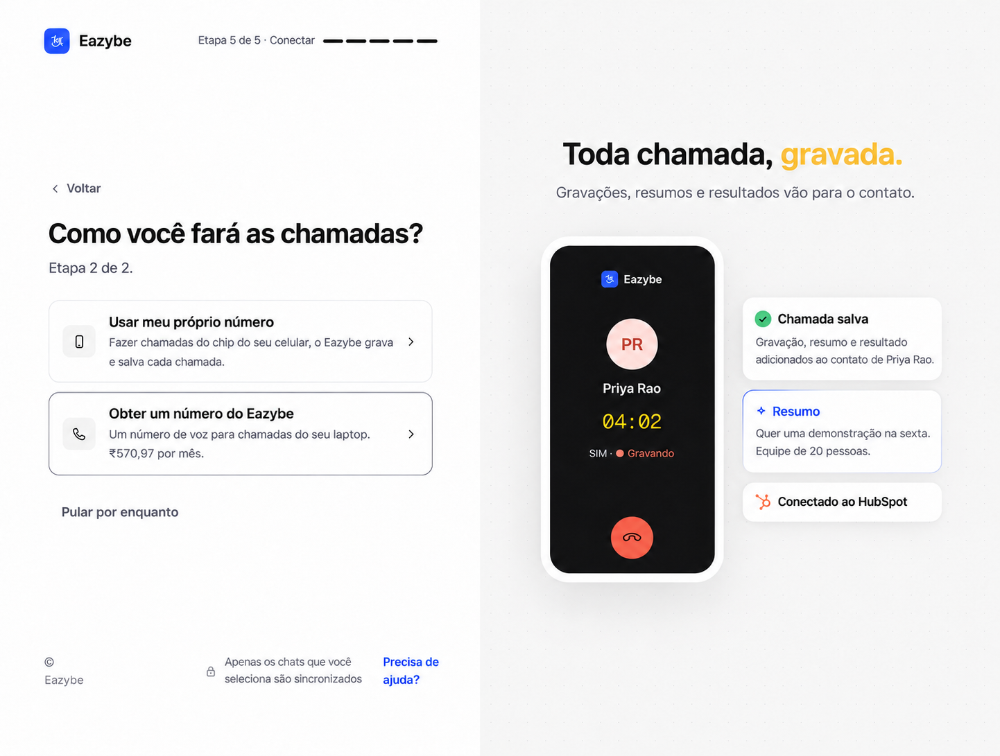
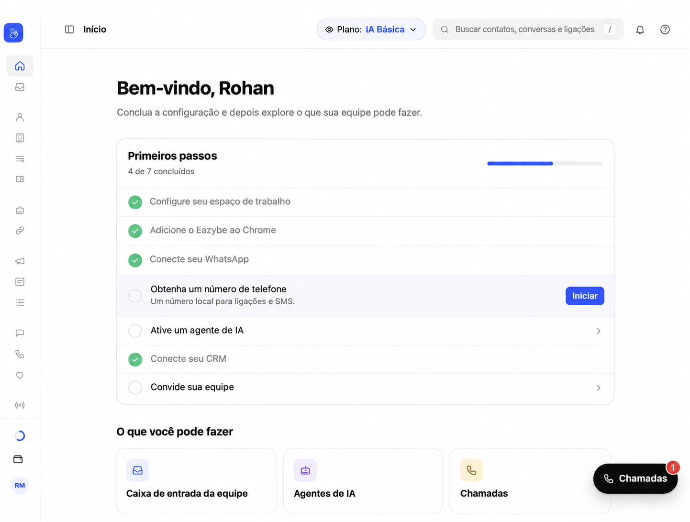

<Note>
Este guia segue o novo onboarding de dev. As telas após o login usam o protótipo como referência visual: nomes, números, preços, contadores de etapas e botões exclusivos do protótipo são ilustrativos. Siga os controles do seu aplicativo Eazybe.
</Note>

Continuar aqui depois de criar ou entrar no workspace.

<Steps>
<Step title="Adicione o Eazybe ao Chrome">
Em **Adicione o Eazybe ao Chrome**, selecione **Adicionar ao Chrome · é grátis**. Você também pode abrir a [página da Chrome Web Store](https://chromewebstore.google.com/detail/whatsapp-ai-agents-with-c/clgficggccelgifppbcaepjdkklfcefd) diretamente. Na loja, escolha **Add to Chrome** e depois **Add extension**. Instale apenas uma vez. Se o Eazybe já detectar a extensão, selecione **Continuar**. **Pular por enquanto** permite concluir outras tarefas, mas instale a extensão antes de usar o Eazybe dentro do WhatsApp Web.

</Step>
<Step title="Escolha como sua equipe usará o Eazybe">
Em **Para que sua equipe usará o Eazybe?**, selecione **WhatsApp**, **Chamadas** ou **Ambos**. Ambos configura primeiro o WhatsApp e depois as chamadas. Você pode adicionar a outra opção mais tarde.

</Step>
<Step title="Escolha a conexão do WhatsApp">
Se escolheu WhatsApp ou Ambos, selecione um método abaixo. Coexistência e API na nuvem exigem um administrador; peça ajuda se essas opções estiverem indisponíveis.

</Step>

</Steps>

| Método | Quando usar | Próxima ação |
| --- | --- | --- |
| **WhatsApp** | Conectar um número pessoal ou do aplicativo WhatsApp Business. | Escaneie o QR pelo celular. |
| **Coexistência** | Manter o WhatsApp Business e adicionar a API ao mesmo número. | Selecione **Connect with Meta** e siga o fluxo de conexão do aplicativo Business. |
| **API na nuvem** | Usar um número na API da Meta sem o aplicativo no celular. | Selecione **Connect with Meta** e conclua a configuração da Meta. |

## Conecte com um QR code

No celular, abra o WhatsApp, acesse **Configurações → Aparelhos conectados → Conectar um aparelho** e escaneie o código da sua sessão do Eazybe. Espere **WhatsApp connected** antes de continuar. Use **New code** se aparecer um erro no QR ou **Usar outro método** para trocar de método.

<Note>O QR da imagem é ilustrativo. Escaneie o código atual do seu aplicativo Eazybe. **Já escaneei** é um controle de demonstração do protótipo; o fluxo implementado detecta a conexão.</Note>

## Configure as chamadas

Se escolheu Ambos, selecione **Next: set up calling** depois do WhatsApp. Se escolheu Chamadas, você vai diretamente às opções de chamadas.

- **Usar meu próprio número:** Instale o Eazybe no celular Android, faça login com o mesmo e-mail e siga as instruções de acesso às chamadas.
- **Obter um número do Eazybe:** Selecione **Choose my number** para abrir Phone Numbers, escolha país e código de área e confira o preço real antes de ativar um número. O preço do protótipo é ilustrativo.

Você pode usar **Pular por enquanto** quando disponível e terminar depois. Pular uma etapa não conecta um número.

## Termine em Início

Use a lista **Primeiros passos** para concluir tarefas pendentes, incluindo **Conecte seu CRM** e **Convide sua equipe**. A lista depende do que você selecionou e concluiu.

Escolher **CRM principal** ao criar o workspace não o conecta. Abra **Conecte seu CRM** ou **Integrations** e conclua a autorização. No HubSpot, Salesforce ou Zoho, o administrador confere **Settings → User Mapping** se um funcionário não for mapeado automaticamente. Usuários de outros CRMs concluem a própria integração.
