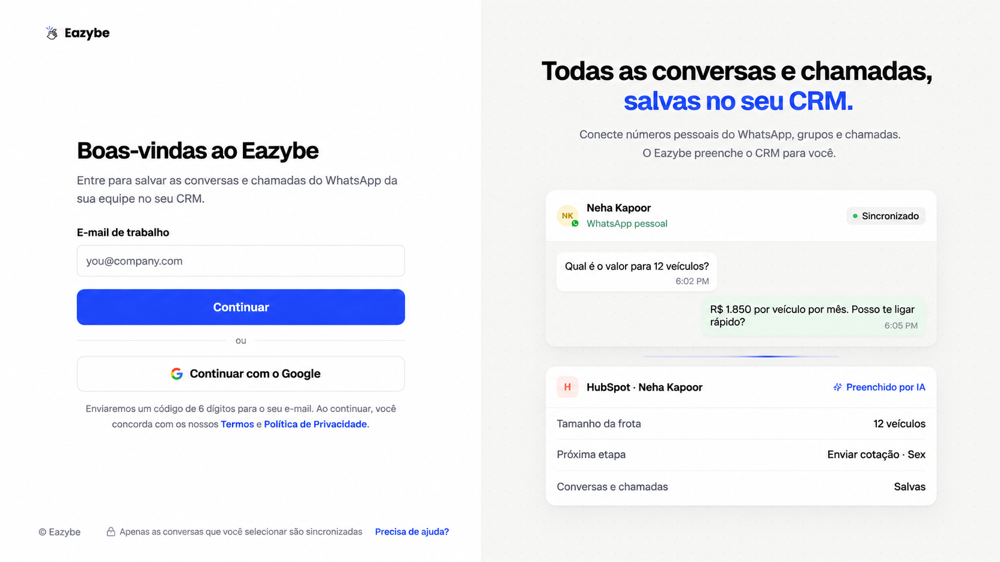
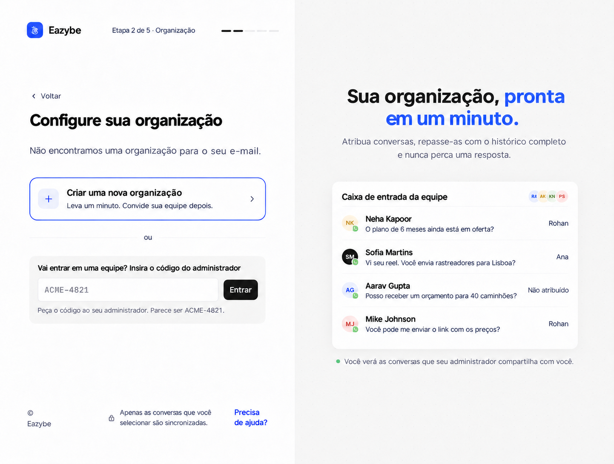

<Note>
Este guia segue o novo onboarding de dev. As telas após o login usam o protótipo como referência visual: nomes, números, preços, contadores de etapas e botões exclusivos do protótipo são ilustrativos. Siga os controles do seu aplicativo Eazybe.
</Note>

Peça ao administrador o código da organização principal e use o e-mail que recebeu o convite. Você pode seguir o link do convite ou fazer login diretamente em app.eazybe.com.

<Steps>
<Step title="Faça login e adicione seu número de trabalho">
Conclua [o login, a verificação de e-mail e o número do WhatsApp de trabalho](/pt/getting-started/onboarding/overview). Use o e-mail convidado. Entrar no WhatsApp é uma etapa separada do login no Eazybe.

</Step>
<Step title="Entre com o código do administrador">
Em **Configure sua organização**, encontre **Vai entrar em uma equipe? Insira o código do administrador**. Cole o código da organização principal e selecione **Entrar**. Isso adiciona você à organização existente durante o onboarding; não é necessário criar outra primeiro.

</Step>

</Steps>

## Continuar com a extensão e as conexões

[Siga a configuração da extensão, WhatsApp e chamadas →](/pt/getting-started/onboarding/crm)

Você pode instalar a extensão pela tela de onboarding ou diretamente pela Chrome Web Store. As duas opções instalam a mesma extensão. Use o e-mail convidado para fazer login nela.

## Se algo não corresponder

<AccordionGroup>
  <Accordion title="O e-mail de convite não chegou">
    Confira o spam e confirme o endereço com o administrador. Você pode fazer login diretamente com o e-mail convidado e entrar com o código compartilhado por ele.
  </Accordion>
  <Accordion title="O código da organização não funciona">
    Cole novamente, sem espaços extras. Peça ao administrador que confirme se o código pertence à organização principal. Não use o código de exemplo da captura.
  </Accordion>
  <Accordion title="Meu CRM não está conectado depois de entrar">
    Para HubSpot, Salesforce ou Zoho, peça ao administrador que confira a conexão e Settings → User Mapping. Para outros CRMs, integre sua própria conta. Entrar na organização não autoriza, por si só, uma conexão de CRM.
  </Accordion>
</AccordionGroup>
