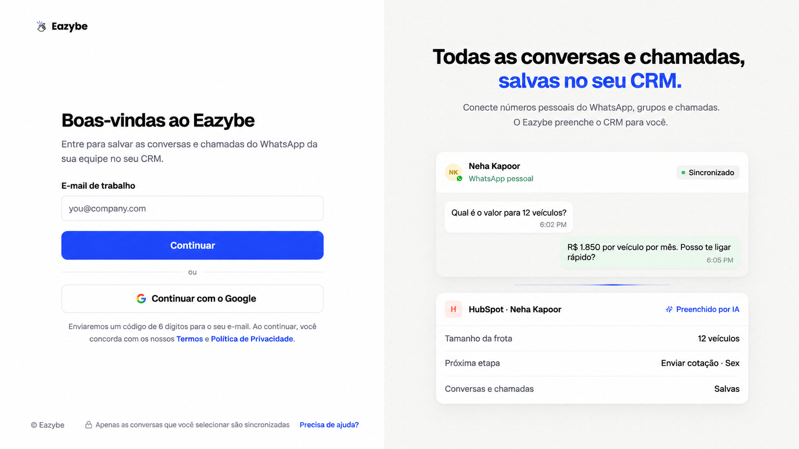
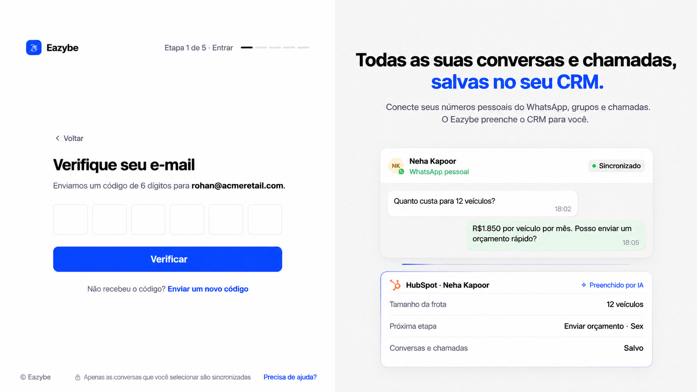
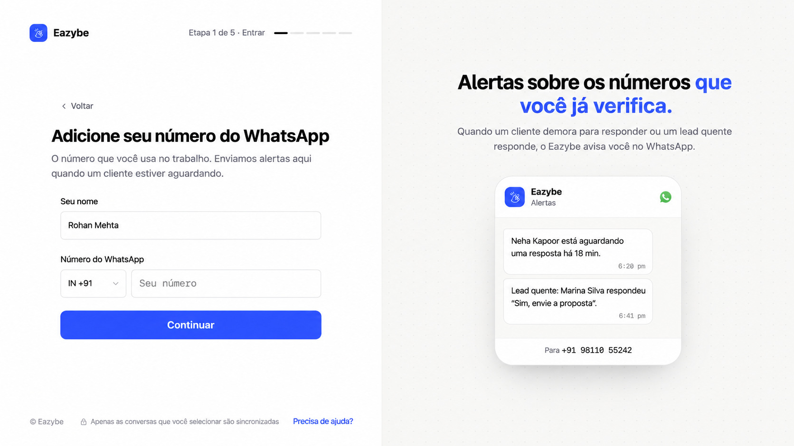

<Note>
Este guia segue o novo onboarding de dev. As telas após o login usam o protótipo como referência visual: nomes, números, preços, contadores de etapas e botões exclusivos do protótipo são ilustrativos. Siga os controles do seu aplicativo Eazybe.
</Note>

Comece pelo [Eazybe](https://app.eazybe.com/signin). Para revisar o novo fluxo antes do lançamento, use [dev](https://dev-app.eazybe.com/signin).

O fluxo é **Login → Seu WhatsApp → Workspace → Extensão → Objetivo → Conexão**. Algumas telas podem ser puladas se sua conta já tiver as informações necessárias.

<Steps>
<Step title="Faça login com seu e-mail de trabalho">
Preencha **E-mail de trabalho** e selecione **Continuar**, ou escolha **Continuar com o Google**. Se o administrador convidou você, use o mesmo e-mail do convite.

</Step>
<Step title="Verifique seu e-mail">
Digite o código de seis dígitos recebido por e-mail e selecione **Verificar**. Use **Enviar um novo código** se necessário ou **Voltar** para corrigir o e-mail. O login pelo Google pode não exigir essa tela de código.

</Step>
<Step title="Adicione seu WhatsApp de trabalho">
Preencha **Seu nome**, escolha o código do país e informe **Número do WhatsApp**. Selecione **Continuar**. Esse número é usado para alertas; adicioná-lo aqui não conecta a sincronização de conversas.

</Step>

</Steps>

## Crie ou entre em um workspace

- **Está configurando para sua empresa?** [Crie seu workspace](/pt/getting-started/onboarding/admin).
- **Vai entrar em uma equipe existente?** [Use o código do administrador](/pt/getting-started/onboarding/employee).

Use o mesmo e-mail de trabalho no Eazybe, na extensão e no aplicativo móvel. A conexão do CRM é concluída separadamente da verificação de e-mail.
