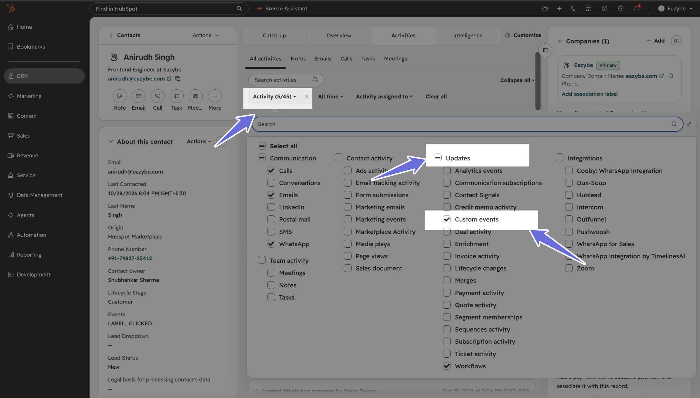
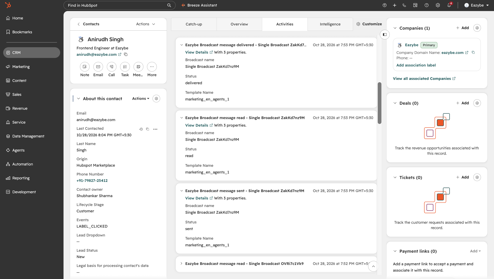

Acompanhe a atividade das suas transmissões do WhatsApp diretamente na linha do tempo de um contato do HubSpot. Expanda um evento personalizado da Eazybe para ver o nome da transmissão, o status da mensagem, o nome do modelo e o motivo da falha, quando disponível.

## Antes de começar

- Use uma assinatura do HubSpot **Professional ou Enterprise** que inclua **Custom events** (Eventos personalizados). Confira a [disponibilidade de eventos personalizados do HubSpot](https://knowledge.hubspot.com/reports/create-custom-events) para sua assinatura.
- Conecte seu espaço de trabalho da Eazybe à conta do HubSpot que contém o registro do contato destinatário. Consulte [Conectar sua conta do HubSpot](/pt/integrations/hubspot/account-connection).
- Verifique se o destinatário da transmissão está associado ao contato correto do HubSpot por meio da integração da Eazybe.
- Envie as mensagens por um fluxo de transmissão da API do WhatsApp Business da Eazybe.

### Permissões necessárias do HubSpot

Para habilitar os escopos de permissão necessários, integre o HubSpot à Eazybe e aprove o acesso solicitado durante a autorização do HubSpot. Siga as etapas de [Conectar sua conta do HubSpot](/pt/integrations/hubspot/account-connection) para concluir a integração.

Sua conexão com o HubSpot precisa das duas permissões abaixo, além do acesso aos contatos que já possui:

| Permissão | Para que a Eazybe a utiliza |
| --- | --- |
| `analytics.behavioral_events.send` | Enviar ao HubSpot as ocorrências de eventos de status das transmissões. |
| `behavioral_events.event_definitions.read_write` | Ler, criar e atualizar a definição do evento personalizado. |

Se você conectou o HubSpot antes de essas permissões serem solicitadas, autorize a integração novamente na área de integração com o HubSpot da Eazybe. Selecione a conta correta do HubSpot e aprove o acesso solicitado. Peça ao administrador do HubSpot para concluir a autorização se você não puder concedê-la.

<Note>
  Uma conexão existente não confirma que as duas permissões foram concedidas. Após a autorização, use uma nova transmissão de teste para verificar a conexão. A Eazybe cria ou encontra a definição do evento automaticamente; você não precisa criar um evento personalizado manualmente.
</Note>

## Exibir eventos de transmissão na linha do tempo

No HubSpot, abra **CRM → Contacts** (Contatos), selecione o registro do contato destinatário e abra **Activities → All activities** (Atividades → Todas as atividades).

<Steps>
  <Step title="Selecione os eventos personalizados no filtro de atividade">
    Abra o menu suspenso **Activity** (Atividade) acima da linha do tempo. O menu mostra a quantidade de itens selecionados, como **Activity (5/45)** na captura de tela. Em **Updates** (Atualizações), selecione **Custom events** (Eventos personalizados) e feche o menu.

    Verifique se o filtro de datas inclui a data de envio da transmissão. Escolha **All time** (Todo o período) ao procurar um evento.

    

    <Note>
      Em alguns layouts do HubSpot, o filtro se chama **Filter activity** (Filtrar atividade) e a opção, **Custom event** (Evento personalizado). Selecioná-la altera quais atividades você vê; isso não envia uma mensagem de WhatsApp nem um e-mail.
    </Note>
  </Step>

  <Step title="Expanda um evento de transmissão da Eazybe">
    Encontre uma entrada que comece com **Eazybe Broadcast message**. Clique na seta ao lado da entrada para expandi-la e conferir **Broadcast name** (Nome da transmissão), **Status** e **Template Name** (Nome do modelo). A data e a hora do evento aparecem ao lado do título.

    Cada status informado aparece como uma entrada separada. A captura de tela mostra os eventos **delivered** (entregue), **read** (lido) e **sent** (enviado) da mesma transmissão.

    

    <Warning>
      O contato, os nomes das transmissões e dos modelos e as datas e horas nessas capturas de tela são exemplos. Confira o registro do seu próprio contato destinatário para ver a atividade de transmissão dele.
    </Warning>
  </Step>
</Steps>

## Entender o status e os detalhes

Os títulos dos eventos incluem o status seguido do nome da transmissão, por exemplo: **Eazybe Broadcast message delivered - Single Broadcast ZakKd7nz9M**.

| Status | O que significa |
| --- | --- |
| **sent** (enviado) | O WhatsApp informou que a mensagem foi enviada. |
| **delivered** (entregue) | O WhatsApp informou que a mensagem foi entregue. |
| **read** (lido) | O WhatsApp informou que a mensagem foi lida. |
| **failed** (falha) | O WhatsApp informou uma falha na entrega. Expanda o evento para conferir **Failure reason** (Motivo da falha), quando disponível. |

**Broadcast name** (Nome da transmissão) identifica a campanha, e **Template Name** (Nome do modelo) identifica o modelo do WhatsApp utilizado. **Failure reason** (Motivo da falha) aparece apenas para status de falha quando há uma explicação disponível. A data e a hora do evento refletem o momento em que o provedor informou o status, conforme exibido pelo HubSpot.

<Note>
  Apenas os status informados aparecem. Uma mensagem não precisa ter todos os status, e **delivered** (entregue) não significa automaticamente **read** (lido). Uma transmissão mais recente não substitui os eventos de transmissões anteriores.
</Note>

## Quais mensagens aparecem?

Este recurso acompanha os status informados pelo provedor para transmissões da API do WhatsApp Business da Eazybe. São incluídas as transmissões do espaço de trabalho e os envios de fluxos de trabalho do HubSpot que usam esse fluxo de transmissão. Os envios da extensão e de outros CRMs só são incluídos quando usam o mesmo fluxo de transmissão; conversas comuns com mensagens de texto livre não são incluídas automaticamente.

As transmissões anteriores não são adicionadas automaticamente quando você habilita o recurso. Os envios rejeitados localmente antes de chegarem ao provedor, incluindo aqueles bloqueados porque um contato optou por não receber mensagens, não geram esses eventos de status do provedor.

## Resolver problemas de eventos ausentes

| O que você vê | O que verificar |
| --- | --- |
| Nenhum evento de transmissão da Eazybe | Selecione **Updates → Custom events** (Atualizações → Eventos personalizados), escolha **All time** (Todo o período) e confirme que abriu o contato correto na conta do HubSpot conectada. |
| **Custom events** (Eventos personalizados) não está disponível | Peça ao administrador para confirmar que sua assinatura do HubSpot inclui eventos personalizados. |
| Faltam eventos após uma configuração antiga da integração | Autorize novamente a conexão da Eazybe com o HubSpot com as duas permissões listadas acima e verifique uma nova transmissão. |
| Uma nova transmissão ainda não tem evento | As atualizações de status dependem das notificações do provedor e da sincronização em segundo plano. Atualize a linha do tempo mais tarde; não reenvie uma transmissão apenas para atualizar sua atividade. |
| Nenhuma entrada **read** (lido) | Um status de leitura pode não ter sido informado. Um evento de entrega por si só não confirma que a mensagem foi lida. |
| Um evento **failed** (falha) não tem explicação | O provedor pode não ter fornecido um motivo para a falha. |
| Faltam transmissões anteriores | Habilitar o filtro não adiciona os eventos de transmissões anteriores. |

Se os eventos continuarem ausentes, entre em contato com o [suporte da Eazybe](mailto:support@eazybe.com) e informe o ID da sua conta do HubSpot, o link do registro do contato, o nome da transmissão, o horário aproximado de envio e o fuso horário, o status esperado e uma captura de tela do filtro de atividade. Não inclua senhas nem tokens de acesso.
