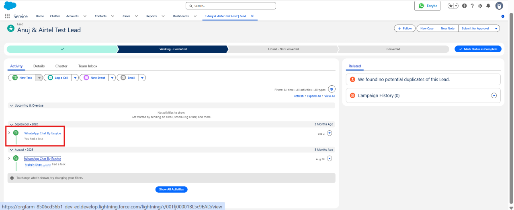

Com **Back up in activities** ativado, o Eazybe salva **conversas individuais e em grupo como tarefas concluídas** no **Contato ou Lead** associado do Salesforce. As mensagens são adicionadas à atividade diária da conversa conforme os backups são executados.

## Ativar o backup em atividades

1. Instale o [pacote Eazybe Team Inbox](/pt/integrations/salesforce/team-inbox) e conecte sua conta do Salesforce ao Eazybe.
2. No seu espaço de trabalho do Eazybe, abra **Integrações → Salesforce → Geral**.
3. Em **What gets saved to Salesforce**, ative **Back up in activities**. O texto confirma que as conversas estão sendo salvas como tarefas concluídas.

<Note>
Instalar o Team Inbox não ativa automaticamente o backup em atividades. Ative a opção separadamente; ela será aplicada a partir do próximo backup.
</Note>

Administradores e gerentes alteram essa opção para as conexões do Salesforce da organização. Os demais usuários a alteram para a própria conexão.

## Encontrar uma conversa salva no Salesforce

1. Abra o registro do **Contato** ou **Lead** associado no Salesforce.
2. Abra **Atividade** (Activity) e localize a entrada **WhatsApp Chat by Eazybe** da data desejada.
3. Abra a tarefa concluída e leia as mensagens sincronizadas em **Descrição** (Description).

## Como funcionam as atividades diárias

- **Conversas individuais:** Cada conversa tem uma tarefa diária no Contato ou Lead correspondente. As conversas individuais de diferentes membros da equipe ficam em atividades separadas.
- **Conversas em grupo:** O Eazybe salva a conversa do grupo nos registros de Contato ou Lead dos participantes associados. Quando vários membros da equipe fazem backup do mesmo grupo, as mensagens são adicionadas à mesma tarefa diária de cada registro associado. O backup de grupos também precisa estar ativado.
- **Atualizações:** Os backups seguintes adicionam novas mensagens à tarefa diária existente. Conversas longas podem continuar em tarefas adicionais.
- **Data:** A data da atividade é o dia do backup no fuso horário informado. As mensagens mantêm seus próprios horários, portanto uma atividade pode conter mensagens enviadas em dias anteriores.

O funcionamento é semelhante ao [backup em atividades do Zoho](/pt/integrations/zoho/activity-backup): as conversas são salvas como tarefas concluídas. No Salesforce, elas aparecem na **linha do tempo de atividades** do registro; no Zoho, em **Atividades encerradas** (Closed Activities).

## Quando o backup em atividades está desativado

Com essa opção desativada, o Eazybe usa o método de backup existente do Salesforce: o objeto personalizado **WhatsApp Chats by Eazybe** e, para Contatos, **Notas e anexos**. Ao ativar o backup em atividades, os próximos backups de conversas são salvos como tarefas concluídas em vez de usar esse método.
