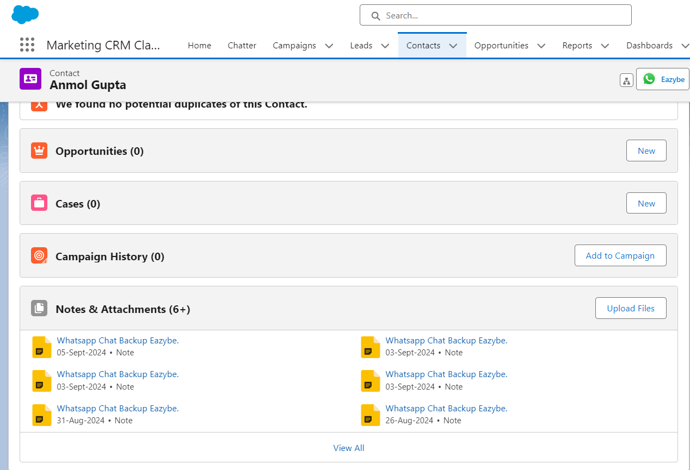

Com **Back up in activities** ativado, o Eazybe salva **conversas individuais e em grupo como tarefas concluídas** no **Contato ou Lead** associado do Salesforce. As mensagens são adicionadas à atividade diária da conversa conforme os backups são executados.

## Encontrar uma conversa salva no Salesforce

1. Abra o registro do **Contato** ou **Lead** associado no Salesforce.
2. Abra **Atividade** (Activity) e localize a entrada **WhatsApp Chat by Eazybe** da data desejada.
3. Abra a tarefa concluída e leia as mensagens sincronizadas em **Descrição** (Description).

Confira as etapas e os exemplos em [Backup em atividades](/pt/integrations/salesforce/activity-backup).

## Quando o backup em atividades está desativado

Com essa opção desativada, o Eazybe usa o método de backup existente do Salesforce: o objeto personalizado **WhatsApp Chats by Eazybe** e, para Contatos, **Notas e anexos**. Ao ativar o backup em atividades, os próximos backups de conversas são salvos como tarefas concluídas em vez de usar esse método.

### Página de Contato do Salesforce

As conversas do WhatsApp sincronizadas aparecem em duas localizações nas respectivas páginas de Contatos do Salesforce:

<CardGroup cols={2}>
  <Card title="Notas e Anexos">
    Encontre suas conversas sincronizadas na seção de Notas e Anexos.
  </Card>
  <Card title="WhatsApp Chats por Eazybe">
    Visualize as conversas no objeto de atividade personalizado.
  </Card>
</CardGroup>

### Página de Lead do Salesforce

As conversas do WhatsApp sincronizadas são exibidas no objeto de atividade personalizado **"WhatsApp Chats por Eazybe"** nas respectivas páginas de Leads do Salesforce.

<Tip>
  Tanto as páginas de Contatos quanto de Leads fornecem fácil acesso às suas conversas do WhatsApp sincronizadas, ajudando você a manter um histórico de comunicação completo dentro do Salesforce.
</Tip>

## Precisa de Ajuda?

Se você tiver alguma dúvida ou precisar de mais assistência, entre em contato conosco em [hey@eazybe.com](mailto:hey@eazybe.com).
