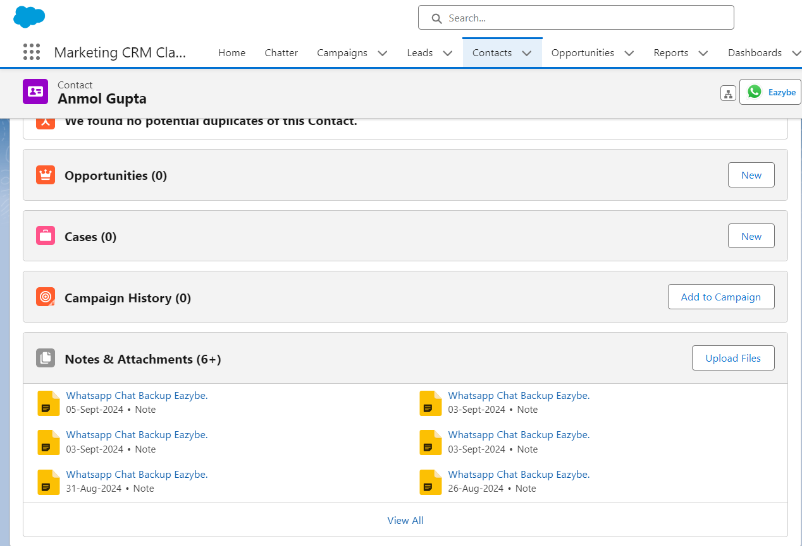
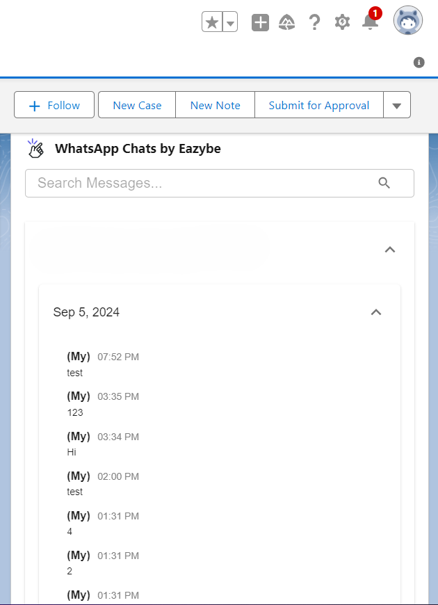
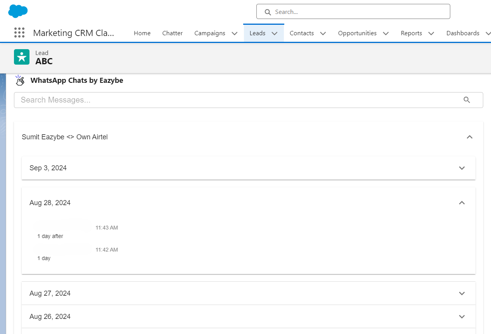

Este guia explica como os contatos do WhatsApp e Salesforce são vinculados, habilitando o backup e sincronização automática de chats.

## Como Funciona a Vinculação de Contatos

Os números do WhatsApp são vinculados a Leads e Contatos do Salesforce pelos campos configurados em [Mapeamento de números](/pt/integrations/salesforce/number-mapping). A opção padrão usa Telefone, Celular e os campos mapeados anteriormente. Administradores podem pesquisar todos os campos do tipo Telefone ou selecionar campos específicos de Telefone e Texto, incluindo os personalizados. Você também pode:

- Criar contatos diretamente do WhatsApp usando o EazyBe
- Vincular contatos existentes do Salesforce a números de telefone do WhatsApp

## O Que Acontece Após a Vinculação

<Info>
  Uma vez vinculado, o cartão do contato aparece na visualização Mini-CRM do EazyBe, dando acesso instantâneo aos detalhes do contato enquanto você conversa.
</Info>

Tanto os chats 1:1 quanto os chats em grupo associados ao contato serão salvos no Salesforce:

- **Para Contatos**: O conteúdo do chat e anexos são exibidos na Seção de Notas e Anexos e no objeto Atividade de Chats do WhatsApp por EazyBe
- **Para Leads**: Os chats aparecem nos Objetos de Atividade de Chats do WhatsApp

## Sincronização Automática

<Steps>
  <Step title="Criação de Contato">
    Ao criar novos contatos do Salesforce através da extensão EazyBe WhatsApp, os contatos são automaticamente vinculados ao Salesforce.
  </Step>
  <Step title="Backup de Chat">
    Os chats do WhatsApp são salvos automaticamente a cada 3 minutos.
  </Step>
  <Step title="Status de Sincronização">
    O horário da última sincronização é atualizado no espaço de trabalho EazyBe para que você possa verificar a sincronização.
  </Step>
</Steps>

<Tip>
  Confira se o número correto do WhatsApp está em um campo incluído na configuração salva de Number mapping.
</Tip>

## Precisa de Ajuda?

Se você tiver alguma dúvida ou precisar de assistência, entre em contato com nossa equipe de suporte em **hey@eazybe.com**.
