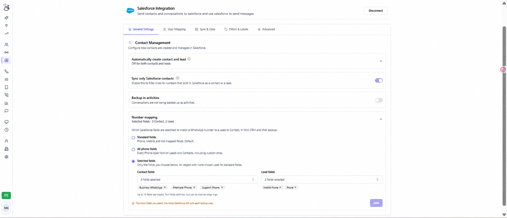

Use **Number mapping** para escolher em quais campos do Salesforce o Eazybe procura um número do WhatsApp para encontrar um Lead ou Contato. Essa busca é usada no Mini CRM e no backup de conversas, inclusive quando o número está em um campo personalizado.

## Abrir a configuração

Acesse o espaço de trabalho do Eazybe como **administrador**, abra **Integrations → Salesforce → General Settings** e expanda **Number mapping** em **Contact Management**. O Salesforce deve estar conectado. Os nomes dos controles foram mantidos em inglês para facilitar a identificação na interface.

## Escolher os campos de busca

| Opção | Campos pesquisados | Quando usar |
| --- | --- | --- |
| **Standard fields** | Telefone, Celular e os campos mapeados anteriormente. É a opção padrão. | A equipe utiliza os campos padrão ou mapeamentos existentes. |
| **All phone fields** | Todos os campos acessíveis do tipo Telefone em Leads e Contatos, incluindo os personalizados. | Os números estão distribuídos entre vários campos do tipo Telefone. |
| **Selected fields** | Apenas os campos escolhidos separadamente para Contatos e Leads. Campos de Telefone e Texto compatíveis estão disponíveis. | Você quer usar campos personalizados específicos ou um campo de Texto que contém um número. |

<Note>
  Em **Selected fields**, Telefone e Celular não são incluídos automaticamente quando o objeto tem campos selecionados. Selecione-os se também quiser pesquisá-los. Se a seleção de um objeto ficar vazia, esse objeto usará seus campos padrão. Escolha pelo menos um campo entre Contatos e Leads para salvar esse modo.
</Note>

## Configurar campos personalizados

1. Selecione **Selected fields**.
2. Abra **Contact fields**, pesquise pelo rótulo ou nome de API e escolha os campos que contêm os números de WhatsApp dos clientes.
3. Abra **Lead fields** e escolha os campos de Leads. É possível selecionar até **15 campos por objeto**.
4. Para remover um campo, clique no **×** ao lado do nome selecionado.
5. Clique em **Save** e aguarde a confirmação **Number mapping updated**. As alterações só são aplicadas após salvar.

A captura editada usa os seguintes nomes de exemplo para Contatos: **Business WhatsApp**, **Alternate Phone** e **Support Phone**. Leads usam **Mobile Phone** e **Phone**. Escolha os campos reais da sua organização; essa configuração não cria novos campos no Salesforce.

Se o número de WhatsApp de um Contato estiver apenas em **Business WhatsApp**, selecione esse campo para que o Eazybe encontre o registro no Mini CRM e no backup de conversas. No exemplo, os campos Telefone e Celular do Contato não são pesquisados, a menos que você os adicione.

<Warning>
  Pesquisar todos os campos de telefone ou selecionar mais campos aumenta o uso da API do Salesforce por busca. Campos de Texto podem ser mais lentos em organizações grandes. Selecione os campos que sua equipe realmente utiliza.
</Warning>

## Verificar o resultado

Abra uma conversa do WhatsApp cujo número esteja em um dos campos configurados. Confira se o Lead ou Contato esperado aparece no Mini CRM e verifique o [status da sincronização](/pt/integrations/salesforce/message-sync).

Se o registro não for encontrado:

- Confira se o número está correto e em um campo incluído no modo salvo.
- Verifique as seleções de Contatos e Leads separadamente.
- Para números em campos de Texto, use **Selected fields** e selecione o campo explicitamente.
- Se um campo não aparecer na lista, verifique o acesso do usuário conectado ao Salesforce. Apenas campos de Telefone e Texto compatíveis são exibidos.
- Se os campos não carregarem, confira a conexão com o Salesforce e tente novamente.

Para restaurar a busca padrão, selecione **Standard fields** e clique em **Save**. As escolhas de campos são mantidas ao alternar entre modos.

Veja [Vincular Contatos](/pt/integrations/salesforce/linking-contacts). Para obter ajuda, entre em contato pelo **hey@eazybe.com**.
