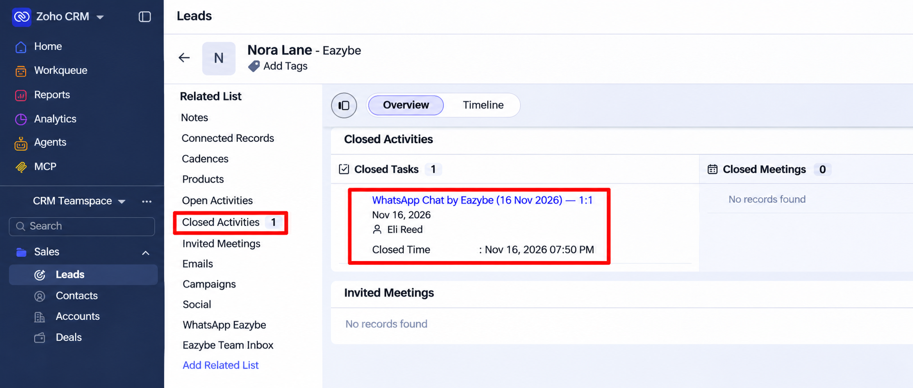
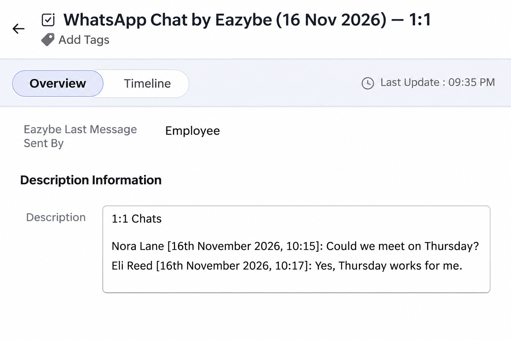

O Eazybe cria uma tarefa concluída por conversa por dia no registro correspondente. Abra a tarefa para ler as mensagens sincronizadas daquele dia.

## Ativar o backup em atividades

1. No seu espaço de trabalho do Eazybe, abra **Integrações**, selecione a conta conectada do **Zoho CRM** e abra **Configurações gerais**.
2. Ative **Backup in activities**. O texto abaixo da opção confirma que as conversas estão sendo salvas como tarefas concluídas.

Administradores e gerentes alteram essa configuração para toda a organização. Os demais usuários alteram apenas a própria conexão com o Zoho.

## Consultar uma conversa no Zoho

1. Abra o módulo **Leads** ou **Contatos** e selecione o registro da pessoa.
2. Na lista relacionada à esquerda, selecione **Atividades encerradas** (Closed Activities). Em **Tarefas encerradas** (Closed Tasks), abra **WhatsApp Chat by Eazybe** com a data desejada.

Na visão geral da tarefa, role até a seção de descrição. O campo **Descrição** mostra o remetente, o horário e o texto de cada mensagem sincronizada.

