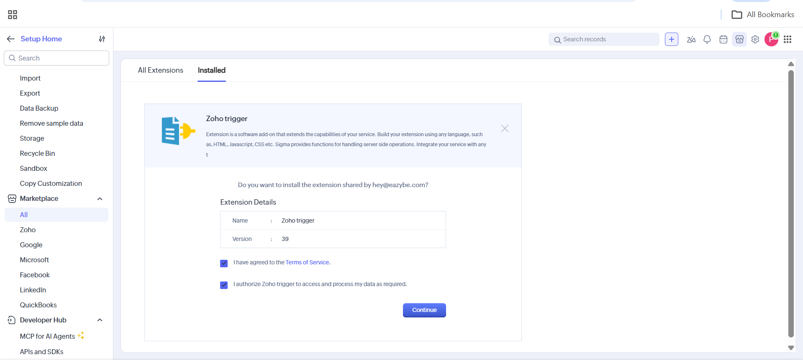
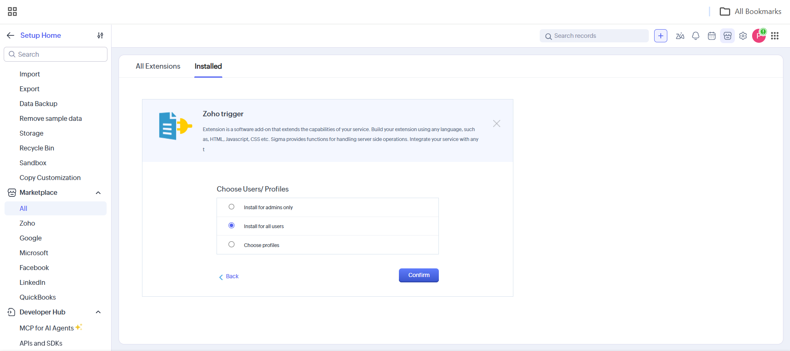
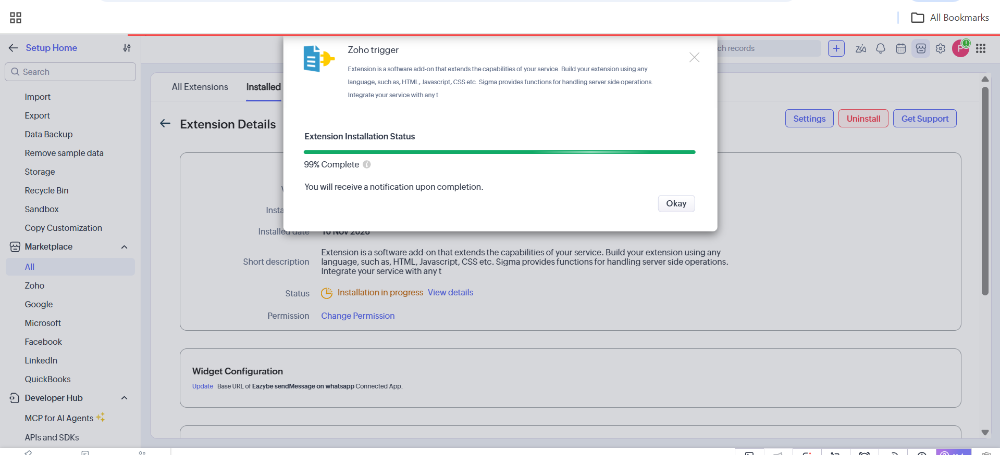
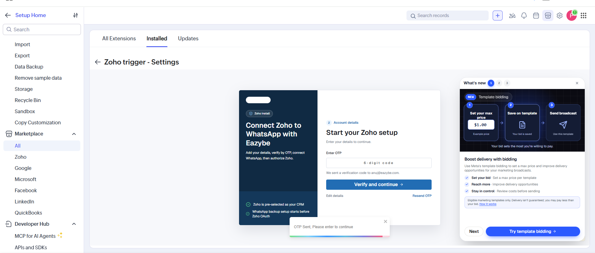
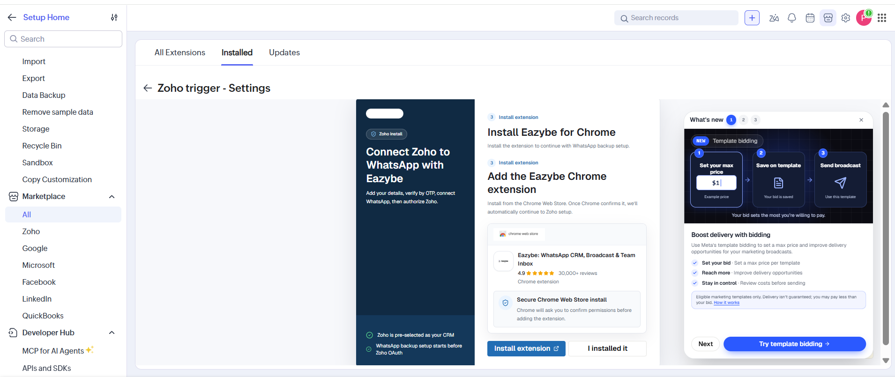
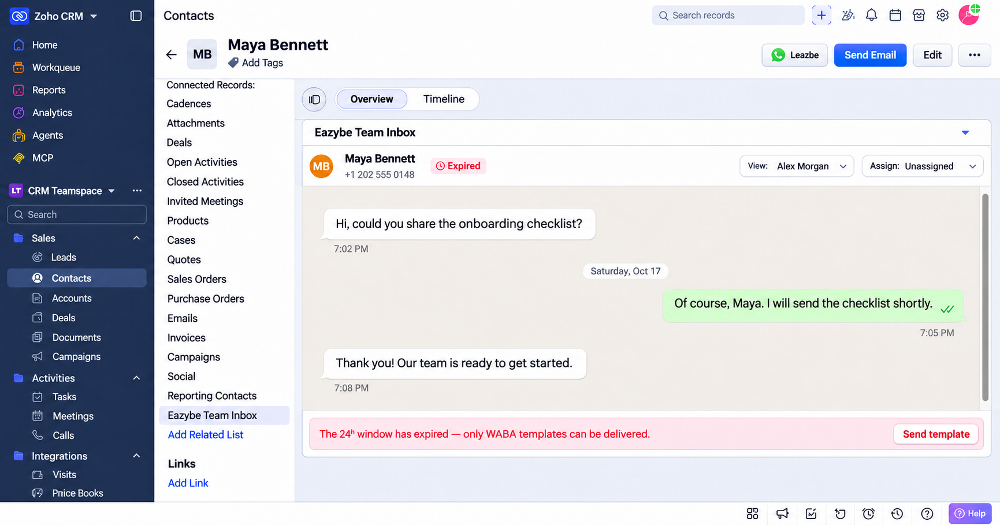
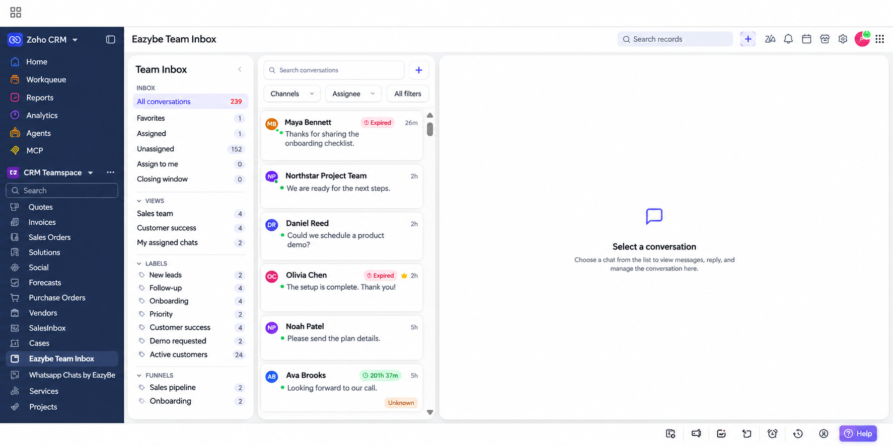

O Eazybe Team Inbox traz as conversas do WhatsApp para o Zoho CRM. Abra a conversa de um contato ou lead no próprio registro ou use a caixa de entrada geral para gerenciar as conversas às quais você tem acesso.

<Note>
O pacote **Zoho trigger** inclui a ação de WhatsApp para fluxos de trabalho e o **Eazybe Team Inbox**. A instalação adiciona uma lista relacionada aos registros de Contatos e Leads e uma entrada na navegação de módulos. A caixa de entrada geral não exige a extensão do Chrome nem uma aba aberta do WhatsApp Web.
</Note>

## Instalar o Pacote

Use uma conta com permissão para instalar extensões no Zoho CRM. Se o pacote já estiver instalado, confirme que **Zoho trigger** está **Active** em **Setup → Marketplace → All → Installed**.

<Steps>
  <Step title="Abrir o pacote e revisar o acesso">
    Abra [Instalar Zoho trigger e Team Inbox](https://crm.zoho.com/market/installPrivatePlugin.do?portalName=rajatverma&nameSpace=zohotrigger&versionIndex=4520363000000438001). Revise os termos de serviço e a autorização de acesso aos dados. Se concordar, marque as duas caixas e clique em **Continue**.

    
  </Step>
  <Step title="Escolher os usuários">
    Em **Choose Users/Profiles**, selecione **Install for all users** e clique em **Confirm**. Para restringir o acesso, escolha **Install for admins only** ou **Choose profiles**.

    
  </Step>
  <Step title="Aguardar a conclusão da instalação">
    O Zoho exibe **Extension Installation Status**. Clique em **Okay** e aguarde a notificação de conclusão. Confirme que o status é **Active**.

    <Note>A captura mostra **99% Complete**: a instalação ainda está em andamento.</Note>

    
  </Step>
  <Step title="Verificar sua conta Eazybe">
    Abra **Settings** no pacote instalado e siga a configuração. Informe seus dados quando solicitado. Em **Enter OTP**, digite o código de seis dígitos enviado por e-mail e clique em **Verify and continue**. Use **Resend OTP** para solicitar outro código ou **Edit details** para corrigir o e-mail.

    
  </Step>
  <Step title="Revisar a configuração de backup do WhatsApp">
    A configuração pode mostrar **Install Eazybe for Chrome** para o backup do WhatsApp. Se estiver configurando esse recurso, clique em **Install extension** ou **I installed it**, conforme necessário. Siga as instruções para conectar sua conta e autorizar o Zoho.

    **O Team Inbox faz parte do pacote do Zoho. A extensão do Chrome não é necessária para abrir a caixa de entrada geral.**

    
  </Step>
</Steps>

<Tip>
Para usar a ação incluída no mesmo pacote, consulte [Enviar mensagens do WhatsApp por um fluxo de trabalho do Zoho](/pt/waba/broadcasting/zoho-workflow/send-whatsapp-message). Crie e ative a regra após instalar o pacote.
</Tip>

## Abrir a Caixa de um Contato ou Lead

1. Abra **Contacts** ou **Leads** e selecione um registro.
2. Role a seção **Related List**, à esquerda, e clique em **Eazybe Team Inbox**. Você também pode rolar a página do registro até a seção com esse nome.
3. Leia a conversa. Use **View:** para selecionar uma visualização disponível e **Assign:** para gerenciar a atribuição conforme suas permissões.

<Warning>A captura foi editada com cliente e mensagens fictícios. Ela mostra um Contato; a mesma entrada fica disponível em Leads após a instalação do pacote.</Warning>

<Note>Se aparecer **Expired** e o aviso de que a janela de 24 horas expirou, use **Send template** para continuar com um modelo de mensagem.</Note>

## Abrir a Caixa de Entrada Geral

1. Localize **Eazybe Team Inbox** na navegação de módulos, junto a **Vendors**, **Services** e **Projects**. Role a lista se necessário; na captura, ela está à esquerda.
2. Clique em **Eazybe Team Inbox** para ver as conversas disponíveis no seu espaço de trabalho.
3. Escolha **All conversations**, **Favorites**, **Assigned**, **Unassigned** ou **Assign to me**. Use **Search conversations**, **Channels**, **Assignee** e **All filters** para filtrar a lista.
4. Selecione uma conversa para ver as mensagens à direita. Antes da seleção, o painel mostra **Select a conversation**.

<Warning>Esta captura editada usa nomes de clientes, visualizações, etiquetas e mensagens fictícios.</Warning>

## Gerenciar Conversas no Zoho

Suas permissões no Eazybe determinam quais conversas você pode visualizar e gerenciar no Zoho CRM. Com um número de **WhatsApp Business API** ou **Coexistence (CoEx)** conectado, você pode enviar e receber mensagens no Team Inbox.

## Solução de Problemas

### O Team Inbox Não Aparece

Confirme que o pacote está instalado e **Active**, que seu usuário ou perfil tem acesso e atualize o Zoho CRM. Procure em **Related List** nos Contatos e Leads ou na navegação de módulos para a caixa geral.

### A Conversa de um Contato ou Lead Não Aparece

Verifique o número de WhatsApp do registro, incluindo o código internacional, a conexão com o Eazybe, suas permissões e a seleção de **View:**.

### A Caixa Geral Não Carrega ou Não Mostra os Chats Esperados

Verifique a instalação, o status do pacote, o acesso do usuário e a conexão com o Eazybe. Recarregue a caixa, compare seu acesso em [app.eazybe.com](https://app.eazybe.com) e limpe pesquisas ou filtros que ocultem conversas. A caixa geral é fornecida pelo pacote do Zoho e não depende da extensão do Chrome.
