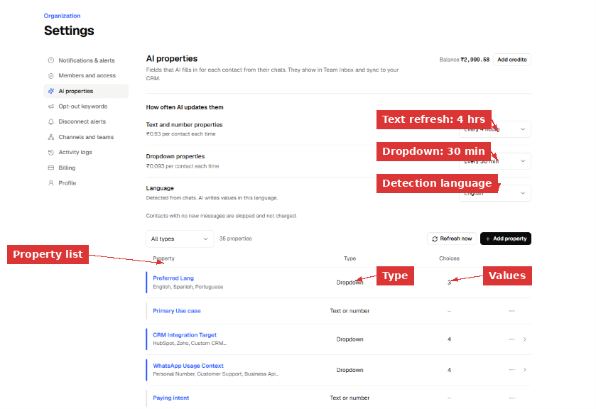
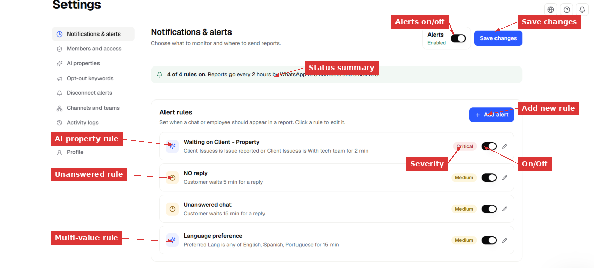
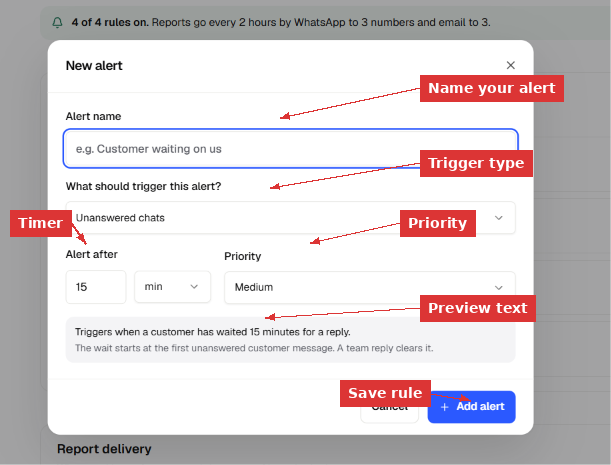
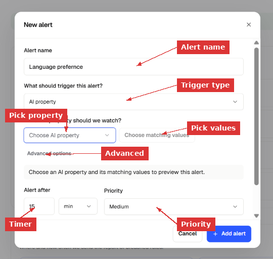
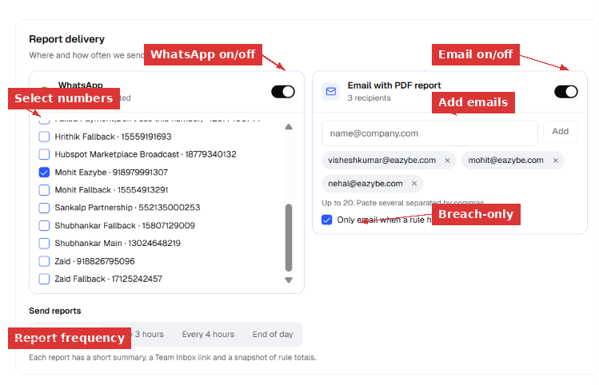

> **Diretório de Documentação**
> Antes de explorar páginas individuais, consulte o índice completo em [https://help.eazybe.com/llms.txt](https://help.eazybe.com/llms.txt) para todos os tópicos disponíveis.

# Notificações e Alertas

> Configure regras de alerta para saber no momento em que um cliente espera demais, uma conversa fica no estado errado ou um membro da equipe fica inativo. O Eazybe verifica cada regra continuamente e envia um relatório para seu WhatsApp e e-mail quando algo precisa de atenção.

Notificações e alertas é o centro de controle para monitoramento de tempos de resposta em todo o seu espaço de trabalho. Você define as regras — o Eazybe monitora seus chats 24 horas por dia e avisa quando algo ultrapassa o limite.

---

## O Que São Regras de Alerta?

Uma regra de alerta é uma condição mais um temporizador. Quando a condição permanece verdadeira por mais tempo que o temporizador, a conversa (ou colaborador) aparece no próximo relatório programado.

O Eazybe suporta dois tipos de gatilhos:

### Chats sem resposta
Monitora mensagens de clientes que não receberam resposta da equipe. O temporizador começa na primeira mensagem sem resposta do cliente. Ele zera no momento em que qualquer membro da equipe responde. Mensagens adicionais do cliente **não** reiniciam o temporizador — o relógio continua contando a partir da mensagem original sem resposta.

**Exemplo:** "Cliente esperando 15 min por uma resposta" — se um cliente envia uma mensagem às 14:00 e ninguém responde até às 14:15, este chat aparece no relatório.

### Propriedade de IA
Monitora um valor específico de propriedade de IA em uma conversa. O temporizador começa quando a propriedade assume o valor correspondente e continua enquanto permanecer assim. Quando a propriedade muda para outro valor, o temporizador zera.

**Exemplo:** "Client Issues é Issue reported por 2 min" — qualquer conversa onde a IA detectou um problema e ele permanece sem tratamento por 2 minutos é sinalizada.

Você pode monitorar um **valor único** (ex., Conversation State é "Waiting on Client") ou **múltiplos valores** (ex., Preferred Lang é qualquer um de English, Spanish, Portuguese).

> [!NOTE]
> Apenas propriedades de IA tipo **dropdown** podem ser usadas em regras de alerta. Propriedades de texto e número ainda não são suportadas. Você pode ver quais propriedades são dropdown em **Settings → AI Properties**.

---

## Entendendo as Propriedades de IA

Propriedades de IA são campos que a IA do Eazybe preenche automaticamente para cada conversa com base no que é discutido no chat. Elas aparecem no Team Inbox e sincronizam com seu CRM.

Para ver as propriedades de IA do seu espaço de trabalho:

1. Vá para **Settings → AI Properties**.
2. Você verá uma lista de todas as propriedades disponíveis, seus tipos (Dropdown ou Text/Number) e quantos valores cada uma possui.

*Settings → AI Properties mostra cada campo que a IA preenche. Propriedades Dropdown (como "Preferred Lang" com 3 opções) podem ser usadas em regras de alerta. Propriedades Text/Number (como "Primary Use case") ainda não podem ser usadas em regras.*

### Com que frequência as propriedades atualizam

Propriedades de IA não são instantâneas — elas atualizam em um cronograma:

| Tipo de propriedade | Frequência de atualização | Custo |
|---|---|---|
| Propriedades **Dropdown** | A cada 30 minutos | ₹0,093 por contato por atualização |
| Propriedades de **texto e número** | A cada 4 horas | ₹0,93 por contato por atualização |

Contatos sem novas mensagens desde a última atualização são ignorados e não são cobrados.

> [!IMPORTANT]
> Como as propriedades dropdown atualizam a cada 30 minutos, uma regra de alerta com temporizador de 2 minutos pode não disparar exatamente aos 2 minutos. A mudança de estado só é detectada na próxima atualização. Para alertas precisos, use temporizadores maiores que o intervalo de atualização. Uma regra de 2 minutos é útil para capturar problemas que estão naquele estado por pelo menos um ciclo de atualização.

---

## Configurando Regras de Alerta

### Passo 1: Abra a página de alertas

Vá para **Settings** na barra lateral esquerda, depois clique em **Notifications & alerts**.

Você verá:
- Um interruptor de **Alerts** (canto superior direito) — deve estar **Enabled** para que as regras funcionem.
- Uma **barra de resumo** mostrando quantas regras estão ativas, frequência de relatórios e canais de entrega.
- Sua **lista de regras de alerta** — cada regra mostra seu nome, descrição, severidade, interruptor liga/desliga e um botão de edição.

*A página de Notifications & alerts. A barra de resumo no topo mostra "4 of 4 rules on" com detalhes de entrega de relatórios. Cada cartão de regra mostra a condição de disparo, temporizador, selo de severidade, interruptor liga/desliga e lápis de edição.*

### Passo 2: Crie um novo alerta

Clique em **+ Add alert** (canto superior direito da seção Alert rules). Um diálogo é aberto.

#### Criando um alerta de chat sem resposta

1. Insira um **Alert name** — algo descritivo como "Customer waiting 15 min" ou "No reply 5 min".
2. Em **"What should trigger this alert?"** — selecione **Unanswered chats**.
3. Configure **Alert after** — o número de minutos (ou horas) que um cliente pode esperar antes desta regra disparar. Por exemplo: 15 min.
4. Configure **Priority** — Critical, High, Medium ou Low. Isso controla como a regra aparece nos relatórios.
5. Revise o **texto de pré-visualização** na parte inferior — ele explica exatamente quando esta regra dispara e o que a zera.
6. Clique em **+ Add alert**.

*Criando um alerta de Unanswered chats. A pré-visualização na parte inferior confirma: "Triggers when a customer has waited 15 minutes for a reply. The wait starts at the first unanswered customer message. A team reply clears it."*

#### Criando um alerta de propriedade de IA

1. Insira um **Alert name** — por exemplo "Waiting on Client - Property" ou "Language preference".
2. Em **"What should trigger this alert?"** — selecione **AI property**.
3. Em **"Which AI property should we watch?"** — escolha uma propriedade dropdown da lista (ex., Conversation State, Preferred Lang, Client Issues).
4. Clique em **Choose matching values** — selecione um ou mais valores. Por exemplo, selecione "Waiting on Client" de Conversation State, ou selecione "English, Spanish, Portuguese" de Preferred Lang.
5. Opcionalmente expanda **Advanced options** para configuração adicional.
6. Configure **Alert after** — quanto tempo a propriedade deve permanecer no estado correspondente.
7. Configure **Priority**.
8. Clique em **+ Add alert**.

*Criando um alerta de AI property. Selecione a propriedade a monitorar, escolha quais valores disparam o alerta e configure quanto tempo a condição deve se manter antes de disparar.*

> [!NOTE]
> **Valor único vs. múltiplos valores:**
> - Valor único (ex., Conversation State **é** "Waiting on Client") — a regra dispara quando a conversa tem exatamente este estado.
> - Múltiplos valores (ex., Preferred Lang **é qualquer um de** English, Spanish, Portuguese) — a regra dispara quando a conversa corresponde a qualquer um dos valores selecionados. Isso é útil para monitorar um grupo de estados relacionados.

### Passo 3: Configure cada regra

Após criar as regras, você pode gerenciá-las pela página principal:

- **Ligar/desligar** — o interruptor ao lado de cada regra habilita ou desabilita sem excluí-la.
- **Editar** — clique no ícone de lápis para alterar o nome, temporizador, prioridade ou condições.
- **Selos de severidade** — Critical (vermelho), High (laranja), Medium (amarelo), Low (azul) ajudam a priorizar visualmente.

A **barra de resumo** atualiza automaticamente: "4 of 4 rules on. Reports go every 2 hours by WhatsApp to 3 numbers and email to 3."

---

## Configurando a Entrega de Relatórios

Role para baixo, abaixo das regras de alerta, até a seção **Report delivery**. Aqui é onde você configura como e quando as regras violadas são enviadas à sua equipe.

*Configuração de entrega de relatórios. WhatsApp e e-mail podem ser habilitados independentemente. As abas de frequência controlam com que frequência os relatórios são enviados.*

### Relatórios por WhatsApp

1. Ative o interruptor de **WhatsApp**.
2. Selecione quais números de WhatsApp conectados devem receber o relatório. Marque as caixas ao lado dos números desejados.
3. Os relatórios são enviados como mensagem de texto normal (se a janela de mensagens estiver aberta) ou como o template `sla_notice` (se a janela estiver fechada — o destinatário toca "Send report" para receber o texto completo).

### Relatórios por e-mail

1. Ative o interruptor de **Email with PDF report**.
2. Insira endereços de e-mail no campo **Email recipients** e clique em **Add**. Você pode adicionar até 20 destinatários. Cole múltiplos endereços separados por vírgulas.
3. Marque **"Only email when a rule has breached"** — isso é recomendado para não receber relatórios vazios quando tudo está bem.

Cada e-mail inclui:
- Um breve resumo do total de violações
- Um link para o Team Inbox para ver as conversas violadoras
- Um anexo PDF com totais de regras e exemplos de conversas

### Frequência de relatórios

Escolha com que frequência os relatórios são entregues:

| Frequência | Melhor para |
|---|---|
| **Every 2 hours** | Equipes de alto tráfego que precisam de atualizações frequentes |
| **Every 3 hours** | Monitoramento padrão |
| **Every 4 hours** | Equipes de menor tráfego |
| **End of day** | Resumo diário — um relatório no final do dia de trabalho |

> [!IMPORTANT]
> **Temporizador vs. frequência:** O temporizador de cada regra (ex., "15 min") controla quando uma conversa **se qualifica** como violada. A frequência (ex., "Every 2 hours") controla quando o **relatório é enviado**. Uma conversa pode violar após 15 minutos, mas só aparecer no próximo relatório programado até 2 horas depois. Para maior rapidez, use intervalos de frequência mais curtos.

### Salve suas alterações

Após configurar as regras e a entrega, clique em **Save changes** (canto superior direito). Atualize a página para confirmar que tudo foi salvo corretamente.

---

## Visualizando Regras Violadas no Team Inbox

Uma vez que as regras de alerta estão ativas e as conversas começam a violá-las, você pode ver os resultados no Team Inbox.

1. Abra o **Team Inbox** na barra lateral esquerda.
2. Role até o final do painel esquerdo — encontre a seção **Over SLA**.
3. Cada regra ativa aparece com um **contador ao vivo** de quantas conversas estão violando atualmente.
4. Clique no nome de uma regra para **filtrar a lista de chats** — apenas conversas que correspondem àquela regra são mostradas.

*A seção "Over SLA" no Team Inbox mostra contadores ao vivo para cada regra violada. Clique em uma regra para filtrar conversas. Neste exemplo, 54 chats estão violando "Waiting on Client" e 93 estão em "NO reply".*

### O que zera uma violação?

| Tipo de regra | O que a zera |
|---|---|
| **Chat sem resposta** | Qualquer membro da equipe responde à conversa. A violação zera imediatamente. Mensagens adicionais do cliente **não** reiniciam o temporizador. |
| **Propriedade de IA** | O valor da propriedade muda para algo que não corresponde mais à condição da regra. Por exemplo, se a regra monitora "Conversation State é Waiting on Client" e o estado muda para "Active", a violação zera. |

> [!NOTE]
> Uma única conversa pode violar múltiplas regras ao mesmo tempo. Por exemplo, um chat pode aparecer tanto em "Unanswered 15 min" quanto em "Waiting on Client" se ambas as condições forem verdadeiras. As contagens de violações no Team Inbox e relatórios contam correspondências de regras, não conversas únicas.

---

## Entendendo o Relatório por E-mail

Quando um relatório programado é executado e regras foram violadas, você recebe um e-mail como este:

**Assunto:** "SLA breaches need attention"

O corpo do e-mail inclui:

| Campo | O que mostra |
|---|---|
| **Workspace** | O ID do seu espaço de trabalho |
| **Chat breaches** | Total de conversas que ultrapassaram um limite de regra |
| **Inactivity breaches** | Colaboradores que não enviaram mensagens dentro do limite (se você tem regras de inatividade) |
| **Critical breaches** | Contagem de violações em regras de prioridade Critical |
| **Rule breakdown** | Cada regra listada com sua contagem individual de violações e severidade |

O **PDF** anexo fornece um resumo com exemplos de conversas de cada regra violada, para que um gerente possa revisar sem abrir o painel de controle.

---

## Configurações de Alerta de Exemplo

Configurações comuns para diferentes necessidades de equipe:

### Equipe de resposta rápida (vendas)
| Regra | Gatilho | Temporizador | Prioridade |
|---|---|---|---|
| SLA de resposta rápida | Unanswered chats | 5 min | Critical |
| Lead quente parado | AI property: Lead Stage é "Hot" | 10 min | High |

### Equipe de suporte
| Regra | Gatilho | Temporizador | Prioridade |
|---|---|---|---|
| Cliente esperando | Unanswered chats | 15 min | Medium |
| Problema não resolvido | AI property: Client Issues é "Issue reported" | 30 min | High |
| Escalação pendente | AI property: Client Issues é "With tech team" | 60 min | Critical |

### Equipe multilíngue
| Regra | Gatilho | Temporizador | Prioridade |
|---|---|---|---|
| SLA de idioma | AI property: Preferred Lang é qualquer um de English, Spanish, Portuguese | 15 min | Medium |
| Sem resposta | Unanswered chats | 10 min | High |

---

## Dicas e Melhores Práticas

- **Comece com temporizadores mais longos** (15–30 min) e encurte à medida que sua equipe se adapta. Uma regra de 2 minutos em uma equipe que tem média de 10 minutos de resposta vai gerar ruído constante.
- **Nomeie suas regras claramente** — o nome aparece no Team Inbox, relatórios de WhatsApp e relatórios por e-mail. "Customer waiting 15 min" é melhor que "Rule 1".
- **Use os níveis de prioridade com significado** — Critical para regras que precisam de ação imediata (negócios perdidos, escalações), Medium para acompanhamento padrão de SLA, Low para monitoramento informativo.
- **Habilite "Only email when breached"** — isso evita que relatórios vazios encham sua caixa de entrada.
- **Verifique o intervalo de atualização das propriedades de IA** — propriedades dropdown atualizam a cada 30 minutos. Uma regra com temporizador menor que 30 minutos pode não disparar no minuto exato, mas vai capturar tudo que estiver naquele estado por pelo menos um ciclo de atualização.
- **Use múltiplos valores** para monitoramento mais amplo — em vez de criar 3 regras separadas para English, Spanish e Portuguese, crie uma regra com "Preferred Lang é qualquer um de English, Spanish, Portuguese".
- **Revise a seção Over SLA diariamente** — faça parte da sua rotina matinal verificar Team Inbox → Over SLA para quaisquer violações noturnas.

---

## Solução de Problemas

**Os alertas estão ativados mas não aparecem regras no Team Inbox**

Certifique-se de ter pelo menos uma regra criada e ativada. Clique em Save changes e atualize o Team Inbox. As regras podem levar alguns minutos para aparecer após serem salvas.

**A contagem da regra é 0 embora os chats devessem corresponder**

Para regras de propriedade de IA, o valor da propriedade deve corresponder exatamente. Abra uma conversa que você espera que viole, verifique o painel de propriedades de IA e confirme que o valor corresponde à condição da sua regra. Também verifique se a propriedade foi atualizada recentemente — propriedades dropdown atualizam a cada 30 minutos.

**O relatório por e-mail não chega**

Verifique se o endereço de e-mail está corretamente adicionado em Report delivery. Procure nas pastas de spam/lixo eletrônico. Se "Only email when a rule has breached" está marcado, os relatórios só são enviados quando há violações reais. Verifique a frequência — se está configurada em "End of day", o relatório chega uma vez no final do dia de trabalho.

**O relatório de WhatsApp não chega**

Confirme que os números de telefone estão marcados em Report delivery. Se a janela de mensagens está fechada, o relatório é enviado como o template `sla_notice` — o destinatário precisa tocar "Send report" para receber o texto real. Verifique se o template está aprovado no WhatsApp Manager.

**Uma conversa foi resolvida mas ainda aparece em Over SLA**

As contagens de Over SLA atualizam no próximo ciclo de verificação, não instantaneamente. Após responder a uma conversa, a contagem deve cair na próxima avaliação. Se persistir, a conversa pode ainda estar correspondendo a outra condição na mesma regra.

**O temporizador parece impreciso para regras de propriedade de IA**

Mudanças de estado de propriedades de IA são detectadas no próximo intervalo de atualização (a cada 30 minutos para dropdowns). Uma regra com temporizador de 2 minutos não significa que o alerta dispara exatamente 2 minutos após a mudança de estado — ele dispara 2 minutos após o sistema detectar o estado, o que pode ser até 30 minutos após a mudança real. Para alertas sensíveis ao tempo, use o gatilho "Unanswered chats" que usa timestamps de mensagens em tempo real.

**Uma conversa aparece em múltiplas regras**

Isso é esperado. Uma conversa pode corresponder a mais de uma regra ao mesmo tempo. As contagens totais nos relatórios são correspondências de regras, não conversas únicas.

---

*Última atualização: Novembro 2026*
