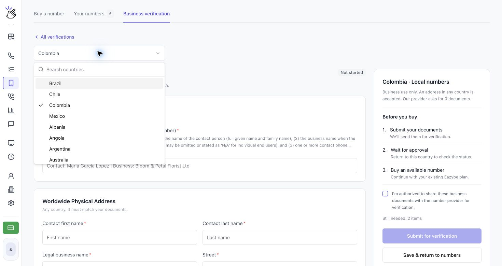
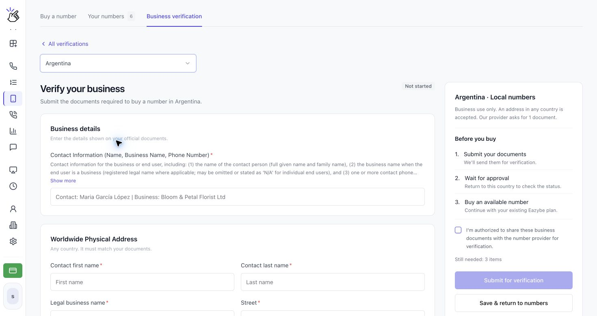
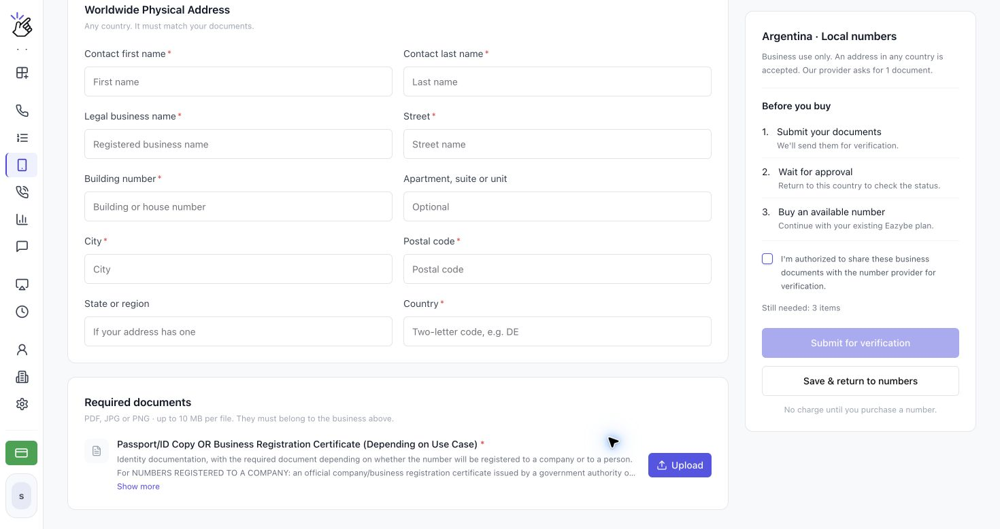
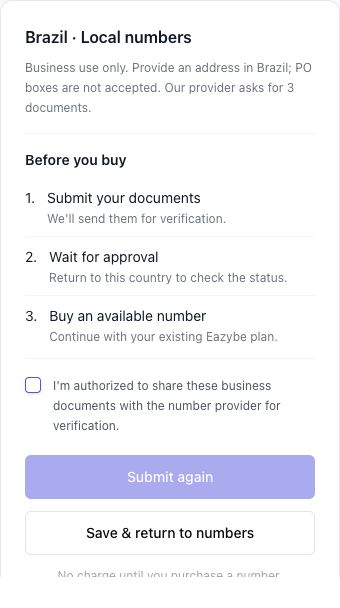
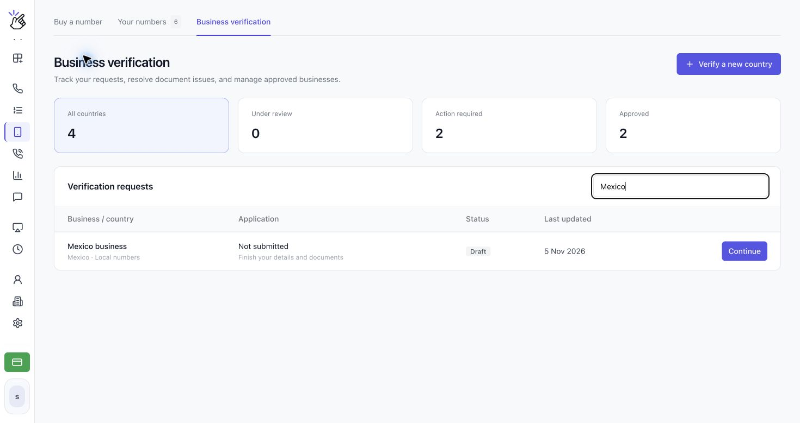
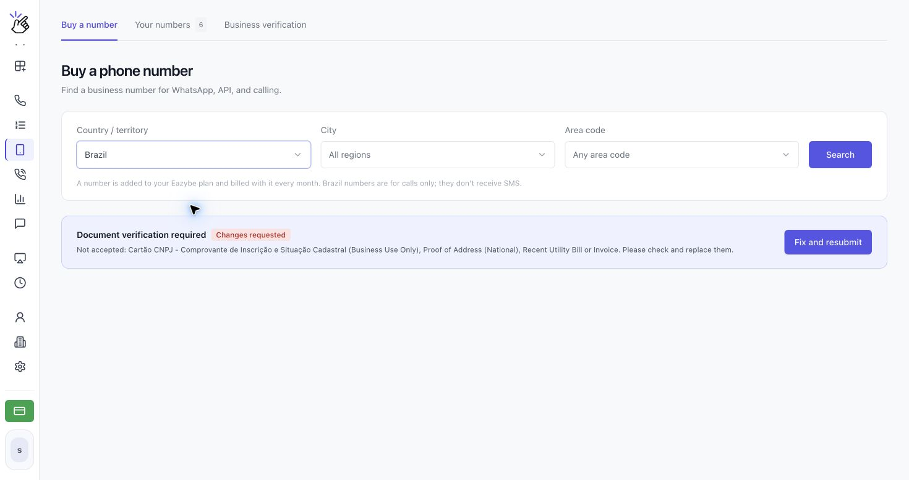

Conclua **Business verification** antes de comprar um número em um país que a exija, incluindo o Brasil. Envie uma verificação separada para cada país onde deseja comprar números.

<Note>O formulário varia conforme o país. As capturas mostram países diferentes para ilustrar o processo; siga os campos e requisitos de documentos do país selecionado. Os nomes de exemplo devem ser substituídos pelos seus próprios dados.</Note>

## Enviar sua verificação

<Steps>
  <Step title="Abra Business verification">
    Abra **CALLS → Phone Numbers → Business verification**. Clique em **Verify a new country** e escolha o país no seletor. Você também pode clicar em **Verify business** no aviso **Document verification required** em **Buy a number**.

    

    <Note>Se a página informar que o país ainda não está disponível porque a checagem de identidade não pode ser oferecida aqui, você ainda não pode concluir essa verificação na Eazybe. Escolha outro país disponível.</Note>
  </Step>
  <Step title="Informe os dados da sua empresa">
    Em **Verify your business**, preencha os campos obrigatórios de **Business details** com as informações dos documentos oficiais. Clique em **Show more** abaixo de um requisito para ler todas as instruções. Os campos com asterisco são obrigatórios.

    

    Para o Brasil, o formulário solicita **Contact Information (Name, Business Name, Phone Number)** e **Brazilian CPF Tax Number (Personal Use Only)**. Use os dados pessoais do representante autorizado nos requisitos de uso pessoal e os dados da empresa nos requisitos de uso empresarial. O CNPJ não substitui o CPF.
  </Step>
  <Step title="Adicione o endereço e envie os documentos exigidos">
    Preencha a seção de endereço. Se o formulário exigir um endereço no país do número, use um endereço local que corresponda aos documentos; o Brasil exige um endereço no Brasil e não aceita caixas postais. Quando aparecer **Worldwide Physical Address**, o formulário aceita um endereço em qualquer país, desde que corresponda aos documentos.

    Em **Required documents**, leia cada requisito e clique em **Upload** ao lado dele. Use arquivos legíveis em **PDF, JPG ou PNG**, com até **10 MB por arquivo**. Após o envio, use **View** para conferir o arquivo ou **Replace** para corrigi-lo.

    

    <Note>Alguns países solicitam dados e endereço sem envio de arquivos. Siga o formulário do seu país em vez de enviar os mesmos documentos para todos os países.</Note>
  </Step>
  <Step title="Revise e submeta sua verificação">
    Confira **Before you buy** e os itens de **Still needed**. Depois de preencher os campos e enviar os documentos obrigatórios, marque **I'm authorized to share these business documents with the number provider for verification.** e clique em **Submit for verification**. Se estiver corrigindo uma solicitação rejeitada, o botão será **Submit again**.

    

    <Tip>Use **Save & return to numbers** para salvar um rascunho e terminar depois. Salvar o rascunho não o envia para análise.</Tip>

    <Warning>Envie apenas documentos que você está autorizado a compartilhar com o provedor do número. A submissão os encaminha para verificação; não compra um número nem gera cobrança.</Warning>
  </Step>
  <Step title="Acompanhe a solicitação e volte após a aprovação">
    Abra **Business verification** para ver **Verification requests**. Filtre por **All countries**, **Under review**, **Action required** ou **Approved**, ou use **Search business, country or ID**. Abra uma solicitação usando seu botão de ação.

    

    A análise pode levar alguns dias úteis. A Eazybe envia um e-mail quando a solicitação é analisada. Quando aparecer **Approved**, volte a **Buy a number**, selecione o mesmo país e pesquise um número disponível.
  </Step>
</Steps>

## Preparar os documentos para o Brasil

O formulário do Brasil solicita atualmente os itens abaixo. Antes de enviar os arquivos, leia **Show more** para consultar os detalhes atuais dos documentos aceitos.

| Requisito | O que fornecer |
| --- | --- |
| Informações de contato | Nome completo do contato, razão social e telefone de contato. |
| CPF brasileiro | CPF do representante autorizado, correspondente aos dados pessoais dele. |
| Endereço físico no Brasil | Endereço da empresa correspondente aos documentos comprobatórios; não é aceita caixa postal. |
| Proof of Address (National), Recent Utility Bill or Invoice | Comprovante aceito com nome e endereço completo no Brasil. Documentos não governamentais devem ter sido emitidos nos últimos três meses; documentos de identificação oficiais devem estar dentro da validade, quando houver vencimento. |
| Cartão CNPJ - Comprovante de Inscrição e Situação Cadastral (Business Use Only) | Cartão CNPJ oficial da empresa com situação cadastral ativa. Um passaporte não o substitui. |
| ID/Passport Copy (Personal Use Only) | Cópia legível do documento de identidade oficial ou passaporte válido do representante autorizado. |

## Entender o status da solicitação

| Status | Próximo passo |
| --- | --- |
| **Not started** | Preencha o formulário do país. |
| **Draft** | Clique em **Continue** na lista, complete os itens pendentes e envie a solicitação. |
| **Under review** | Aguarde a análise. Os dados não podem ser alterados durante esse período. Abra a solicitação e use **Check status** para atualizar o status. |
| **Changes requested** | Clique em **Fix and resubmit**, leia o motivo, corrija os dados ou use **Replace** nos arquivos indicados e clique em **Submit again**. |
| **Approved** | Compre um número disponível naquele país. Confira a data de validade exibida, se houver. |
| **Expired** | Clique em **Update documents** e envie novamente antes de comprar mais números. Os números que você já tem continuam funcionando. |

<Warning>Alterar os dados de uma verificação aprovada exige uma nova análise antes de comprar mais números naquele país.</Warning>

A tela **Buy a number** também mostra o status atual da verificação e a próxima ação para aquele país.

## Por que o botão de envio está desativado?

Confira **Still needed**, preencha todos os campos obrigatórios, envie cada documento exigido e marque a caixa de autorização. Um rascunho salvo ou um arquivo enviado, por si só, não constitui uma verificação submetida.

## Por que ainda não consigo comprar um número?

Confirme que a verificação do país selecionado está **Approved**. A aprovação em outro país, um rascunho ou uma solicitação em análise não libera a compra. A aprovação também não reserva números: se não houver disponibilidade, tente outro código de área ou pesquise em todas as regiões.

Após a aprovação, siga [Comprar e gerenciar números de telefone](/pt/voice-number/phone-numbers). Números do Brasil e outros exclusivos para chamadas usam uma ligação, em vez de SMS, para a verificação do WhatsApp.
