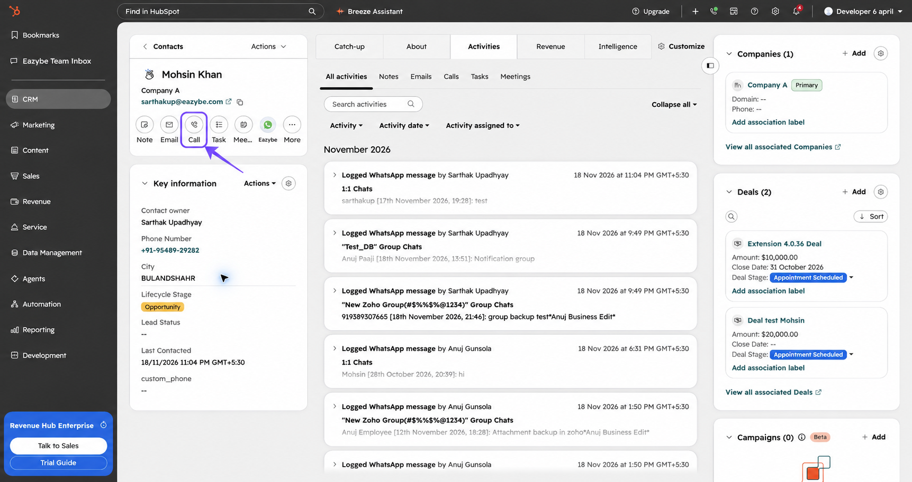
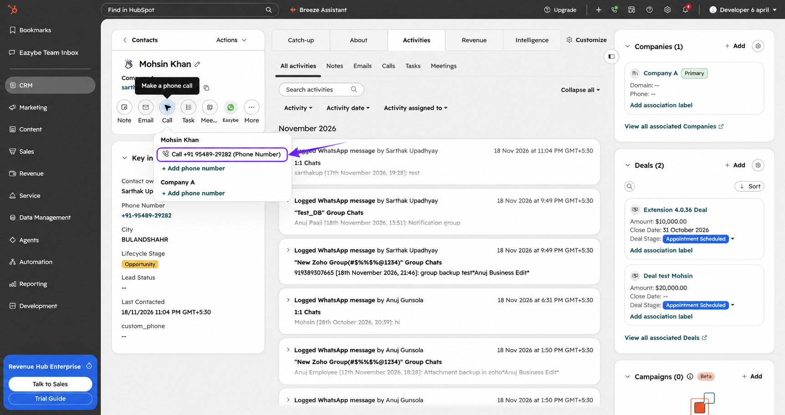
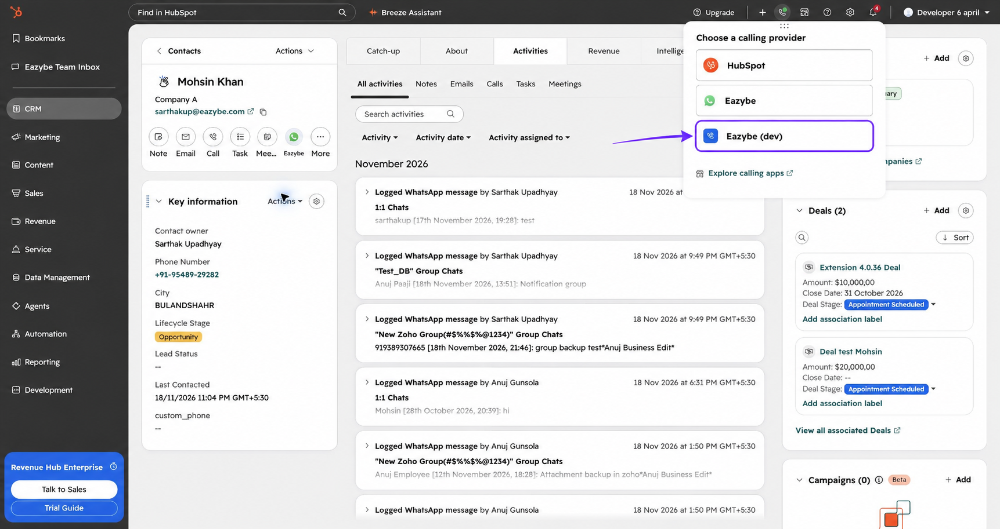
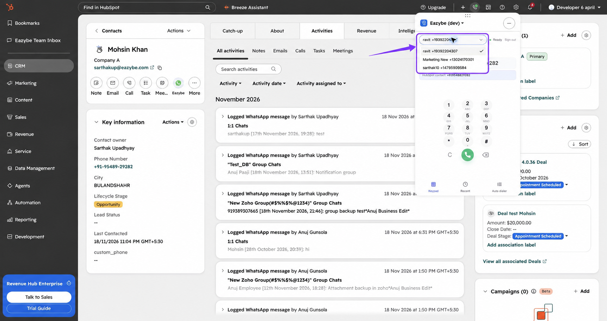
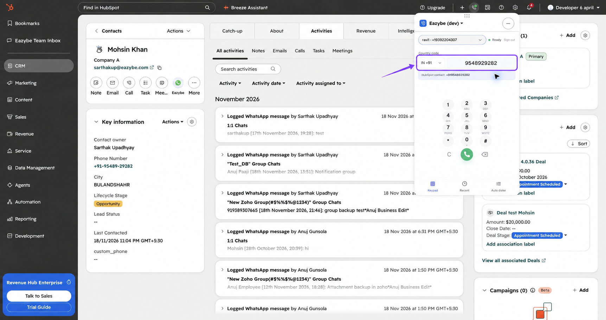
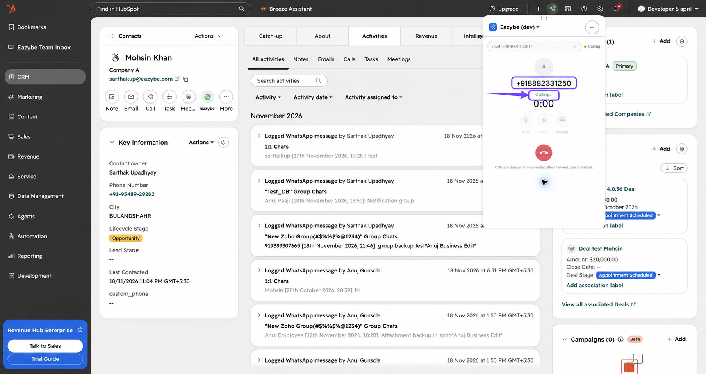
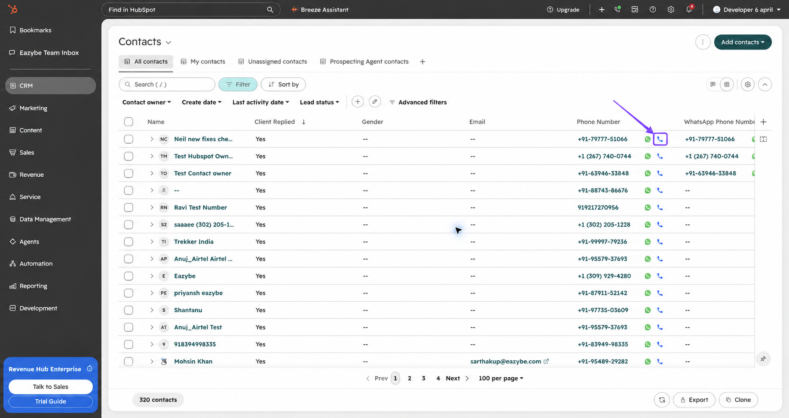
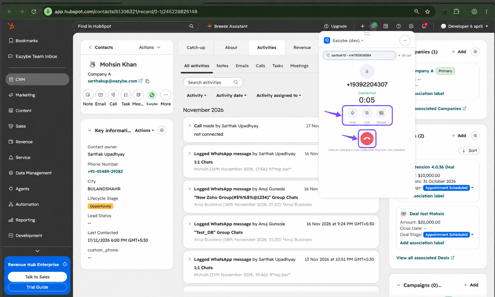
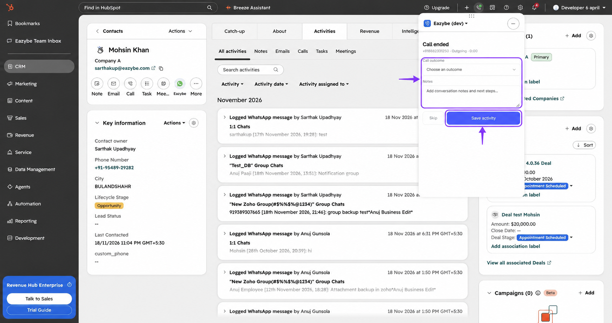

Use o discador da Eazybe para ligar para um contato sem sair do HubSpot. Escolha seu número de voz comercial, confira o número do contato e gerencie a chamada na mesma janela.

## Antes de começar

- Conecte sua conta do HubSpot à Eazybe e entre na Eazybe.
- Verifique se você tem um número de voz da Eazybe ativo e disponível, um plano que inclui chamadas e saldo suficiente na carteira.
- Use um headset e permita o acesso ao microfone quando o navegador solicitar.

<Note>
Para usar o botão **Call with Eazybe** na lista de contatos do HubSpot, mantenha a **extensão da Eazybe aberta** no mesmo perfil do Chrome usado para acessar o HubSpot.
</Note>

<Note>
As capturas mostram uma conta de exemplo e a interface em inglês. Mantivemos os nomes dos botões em inglês para facilitar a identificação nas imagens. Algumas capturas mostram **Eazybe (dev)** como provedor de chamadas; escolha o provedor da Eazybe configurado para sua conta. Seus contatos e números de voz disponíveis serão diferentes.
</Note>

## Ligar pelo registro de um contato

<Steps>
  <Step title="Abra o contato e clique em Call">
    Abra um contato no HubSpot. Abaixo do nome, clique em **Call** (o ícone de telefone). Ao passar o cursor, aparece **Make a phone call**.

    
  </Step>

  <Step title="Selecione o número do contato">
    Clique na opção **Call** seguida do número que deseja usar. O discador da Eazybe será aberto ou o HubSpot pedirá que você escolha um provedor de chamadas.

    

    <Note>
    Se nenhum número estiver salvo, use **+ Add phone number** abaixo do nome do contato antes de continuar.
    </Note>
  </Step>

  <Step title="Escolha a Eazybe como provedor de chamadas">
    Se aparecer **Choose a calling provider**, selecione seu provedor da Eazybe. Você pode pular esta etapa quando o discador abrir diretamente.

    
  </Step>

  <Step title="Escolha seu número para chamadas de saída">
    Abra a lista de números na parte superior do discador e escolha o número de voz da Eazybe que deseja usar para ligar. Aguarde o status **Ready**.

    

    <Note>
    O número no topo é o seu número comercial para chamadas de saída. O número abaixo de **Country code** é o da pessoa para quem você vai ligar.
    </Note>
  </Step>

  <Step title="Confira o número do destinatário">
    Confira **Country code** e o número de telefone ao lado. Se o campo estiver vazio e aparecer **Use phone number**, clique para preencher o número exibido ao lado de **HubSpot contact**.

    Você também pode digitar outro número. Selecione o código do país e digite os demais dígitos sem repetir esse código.

    
  </Step>

  <Step title="Inicie a chamada">
    Clique no botão verde de telefone. O discador mostra o número de destino e **Calling…** enquanto inicia a chamada. Quando a pessoa atende, aparece **Connected** e o tempo de chamada.

    

    <Warning>
    O botão verde de telefone inicia uma chamada real. Confira o número do destinatário antes de clicar. As chamadas são cobradas da sua carteira após o encerramento.
    </Warning>
  </Step>
</Steps>

## Ligar pela lista de contatos

Mantenha a **extensão da Eazybe aberta** enquanto usa este atalho.

<Steps>
  <Step title="Encontre o botão de chamada do contato">
    Abra **CRM → Contacts**. Na linha do contato, encontre o ícone azul de telefone ao lado do número. Esse botão se chama **Call with Eazybe**.

    
  </Step>

  <Step title="Abra o discador e confira o número">
    Clique em **Call with Eazybe**. No discador, confira seu número de voz de saída, o código do país do destinatário e o número de telefone. Depois, clique no botão verde de telefone para ligar.

    

    <Note>
    Se o botão de chamada da lista não aparecer ou não responder, verifique se a extensão da Eazybe está aberta neste perfil do Chrome. Você também pode abrir o registro do contato e usar **Call** por lá.
    </Note>
  </Step>
</Steps>

## Durante uma chamada

Quando a chamada estiver conectada, use os controles do discador:

| Controle | O que você pode fazer |
| --- | --- |
| **Mute** | Desativar o microfone para que a outra pessoa não ouça você. |
| **Hold** | Colocar a chamada conectada em espera. |
| **Keypad** | Digitar números em um menu telefônico durante a chamada. |
| Botão vermelho de telefone | Encerrar a chamada. |

## Atender uma chamada recebida

Ao receber uma chamada, o discador mostra **Incoming call…** e o número de quem está ligando. Clique no botão verde para atender ou no vermelho para recusar.

## Finalizar a chamada

<Steps>
  <Step title="Adicione um resultado e notas">
    Após o encerramento, a tela **Call ended** mostra o número, a direção da chamada e a duração. Escolha um resultado em **Call outcome**, adicione suas notas em **Notes** e clique em **Save activity**. Use **Skip** se não quiser adicionar essas informações.

    
  </Step>
</Steps>

## Precisa de ajuda?

### O número do contato não está preenchido

Clique em **Use phone number** se essa opção aparecer ao lado dos dados do contato do HubSpot. Caso contrário, digite o número do destinatário e selecione o **Country code** correto. Sempre confira o campo antes de ligar, principalmente após trocar de contato.

### Meu número de voz não aparece

Confira se você entrou na conta correta da Eazybe. Peça ao administrador para verificar se o número de voz está ativo e disponível para você.

### Não consigo iniciar uma chamada

Aguarde **Ready**, selecione um número de voz de saída e confira o número do destinatário. Encerre primeiro qualquer chamada em andamento. Se a Eazybe mostrar um aviso sobre a assinatura ou o saldo, peça ao administrador para verificar seu plano de chamadas ou recarregar a carteira.

### A outra pessoa não consegue me ouvir

Verifique a permissão do microfone no navegador e a conexão do headset. Se você silenciou a chamada, reative o microfone pelo mesmo controle.
