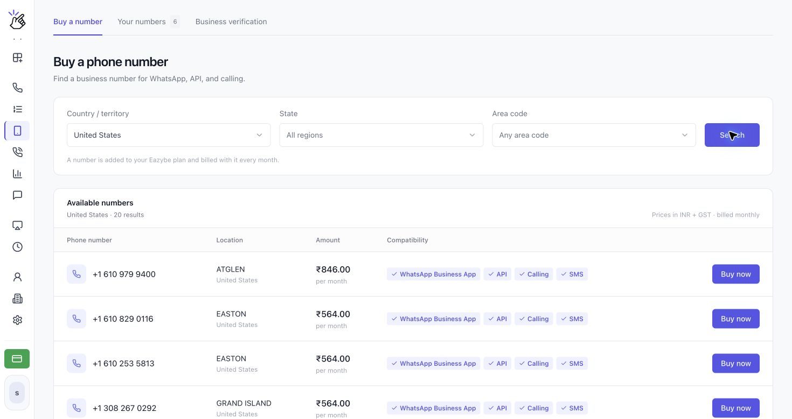
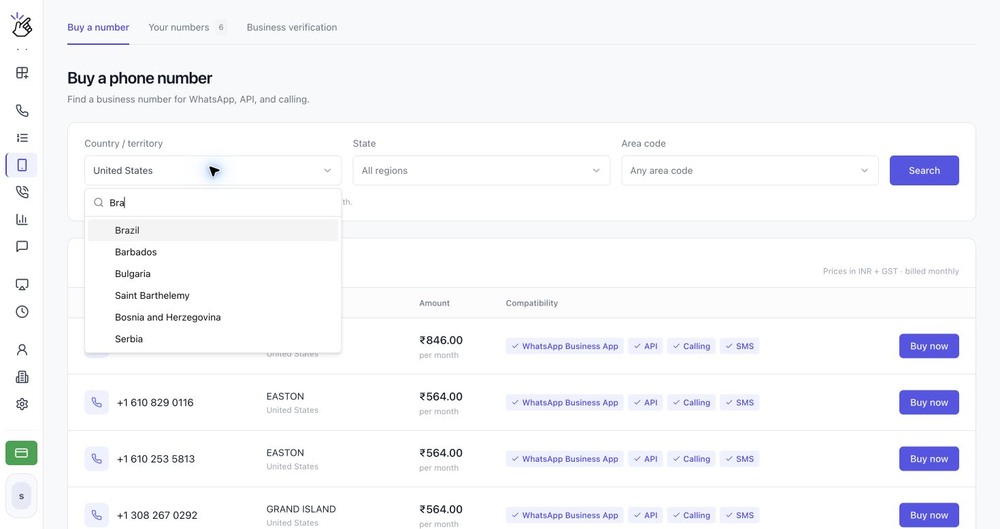
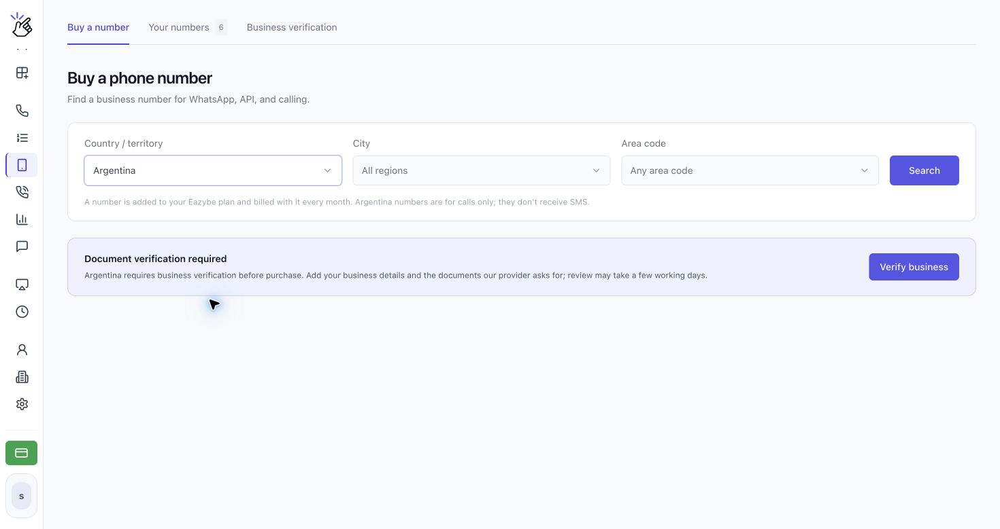
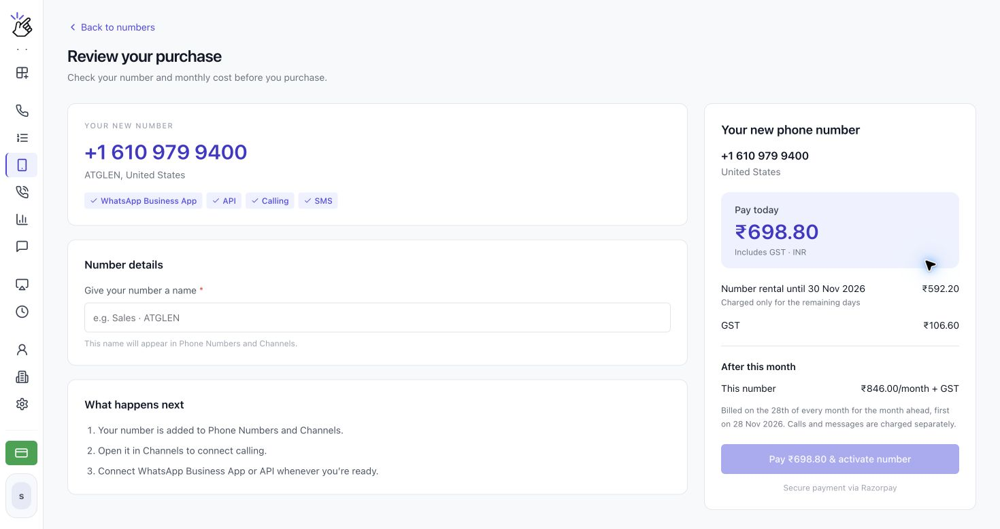

Use **Phone Numbers** para comprar um número de voz comercial no Brasil e em outros países disponíveis e gerenciar os números da sua organização. Nos países que exigem verificação da empresa, você precisa da aprovação antes de comprar.

## Escolher um país

O seletor **Country / territory** agora inclui Brasil, Chile, Colômbia, México, Argentina e muitos outros países, além de Estados Unidos, Canadá, Porto Rico e Ilhas Virgens Americanas. Pesquise seu país no seletor para consultar as opções atuais.

<Note>A presença de um país no seletor não garante números disponíveis. Os requisitos de verificação e a disponibilidade variam conforme o país. Siga os requisitos exibidos para sua seleção.</Note>

## Comprar um número

<Steps>
  <Step title="Abra Phone Numbers">
    Abra **Phone Numbers** em **CALLS** e selecione **Buy a number**. As outras abas são **Your numbers** e **Business verification**.

    
  </Step>
  <Step title="Escolha o país e a localização">
    Abra **Country / territory** e pesquise um país, como **Brazil**. Selecione **City** ou **State** e **Area code** quando disponíveis e clique em **Search**. Mantenha **All regions** e **Any area code** selecionados para ampliar a pesquisa.

    

    <Note>Se aparecer **No numbers available here today**, tente outro código de área ou pesquise em todas as regiões. Se as regiões não carregarem, você ainda pode pesquisar no país inteiro.</Note>
  </Step>
  <Step title="Conclua a verificação da empresa, se necessário">
    Se aparecer **Document verification required**, clique em **Verify business**. Siga o guia [Verificar sua empresa](/pt/voice-number/business-verification) para informar seus dados, enviar os documentos solicitados e submetê-los à análise. Você também pode começar por **Business verification → Verify a new country**.

    Se já iniciou o processo, o botão pode exibir **Continue verification**, **View details**, **Fix and resubmit** ou **Update documents**. Volte para comprar um número após a aprovação.

    

    <Note>A verificação é específica para cada país. A aprovação em um país não verifica sua empresa em todos os outros. Não há cobrança até você comprar um número.</Note>
  </Step>
  <Step title="Compare os números disponíveis">
    Os resultados mostram **Phone number**, **Location**, **Amount** e **Compatibility**. Confira os recursos do número desejado e clique em **Buy now** para abrir **Review your purchase**.

    

    <Warning>Números do Brasil e de outros países identificados como exclusivos para chamadas não recebem SMS. Para verificar esses números no WhatsApp, use uma ligação em vez de solicitar um código por SMS.</Warning>
  </Step>
  <Step title="Revise o preço e ative seu número">
    Em **Review your purchase**, confira o número, o país e a compatibilidade. Em **Number details**, digite um nome em **Give your number a name**. Esse nome aparece em Phone Numbers e Channels.

    Confira **Pay today**, **Number rental until**, qualquer **GST** e **After this month**. Quando estiver pronto para comprar, clique em **Pay … & activate number**, cujo botão mostra o total. Siga o fluxo de pagamento exibido para sua conta.

    

    <Warning>A ativação é uma compra paga com aluguel recorrente. O pagamento pode cobrar seu cartão salvo ou abrir um provedor de pagamentos. Confirme o total, o período de aluguel e o calendário de renovação antes de continuar. Chamadas e mensagens são cobradas separadamente; os preços nas capturas são exemplos, não uma cotação para sua conta.</Warning>
  </Step>
  <Step title="Consulte Your numbers">
    Abra **Your numbers** para ver o nome, o país, o valor mensal e as datas de compra e renovação de cada número. Use **View in Channels** para abrir as configurações do canal. **More actions** inclui **Verification code** e, para gestores, **Cancel subscription**.

    
  </Step>
</Steps>

<Warning>Um número cancelado fica disponível até o fim do período pago; depois, é liberado e não pode ser recuperado. Cancele antes do dia 28 para evitar a próxima cobrança mensal.</Warning>

## Conectar o WhatsApp ao seu número de voz

Você pode usar um número comprado com o **aplicativo WhatsApp Business** ou a **API do WhatsApp** quando a compatibilidade do número indicar essa opção. O método de verificação depende de o número receber SMS. A verificação da empresa para comprar um número é separada da verificação desse número no WhatsApp.

### Conectar o aplicativo WhatsApp Business

1. Instale e abra o **WhatsApp Business** no seu celular.
2. Inicie a configuração da conta e informe o número de voz exibido na Eazybe, incluindo o código do país.
3. Se o número aceitar SMS, solicite o código por SMS e encontre-o em [**SMS na Eazybe**](https://app.eazybe.com/calls/sms). Para um número exclusivo para chamadas, como os do Brasil, escolha **Call me** quando o WhatsApp oferecer essa opção.
4. Ao usar **Call me**, mantenha o telefone da Eazybe ligado, atenda à chamada do WhatsApp nesse número e anote o código lido em voz alta.
5. Volte ao WhatsApp Business e digite o código para concluir a verificação.

### Conectar a API do WhatsApp

1. Abra **Channels** na Eazybe e selecione **Add channel**.
2. Escolha **WhatsApp** para continuar na Meta, faça login e siga as instruções de configuração.
3. Informe o número de voz exibido na Eazybe. Solicite a verificação por SMS se o número aceitar SMS ou por ligação se for exclusivo para chamadas.
4. Leia o código em [**SMS na Eazybe**](https://app.eazybe.com/calls/sms) ou mantenha o telefone da Eazybe ligado e atenda à ligação de verificação para ouvir o código.
5. Volte à Meta, digite o código e conclua a conexão.

### Se o WhatsApp mostrar “Login not available right now”

O WhatsApp pode bloquear temporariamente o login por segurança. Se essa mensagem aparecer, conecte a VPN ao país onde comprou o número de voz e tente entrar novamente. Por exemplo, use uma VPN dos Estados Unidos para um número americano ao se conectar da Índia. Depois da nova tentativa, solicite outro código por SMS ou ligação, conforme os recursos do número, e digite-o no WhatsApp Business ou na Meta.

<Warning>A localização da VPN deve corresponder ao país do número comprado. Solicite um novo código após mudar a conexão, pois o anterior pode expirar.</Warning>
