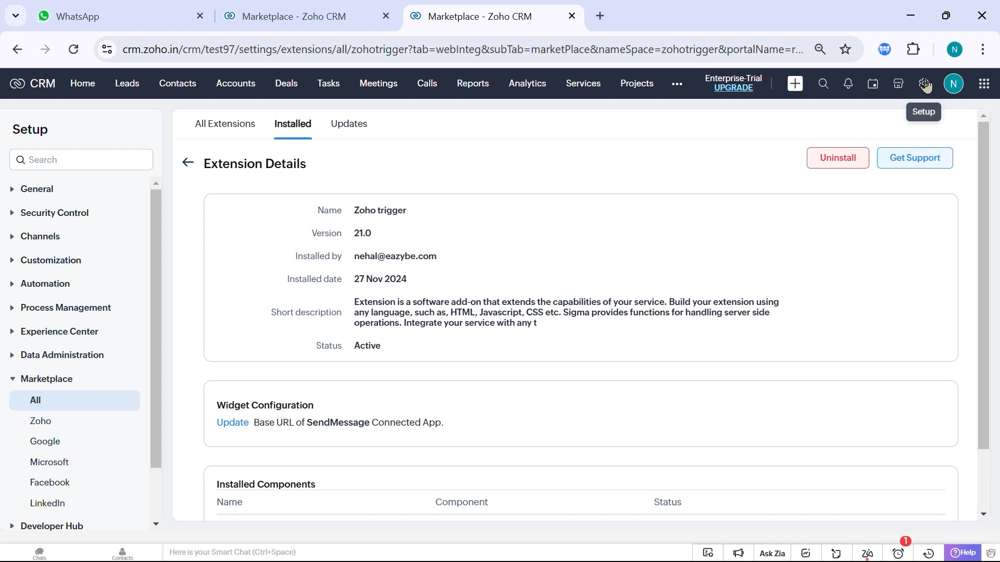
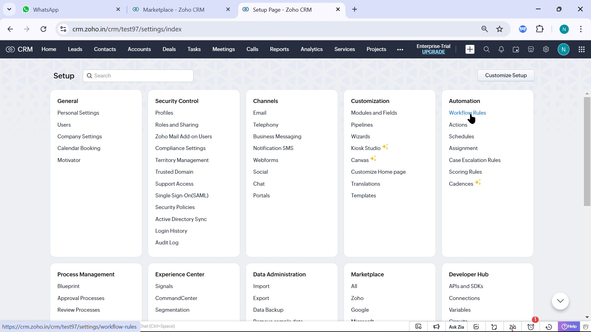
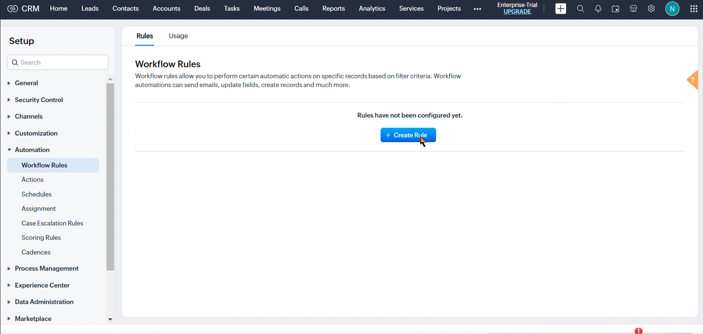
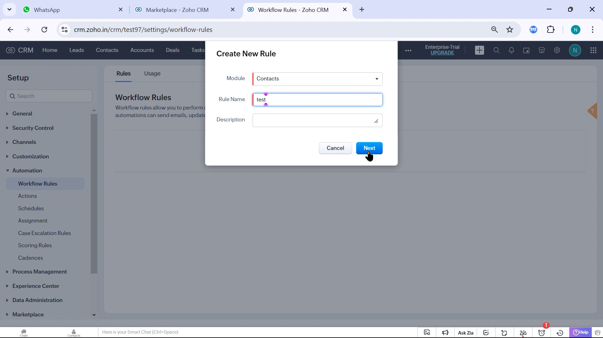
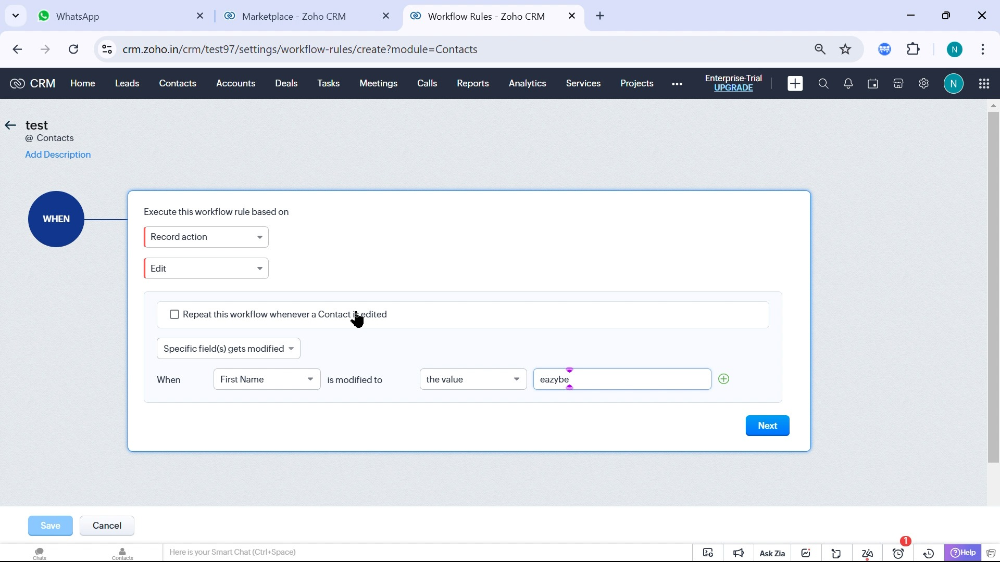
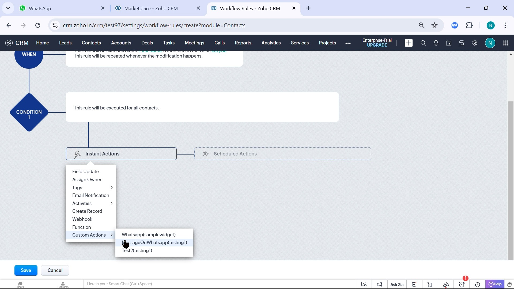
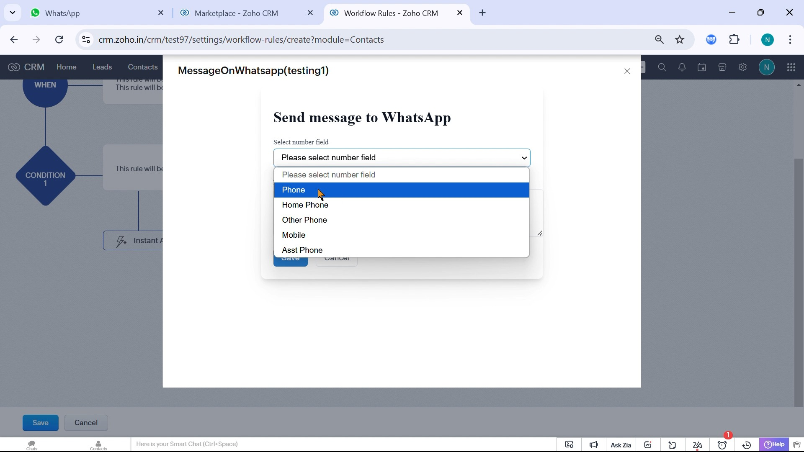

Crie um fluxo de trabalho que envie uma mensagem quando um contato, lead ou outro registro atender às condições definidas.

## Antes de Começar

Você precisa de permissão para criar regras, **Zoho trigger** instalado e **Active**, conta Zoho conectada ao Eazybe e número do destinatário com código internacional. O proprietário do registro deve ter a extensão ou o aplicativo Eazybe instalado e uma conexão ativa com o WhatsApp.

<Warning>A integração de fluxos de trabalho está disponível no **Plano Scalar**. As mensagens são enviadas pelo número de WhatsApp do proprietário do contato ou lead. Defina o proprietário correto antes da execução.</Warning>

<Steps>
  <Step title="Confirmar que o Zoho trigger está ativo">
    Abra **Setup → Marketplace → All → Installed**, selecione **Zoho trigger** e confirme **Status: Active**.

    Se necessário, [instale Zoho trigger e Team Inbox](https://crm.zoho.com/market/installPrivatePlugin.do?portalName=rajatverma&nameSpace=zohotrigger&versionIndex=4520363000000438001). O mesmo pacote inclui a ação de fluxo de trabalho e as caixas de entrada dos Contatos/Leads e geral. Veja as [etapas de instalação](/pt/integrations/zoho/team-inbox#instalar-o-pacote).

    
  </Step>
  <Step title="Abrir as regras de fluxo de trabalho">
    Em **Setup**, abra **Automation → Workflow Rules**.

    
  </Step>
  <Step title="Criar uma regra">
    Clique em **Create Rule** para abrir **Create New Rule**.

    
  </Step>
  <Step title="Escolher o módulo e nomear a regra">
    Selecione **Module**, como **Contacts** ou **Leads**. Preencha **Rule Name**, adicione uma descrição se necessário e clique em **Next**. O campo de telefone e o proprietário virão desse módulo.

    
  </Step>
  <Step title="Definir quando executar">
    Em **Execute this workflow rule based on**, escolha o evento, por exemplo **Record action → Edit**. Defina os campos e valores das condições e clique em **Next**.

    <Warning>Ative a execução repetida apenas se quiser enviar outra mensagem quando o registro voltar a atender à condição. Caso contrário, você poderá enviar duplicatas.</Warning>

    
  </Step>
  <Step title="Adicionar a ação de WhatsApp">
    Abra **Instant Actions → Custom Actions** e selecione **MessageOnWhatsapp** do Eazybe. O Zoho pode mostrar o namespace da extensão entre parênteses.

    
  </Step>
  <Step title="Escolher o destinatário e escrever a mensagem">
    Em **Send message to WhatsApp**, abra **Select number field** e escolha o campo do destinatário, como **Phone** ou **Mobile**. Digite a mensagem e clique em **Save**. Salve o número com código internacional para evitar falhas ou destinatários incorretos.

    
  </Step>
</Steps>

## Ativar e Verificar

Revise o evento, as condições e a ação. Clique em **Save** para ativar a regra e atualize um registro de teste para atender às condições. Confirme que o destinatário correto recebe a mensagem do número do proprietário e que a regra executa apenas quando deve.

<Info>Os arquivos de mídia anexados não podem exceder **15 MB**.</Info>

Se a ação não aparecer, confira a instalação e conexão do Zoho trigger. Se a mensagem não chegar, revise a conexão do proprietário e o campo do número. Se houver duplicatas, confira a execução repetida. Consulte [Solução de problemas do fluxo de trabalho](/pt/integrations/zoho/troubleshoot-workflow).
