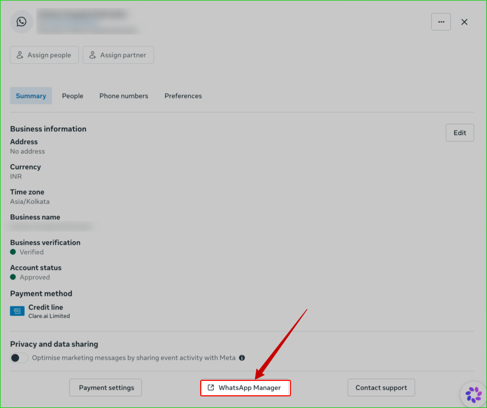
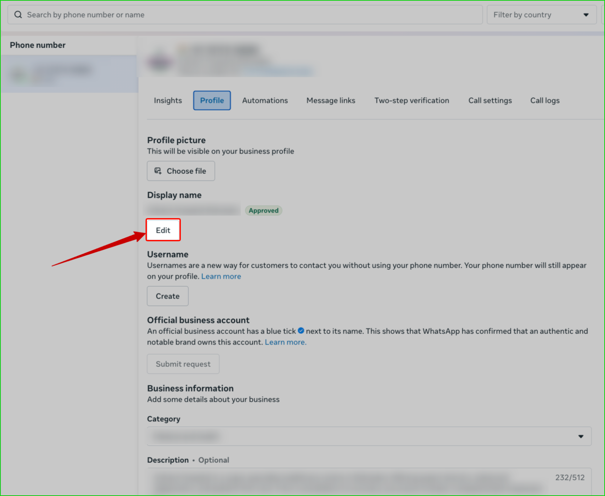
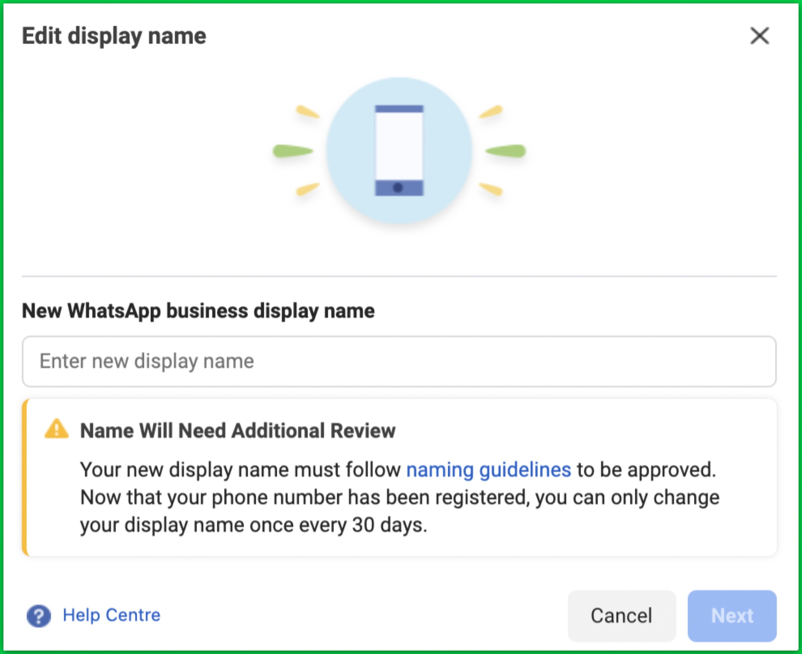
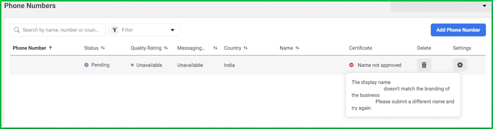
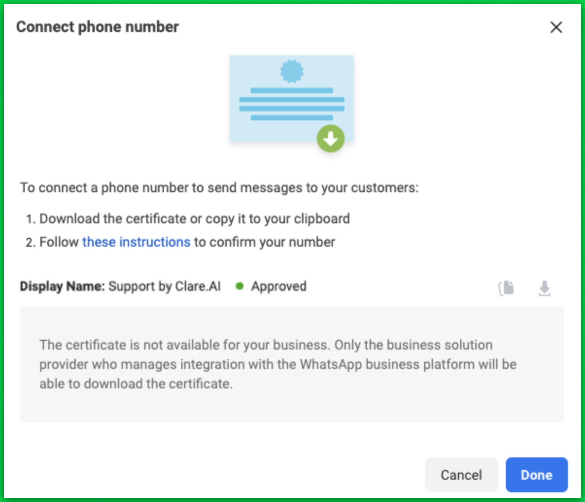

Use o WhatsApp Manager para solicitar um novo nome para o número do WhatsApp conectado à Eazybe. A Meta precisa aprovar a solicitação antes que você possa usar o novo nome.

<Note>
As capturas mostram a Meta em inglês. Sua interface pode ser diferente; os dados da conta são exemplos.
</Note>

<Steps>
  <Step title="Abra o WhatsApp Manager">
    Entre no [Meta Business Manager](https://business.facebook.com/), selecione sua conta empresarial do WhatsApp e abra o **WhatsApp Manager**.

    
  </Step>
  <Step title="Selecione seu número de telefone">
    Encontre o número correto em **Phone numbers** (Números de telefone) e selecione o ícone de configurações.

    
  </Step>
  <Step title="Edite o nome do perfil">
    Abra **Profile** (Perfil) e selecione **Edit** (Editar) abaixo de **Display name** (Nome de exibição).

    
  </Step>
  <Step title="Envie o novo nome">
    Digite o nome em **New WhatsApp business display name**, selecione **Next** (Avançar) e conclua o envio para análise. Leia as diretrizes de nomes e as restrições de alteração exibidas.

    
  </Step>
</Steps>

## Consulte o resultado da análise

Volte ao perfil do número no WhatsApp Manager para consultar a análise do nome. Uma análise pendente ainda aguarda uma decisão. **Approved** (Aprovado) significa que a Meta aceitou o nome; **Name not approved** (Nome não aprovado) indica que você precisa alterá-lo.

## Se o nome for rejeitado

Leia o motivo da rejeição, corrija o nome e use **Edit** para enviar outra solicitação. Por exemplo, a captura abaixo mostra um nome que não corresponde à marca da empresa. Um novo envio inicia outra análise.

## Após a aprovação

Verifique se o nome aprovado aparece no seu número conectado. Se ele não aparecer, ou se a Meta solicitar um certificado ou registro, entre em contato com o [Suporte da Eazybe](mailto:support@eazybe.com) e envie seu número e uma captura do status para receber orientação.

## Perguntas frequentes

### Quanto tempo leva a análise?

Aguarde a análise da Meta. Consulte o resultado mais recente no WhatsApp Manager; a aprovação não é imediata e os prazos podem variar.

### Onde consulto a aprovação?

Use o status do nome no WhatsApp Manager. O status de conexão do número é separado da aprovação do nome.

### Preciso baixar um certificado?

Algumas interfaces da Meta exibem uma janela de certificado, como no exemplo acima. Se ela aparecer, pergunte ao Suporte da Eazybe qual etapa se aplica à sua conexão.

## Guia relacionado

[Verificar sua empresa na Meta](/pt/waba/facebook-business-verification)
