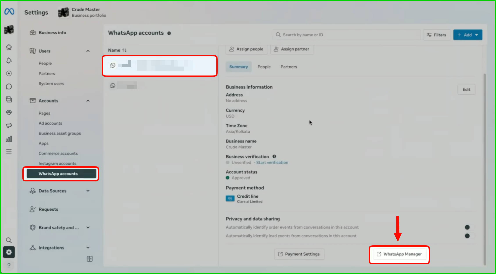

## O que a Classificação Significa

- A classificação de qualidade do número da Meta reflete o feedback recente dos clientes, incluindo bloqueios e denúncias, nos últimos sete dias.
- **High (alta, verde):** Mantenha o foco em mensagens relevantes.
- **Medium (média, amarela):** Revise o público, o conteúdo e a frequência.
- **Low (baixa, vermelha):** Investigue rapidamente o feedback negativo e confira os alertas da Meta.

## Como Consultar Sua Classificação

1. Abra o [Meta Business Suite](https://business.facebook.com/) e selecione seu portfólio empresarial.
2. Acesse **Settings > Accounts > WhatsApp accounts** e selecione sua conta.
3. Clique em **WhatsApp Manager**. Se não conseguir acessar, peça ao administrador da empresa que revise suas permissões.

4. Abra **Phone numbers** e localize o número usado nas transmissões do Eazybe.
5. Confira **Quality rating** ao lado de **Status**.

<Note>
  Estas capturas mostram a interface da Meta. Os nomes das contas e a disposição dos menus podem ser diferentes na sua conta.
</Note>

## O que Fazer se a Qualidade Cair

1. **Revise as campanhas recentes:** Consulte falhas e cancelamentos nas [análises de transmissão](/pt/broadcasts/view-analytics) do Eazybe. Anote o público e o modelo usados antes da queda; isso ajuda a investigar, mas não comprova uma causa.
2. **Confira o consentimento:** Remova clientes que cancelaram o recebimento e evite enviar para pessoas que não esperam suas atualizações.
3. **Melhore a relevância:** Restrinja o público e adapte a mensagem aos seus interesses.
4. **Reduza a frequência excessiva:** Coordene as campanhas e dê uma pausa aos clientes que não interagem.
5. **Revise os alertas da Meta:** Resolva problemas da conta ou do modelo e monitore a classificação após mudar sua abordagem.

Consulte a lista completa em [Melhorar a entrega de transmissões](/pt/waba/improve-broadcast-deliverability).

## Diferencie Estas Verificações

- **Qualidade do número:** Feedback associado ao seu número de envio.
- **Status do modelo:** Indica se o modelo está aprovado e disponível. Consulte as [diretrizes para modelos](/pt/waba/templates/guideline).
- **Status da conexão:** Um número conectado ainda pode ter problemas de entrega. Revise os erros separadamente.
- **Limites de mensagens:** Confira a capacidade atual no WhatsApp Manager. Os limites se aplicam ao portfólio empresarial.

## Confira Também a Qualidade do Modelo

- **A qualidade do modelo é diferente da qualidade do número de telefone.** A Meta avalia cada modelo com base no uso, no feedback dos clientes e no engajamento, incluindo taxas de leitura.
- No WhatsApp Manager, abra [Manage templates](https://business.facebook.com/latest/whatsapp_manager/message_templates) para conferir o modelo que pretende enviar.
- Modelos aprovados podem mostrar **Quality pending** (qualidade pendente), **High quality** (alta), **Medium quality** (média) ou **Low quality** (baixa). Novos modelos começam com uma classificação pendente, atualizada conforme a Meta coleta dados.
- Uma qualidade média ou baixa pode colocar o modelo em risco de pausa ou desativação. Revise o feedback e melhore a mensagem antes de ampliar seu uso.
- A qualidade pode afetar o ritmo de envio e as pausas do modelo. Se perder o status **Approved**, ele não poderá ser enviado até recuperar esse status.

**Referência oficial:** [Meta — Classificação de qualidade dos modelos](https://developers.facebook.com/documentation/business-messaging/whatsapp/templates/template-quality). Esta orientação trata de modelos individuais; use a visualização **Phone numbers** descrita acima para consultar a qualidade do número de envio.

## Perguntas Frequentes

### Uma qualidade alta garante a entrega?

Não. Confira as falhas por destinatário nas [análises de transmissão](/pt/broadcasts/view-analytics) mesmo quando a qualidade for alta.

### Aumentar meu lance corrigirá uma qualidade baixa?

O limite de lance controla o preço máximo de entrega. Ele não deve ser tratado como uma forma de corrigir o feedback negativo dos clientes. Revise primeiro a relevância do público e a frequência; consulte [Preço máximo de lance](/pt/waba/templates/max-bidding-price) para entender os preços.

### O que devo compartilhar com o suporte?

Envie para [support@eazybe.com](mailto:support@eazybe.com) o número de envio, classificação atual, alerta relevante da Meta, nome da campanha e motivos das falhas. Inclua uma captura da classificação e oculte dados da conta que não sejam relevantes.
