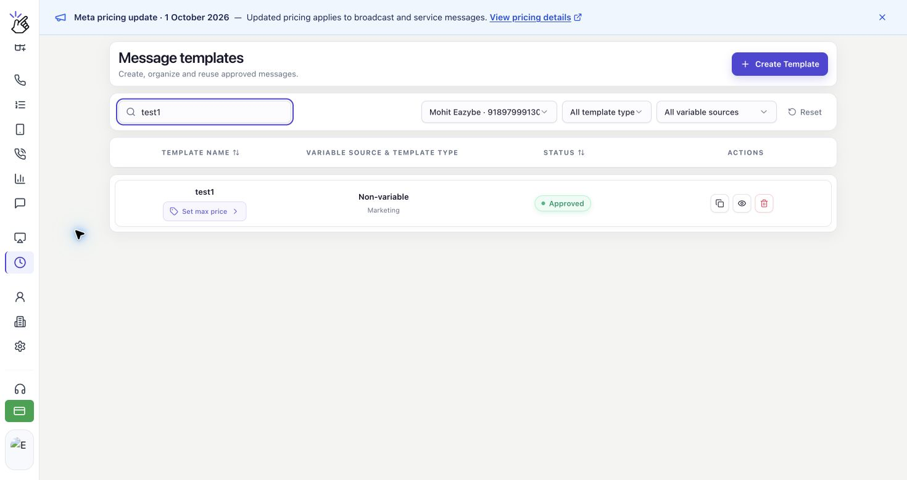
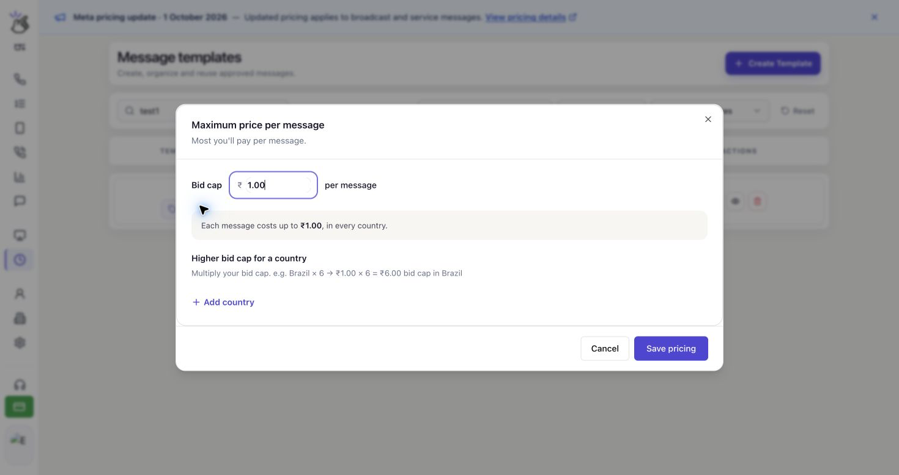
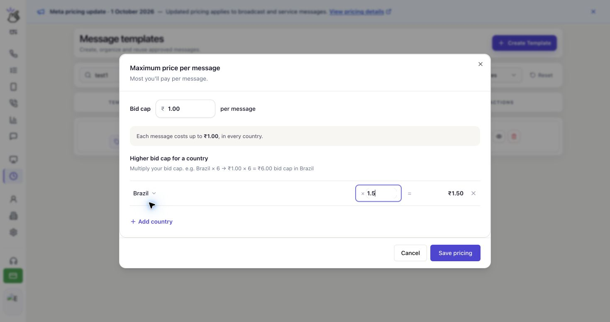

Defina quanto você está disposto a pagar, no máximo, por cada mensagem de marketing entregue no WhatsApp. Salve esse limite de lance (**Bid cap**) no modelo de mensagem e use o modelo na sua transmissão.

## Como Funciona o Preço Máximo

O limite se aplica a cada mensagem entregue; não é o orçamento total da campanha nem uma cobrança fixa. O custo real pode ser menor, e definir um limite não garante a entrega.

Você pode usar o mesmo limite para todos os países ou ajustá-lo por país com um multiplicador. Países sem ajustes mantêm o limite base.

<Note>
  O preço máximo está disponível para modelos de **Marketing** em contas do WhatsApp elegíveis com o MM Lite ativado. Apenas **INR (rupias indianas)** e **USD (dólares americanos)** são aceitos. Modelos de utilidade e autenticação não têm essa configuração.
</Note>

## Configurar o Limite do Modelo

<Warning>
  O limite de ₹1.00 e o multiplicador para o Brasil mostrados abaixo são exemplos, não preços recomendados. Escolha os valores para sua campanha e confira a moeda da sua conta.
</Warning>

As capturas mostram a interface em inglês. Mantivemos os nomes dos controles para que você possa encontrá-los na tela.

<Steps>
  <Step title="Abra os preços do seu modelo de marketing">
    Abra **Templates** na barra lateral do Eazybe. Em **Message templates**, escolha seu número do WhatsApp e use **Search templates** para encontrar o modelo.

    Clique em **Set max price** abaixo do nome. Se o modelo já tiver um limite, clique em **Max … / delivery** para revisá-lo ou alterá-lo.

    

    <Note>
      O modelo precisa estar com o status **Approved** antes de ser usado em uma transmissão.
    </Note>
  </Step>

  <Step title="Insira o limite de lance">
    Em **Maximum price per message**, insira um valor positivo em **Bid cap**. Esse é o preço de uma mensagem entregue, na moeda indicada ao lado do campo.

    - **INR:** Insira o valor em rupias indianas. Por exemplo, **1.00** define um limite de **INR 1.00** por mensagem entregue.
    - **USD:** Insira o valor em dólares americanos. Por exemplo, **1.00** define um limite de **USD 1.00** por mensagem entregue.

    O resumo abaixo do campo é atualizado enquanto você digita.

    

    <Note>
      O texto de exemplo **1.00** no campo não é um preço salvo. Insira seu próprio valor antes de salvar. Não é necessário converter o valor para um preço por 1.000 mensagens.
    </Note>
  </Step>

  <Step title="Ajuste o limite por país se necessário">
    Pule este ajuste para manter o mesmo limite em todos os países. Para definir outro limite em um destino, clique em **Add country**, abaixo de **Higher bid cap for a country**.

    Selecione o país e insira um multiplicador no campo ao lado de **×**. O valor após **=** é o limite resultante para esse país.

    

    Com um limite base de ₹1.00, **1.5** define um limite de ₹1.50 para o Brasil. Um multiplicador de **1** mantém o limite base; um valor abaixo de **1**, como **0.8**, o reduz.

    Os multiplicadores devem ser maiores que **0** e não ultrapassar **10**. Você pode adicionar até **50** países. Clique no botão **×** no final de uma linha para remover o ajuste desse país e voltar a usar o limite base.

    <Warning>
      Um multiplicador acima de 1 aumenta o valor máximo permitido por entrega nesse país. Confira o valor calculado antes de salvar.
    </Warning>
  </Step>

  <Step title="Revise e salve os preços">
    Confira **Bid cap** e o valor de cada país. Clique em **Save pricing** e aguarde a confirmação: **Pricing saved. Refresh before sending a campaign.**

    

    Clique em **Cancel** para fechar sem salvar as alterações. Salvar os preços atualiza o modelo; não envia uma transmissão.

    <Warning>
      Essa configuração pertence ao modelo e pode afetar as transmissões que o utilizam. Evite alterar os preços enquanto transmissões com esse modelo estiverem sendo enviadas.
    </Warning>
  </Step>
</Steps>

## Antes de Enviar uma Transmissão

Siga o guia [Criar uma nova transmissão](/pt/broadcasts/create-broadcast) para escolher o número de envio, o modelo aprovado e os destinatários.

Para um modelo com preço máximo, confira **Marketing delivery pricing** e clique em **Refresh pricing** para carregar as configurações atuais. Após selecionar os destinatários, **Maximum Meta delivery cost** mostra o custo máximo de entrega para esse público. O detalhamento por país mostra a quantidade de destinatários, o preço máximo por entrega e o custo máximo por país.

<Warning>
  Um custo máximo ou uma estimativa não é a cobrança final. Para mensagens com preço máximo, os débitos da carteira são acertados quando a Meta informa o custo de entrega. Se o custo ainda não chegou, ele está pendente; isso não significa entrega gratuita. Não some **Estimated wallet deduction** e **Maximum Meta delivery cost**: são visões separadas, não duas cobranças a serem somadas.
</Warning>

## Perguntas Frequentes

### Por que não consigo definir um preço máximo?

Confira se você selecionou o número correto do WhatsApp e um modelo de **Marketing**. O editor só está disponível quando sua conta, provedor e moeda oferecem suporte a preços máximos. Se aparecer **Maximum pricing changes are unavailable for this account, provider, or currency.**, você não pode alterar o limite para essa seleção.

Se aparecer **Pricing is unavailable.**, clique em **Retry** para recarregar os preços.

### Por que meu valor não é salvo?

Use um número decimal positivo, sem símbolo de moeda no campo. Se o preço tiver mais casas decimais do que sua conta aceita, insira um valor com menos casas decimais e tente novamente. Os multiplicadores por país devem ser maiores que 0 e no máximo 10.

### E se os preços mudarem depois de preparar uma transmissão?

O Eazybe verifica os preços do modelo novamente antes de enviar. Se houver alterações, as mensagens afetadas não são enviadas com as configurações antigas. Confira o preço atualizado e crie uma nova transmissão se o Eazybe solicitar que você recrie a campanha.

### E se o preço for salvo, mas a sincronização falhar?

Se aparecer **Saved at Meta. Local pricing synchronization failed; refresh before sending.**, o preço foi salvo na Meta. Atualize os preços do modelo e confira os valores antes de preparar uma transmissão.

### Um limite maior garante mais entregas?

Não. Um limite maior permite um preço mais alto por entrega, mas não garante que todos os destinatários recebam a mensagem.
