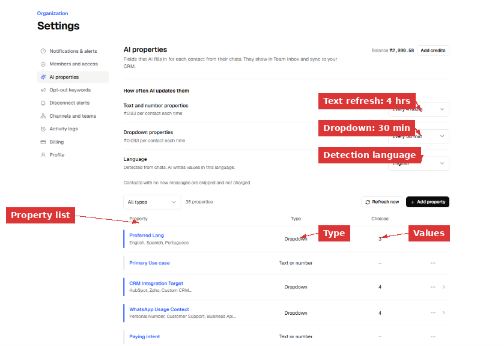
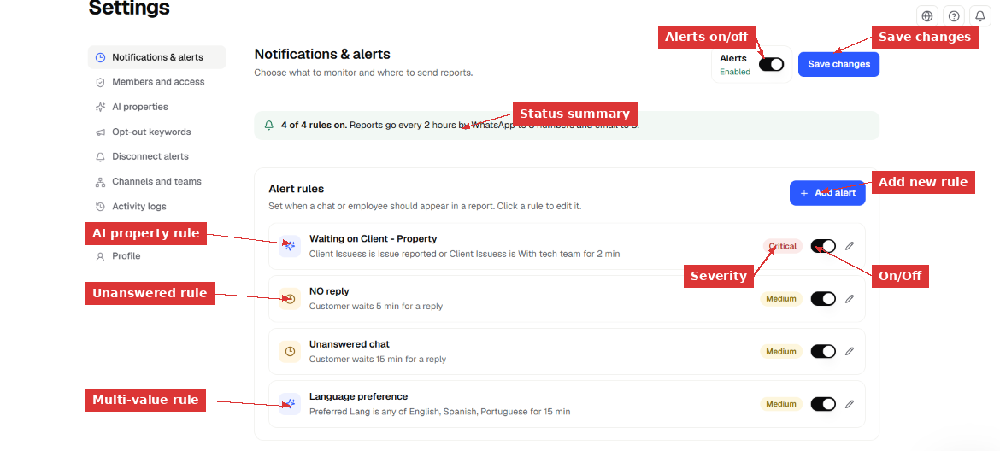
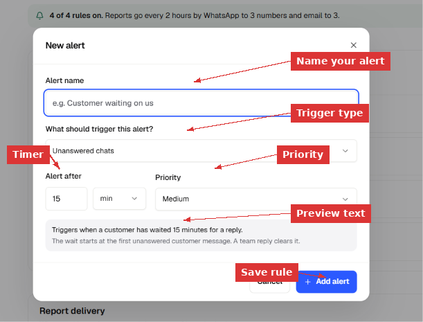
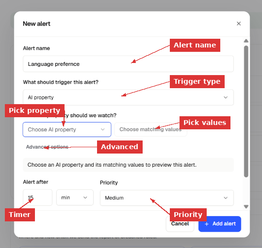
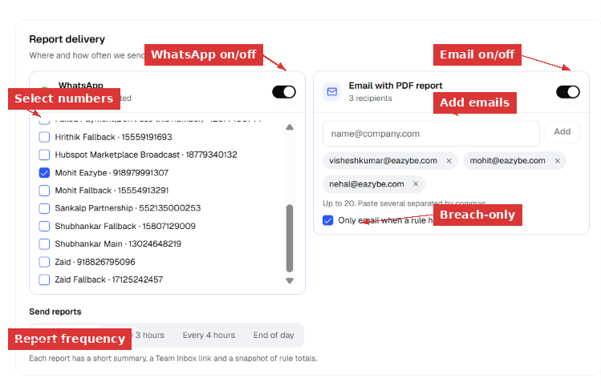

> **Documentation Directory**
> Before exploring individual pages, see the full index at [https://help.eazybe.com/llms.txt](https://help.eazybe.com/llms.txt) for all available topics.

# Notifications & Alerts

> Set alert rules so you know the moment a customer waits too long, a conversation sits in the wrong state, or a team member goes quiet. Eazybe checks every rule continuously and sends a report to your WhatsApp and email when something needs attention.

Notifications & alerts is the control center for response-time monitoring across your workspace. You define rules — Eazybe watches your chats around the clock and tells you when something crosses the line.

---

## What Are Alert Rules?

An alert rule is a condition plus a timer. When the condition stays true longer than the timer, the conversation (or employee) appears in the next scheduled report.

Eazybe supports two types of triggers:

### Unanswered chats
Watches for customer messages that have received no team reply. The timer starts at the first unanswered customer message. It clears the moment any team member replies. Additional messages from the customer do **not** restart the timer — the clock keeps running from the original unanswered message.

**Example:** "Customer waits 15 min for a reply" — if a customer sends a message at 2:00 PM and nobody replies by 2:15 PM, this chat appears in the report.

### AI property
Watches a specific AI property value on a conversation. The timer starts when the property takes the matching value and runs as long as it stays that way. When the property changes to something else, the timer resets.

**Example:** "Client Issuess is Issue reported for 2 min" — any conversation where the AI has detected an issue and it stays unaddressed for 2 minutes gets flagged.

You can watch a **single value** (e.g., Conversation State is "Waiting on Client") or **multiple values** (e.g., Preferred Lang is any of English, Spanish, Portuguese).

> [!NOTE]
> Only **dropdown** AI properties can be used in alert rules. Text and number properties are not supported yet. You can see which properties are dropdowns in **Settings → AI Properties**.

---

## Understanding AI Properties

AI properties are fields that Eazybe's AI fills in automatically for each conversation based on what is discussed in the chat. They appear in Team Inbox and sync to your CRM.

To see your workspace's AI properties:

1. Go to **Settings → AI Properties**.
2. You will see a list of all available properties, their type (Dropdown or Text/Number), and how many values each has.

*Settings → AI Properties shows every field the AI fills in. Dropdown properties (like "Preferred Lang" with 3 choices) can be used in alert rules. Text/Number properties (like "Primary Use case") cannot be used in rules yet.*

### How often properties update

AI properties are not instant — they refresh on a schedule:

| Property type | Refresh rate | Cost |
|---|---|---|
| **Dropdown** properties | Every 30 minutes | ₹0.093 per contact per refresh |
| **Text and number** properties | Every 4 hours | ₹0.93 per contact per refresh |

Contacts with no new messages since the last refresh are skipped and not charged.

> [!IMPORTANT]
> Because dropdown properties refresh every 30 minutes, an alert rule with a 2-minute timer may not fire exactly at 2 minutes. The state change is only detected at the next refresh. For precise alerting, use timers longer than your refresh interval. A 2-minute rule is useful for catching issues that have been sitting for at least one refresh cycle.

---

## Setting Up Alert Rules

### Step 1: Open the alerts page

Go to **Settings** in the left sidebar, then click **Notifications & alerts**.

You will see:
- An **Alerts** toggle (top right) — this must be **Enabled** for rules to work.
- A **summary bar** showing how many rules are active, report frequency, and delivery channels.
- Your **alert rules list** — each rule shows its name, description, severity, on/off toggle, and an edit button.

*The Notifications & alerts page. The summary bar at the top shows "4 of 4 rules on" with report delivery details. Each rule card shows the trigger condition, timer, severity badge, on/off toggle, and edit pencil.*

### Step 2: Create a new alert

Click **+ Add alert** (top right of the Alert rules section). A dialog opens.

#### Creating an Unanswered chat alert

1. Enter an **Alert name** — something descriptive like "Customer waiting 15 min" or "No reply 5 min".
2. Under **"What should trigger this alert?"** — select **Unanswered chats**.
3. Set **Alert after** — the number of minutes (or hours) a customer can wait before this rule fires. For example: 15 min.
4. Set **Priority** — Critical, High, Medium, or Low. This controls how the rule appears in reports.
5. Review the **preview text** at the bottom — it explains exactly when this rule triggers and what clears it.
6. Click **+ Add alert**.

*Creating an Unanswered chats alert. The preview at the bottom confirms: "Triggers when a customer has waited 15 minutes for a reply. The wait starts at the first unanswered customer message. A team reply clears it."*

#### Creating an AI property alert

1. Enter an **Alert name** — for example "Waiting on Client - Property" or "Language preference".
2. Under **"What should trigger this alert?"** — select **AI property**.
3. Under **"Which AI property should we watch?"** — pick a dropdown property from the list (e.g., Conversation State, Preferred Lang, Client Issues).
4. Click **Choose matching values** — select one or more values. For example, select "Waiting on Client" from Conversation State, or select "English, Spanish, Portuguese" from Preferred Lang.
5. Optionally expand **Advanced options** for additional configuration.
6. Set **Alert after** — how long the property must stay in the matching state.
7. Set **Priority**.
8. Click **+ Add alert**.

*Creating an AI property alert. Select the property to watch, choose which values trigger the alert, and set how long the condition must hold before firing.*

> [!NOTE]
> **Single value vs. multiple values:**
> - Single value (e.g., Conversation State **is** "Waiting on Client") — the rule fires when the conversation has exactly this state.
> - Multiple values (e.g., Preferred Lang **is any of** English, Spanish, Portuguese) — the rule fires when the conversation matches any one of the selected values. This is useful for monitoring a group of related states.

### Step 3: Configure each rule

After creating rules, you can manage them from the main page:

- **Toggle on/off** — the switch next to each rule enables or disables it without deleting it.
- **Edit** — click the pencil icon to change the name, timer, priority, or conditions.
- **Severity badges** — Critical (red), High (orange), Medium (yellow), Low (blue) help you visually prioritize.

The **summary bar** updates automatically: "4 of 4 rules on. Reports go every 2 hours by WhatsApp to 3 numbers and email to 3."

---

## Configuring Report Delivery

Scroll down below the alert rules to the **Report delivery** section. This is where you set up how and when breached rules are sent to your team.

*Report delivery configuration. WhatsApp and email can be enabled independently. The frequency tabs control how often reports are sent.*

### WhatsApp reports

1. Toggle **WhatsApp** on.
2. Select which connected WhatsApp numbers should receive the report. Check the boxes next to the numbers you want.
3. Reports are sent as either a normal text message (if the messaging window is open) or the `sla_notice` template (if the window is closed — the recipient taps "Send report" to receive the full text).

### Email reports

1. Toggle **Email with PDF report** on.
2. Enter email addresses in the **Email recipients** field and click **Add**. You can add up to 20 recipients. Paste multiple addresses separated by commas.
3. Check **"Only email when a rule has breached"** — this is recommended so you don't receive empty reports when everything is fine.

Each email includes:
- A short summary of total breaches
- A Team Inbox link to view the breaching conversations
- A PDF attachment with rule totals and sampled conversation entries

### Report frequency

Choose how often reports are delivered:

| Frequency | Best for |
|---|---|
| **Every 2 hours** | High-traffic teams that need frequent updates |
| **Every 3 hours** | Standard monitoring |
| **Every 4 hours** | Lower-traffic teams |
| **End of day** | Daily digest — one report at the end of the working day |

> [!IMPORTANT]
> **Timer vs. frequency:** The timer on each rule (e.g., "15 min") controls when a conversation **qualifies** as breached. The frequency (e.g., "Every 2 hours") controls when the **report is sent**. A conversation can breach after 15 minutes but only appear in the next scheduled report up to 2 hours later. For faster awareness, use shorter frequency intervals.

### Save your changes

After setting up rules and delivery, click **Save changes** (top right). Refresh the page to confirm everything persisted.

---

## Viewing Breached Rules in Team Inbox

Once alert rules are active and conversations start breaching them, you can see the results in Team Inbox.

1. Open **Team Inbox** from the left sidebar.
2. Scroll to the bottom of the left panel — find the **Over SLA** section.
3. Each active rule appears with a **live count** of how many conversations are currently breaching it.
4. Click on a rule name to **filter the chat list** — only conversations matching that rule are shown.

*The "Over SLA" section in Team Inbox shows live counts for each breaching rule. Click a rule to filter conversations. In this example, 54 chats are breaching "Waiting on Client" and 93 are in "NO reply".*

### What resets a breach?

| Rule type | What clears it |
|---|---|
| **Unanswered chat** | Any team member replies to the conversation. The breach clears immediately. Additional customer messages do **not** restart the timer. |
| **AI property** | The property value changes to something that no longer matches the rule condition. For example, if the rule watches "Conversation State is Waiting on Client" and the state changes to "Active", the breach clears. |

> [!NOTE]
> A single conversation can breach multiple rules at the same time. For example, a chat can appear under both "Unanswered 15 min" and "Waiting on Client" if both conditions are true. The breach counts in Team Inbox and reports count rule matches, not unique conversations.

---

## Understanding the Email Report

When a scheduled report runs and rules have been breached, you receive an email like this:

**Subject:** "SLA breaches need attention"

The email body includes:

| Field | What it shows |
|---|---|
| **Workspace** | Your workspace ID |
| **Chat breaches** | Total conversations that crossed a rule threshold |
| **Inactivity breaches** | Employees who haven't sent messages within the threshold (if you have employee inactivity rules) |
| **Critical breaches** | Count of breaches on Critical-priority rules |
| **Rule breakdown** | Each rule listed with its individual breach count and severity |

The attached **PDF** provides a snapshot with sample conversations from each breaching rule, so a manager can review without opening the dashboard.

---

## Example Alert Configurations

Here are common setups for different team needs:

### Fast-response team (sales)
| Rule | Trigger | Timer | Priority |
|---|---|---|---|
| Quick reply SLA | Unanswered chats | 5 min | Critical |
| Hot lead stuck | AI property: Lead Stage is "Hot" | 10 min | High |

### Support team
| Rule | Trigger | Timer | Priority |
|---|---|---|---|
| Customer waiting | Unanswered chats | 15 min | Medium |
| Issue unresolved | AI property: Client Issues is "Issue reported" | 30 min | High |
| Escalation pending | AI property: Client Issues is "With tech team" | 60 min | Critical |

### Multi-language team
| Rule | Trigger | Timer | Priority |
|---|---|---|---|
| Language SLA | AI property: Preferred Lang is any of English, Spanish, Portuguese | 15 min | Medium |
| Unanswered | Unanswered chats | 10 min | High |

---

## Tips and Best Practices

- **Start with longer timers** (15–30 min) and shorten them as your team adjusts. A 2-minute rule on a team that averages 10-minute replies will generate constant noise.
- **Name your rules clearly** — the name appears in Team Inbox, WhatsApp reports, and email reports. "Customer waiting 15 min" is better than "Rule 1".
- **Use priority levels meaningfully** — Critical for rules that need immediate action (lost deals, escalations), Medium for standard SLA tracking, Low for informational monitoring.
- **Enable "Only email when breached"** — this prevents empty reports from cluttering your inbox.
- **Check the AI property refresh interval** — dropdown properties refresh every 30 minutes. A rule with a timer shorter than 30 minutes may not fire on the exact minute, but it will catch anything that has been in that state for at least one refresh cycle.
- **Use multiple values** for broader monitoring — instead of creating 3 separate rules for English, Spanish, and Portuguese, create one rule with "Preferred Lang is any of English, Spanish, Portuguese".
- **Review the Over SLA section daily** — make it part of your morning routine to check Team Inbox → Over SLA for any overnight breaches.

---

## Troubleshooting

**Alerts toggle is on but no rules appear in Team Inbox**

Make sure you have at least one rule created and toggled on. Click Save changes and refresh Team Inbox. Rules may take a few minutes to start appearing after being saved.

**Rule count is 0 even though chats should match**

For AI property rules, the property value must match exactly. Open a conversation you expect to breach, check its AI properties panel, and confirm the value matches your rule condition. Also check if the property has been refreshed recently — dropdown properties update every 30 minutes.

**Email report not arriving**

Check that the email address is correctly added in Report delivery. Look in spam/junk folders. If "Only email when a rule has breached" is checked, reports only send when there are actual breaches. Verify the frequency — if set to "End of day", the report arrives once at the end of the working day.

**WhatsApp report not arriving**

Confirm the phone numbers are checked in Report delivery. If the messaging window is closed, the report is sent as the `sla_notice` template — the recipient needs to tap "Send report" to receive the actual text. Check that the template is approved in WhatsApp Manager.

**A conversation cleared but still shows in Over SLA**

The Over SLA counts update on the next check cycle, not instantly. After replying to a conversation, the count should drop on the next evaluation. If it persists, the conversation may still match another condition on the same rule.

**Timer seems inaccurate for AI property rules**

AI property state changes are detected at the next refresh interval (every 30 minutes for dropdowns). A rule with a 2-minute timer does not mean the alert fires exactly 2 minutes after the state changes — it fires 2 minutes after the system detects the state, which could be up to 30 minutes after the actual change. For time-sensitive alerts, use the "Unanswered chats" trigger instead, which uses real-time message timestamps.

**One conversation appears under multiple rules**

This is expected. A conversation can match more than one rule at the same time. The total counts in reports are rule matches, not unique conversations. For example, a chat that is both "Unanswered 15 min" and "Conversation State is Waiting on Client" appears under both rules.

---

*Last updated: November 2026*
