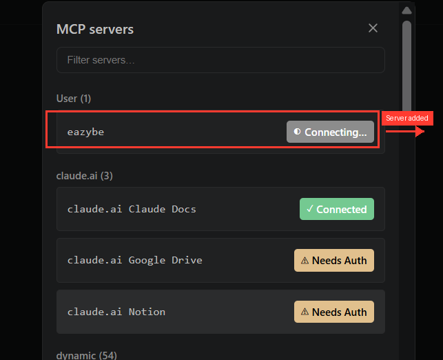
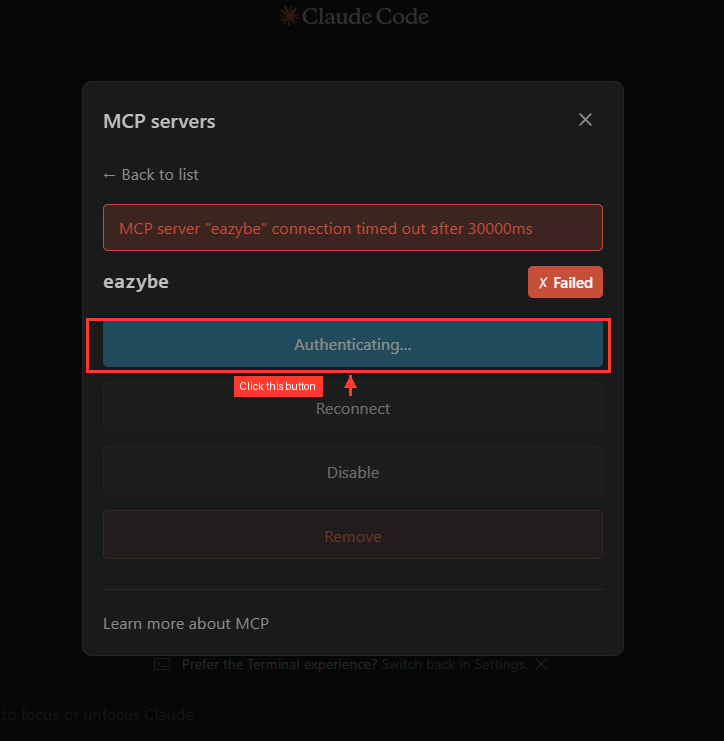
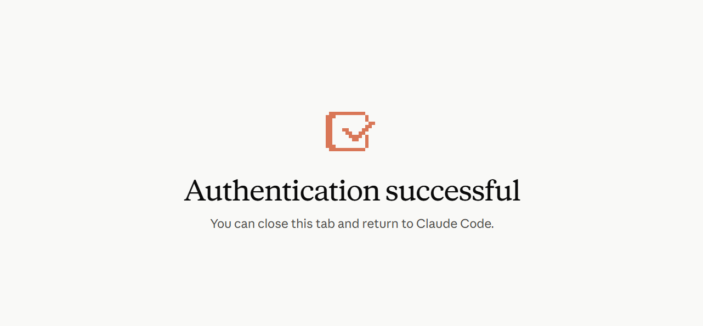
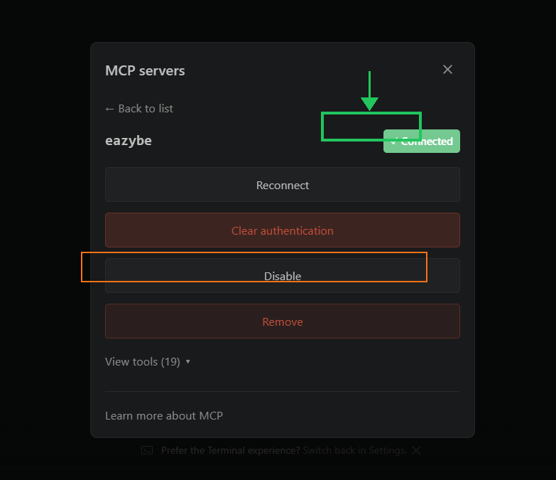
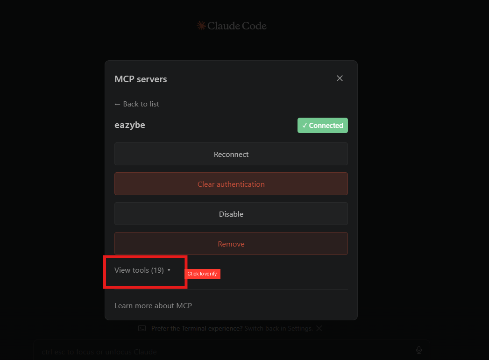
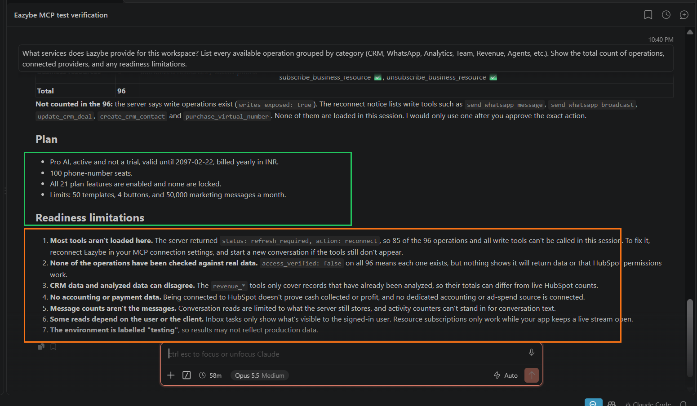

> **Dokumantasyon Dizini**
> Sayfalari tek tek incelemeden once, mevcut konulari anlamak icin [https://help.eazybe.com/llms.txt](https://help.eazybe.com/llms.txt) adresindeki tam dizine bakin.

# Eazybe MCP Sunucusunu Claude ile Baglama

> Eazybe calisma alaninizi MCP sunucusu araciligiyla Claude Code'a baglayarak Claude'a CRM, WhatsApp konusmalari, takim analitikleri, kampanyalar ve daha fazlasina dogrudan erisim saglayin.

Eazybe MCP (Model Context Protocol) sunucusu, Eazybe calisma alaninizi dogrudan Claude Code uzerinden sorgulamaniza ve yonetmenize olanak tanir. Baglandiktan sonra CRM kayitlarini arayabilir, musteri konusmalarini okuyabilir, takim analitiklerini kontrol edebilir, kampanyalari inceleyebilir ve calisma alani islemlerini gerceklestirebilirsiniz — tamamen dogal dil ile.

## Baslamadan Once Gerekenler

Asagidakilerin hazir oldugundan emin olun:

- **Claude Code** — masaustu uygulamasi veya VS Code eklentisi, kurulu ve calisiyor
- **Bir Eazybe calisma alani hesabi** — yonetici veya yetkili kullanici erisimi ile
- **Eazybe MCP sunucu URL'niz** — gelistirme ekibiniz veya calisma alani yoneticiniz saglayacaktir

---

## Adim 1: Claude Code'da MCP Sunucu Ayarlarini Acma

**1. Claude Code'u acin** bilgisayarinizda (masaustu uygulamasi veya VS Code).

**2. MCP sunucular panelini acin.** Yan cubukta **MCP simgesine** tiklayarak veya **Settings > MCP Servers** yoluyla bulabilirsiniz.

MCP sunucularinin bir listesini goreceksiniz. Ilk kez kullaniyorsaniz, liste bos olabilir veya yalnizca varsayilan Claude sunucularini gosterebilir (Claude Docs, Google Drive, Notion).

---

## Adim 2: Eazybe Sunucusunu Ekleme

**1. "Add MCP Server"a tiklayin** (veya **+** dugmesine) yeni bir sunucu eklemek icin.

**2. Sunucu bilgilerini girin:**

| Alan | Ne girilmeli |
|---|---|
| **Server name** | `eazybe` |
| **Server URL** | Gelistirme ekibiniz tarafindan saglanan MCP endpoint URL'si |

> [!NOTE]
> Sunucu URL'si ortaminiza bagli olarak degisir. Gelistirme ekibiniz size dogru URL'yi verecektir. Genellikle `/sse` ile biter. Emin degilseniz, devam etmeden once calisma alani yoneticinize dansin.

**3. Save'e tiklayin.**

Sunucu, MCP sunucular listenizde gorunur. Yaninda **"Connecting..."** durum etiketi goreceksiniz.



*Eazybe sunucusu "User" altinda sari "Connecting..." etiketiyle gorunur.*

---

## Adim 3: Baglantinizi Dogrulama

Ilk baglanti denemesi genellikle **30 saniye sonra zaman asimina ugrar**. Bu beklenen bir durumdur — sunucunun baglanabilmesi icin once giris yapmaniz gerekir.

**1. "Failed" durumu goreceksiniz** su hata mesajiyla: *"MCP server eazybe connection timed out after 30000ms"*.

**2. "Authenticating..." dugmesine tiklayin.** Bu, giris yapabileceginiz bir tarayici penceresi acar.



*Tarayicinizda giris sayfasini acmak icin sari "Authenticating..." dugmesine tiklayin.*

**3. Acilan tarayici penceresinde Eazybe kimlik bilgilerinizle giris yapin.** Eazybe calisma alaniniza giris yapmak icin kullandiginiz ayni e-posta ve sifreyi kullanin.

**4. Dogrulama tamamlandiginda bir onay sayfasi goreceksiniz.**



*"Authentication successful" — artik bu tarayici sekmesini kapatabilir ve Claude Code'a donebilirsiniz.*

**5. Tarayici sekmesini kapatin** ve Claude Code'a donun.

---

## Adim 4: Yeniden Baglama ve Onaylama

**1. Claude Code'a dondugunuzde**, sunucu hala **Failed** gosterebilir. **"Reconnect"e** tiklayin.

**2. Sunucu artik yesil "Connected" etiketi gostermelidir.**



*Yesil "Connected" etiketi sunucunun hazir oldugunu onaylar. Ayrica Reconnect, Clear authentication, Disable ve Remove seceneklerini goreceksiniz.*

> [!NOTE]
> Reconnect calismiyorsa, **"Clear authentication"a** tiklayin ve Adim 3'u basindan tekrarlayin. Eazybe calisma alani kimlik bilgilerinizin dogru oldugundanemin olun.

---

## Adim 5: Araclarinizin Yuklendigini Dogrulama

**1. Sunucu detaylari panelinin altindaki "View tools"a tiklayin.**

**2. 19 veya daha fazla arac listelenmelidir.** Bunlar Claude'un calisma alaninizda kullanabilecegi MCP islemleridir.



*Tum araclarin dogru yuklendigini onaylamak icin "View tools (19)"a tiklayin. 0 arac goruyorsaniz, sunucuyu baglantisini kesin ve yeniden baglayin.*

---

## Adim 6: Ilk Sorgunuzu Calistirma

**1. Claude Code'da yeni bir sohbet acin.**

**2. Bu test sorgusunu yazin:**

```
What services does Eazybe provide for this workspace? List every available operation grouped by category.
```

**3. Claude `business_capabilities` aracini cagiracak** ve calisma alaninizin tam islem listesini dondurecektir.

**4. Basarili bir yanit sunlari gosterir:**

- Organizasyon kimliginiz ve plan detaylari
- Bagli saglayicilar (ornegin HubSpot, Google Calendar)
- Toplam mevcut islem sayisi
- Hazirlik sinirliliklari



*Basarili bir ilk sorgu, MCP baglantinizin tamamen calistigini onaylar.*

Bu yaniti goruyorsaniz, kurulumunuz tamamdir. Artik Eazybe calisma alaninizi sorgulamak icin Claude'u kullanabilirsiniz.

---

## Baglandiktan Sonra Yapabilecekleriniz

MCP sunucusu baglandiktan sonra, Claude'dan sunlari isteyebilirsiniz:

- **CRM kayitlarini arama** — herhangi bir alan, sahip, tarih veya asamaya gore anlasmalar, kisiler, sirketler veya biletler bulma
- **Takim analitiklerini kontrol etme** — mesajlasma aktivitesini, temsilci performansini ve haftadan haftaya karsilastirmalari gorme
- **Musteri konusmalarini okuma** — birden fazla dilde WhatsApp mesajlarini arama, tam ileti dizilerini okuma, kimin yanit bekledigini kontrol etme
- **Kampanyalari ve yayinlari inceleme** — kampanyalari listeleme, teslimat ve okuma oranlarini kontrol etme, bireysel alici durumlarini gorme
- **Sablonlari onizleme** — test degerleriyle islenmis sablon mesajlarini gorme, hicbir sey gondermeden
- **Cuzdan bakiyesini kontrol etme** — mesajlasma kredisi bakiyenizi ve para biriminizi gorme
- **Ajanlari ve etiketleri listeleme** — yapay zeka ajanlarini, hazirliklarini, surumleri ve huni yapilarindaki is etiketlerini inceleme
- **CRM kayitlarini yonetme** — anlasmalar, kisiler, sirketler ve biletler olusturma, guncelleme veya arsivleme (acik onayinizi gerektirir)

> [!NOTE]
> **Tum yazma islemleri acik onayinizi gerektirir.** Claude her zaman tam islemi (neyin olusturulacagini, degistirilecegini veya silinecegini) gosterecek ve herhangi bir degisiklik yapmadan once onayinizi bekleyecektir. Izniniz olmadan hicbir mesaj gonderilmez ve hicbir kayit degistirilmez.

---

## Sorun Giderme

**Baglanti 30 saniye sonra zaman asimina ugriyor**

Bu, dogrulamanin gerekli oldugu anlamina gelir. **Authenticating...**'e tiklayin, tarayicida Eazybe kimlik bilgilerinizle giris yapin, sonra Claude Code'a donun ve **Reconnect**'e tiklayin.

**Sunucu dogrulamadan sonra "Failed" gosteriyor**

**Reconnect**'e tiklayin. Hala basarisiz oluyorsa, **Clear authentication**'a tiklayin ve dogrulama adimlarini tekrarlayin. Eazybe calisma alani kimlik bilgilerinizin dogru oldugundanemin olun.

**Araclar 0 gosteriyor veya yuklenmiyor**

Sunucunun yenilenmesi gerekebilir. Eazybe sunucusunun baglantisinni kesin, yeniden baglayin ve Claude Code'da **yeni bir konusma** baslatinin. Araclar hala gorunmuyorsa, gelistirme ekibinizle MCP sunucusunun calistigini dogrulayin.

**Tum islemlerde "access_verified: false"**

Bu normal ve beklenen bir durumdur. Baglantinin var oldugu ancak her veri kaynaginin ona karsi ilk sorguyu calistirdiginizda dogrulandigi anlamina gelir. Belirli bir sorgu izin hatasiyla basarisiz olursa, Eazybe rolunuzu veya HubSpot hesap izinlerinizi kontrol edin.

**Bir sorguda "connection_store_unavailable" hatasi**

Bu aralikli bir backend sorunudur. Ayni sorguyu tekrar deneyin — genellikle ikinci denemede calisir. Devam ederse, MCP sunucusunun gelistirme ekibi tarafindan yeniden baslatilmasi gerekebilir.

**Google Calendar "connected" gosteriyor ama takvim sorgulari basarisiz oluyor**

`read_calendar_events` araci su anda MCP konektoru araciligiyla sunulmuyor. Takvimle ilgili sorgular (toplanti uygunlugu, planlanan demolar) bu arac eklenene kadar calismayacaktir. Talep etmek icin gelistirme ekibiyle iletisime gecin.

**Claude "most tools aren't loaded" veya "status: refresh_required" diyor**

Ayarlarinizda Eazybe MCP sunucusunun baglantisinni kesin, yeniden baglayin ve yeni bir konusma baslatin. Bu, oturum belirtecinin suresi doldugunda ve yeni bir baglanti gerektiginde olusur.

---


