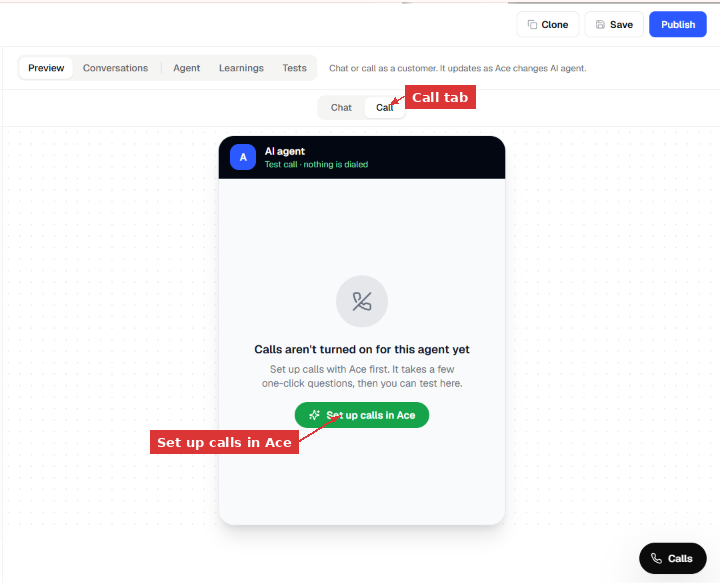
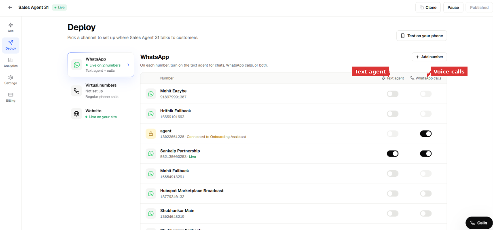
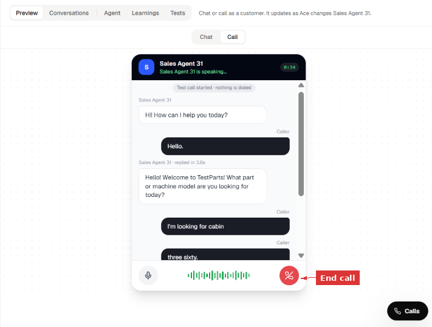
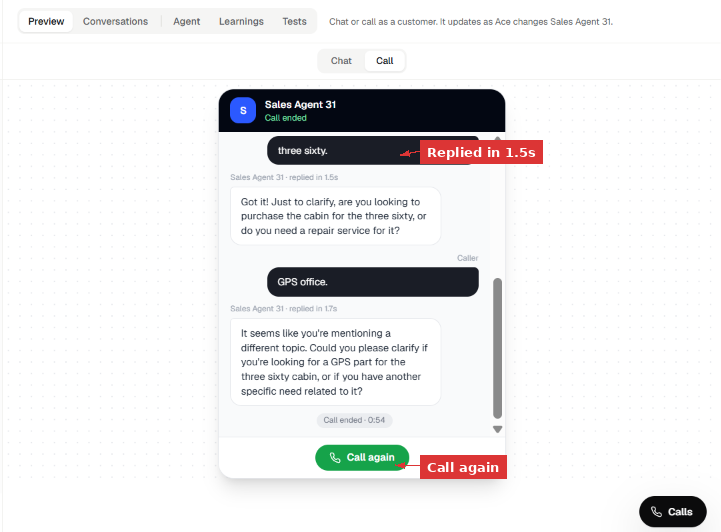

# Sesli Yapay Zeka Ajanı

> Yapay zeka ajanınızın WhatsApp ve sanal numaralar üzerinden telefon görüşmelerini yönetebilmesi için sesli aramayı etkinleştirin.

Yapay zeka ajanınız sesli aramalar için de metin sohbetlerindeki aynı prompt, bilgi tabanı ve araçları kullanır. Ses katmanını etkinleştirin, numaralarınıza dağıtın ve ajan aramaları otomatik olarak yanıtlasın.

---

## Nasıl Çalışır

Yapay zeka ajanınız zaten müşterilere metin olarak nasıl yanıt vereceğini biliyor. Voice AI bunun üzerine bir ses katmanı ekler:

1. Bir müşteri WhatsApp numaranızı veya sanal numaranızı arar.
2. Yapay zeka ajanı müşterinin sesini dinler ve metne dönüştürür.
3. Ajan, mesajı prompt'unuz, bilgi tabanınız ve araçlarınızı kullanarak işler — metin sohbetlerini yönettiği şekilde.
4. Ajanın yanıtı doğal bir sese dönüştürülür ve arayan kişiye oynatılır.

Tüm konuşma ayrıca Team Inbox'ınızda metin transkripsiyonu olarak kaydedilir, böylece ekibiniz nelerin söylendiğini inceleyebilir.

---

## Sesli Aramaları Kurma

### Adım 1: Ace'de sesi etkinleştirin

**1.** Ajanınızı açın ve **Preview** sekmesine gidin.

**2.** **Chat**'ten **Call**'a geçin.

**3.** Aramalar henüz etkinleştirilmemişse şu mesajı göreceksiniz: "Calls aren't turned on for this agent yet." **Set up calls in Ace**'e tıklayın.

**4.** Ace, ajanınızın ses ayarlarını yapılandırmak için birkaç hızlı soru sorarak size rehberlik edecektir.

*Preview'da Call sekmesine geçin. Ajanınız için sesi etkinleştirmek üzere "Set up calls in Ace"e tıklayın.*

### Adım 2: Numaralarınızda sesi dağıtın

Ses etkinleştirildikten sonra, hangi numaraların sesli arama alacağını seçmek için **Deploy** sekmesine gidin.

**1.** Sol kenar çubuğunda **Deploy**'a tıklayın.

**2.** **WhatsApp** altında, bağlı numaralarınızın listesini iki geçiş sütunuyla göreceksiniz:
   - **Text agent** — o numarada metin sohbetleri için yapay zekayı etkinleştirir.
   - **WhatsApp calls** — o numarada sesli aramalar için yapay zekayı etkinleştirir.

**3.** İstediğiniz numaralar için **WhatsApp calls**'u açın. Her numarada yalnızca metin, yalnızca ses veya her ikisini birden etkinleştirebilirsiniz.

**4.** **Virtual numbers** altında, sesli aramalar için normal telefon numaraları (WhatsApp dışı) kurabilirsiniz. Bu, yapay zeka ajanınız için özel bir telefon hattı istiyorsanız faydalıdır.

*Deploy sayfası. Her numaranın metin ve ses için ayrı geçişleri vardır. Yapay zekanın yanıtlamasını istediğiniz numaralarda WhatsApp calls'u etkinleştirin.*

> [!NOTE]
> Birden fazla numarada sesi etkinleştirebilirsiniz. Her numara bağımsız olarak metin, ses veya her ikisi etkin olabilir. Değişiklikler hemen geçerli olur — ajanı yeniden yayınlamanıza gerek yoktur.

---

## Sesli Aramaları Test Etme

Canlıya çıkmadan önce, ajanınızın sesini **Preview** sekmesinde test edin.

**1.** **Preview** → **Call**'a gidin.

**2.** Test araması otomatik olarak başlar — üstte "Test call - nothing is dialed" göreceksiniz. Bu, aramanın simüle edildiği ve gerçek bir telefon numarası kullanmadığı anlamına gelir.

**3.** Mikrofonunuza konuşun. Ajan gerçek zamanlı yanıt verecektir. Konuşmanın canlı transkripsiyonunu olurken görebilirsiniz.

**4.** Ajanın durumu üstte gösterilir — ajan konuşurken "is speaking..." ve yanıt süresi (ör. "replied in 1.5s") her mesajın yanında görünür.

*Devam eden bir test araması. Ajan gerçek zamanlı yanıt verir ve tam transkripsiyonu görebilirsiniz. Yanıt süreleri her yanıtın yanında gösterilir.*

**5.** İşiniz bittiğinde, kırmızı **aramayı sonlandır** düğmesine tıklayın. Toplam süreyle birlikte "Call ended" ve yeni bir test başlatmak için **Call again** düğmesini göreceksiniz.

*Bir aramayı sonlandırdıktan sonra, transkripsiyonu inceleyin ve başka bir test yapmak için "Call again"e tıklayın.*

---

## Test Ederken Nelere Dikkat Edilmeli

Sesli ajanınızı test ederken şunlara dikkat edin:

- **Yanıt hızı** — konuşmanız bittikten sonra ajan ne kadar hızlı yanıt veriyor. 3 saniyenin altını hedefleyin.
- **Ses netliği** — ajan doğal mı duyuluyor? Kelimeler doğru telaffuz ediliyor mu?
- **Dolgu kelimeleri** — ajan yanıt vermeden önce gereksiz "yeah", "okay" veya "hmm" sesleri eklememeli.
- **Arka plan gürültüsü** — ajanın sesinde klavye sesleri, yazma sesleri veya başka yapay sesler olmamalı.
- **Konuşma akışı** — ajan prompt'unuzu doğru takip ediyor mu? Doğru soruları doğru sırayla soruyor mu?
- **Dil** — ajanınız birden fazla dili destekliyorsa, o dilde konuştuğunuzda doğru dilde yanıt verdiğini test edin.

---

## İpuçları ve En İyi Uygulamalar

- **Prompt'unuzu kısa tutun** — sesli konuşmalar metinden daha hızlı ilerler. Uzun ve karmaşık prompt'lar gecikmelere neden olabilir. Daha kısa talimatlar ajanın daha hızlı yanıt vermesine yardımcı olur.
- **Gerçek senaryolarla test edin** — sadece "merhaba" demeyin. Ajanınızın yönettiği gerçek müşteri yolculuğunu takip edin (nitelendirme, randevu, SSS, vb.).
- **Önce bir numarada etkinleştirin** — tek bir numarada sesle başlayın, aramaları izleyin, ardından emin olduğunuzda daha fazla numaraya genişletin.
- **Transkripsiyonları düzenli olarak inceleyin** — her sesli arama Team Inbox'ta metin transkripsiyonu olarak kaydedilir. Sorunları tespit etmek ve ajanınızın prompt'unu geliştirmek için bunları kullanın.
- **Özel ses hatları için sanal numaralar kullanın** — yalnızca yapay zeka aramaları için ayrı bir telefon numarası istiyorsanız (WhatsApp değil), Deploy sekmesinde sanal bir numara kurun.

---

## Sorun Giderme

**"Calls aren't turned on for this agent yet"**

Preview → Call'a gidin ve "Set up calls in Ace"e tıklayın. Ace, bu ajan için sesi etkinleştirmeniz konusunda size rehberlik edecektir.

**Ajan yavaş yanıt veriyor**

Prompt'unuzun uzunluğunu kontrol edin — çok uzun prompt'lar yanıt süresini artırabilir. Ayrıca ajanın yanıt vermeden önce aradığı çok sayıda aracın etkin olup olmadığını kontrol edin.

**Ajan dolgu kelimeleri veya arka plan sesleri ekliyor**

Bu, bazı ses yapılandırmalarında bilinen bir sorundur. Ajanınızın ses ayarlarını düzenleyebilmeleri için Eazybe ekibine bildirin.

**Ses etkin ama aramalar yanıtsız kalıyor**

Deploy'da doğru numara için WhatsApp calls geçişinin açık olduğundan emin olun. Ayrıca ajanın Published durumunda olduğunu doğrulayın (Paused veya Draft değil).

**Müşteri aradığında hiçbir şey duymuyor**

Numaranın bağlı ve aktif olduğunu kontrol edin. Deploy → WhatsApp'a gidin ve numaranın yeşil "Live" durumu gösterdiğini onaylayın.

