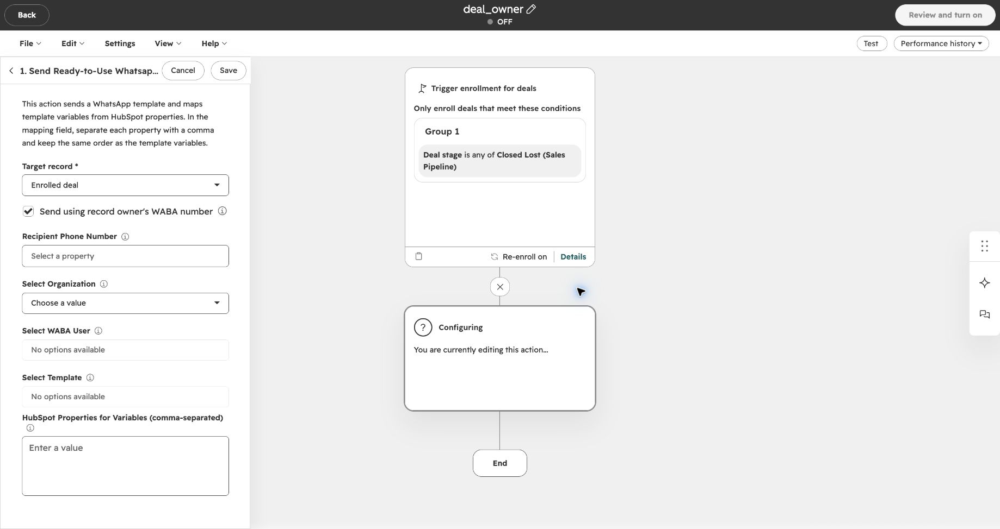
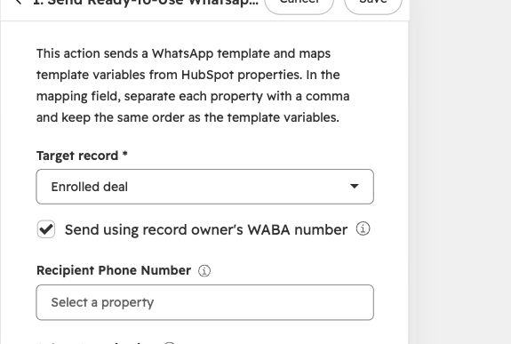
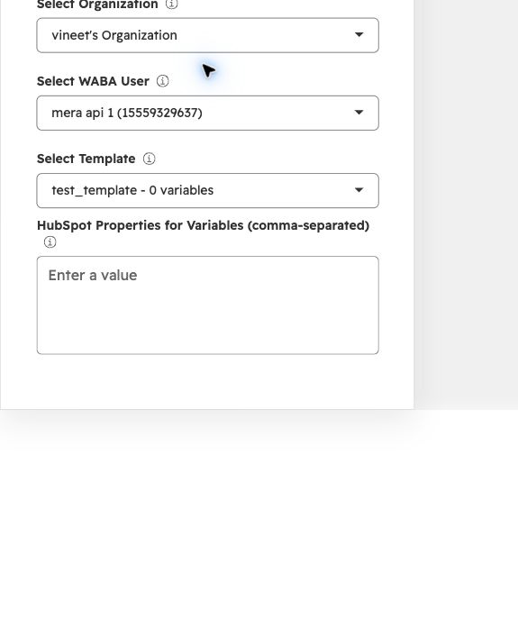
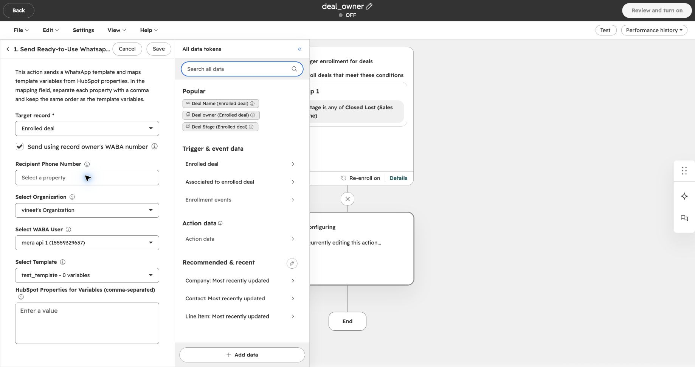
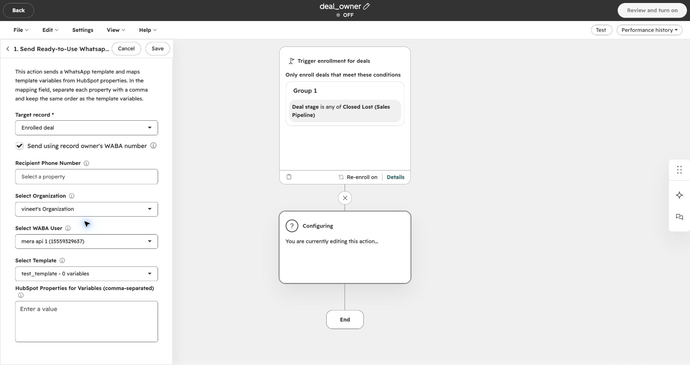

HubSpot anlaşmasından veya kişisinden sorumlu kişinin numarasından WhatsApp şablonu gönderin. İş akışına alınan her kayıt için göndereni otomatik seçmek üzere Eazybe eyleminde **Send using record owner's WABA number** seçeneğini etkinleştirin.

## Başlamadan Önce

Numarasından mesaj gönderilecek **her kayıt sahibi** için şu koşulları kontrol edin:

| Kontrol | Gerekenler |
| --- | --- |
| Kayıt sahibi | İş akışına alınan anlaşmanın bir **Deal owner**, kişinin ise bir **Contact owner** değeri olmalıdır. |
| Bağlı WABA numarası | Kayıt sahibinin WhatsApp Business API (WABA / Meta API) numarası Eazybe’ye bağlı olmalıdır. Yalnızca WhatsApp Web bağlantısı yeterli değildir. Bağlı değilse [WABA bağlantısı kurma](https://help.eazybe.com/tr/waba/connect-waba) kılavuzunu izleyin. |
| HubSpot kullanıcı eşleştirmesi | WABA kullanıcısı, doğru HubSpot hesabı ve Eazybe kuruluşunda kaydın sahibi olan HubSpot kullanıcısıyla eşleştirilmiş olmalıdır. Eşleştirme yoksa [WABA API numarası kullanıcılarını eşleştirme (İngilizce)](https://help.eazybe.com/en/integrations/hubspot/waba-api-number-integration) kılavuzunu izleyin. |
| Tek bir kullanıcıyla eşleştirme | Kayıt sahibi tek bir Eazybe kullanıcısına karşılık gelmelidir. Aynı HubSpot sahibi birden fazla Eazybe kullanıcısıyla eşleştirilmişse iş akışında seçilen gönderen kullanılır. |
| Uyumlu, onaylı şablon | Kayıt sahibinin WhatsApp Business hesabında, eylemde seçilen şablonla aynı adı ve dili taşıyan **onaylı** bir şablon bulunmalıdır. Bileşen yapısı, başlık biçimi, değişken konumları ve düğme türleri de eşleşmelidir. |
| İş akışı erişimi | HubSpot iş akışlarını oluşturma veya düzenleme yetkiniz olmalı ve **WhatsApp Integration by Eazybe** yüklü olmalıdır. |
| Varsayılan gönderen ve alıcılar | Yedek gönderen olarak seçebileceğiniz bağlı bir WABA kullanıcısı, kullanılabilir bir şablon ve geçerli alıcı telefon numaraları olmalıdır. Anlaşma iş akışlarında anlaşmayla ilişkilendirilmiş kişiler bulunduğunu kontrol edin. |

<Warning>
  Bu ayar, her mesajın kayıt sahibinden gönderilmesini zorunlu kılmaz. Eazybe kayıt sahibinin numarasını veya uyumlu şablonunu kullanamazsa eylemdeki **Select WABA User** ve **Select Template** seçimlerini kullanır. Müşterilerinize mesaj göndermek için uygun bir varsayılan numara seçin.
</Warning>

## Mesajı Hangi Kayıt Sahibi Gönderir?

| İş akışı türü | Göndereni belirleyen kayıt sahibi |
| --- | --- |
| Anlaşma tabanlı | İlişkili kişilerin sahipleri farklı olsa bile iş akışına alınan **anlaşmanın** sahibi. |
| Kişi tabanlı | İş akışına alınan **kişinin** sahibi. |

Örneğin anlaşmanın sahibi Priya, ilişkili kişinin sahibi Alex ise anlaşma tabanlı iş akışı, koşulları sağlayan Priya’nın WABA numarasını kullanır. Alıcı yine müşteridir; bu seçenek Priya’ya bildirim göndermez.

<Note>
  Kayıt sahibinden gönderim, kişi ve anlaşma iş akışlarında desteklenir. Şirket ve lead iş akışları seçilen WABA kullanıcısını kullanmaya devam eder. Mevcut iş akışlarında da kutuyu işaretlemediğiniz sürece seçilen gönderen değişmez.
</Note>

## İş Akışı Eylemini Ayarlama

Henüz bir iş akışı oluşturmadıysanız iş akışını oluşturmak ve kaydetme koşullarını belirlemek için [HubSpot iş akışından hazır şablon gönderme](https://help.eazybe.com/tr/waba/broadcasting/hubspot-workflow/send-ready-to-use-template) kılavuzunu izleyin. Bu kılavuz bir kişi iş akışını gösterir; göndereni **anlaşma sahibinin** belirlemesini istiyorsanız anlaşma tabanlı iş akışı kullanın.

Eazybe eyleminin ayarlarına ulaştığınızda buraya dönün. Alan adları, ekran görüntüleriyle eşleşmesi için İngilizce bırakılmıştır.

<Steps>
  <Step title="Eazybe şablon eylemini açın">
    İş akışınızda **Send Ready-to-Use Whatsapp Template** eylemini açın. **Target record** alanının kullanmak istediğiniz kayıt olduğunu doğrulayın. Bu anlaşma örneğinde değer **Enrolled deal** şeklindedir.

    
  </Step>

  <Step title="Kayıt sahibinden gönderimi etkinleştirin">
    **Send using record owner's WABA number** kutusunu işaretleyin. Eylem çalıştığında Eazybe kayıt sahibini kontrol eder ve sahibin eşleştirilmiş, bağlı WABA numarasını kullanmaya çalışır.

    

    <Note>
      Bu kutunun işaretini kaldırırsanız eylem, elle seçtiğiniz WABA kullanıcısını kullanır.
    </Note>
  </Step>

  <Step title="Kuruluşu, varsayılan göndereni ve şablonu seçin">
    Önce **Select Organization**, ardından **Select WABA User**, sonra **Select Template** seçimini yapın. Kayıt sahibinden gönderim etkin olsa da bu alanları doldurun: yedek göndereni ve sahibin hesabında eşleşmesi gereken şablonu belirlerler.

    Şablonda değişkenler varsa **HubSpot Properties for Variables (comma-separated)** alanını şablondaki değişkenlerle aynı sırada doldurun. Eazybe kayıt sahibinin uyumlu şablonuna geçtiğinde iş akışındaki değişken ayarları korunur.

    

      
    

    <Note>
      Ekran görüntüsündeki örnek şablon **0 variables** içerdiğinden değişken alanı boştur. Kendi kuruluşunuzu, numaranızı ve onaylı şablonunuzu seçin. WABA kullanıcısı veya şablon listesi boşsa önce bir önceki seçimi ve WABA bağlantısını kontrol edin.
    </Note>
  </Step>

  <Step title="Mesajın alıcısını seçin">
    Anlaşma iş akışı için:

    1. **Recipient Phone Number** alanına tıklayın.
    2. **All data tokens** altında **Contact: Most recently updated** seçeneğini seçin.
    3. **Phone Number** özelliğini seçin. Müşterinin WhatsApp numarasını içerdiğinden emin olun.

    

    <Note>
      Bu seçim, **anlaşma başına bir ilişkili kişiye** mesaj gönderir: kaydı en son güncellenen kişiye. Anlaşmayla ilişkili tüm kişilere göndermez.
    </Note>

    <Warning>
      - **Deal owner**, **Contact owner** veya **Record ID** yerine **Phone Number** seçin. Bu diğer alanlar müşterinin telefonunu değil, kimlik değerlerini içerir.
      - **Send using record owner's WABA number** kutusu mesajı kimin göndereceğini belirler.
      - Tek bir kişiye göndermek için **Recipient Phone Number** alanını doldurun. Alan boş bırakılırsa anlaşmayla ilişkili **en son güncellenen beş kişi** arasından telefon numarası olanlara mesaj gönderilebilir. Bu gruptaki aynı numaralara yalnızca bir mesaj gönderilir.
    </Warning>
  </Step>

  <Step title="Eylemi kontrol edip kaydedin">
    Kayıt sahibi kutusunu, alıcıyı, kuruluşu, yedek WABA kullanıcısını, şablonu ve değişken değerlerini kontrol edin. Eylemi kaydetmek için **Save** düğmesine tıklayın.

    

    <Note>
      Bu ekran görüntüsü, alıcı alanı boş ve iş akışı **OFF** olan tamamlanmamış bir örneği gösterir. Kaydetmeden önce kendi alıcı ayarlarınızı tamamlayın. Eylemi kaydetmek ile iş akışını etkinleştirmek ayrı işlemlerdir.
    </Note>

    Etkinleştirmeye hazır olduğunuzda [iş akışını gözden geçirme ve etkinleştirme adımlarını](https://help.eazybe.com/tr/waba/broadcasting/hubspot-workflow/send-ready-to-use-template) izleyin. Müşterileri toplu olarak iş akışına almadan önce bir test kaydı ve kontrolünüzdeki bir alıcı numarasıyla göndereni ve teslimatı doğrulayın.

    <Warning>
      İş akışını etkinleştirmek, iş akışına alınan alıcılara gerçek WhatsApp mesajları gönderebilir. Etkinleştirmeden önce kaydetme ve yeniden kaydetme koşullarını kontrol edin. Normal mesaj ücretleri uygulanır; [WhatsApp mesaj fiyatlarına (İngilizce)](/en/waba/broadcast-rate-list-1-october-2026) bakın.
    </Warning>
  </Step>
</Steps>

## Eylem Çalıştığında Ne Olur?

Eazybe kayıt sahibini bulur, seçilen kuruluşta sahibin HubSpot eşleştirmesini ve WABA bağlantısını kontrol eder, ardından sahibin hesabında uyumlu ve onaylı bir şablon arar. Kontroller başarılıysa mesaj, kayıt sahibinin numarası ve eşleşen şablonuyla gönderilir.

Kayıt sahibi sorgusu, eşleştirme, bağlantı veya şablon kontrollerinden biri tamamlanamazsa Eazybe seçilen varsayılan göndereni ve şablonu korur. Bu gönderenin de normal bağlantı ve şablon kontrollerini geçmesi gerekir; yedek gönderene geçilmesi teslimatı garanti etmez.

<Note>
  Kutu yalnızca **göndereni** değiştirir; iş akışına alma kurallarını, alıcı seçimini veya şablon değişken eşleştirmelerini değiştirmez. Kayıt sahibi zaten seçilen WABA kullanıcısıysa gönderen aynı kalır.
</Note>

## Sorun Giderme

| Gözlemlediğiniz durum | Kontrol edilecekler |
| --- | --- |
| Mesaj varsayılan numaradan geldi | Kutunun işaretli olduğunu ve kaydın bir sahibi bulunduğunu doğrulayın. Ardından sahibin WABA bağlantısını, HubSpot eşleştirmesini ve uyumlu onaylı şablonunu kontrol edin. |
| Kayıt sahibinin WABA numarası bağlı değil | [WABA bağlantısını kurun veya yeniden bağlayın](https://help.eazybe.com/tr/waba/connect-waba). Numara tekrar koşulları sağlayana kadar eylem varsayılan göndereni kullanabilir. |
| Kayıt sahibinin numarası var ancak kullanılmıyor | [HubSpot kullanıcı eşleştirmesini kontrol edin (İngilizce)](https://help.eazybe.com/en/integrations/hubspot/waba-api-number-integration). Kayıt sahibinin, HubSpot hesabının ve Eazybe kuruluşunun doğru olduğunu doğrulayın; birden fazla Eazybe kullanıcısına yapılan eşleştirmeleri düzeltin. |
| Şablon var ama varsayılan numara kullanılıyor | Sahibin hesabındaki onay durumunu, tam şablon adını, dili, bileşen yapısını, başlığı, değişkenleri ve düğmeleri kontrol edin. Yalnızca adın eşleşmesi yeterli değildir. |
| Anlaşma mesajı kişi sahibinin numarasını kullanmadı | Anlaşma iş akışları **anlaşma sahibini** kullanır. Anlaşmanın sahibini ve bu sahibin eşleştirmesini kontrol edin. |
| Birden fazla kişiye mesaj gitti | **Recipient Phone Number** alanının boş bırakılıp bırakılmadığını kontrol edin. Bu durumda anlaşma iş akışları ilişkili kişilere gönderim yapabilir. |
| Hiçbir mesaj teslim edilmedi | Kullanılan gönderenin bağlantısını ve şablonunu, alıcı numarasını ve anlaşmayla ilişkili kişileri kontrol edin. **Performance history** bölümünü ve [yayın teslimat analizlerini](/tr/broadcasts/view-analytics) inceleyin. |
| Eylemdeki kuruluşu değiştirdiniz | Yeni kuruluşa ait olmaları için WABA kullanıcısını ve şablonu yeniden seçin. |

## İlgili Kılavuzlar

- [WABA bağlantısı kurma](https://help.eazybe.com/tr/waba/connect-waba)
- [WABA API numarası kullanıcılarını eşleştirme (İngilizce)](https://help.eazybe.com/en/integrations/hubspot/waba-api-number-integration)
- [HubSpot şablon iş akışı oluşturma ve etkinleştirme](https://help.eazybe.com/tr/waba/broadcasting/hubspot-workflow/send-ready-to-use-template)
- [HubSpot iş akışı sorunlarını giderme](/tr/integrations/hubspot/workflow-troubleshoot)
