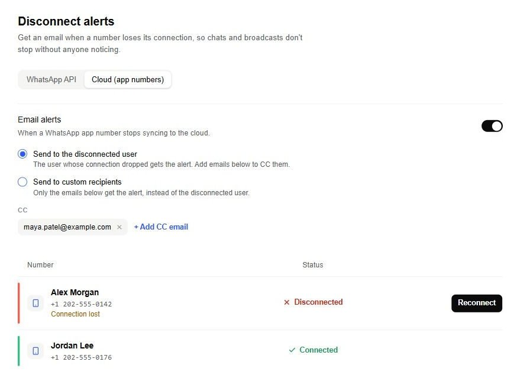
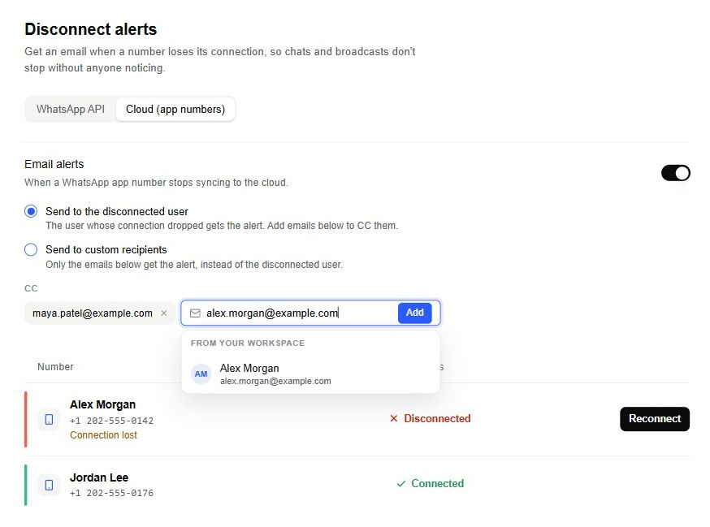
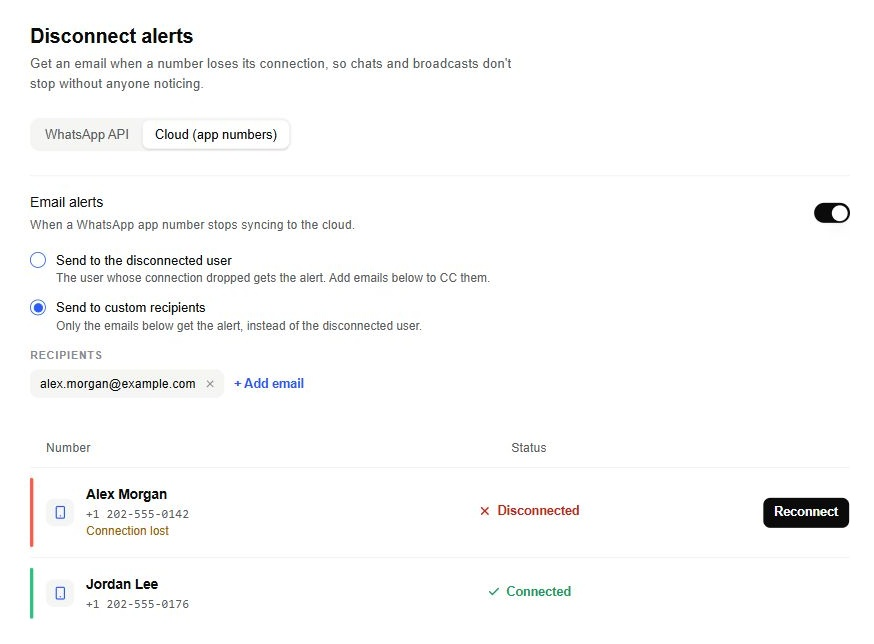

Cloud bağlantısı kesildiğinde kullanıcıyı bilgilendirin ve ekibin de haberdar olması için CC e-posta adresleri ekleyin. **Settings → Disconnect alerts → Cloud (app numbers)** bölümünden özel bir alıcı listesine de uyarı gönderebilirsiniz.

<Note>
Bu uyarıları yalnızca çalışma alanı yöneticileri yönetebilir. **Cloud (app numbers)** ve **WhatsApp API** için uyarı ayarları ve alıcı listeleri ayrıdır.
</Note>

*Ekran görüntülerinde uygulama bileşenleri, örnek amaçlı kurgusal adlar, e-posta adresleri ve telefon numaralarıyla gösterilir. Kontrol adları, ekran görüntüleriyle eşleşmesi için İngilizce bırakılmıştır.*

## CC e-postalarıyla Cloud uyarılarını ayarlama

<Steps>
  <Step title="Cloud uyarılarını açın ve e-posta bildirimlerini etkinleştirin">
    [Eazybe Settings](https://app.eazybe.com/settings) sayfasını açın, **Disconnect alerts** bölümünü seçin ve **Cloud (app numbers)** sekmesine geçin.

    Alıcı seçeneklerini görüntülemek için **Email alerts** anahtarını açın. **Send to the disconnected user** seçeneğini seçin: bağlantısı kesilen kullanıcı uyarıyı alır; **CC** altındaki adreslere aynı e-postanın bir kopyası gönderilir.

    Bu, varsayılan alıcı seçeneğidir. **Email alerts** anahtarının açık olduğundan emin olun; alıcı seçmek tek başına uyarıları etkinleştirmez.

    
  </Step>

  <Step title="İsteğe bağlı CC e-postaları ekleyin">
    **CC** altında **+ Add CC email** seçeneğini seçin. **FROM YOUR WORKSPACE** bölümünden bir ekip arkadaşı seçin veya bir e-posta adresi girip **Add** düğmesine basın. Çalışma alanı dışındaki adresleri de ekleyebilirsiniz.

    Yönetici veya bağlantıyı yeniden kurmakla sorumlu ekip gibi, kopya alması gereken her kişi için işlemi tekrarlayın. Kaydedilen adresler etiket olarak görünür. En fazla 10 CC adresi ekleyebilirsiniz.

    Değişiklikler otomatik kaydedilir. Sonraki değişikliği yapmadan önce kaydetme işleminin bitmesini bekleyin. Kaydetme başarısız olursa tekrar deneyin ve adresin listede göründüğünü kontrol edin.

    

    <Note>
    CC isteğe bağlıdır. Liste boşsa *No one in CC. Only the disconnected user is notified.* mesajı görünür; bu, yalnızca bağlantısı kesilen kullanıcının bilgilendirildiği anlamına gelir. Kullanıcının adresini CC listesine eklemeniz gerekmez.
    </Note>
  </Step>

  <Step title="Gerekirse özel alıcıları seçin">
    Uyarıları yalnızca belirli bir listeye göndermek için **Send to custom recipients** seçeneğini seçin. **Recipients** altında **+ Add email** seçeneğine basın, bir ekip arkadaşı seçin veya adres girin ve **Add** düğmesine basın. En fazla 10 alıcı ekleyebilirsiniz.

    Uyarıları kimin alacağını doğrulamak için önceden doldurulmuş yönetici adresleri dahil, görüntülenen adresleri kontrol edin.

    

    <Note>
    Bu modda bağlantısı kesilen kullanıcı otomatik olarak bilgilendirilmez. Uyarıyı onun da alması gerekiyorsa adresini **Recipients** listesine ekleyin. CC yalnızca **Send to the disconnected user** seçeneğinde kullanılır.
    </Note>
  </Step>
</Steps>

CC ve özel alıcı listeleri ayrı kaydedilir. Seçenek değiştirdiğinizde ilgili liste görüntülenir; adresler listeler arasında taşınmaz.

## Alıcıları yönetme veya uyarıları durdurma

Bir adresi kaldırmak için e-posta etiketinin yanındaki **×** simgesini kullanın. Gizli adresler varsa tüm listeyi görüntülemek ve aramak için **+N more** seçeneğine basın.

- **Send to the disconnected user** seçiliyken tüm CC adreslerini kaldırabilirsiniz. **Email alerts** açık olduğu sürece bağlantısı kesilen kullanıcı uyarıları almaya devam eder.
- **Send to custom recipients** seçiliyken uyarılar açık olduğu sürece en az bir alıcı bırakın. Son alıcıyı kaldırmadan önce **Email alerts** anahtarını kapatın.

Cloud bağlantı kesilme e-postalarını durdurmak için **Email alerts** anahtarını kapatın. Alıcı ayarları, uyarıları yeniden açtığınızda kullanılmak üzere saklanır. Bu seçenekleri düzenlerken **Cloud (app numbers)** sekmesini seçili tutun.

## Bağlantısı kesilen numarayı kontrol etme ve yeniden bağlama

Uyarı ayarlarının altındaki tabloda ilgili numarayı bulun. **Status** sütununu kontrol edin: **Disconnected**, bağlantıyla ilgilenmeniz gerektiğini gösterir. Numaranın altında **Connection lost** (bağlantı kaybedildi) gibi bir neden görünebilir.

[Channels sayfasını](https://app.eazybe.com/numbers-connected) açmak için numaranın yanındaki **Reconnect** düğmesine basın. İlgili numarayı bulup Cloud bağlantı adımlarını izleyin. **Reconnect**, Channels sayfasını açar; tek başına bağlantıyı yeniden kurmaz.

## Sık sorulan sorular

<AccordionGroup>
  <Accordion title="Yalnızca bağlantısı kesilen kullanıcıyı bilgilendirebilir miyim?">
    Evet. **Email alerts** anahtarını açın, **Send to the disconnected user** seçeneğini seçin ve **CC** listesini boş bırakın. Tüm CC adreslerini kaldırmak uyarıları kapatmaz.
  </Accordion>
  <Accordion title="Neden kimse uyarı almadı?">
    **Cloud (app numbers)** sekmesinde **Email alerts** anahtarının açık olduğunu doğrulayın. Seçilen alıcı seçeneğini kontrol edin: ilk modda ilgili kullanıcı ve CC adresleri, özel modda ise yalnızca **Recipients** listesindeki adresler e-posta alır. Değişikliklerin kaydedildiğini kontrol edin ve alıcıdan spam klasörüne bakmasını isteyin.
  </Accordion>
  <Accordion title="Alıcı seçeneklerini neden değiştiremiyorum?">
    Bu ayarları yalnızca yöneticiler yönetebilir. **Admin only** görüyorsanız bir yöneticiden ayarları güncellemesini isteyin. Yöneticiyseniz seçenekleri görüntülemek için **Email alerts** anahtarını açın ve devam eden kaydetme işleminin bitmesini bekleyin.
  </Accordion>
  <Accordion title="Neden Cloud yerine API uyarılarını görüyorum?">
    **Disconnect alerts** bölümünün üst kısmında **WhatsApp API** yerine **Cloud (app numbers)** sekmesini seçin. Ayarları birbirinden ayrıdır.
  </Accordion>
</AccordionGroup>
