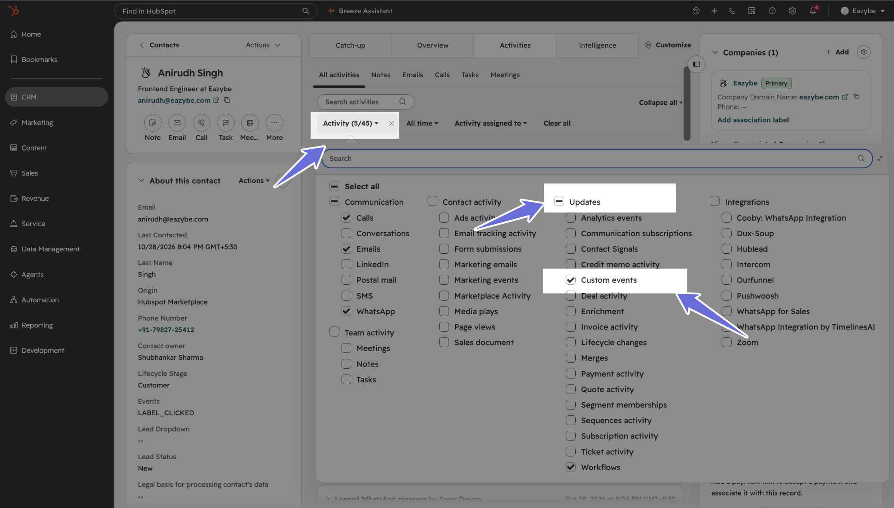
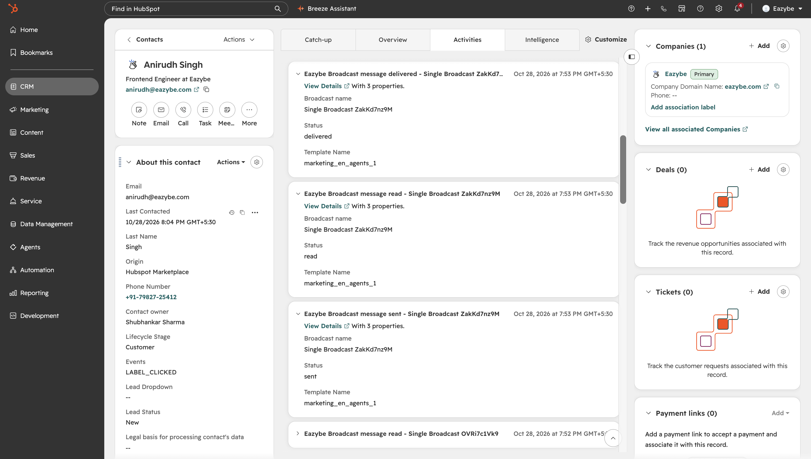

WhatsApp yayın etkinliğinizi doğrudan bir HubSpot kişi kaydının zaman çizelgesinden takip edin. Yayın adını, mesaj durumunu, şablon adını ve varsa hata nedenini görmek için bir Eazybe özel etkinliğini genişletin.

## Başlamadan önce

- **Custom events** (Özel etkinlikler) özelliğini içeren bir HubSpot **Professional veya Enterprise** aboneliği kullanın. Aboneliğiniz için [HubSpot özel etkinliklerinin kullanılabilirliğini](https://knowledge.hubspot.com/reports/create-custom-events) kontrol edin.
- Eazybe çalışma alanınızı, alıcının kişi kaydını içeren HubSpot hesabına bağlayın. [HubSpot hesabınızı bağlama](/tr/integrations/hubspot/account-connection) kılavuzuna bakın.
- Yayın alıcısının Eazybe entegrasyonunuz aracılığıyla doğru HubSpot kişisiyle ilişkilendirildiğinden emin olun.
- Gönderimleri Eazybe WhatsApp Business API yayın akışı üzerinden yapın.

### Gerekli HubSpot izinleri

Gerekli izin kapsamlarını etkinleştirmek için HubSpot'u Eazybe ile entegre edin ve HubSpot yetkilendirmesi sırasında istenen erişimi onaylayın. Entegrasyonu tamamlamak için [HubSpot hesabınızı bağlama](/tr/integrations/hubspot/account-connection) kılavuzunu izleyin.

HubSpot bağlantınızın, mevcut kişi erişimine ek olarak aşağıdaki iki izne de ihtiyacı vardır:

| İzin | Eazybe'nin kullanım amacı |
| --- | --- |
| `analytics.behavioral_events.send` | Yayın durumu etkinlik kayıtlarını HubSpot'a göndermek. |
| `behavioral_events.event_definitions.read_write` | Özel etkinlik tanımını okumak, oluşturmak ve güncellemek. |

HubSpot'u bu izinler istenmeden önce bağladıysanız Eazybe'nin HubSpot entegrasyonu alanından entegrasyonu yeniden yetkilendirin. Doğru HubSpot hesabını seçin ve istenen erişimi onaylayın. Erişim izni veremiyorsanız HubSpot yöneticinizden yetkilendirmeyi tamamlamasını isteyin.

<Note>
  Mevcut bir bağlantı, her iki iznin de verildiğini doğrulamaz. Yetkilendirmeden sonra bağlantıyı kontrol etmek için yeni bir test yayını kullanın. Eazybe, etkinlik tanımını otomatik olarak oluşturur veya bulur; manuel olarak özel bir etkinlik oluşturmanız gerekmez.
</Note>

## Yayın etkinliklerini zaman çizelgesinde gösterme

HubSpot'ta **CRM → Contacts** (Kişiler) bölümünü açın, alıcının kişi kaydını seçin ve **Activities → All activities** (Etkinlikler → Tüm etkinlikler) bölümünü açın.

<Steps>
  <Step title="Etkinlik filtresinde özel etkinlikleri seçin">
    Zaman çizelgesinin üzerindeki **Activity** (Etkinlik) açılır menüsünü açın. Menü, ekran görüntüsündeki **Activity (5/45)** örneğinde olduğu gibi seçili öğe sayısını gösterir. **Updates** (Güncellemeler) altında **Custom events** (Özel etkinlikler) seçeneğini işaretleyin ve menüyü kapatın.

    Tarih filtresinin yayınınızın gönderim tarihini kapsadığından emin olun. Bir etkinliği ararken **All time** (Tüm zamanlar) seçeneğini belirleyin.

    

    <Note>
      Bazı HubSpot düzenlerinde filtre **Filter activity** (Etkinlikleri filtrele), seçenek ise **Custom event** (Özel etkinlik) olarak adlandırılır. Bu seçeneği işaretlemek hangi etkinlikleri gördüğünüzü değiştirir; WhatsApp mesajı veya e-posta göndermez.
    </Note>
  </Step>

  <Step title="Bir Eazybe yayın etkinliğini genişletin">
    **Eazybe Broadcast message** ile başlayan bir kayıt bulun. Kaydı genişletmek için yanındaki oka tıklayın ve **Broadcast name** (Yayın adı), **Status** (Durum) ve **Template Name** (Şablon adı) alanlarını inceleyin. Etkinliğin tarihi ve saati başlığının yanında görünür.

    Bildirilen her durum ayrı bir kayıt olarak görünür. Ekran görüntüsü aynı yayın için **delivered** (teslim edildi), **read** (okundu) ve **sent** (gönderildi) etkinliklerini gösterir.

    

    <Warning>
      Bu ekran görüntülerindeki kişi, yayın adları, şablon adları ve zaman damgaları örnektir. Alıcınızın yayın etkinliğini görmek için kendi alıcınızın kişi kaydını kontrol edin.
    </Warning>
  </Step>
</Steps>

## Durumu ve ayrıntıları anlama

Etkinlik başlıkları, durumun ardından yayın adını içerir. Örneğin: **Eazybe Broadcast message delivered - Single Broadcast ZakKd7nz9M**.

| Durum | Anlamı |
| --- | --- |
| **sent** (gönderildi) | WhatsApp, mesajın gönderildiğini bildirdi. |
| **delivered** (teslim edildi) | WhatsApp, mesajın teslim edildiğini bildirdi. |
| **read** (okundu) | WhatsApp, mesajın okunduğunu bildirdi. |
| **failed** (başarısız) | WhatsApp, teslimatın başarısız olduğunu bildirdi. Varsa **Failure reason** (Hata nedeni) alanını kontrol etmek için etkinliği genişletin. |

**Broadcast name** (Yayın adı) kampanyayı, **Template Name** (Şablon adı) ise kullanılan WhatsApp şablonunu belirtir. **Failure reason** (Hata nedeni) yalnızca bir açıklama mevcut olduğunda başarısız durumları için görünür. Etkinliğin zaman damgası, sağlayıcının durumu bildirdiği zamanı HubSpot'un gösterdiği biçimde yansıtır.

<Note>
  Yalnızca bildirilen durumlar görünür. Bir mesajın tüm durumlara sahip olması gerekmez ve **delivered** (teslim edildi) otomatik olarak **read** (okundu) anlamına gelmez. Daha yeni bir yayın, eski yayın etkinliklerinin yerini almaz.
</Note>

## Hangi mesajlar görünür?

Bu özellik, Eazybe WhatsApp Business API yayınları için sağlayıcı tarafından bildirilen durumları takip eder. Bu yayın akışını kullanan çalışma alanı yayınları ve HubSpot iş akışı gönderimleri dahildir. Uzantıdan ve diğer CRM'lerden yapılan gönderimler yalnızca aynı yayın akışını kullandıklarında dahil edilir; normal serbest metin sohbetleri otomatik olarak dahil edilmez.

Özelliği etkinleştirdiğinizde geçmiş yayınlar otomatik olarak eklenmez. Kişinin mesaj almayı reddetmesi nedeniyle engellenenler dahil, sağlayıcıya ulaşmadan önce yerel olarak reddedilen gönderimler bu sağlayıcı durumu etkinliklerini oluşturmaz.

## Eksik etkinliklerle ilgili sorunları giderme

| Gördüğünüz durum | Kontrol etmeniz gerekenler |
| --- | --- |
| Hiç Eazybe yayın etkinliği yok | **Updates → Custom events** (Güncellemeler → Özel etkinlikler) seçeneğini işaretleyin, **All time** (Tüm zamanlar) seçeneğini belirleyin ve bağlı HubSpot hesabında doğru kişiyi açtığınızı doğrulayın. |
| **Custom events** (Özel etkinlikler) kullanılamıyor | Yöneticinizden HubSpot aboneliğinizin özel etkinlikleri içerdiğini doğrulamasını isteyin. |
| Daha önce kurulmuş bir entegrasyonda etkinlikler eksik | Eazybe HubSpot bağlantısını yukarıda listelenen iki izinle yeniden yetkilendirin, ardından yeni bir yayını kontrol edin. |
| Yeni bir yayının henüz etkinliği yok | Durum güncellemeleri, sağlayıcıdan gelen bildirimlere ve arka planda eşitlemeye bağlıdır. Zaman çizelgesini daha sonra yenileyin; yalnızca etkinliğini yenilemek için yayını tekrar göndermeyin. |
| **read** (okundu) kaydı yok | Okundu durumu bildirilmemiş olabilir. Tek başına bir teslimat etkinliği, mesajın okunduğunu doğrulamaz. |
| Bir **failed** (başarısız) etkinliğinin açıklaması yok | Sağlayıcı bir hata nedeni belirtmemiş olabilir. |
| Eski yayınlar eksik | Filtreyi etkinleştirmek geçmiş yayınların etkinliklerini geriye dönük olarak eklemez. |

Etkinlikler hâlâ görünmüyorsa HubSpot hesap kimliğinizi, kişi kaydının bağlantısını, yayın adını, yaklaşık gönderim saatini ve saat dilimini, beklenen durumu ve etkinlik filtresinin ekran görüntüsünü [Eazybe destek ekibine](mailto:support@eazybe.com) iletin. Parolaları veya erişim belirteçlerini eklemeyin.
