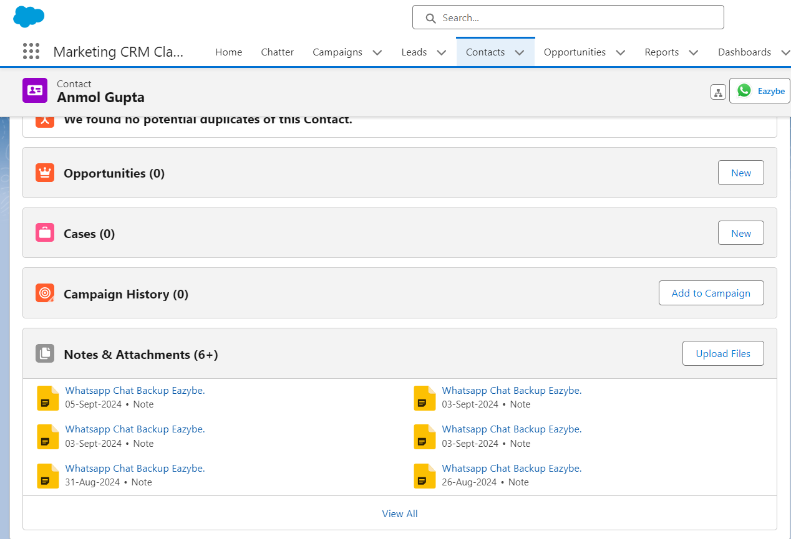
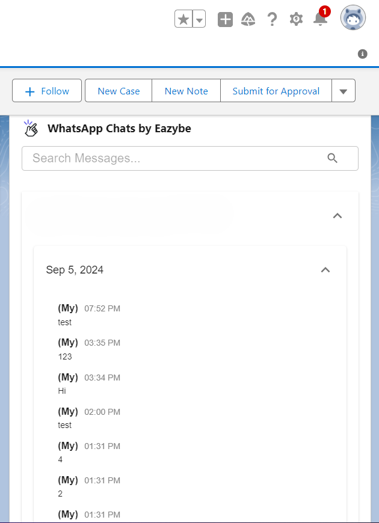
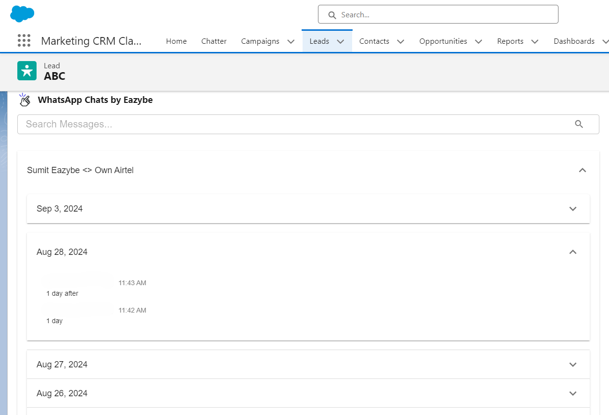

Bu kılavuz, WhatsApp ve Salesforce kişilerinin nasıl bağlandığını açıklar ve otomatik sohbet yedekleme ile senkronizasyonu etkinleştirir.

## Kişi Bağlama Nasıl Çalışır

WhatsApp numaraları, [Numara eşleme](/tr/integrations/salesforce/number-mapping) ayarında yapılandırılan alanlar kullanılarak Salesforce Lead ve Kişi kayıtlarıyla eşleştirilir. Varsayılan seçenek Telefon, Cep Telefonu ve daha önce eşlenen alanları kullanır. Yöneticiler tüm Telefon türündeki alanlarda arama yapabilir veya özel alanlar dahil belirli Telefon ve Metin alanlarını seçebilir. Ayrıca şunları yapabilirsiniz:

- EazyBe kullanarak doğrudan WhatsApp'tan kişi oluşturma
- Mevcut Salesforce kişilerini WhatsApp telefon numaralarına bağlama

## Bağlamadan Sonra Ne Olur

<Info>
  Bağlandıktan sonra, kişi kartı EazyBe'nin Mini-CRM görünümünde görünür ve sohbet ederken kişi ayrıntılarına anında erişim sağlar.
</Info>

Kişiyle ilişkili hem 1:1 sohbetler hem de grup sohbetleri Salesforce'a yedeklenecektir:

- **Kişiler için**: Sohbet içeriği ve ekler, Notlar ve Ekler Bölümünde ve EazyBe tarafından WhatsApp Sohbetleri Aktivite nesnesinde görüntülenir
- **Leadler için**: Sohbetler WhatsApp Sohbetleri Aktivite Nesnelerinde görünür

## Otomatik Senkronizasyon

<Steps>
  <Step title="Kişi Oluşturma">
    EazyBe WhatsApp eklentisi aracılığıyla yeni Salesforce kişileri oluştururken, kişiler otomatik olarak Salesforce'a bağlanır.
  </Step>
  <Step title="Sohbet Yedekleme">
    WhatsApp sohbetleri her 3 dakikada bir otomatik olarak yedeklenir.
  </Step>
  <Step title="Senkronizasyon Durumu">
    Son senkronizasyon zamanı EazyBe çalışma alanında güncellenir, böylece senkronizasyonu doğrulayabilirsiniz.
  </Step>
</Steps>

<Tip>
  Doğru WhatsApp numarasının, kaydedilen Number mapping yapılandırmasının kapsadığı bir alanda bulunduğundan emin olun.
</Tip>

## Yardıma mı İhtiyacınız Var?

Sorularınız varsa veya yardıma ihtiyacınız varsa, **hey@eazybe.com** adresinden destek ekibiyle iletişime geçin.
