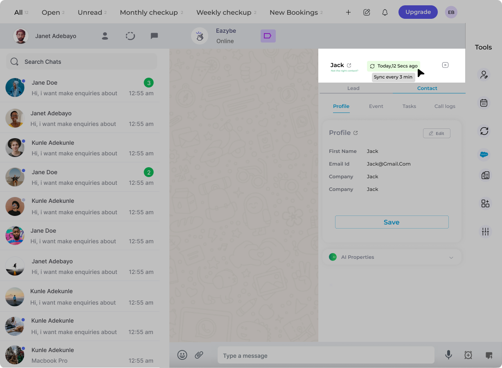
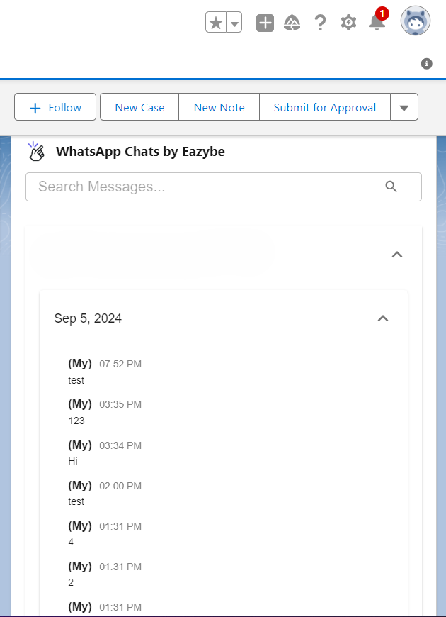
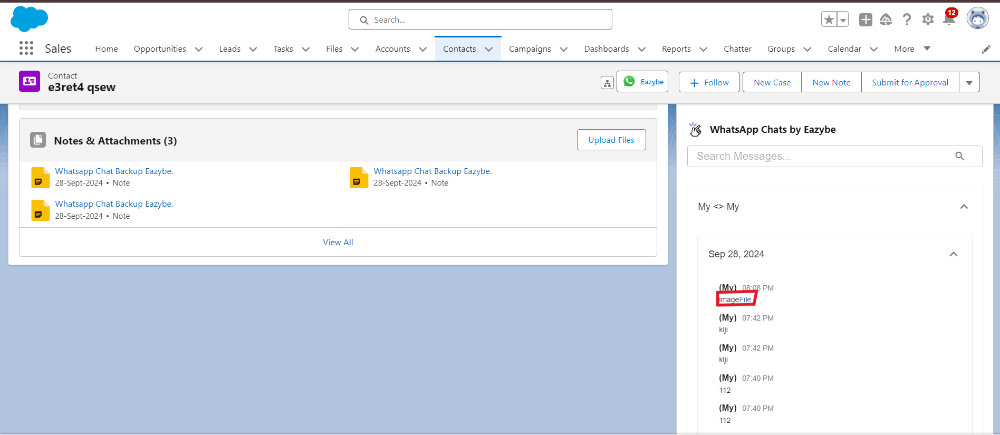

Bu kılavuz, WhatsApp konuşmalarının Salesforce kişileriniz ve leadlerinizle nasıl otomatik olarak senkronize edildiğini açıklar.

## Özel alanlarda saklanan numaraları bulma

Eazybe'nin sohbet yedeklemesi için Lead veya Kişi kaydını hangi alanlarda arayacağını [Numara eşleme](/tr/integrations/salesforce/number-mapping) ayarıyla belirleyin. Yönetici standart alanları, tüm Telefon türündeki alanları veya seçili Telefon ve Metin alanlarını kullanabilir. Numara özel bir alandaysa bu alanın kaydedilen yapılandırmaya dahil olduğunu kontrol edin.

## Otomatik Senkronizasyon

<Info>
  Salesforce kişileriniz veya leadlerinizle olan WhatsApp konuşmaları her **3 dakikada** bir otomatik olarak senkronize edilir.
</Info>

Son senkronizasyon tarihi ve saati EazyBe eklentisinde görüntülenir. Senkronizasyonun tamamlandığını doğrulamak için simgeye tıklayarak kişinin Salesforce sayfasına erişebilirsiniz.

## İlk Entegrasyon

Salesforce'u EazyBe ile ilk kez entegre ettiğinizde, sistem otomatik olarak **son 3 güne** ait yedekleme verilerini sağlar. Bu, son konuşma geçmişinin hemen kullanılabilir olmasını sağlar.

## Etkinliklerde yedekleme

**Back up in activities** açıkken Eazybe, **birebir ve grup görüşmelerini tamamlanmış görevler olarak** ilgili Salesforce **Kişi veya Aday Müşteri** kaydına kaydeder. Yedeklemeler çalıştıkça mesajlar görüşmenin günlük etkinliğine eklenir.

Kurulum adımları ve örnekler için [Etkinliklerde yedekleme](/tr/integrations/salesforce/activity-backup) kılavuzuna bakın.

## Etkinliklerde yedekleme kapalıyken

Bu seçenek kapalıyken Eazybe, Salesforce’un mevcut yedekleme yöntemini kullanır: **WhatsApp Chats by Eazybe** özel nesnesi ve Kişiler için **Notlar ve Ekler**. Etkinliklerde yedekleme açıldığında sonraki sohbet yedekleri bu yöntem yerine tamamlanmış görevlere kaydedilir.

WhatsApp sohbetleri Salesforce içinde iki konumda saklanır:

<Steps>
  <Step title="Notlar ve Ekler Bölümü">
    Kişiler için, sohbetler kişi kaydının Notlar ve Ekler bölümünde görünür.

    
  </Step>
  <Step title="Özel Aktivite Nesnesi">
    **WhatsApp Chats by EazyBe** adlı özel bir aktivite nesnesi, hem Kişiler hem de Leadler için tüm konuşma verilerini saklar.

    
  </Step>
</Steps>

### Ek Dosyaları Yedekleme

<Tip>
  WhatsApp konuşmalarından gelen ek dosyalar, hem Leadler hem de Kişiler sayfaları için **WhatsApp Chats by EazyBe** özel aktivite nesnesinde saklanır.
</Tip>

## Yardıma mı İhtiyacınız Var?

Sorularınız varsa veya yardıma ihtiyacınız varsa, **hey@eazybe.com** adresinden destek ekibiyle iletişime geçin.
