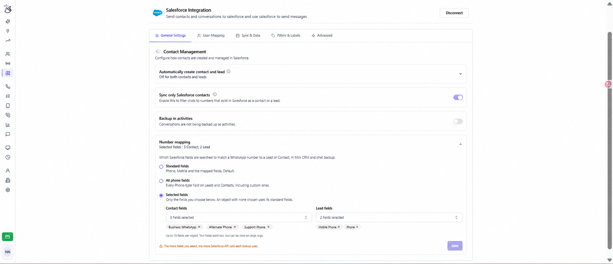

**Number mapping**, Eazybe'nin bir WhatsApp numarasını Lead veya Kişi kaydıyla eşleştirirken hangi Salesforce alanlarında arama yapacağını belirler. Bu eşleştirme, numara özel bir alanda saklandığında da Mini CRM ve sohbet yedeklemesinde kullanılır.

## Ayarı açma

Eazybe çalışma alanına **yönetici** olarak giriş yapın. **Integrations → Salesforce → General Settings** yolunu izleyin ve **Contact Management** altında **Number mapping** bölümünü açın. Salesforce bağlantısı kurulmuş olmalıdır. Arayüzde kolayca bulabilmeniz için kontrol adları İngilizce bırakılmıştır.

## Aranacak alanları seçme

| Seçenek | Aranan alanlar | Ne zaman kullanılır? |
| --- | --- | --- |
| **Standard fields** | Telefon, Cep Telefonu ve daha önce eşlenen alanlar. Varsayılan seçenektir. | Ekibiniz standart alanları veya mevcut eşlemeleri kullanıyorsa. |
| **All phone fields** | Lead ve Kişi kayıtlarında erişilebilen tüm Telefon türündeki alanlar; özel Telefon alanları da dahildir. | Numaralar birden fazla Telefon alanında saklanıyorsa. |
| **Selected fields** | Kişiler ve Lead'ler için ayrı ayrı seçtiğiniz alanlar. Uygun Telefon ve Metin alanları seçilebilir. | Belirli özel alanları veya numara içeren bir Metin alanını kullanmak istiyorsanız. |

<Note>
  **Selected fields** modunda, bir nesne için alan seçtiğinizde Telefon ve Cep Telefonu otomatik olarak dahil edilmez. Bunların da aranmasını istiyorsanız ayrıca seçin. Bir nesnenin seçimini boş bırakırsanız o nesnenin standart alanları kullanılır. Bu modu kaydetmek için Kişiler veya Lead'ler için en az bir alan seçmelisiniz.
</Note>

## Özel alanları yapılandırma

1. **Selected fields** seçeneğini seçin.
2. **Contact fields** listesini açın. Alan etiketi veya API adıyla arama yaparak müşterilerinizin WhatsApp numaralarını içeren alanları seçin.
3. **Lead fields** listesini açıp Lead alanlarını seçin. **Her nesne için en fazla 15 alan** seçebilirsiniz.
4. Bir alanı kaldırmak için seçili alan adının yanındaki **×** simgesine tıklayın.
5. **Save** düğmesine tıklayın ve **Number mapping updated** onayını bekleyin. Değişiklikler yalnızca kaydettikten sonra uygulanır.

Düzenlenen ekran görüntüsünde Kişiler için **Business WhatsApp**, **Alternate Phone** ve **Support Phone** örnek alan adları kullanılmıştır. Lead'ler için **Mobile Phone** ve **Phone** seçilmiştir. Kendi Salesforce kuruluşunuzdaki gerçek alanları seçin; buradan alan seçmek Salesforce'ta yeni alan oluşturmaz.

Örneğin bir Kişinin WhatsApp numarası yalnızca **Business WhatsApp** alanındaysa, Eazybe'nin Mini CRM ve sohbet yedeklemesi için kaydı bulabilmesi amacıyla bu alanı seçin. Görseldeki yapılandırmada Kişinin Telefon ve Cep Telefonu alanları, siz eklemedikçe aranmaz.

<Warning>
  Tüm telefon alanlarını aramak veya daha fazla alan seçmek, arama başına Salesforce API kullanımını artırır. Metin alanları büyük kuruluşlarda daha yavaş olabilir. Ekibinizin gerçekten kullandığı alanları seçin.
</Warning>

## Sonucu kontrol etme

Numarası yapılandırılmış alanlardan birinde bulunan bir WhatsApp sohbetini açın. Mini CRM'de beklenen Lead veya Kişi kaydının göründüğünü doğrulayın ve [senkronizasyon durumunu](/tr/integrations/salesforce/message-sync) kontrol edin.

Kayıt bulunamazsa:

- Numaranın doğru olduğundan ve kaydedilen modun kapsadığı bir alanda bulunduğundan emin olun.
- Kişi ve Lead alan seçimlerini ayrı ayrı kontrol edin.
- Metin alanında saklanan numaralar için **Selected fields** modunu kullanın ve alanı açıkça seçin.
- Bir alan listede yoksa bağlı Salesforce kullanıcısının erişimini kontrol edin. Yalnızca uygun Telefon ve Metin alanları listelenir.
- Alanlar yüklenmezse Salesforce bağlantısını kontrol edip yeniden deneyin.

Varsayılan eşleştirmeye dönmek için **Standard fields** seçeneğini seçip **Save** düğmesine tıklayın. Mod değiştirirken alan seçimleriniz korunur.

[Kişileri Bağlama](/tr/integrations/salesforce/linking-contacts) kılavuzuna da bakabilirsiniz. Yardım için **hey@eazybe.com** adresine yazın.
