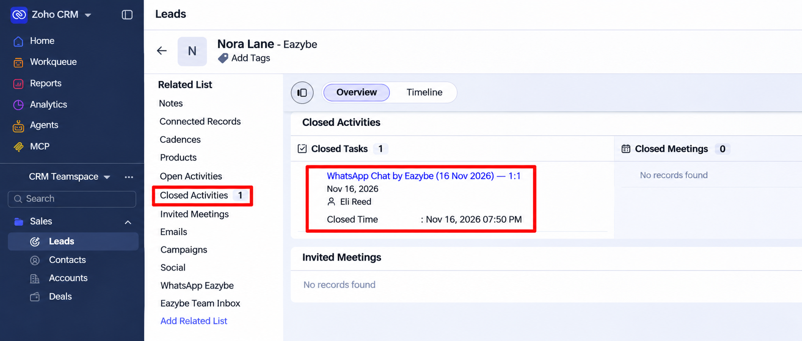
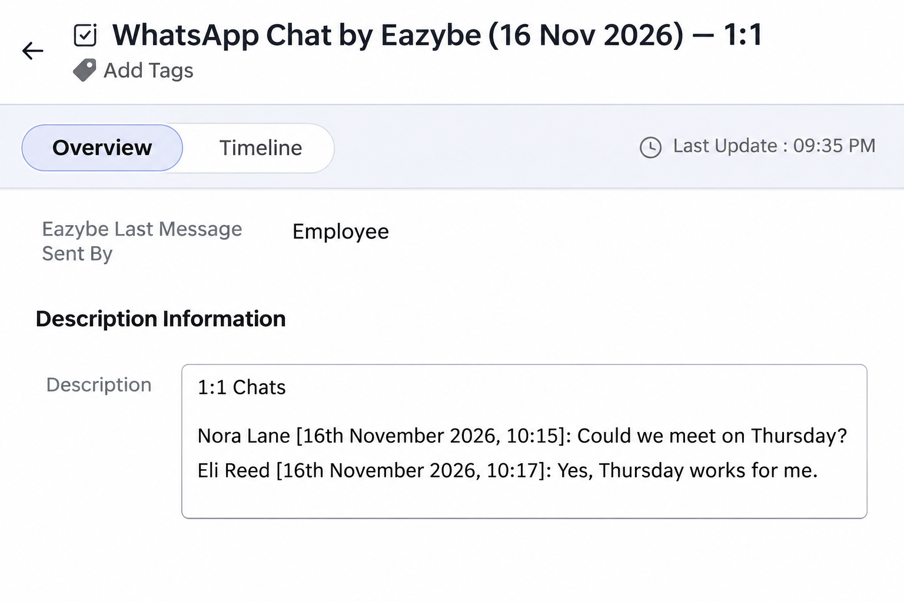

Eazybe, her sohbet için ilgili kayıtta günde bir tamamlanmış görev oluşturur. O gün eşitlenen mesajları okumak için görevi açın.

## Etkinliklerde yedeklemeyi açma

1. Eazybe çalışma alanınızda **Entegrasyonlar** bölümünü açın. Bağlı **Zoho CRM** hesabınızı seçip **Genel Ayarlar** bölümüne gidin.
2. **Backup in activities** seçeneğini açın. Seçeneğin altındaki açıklama, görüşmelerin tamamlanmış görev olarak kaydedildiğini gösterir.

Yöneticiler ve ekip yöneticileri bu ayarı kuruluşun tamamı için değiştirir. Diğer kullanıcıların yaptığı değişiklik yalnızca kendi Zoho bağlantıları için geçerlidir.

## Zoho’da kaydedilen sohbeti bulma

1. **Aday Müşteriler** veya **Kişiler** modülünde sohbetini okumak istediğiniz kişinin kaydını açın.
2. Soldaki ilgili listeden **Kapatılan Etkinlikler** (Closed Activities) bölümünü seçin. **Kapatılan Görevler** (Closed Tasks) altında istediğiniz tarihe ait **WhatsApp Chat by Eazybe** görevini açın.

Görevin genel görünümünde açıklama bilgilerine gidin. **Açıklama** alanında eşitlenen her mesajın gönderenini, saatini ve metnini görebilirsiniz.

