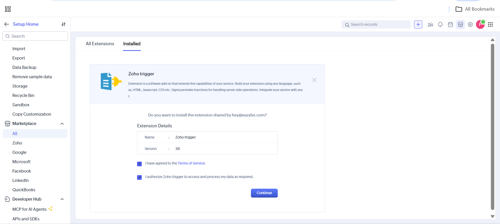
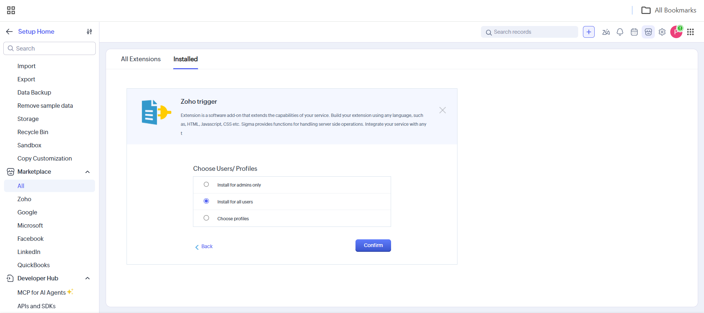
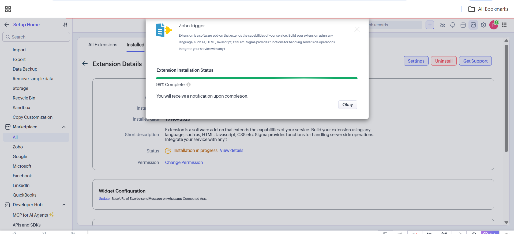
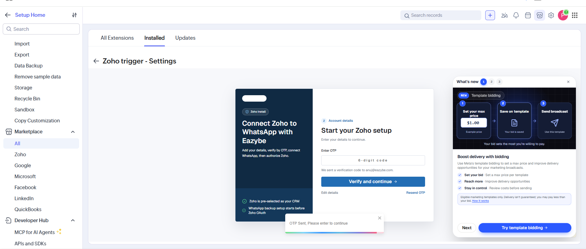
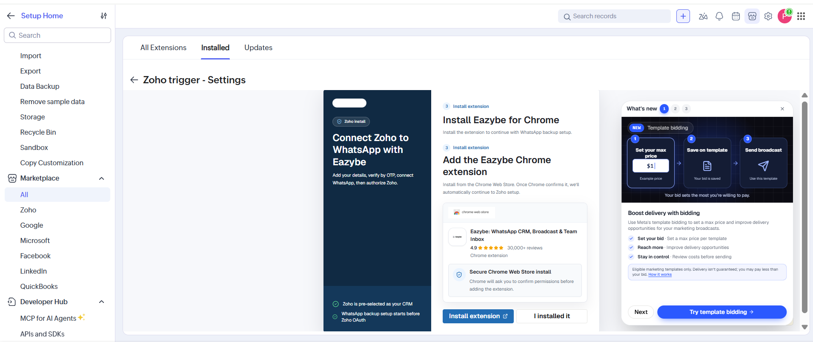
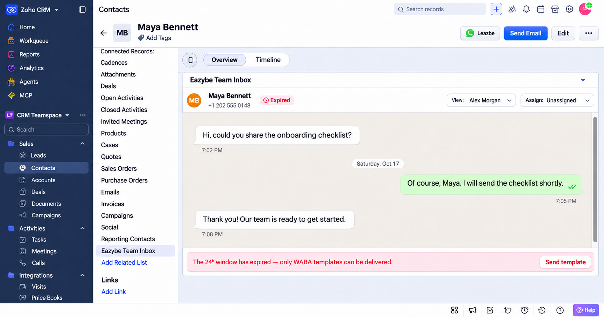
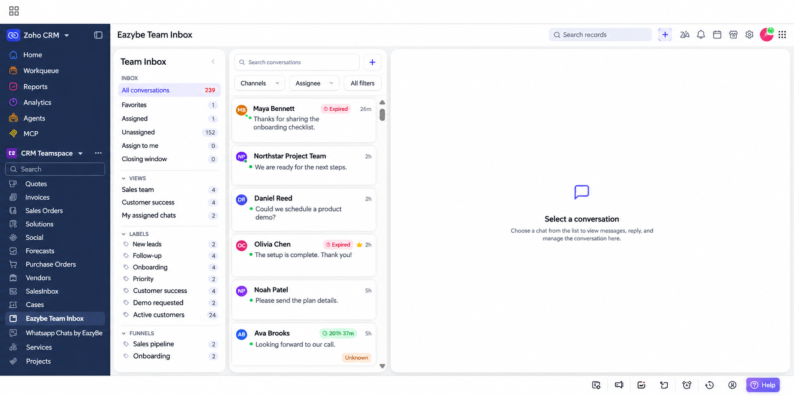

Eazybe Team Inbox, WhatsApp görüşmelerinizi Zoho CRM'e getirir. Bir kişinin veya potansiyel müşterinin görüşmesini kendi kaydından açabilir ya da erişiminiz olan görüşmeleri genel gelen kutusunda yönetebilirsiniz.

<Note>
**Zoho trigger** paketi hem iş akışları için WhatsApp eylemini hem de **Eazybe Team Inbox** özelliğini içerir. Yükleme, Kişiler ve Potansiyel Müşteriler kayıtlarına ilgili listeyi ve modül menüsüne gelen kutusu girişini ekler. Genel gelen kutusu için Chrome uzantısı veya açık bir WhatsApp Web sekmesi gerekmez.
</Note>

## Paketi Yükleyin

Zoho CRM uzantılarını yükleme yetkisi olan bir hesap kullanın. Paket zaten yüklüyse **Setup → Marketplace → All → Installed** altında **Zoho trigger** durumunun **Active** olduğunu doğrulayın.

<Steps>
  <Step title="Paketi açın ve erişimi inceleyin">
    [Zoho trigger ve Team Inbox yükleme bağlantısını](https://crm.zoho.com/market/installPrivatePlugin.do?portalName=rajatverma&nameSpace=zohotrigger&versionIndex=4520363000000438001) açın. Hizmet koşullarını ve veri erişim yetkisini inceleyin. Kabul ediyorsanız iki kutuyu işaretleyip **Continue** düğmesine tıklayın.

    
  </Step>
  <Step title="Kullanıcıları seçin">
    **Choose Users/Profiles** altında **Install for all users** seçeneğini seçip **Confirm** düğmesine tıklayın. Erişimi sınırlandırmak için **Install for admins only** veya **Choose profiles** kullanın.

    
  </Step>
  <Step title="Yüklemenin tamamlanmasını bekleyin">
    Zoho, **Extension Installation Status** ekranını gösterir. **Okay** düğmesine tıklayın ve tamamlanma bildirimini bekleyin. Durumun **Active** olduğunu doğrulayın.

    <Note>Ekran görüntüsündeki **99% Complete**, yüklemenin henüz tamamlanmadığını gösterir.</Note>

    
  </Step>
  <Step title="Eazybe hesabınızı doğrulayın">
    Yüklü pakette **Settings** bölümünü açıp kurulumu izleyin. İstendiğinde hesap bilgilerinizi girin. **Enter OTP** alanına e-postanıza gönderilen altı haneli kodu yazıp **Verify and continue** düğmesine tıklayın. Yeni kod için **Resend OTP**, e-postayı düzeltmek için **Edit details** kullanın.

    
  </Step>
  <Step title="WhatsApp yedekleme kurulumunu inceleyin">
    Kurulum, WhatsApp yedeklemesi için **Install Eazybe for Chrome** ekranını gösterebilir. Bu özelliği kuruyorsanız durumunuza göre **Install extension** veya **I installed it** düğmesine tıklayın. Hesabınızı bağlamak ve Zoho'yu yetkilendirmek için ekrandaki adımları izleyin.

    **Team Inbox, Zoho paketine dahildir. Genel gelen kutusunu açmak için Chrome uzantısı gerekmez.**

    
  </Step>
</Steps>

<Tip>
Aynı paketteki iş akışı eylemini kullanmak için [Zoho iş akışıyla WhatsApp mesajları gönderme](/tr/waba/broadcasting/zoho-workflow/send-whatsapp-message) kılavuzuna bakın. Paketi yükledikten sonra kuralı oluşturup etkinleştirmeniz gerekir.
</Tip>

## Kişi veya Potansiyel Müşteri Gelen Kutusunu Açın

1. **Contacts** veya **Leads** bölümünü açıp bir kayıt seçin.
2. Soldaki **Related List** bölümünde aşağı kaydırıp **Eazybe Team Inbox** seçeneğine tıklayın. Kayıt sayfasında aynı adlı bölüme de kaydırabilirsiniz.
3. Görüşmeyi inceleyin. Kullanılabilir görünümü **View:** ile seçin; yetkilerinize göre atamayı **Assign:** ile yönetin.

<Warning>Bu düzenlenmiş ekran görüntüsünde kurgusal müşteri bilgileri ve örnek mesajlar kullanılmıştır. Görsel bir Kişi kaydını gösterir; paket yüklendikten sonra aynı giriş Potansiyel Müşteriler kayıtlarında da bulunur.</Warning>

<Note>**Expired** ve 24 saatlik sürenin dolduğunu belirten uyarı görünürse şablonla devam etmek için **Send template** kullanın.</Note>

## Genel Ekip Gelen Kutusunu Açın

1. Modül menüsünde **Vendors**, **Services** ve **Projects** gibi modüllerin yanında **Eazybe Team Inbox** girişini bulun. Gerekirse listeyi kaydırın; görselde menü soldadır.
2. Çalışma alanınızda erişebildiğiniz görüşmeleri görmek için **Eazybe Team Inbox** seçeneğine tıklayın.
3. **All conversations**, **Favorites**, **Assigned**, **Unassigned** veya **Assign to me** listesini seçin. **Search conversations**, **Channels**, **Assignee** ve **All filters** ile filtreleyin.
4. Mesajları sağ tarafta görmek için bir görüşme seçin. Seçim yapmadan önce **Select a conversation** yazısı görünür.

<Warning>Bu düzenlenmiş görselde müşteri, görünüm, etiket adları ve mesaj önizlemeleri kurgusaldır.</Warning>

## Zoho'da Görüşmeleri Yönetin

Eazybe izinleriniz, Zoho CRM içinde hangi görüşmeleri görebileceğinizi ve yönetebileceğinizi belirler. Bağlı bir **WhatsApp Business API** veya **Coexistence (CoEx)** numarasıyla Team Inbox üzerinden mesaj gönderip alabilirsiniz.

## Sorun Giderme

### Team Inbox Girişi Görünmüyor

Paketin yüklü ve **Active** olduğunu, kullanıcı veya profilinizin erişimi bulunduğunu kontrol edip Zoho CRM'i yenileyin. Kişiler ve Potansiyel Müşteriler için **Related List**, genel gelen kutusu için modül menüsüne bakın.

### Kişi veya Potansiyel Müşteri Görüşmesi Görünmüyor

Kayıttaki WhatsApp numarasını uluslararası ülke koduyla birlikte kontrol edin. Eazybe bağlantısını, erişim izinlerinizi ve **View:** seçimini doğrulayın.

### Genel Gelen Kutusu Yüklenmiyor veya Beklenen Sohbetler Görünmüyor

Paketin kurulumunu ve durumunu, kullanıcı erişimini ve Eazybe bağlantısını kontrol edin. Gelen kutusunu yenileyin, [app.eazybe.com](https://app.eazybe.com) erişiminizle karşılaştırın ve sohbetleri gizleyebilecek arama veya filtreleri temizleyin. Genel gelen kutusu Zoho paketiyle sağlanır; Chrome uzantısına bağlı değildir.
