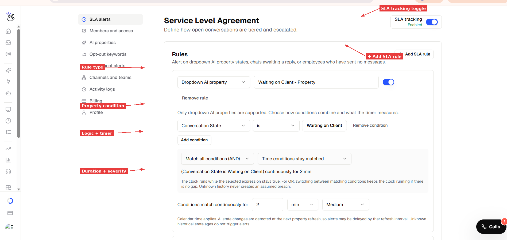
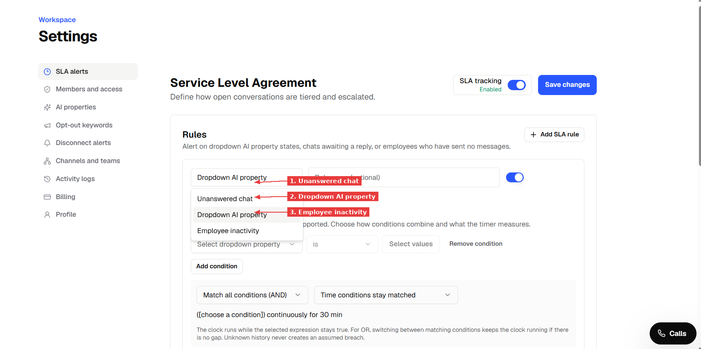
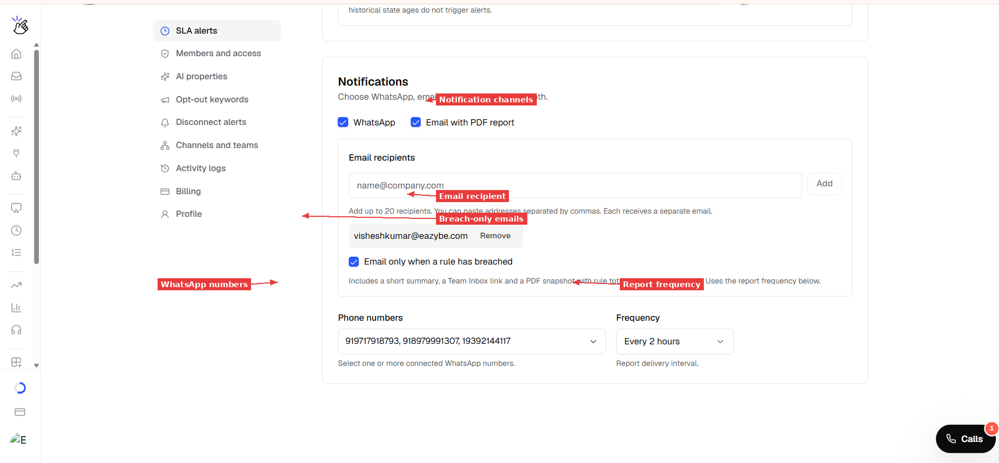

> **Dokumantasyon Dizini**
> Bireysel sayfalari kesfetmeden once, mevcut konulari anlamak icin [https://help.eazybe.com/llms.txt](https://help.eazybe.com/llms.txt) adresindeki tam dizine bakin.

# SLA Uyarilari — Yanit Surelerini ve Ozellik Durumlarini Izleyin

> AI ozellikleriniz, cevaplanmamis sohbetleriniz ve calisan aktiviteleriniz uzerinde zamana dayali kurallar tanimlayin. Bir kural ihlal edildiginde, Eazybe WhatsApp ve e-posta ile rapor gonderir — boylece ekibiniz musteriler cok uzun beklemeden harekete gecebilir.

SLA (Hizmet Duzeyi Anlasmalari) uyarilari, cok uzun suredir ilgilenilmeyen konusmalari yakalamaniza yardimci olur. Kurallari siz belirlersiniz — Eazybe sohbetlerinizi izler ve bir sey dikkat gerektirdiginde sizi bilgilendirir.

## SLA Uyarilari Neleri Takip Edebilir?

SLA uyarilari uc tur kurali destekler:

- **Dropdown AI ozelligi** — Bir konusma belirli bir AI ozellik durumunda cok uzun kaldiginda uyari verir. Ornek: "Konusma Durumu 2 saatten fazla suredir Musteri Bekleniyor."
- **Cevaplanmamis sohbet** — Bir musteri, esik degerinizin otesinde ekip yanitini beklediginde uyari verir. Ornek: "30 dakikadir ekip yaniti yok."
- **Calisan hareketsizligi** — Bir calisan, esik degeriniz icinde hicbir nitelikli mesaj gondermediginde uyari verir. Ornek: "Calisan 4 saattir mesaj gondermedi."

Kosullari birlestirebilirsiniz de. Ornek: "Konusma Durumu Musteri Bekleniyor **AND** Tercih Edilen Dil Ingilizce — 5 dakikadan fazla."

> [!NOTE]
> SLA kurallarinda yalnizca **dropdown** AI ozellikleri desteklenmektedir. Metin ve sayi ozellikleri henuz kosul olarak kullanilamaz.

---

## Baslamadan Once Gerekenler

- Eazybe calisma alaniniza **yonetici veya yetkili erisim**
- Settings → AI Properties'te tanimlanmis **en az bir AI ozelligi** (dropdown turunde)
- Calisma alanina bagli **bir WhatsApp numarasi** (WhatsApp raporlari icin)
- PDF raporlari almak icin **bir e-posta adresi** (istege bagli)

---

## Adim 1: SLA Ayarlarini Acin

**1.** Eazybe panelinizin sol kenar cubugundaki **Settings** bolumune gidin.

**2.** Ayarlar menusunde **SLA alerts** secenegine tiklayin.

**3.** Kurallar bolumu ve bildirim ayarlari ile birlikte Service Level Agreement sayfasini goreceksiniz.

*SLA uyarilari sayfasi. SLA takip anahtari sag usttedir. Ilk kuralinizi olusturmak icin "+ Add SLA rule" dugmesine tiklayin.*

---

## Adim 2: Ilk Kuralinizi Olusturun

**1.** Yeni bir kural eklemek icin **"+ Add SLA rule"** dugmesine tiklayin.

**2.** Acilir menuden kural turunu secin:

| Tur | Neyi Izler |
|---|---|
| **Dropdown AI property** | Belirli bir AI ozellik degerinin cok uzun surmesi (orn., Conversation State = Waiting on Client) |
| **Unanswered chat** | Musterinin son mesajindan bu yana ekip yaniti olmadan gecen sure |
| **Employee inactivity** | Bir calisanin en son nitelikli mesaj gondermesinden bu yana gecen sure |

*Kural turunuzu secin. Her tur farkli bir gecikme turunu olcer.*

**3.** Kuraliniza bir **isim** verin (istege bagli ancak raporlarda netlik icin onerilir).

---

## Adim 3: Kural Kosullarini Yapilandirin

### Dropdown AI Ozellik Kurallari Icin

**1.** Listeden **dropdown ozelligi** secin (orn., Conversation State).

**2.** **Operatoru** secin (orn., "is").

**3.** Izlenecek **degeri** secin (orn., "Waiting on Client").

**4.** Istege bagli olarak ikinci bir kosul eklemek icin **"Add condition"** dugmesine tiklayin. Ornegin, birlesik bir kural olusturmak icin "Preferred Lang is English" ekleyin.

**5.** Kosullarin nasil birlesecegini secin:
- **Match all conditions (AND)** — tum kosullar dogru olmalidir
- **Match any condition (OR)** — en az bir kosul dogru olmalidir

**6.** Zamanlayicinin neyi olcecegini secin:
- **Time conditions stay matched** — ozelligin bu degere sahip oldugu sure
- **No team reply** — kosul gecerliyken musterinin en son cevaplanmamis mesajindan bu yana gecen sure

*"Conversation State is Waiting on Client" durumunu surekli 2 dakika boyunca izleyen bir ozellik kurali. Alttaki ozet, kural mantigini onaylar.*

> [!NOTE]
> AI ozellikleri bir yenileme takviminde yeniden degerlendirilir (dropdown ozellikler icin her 30 dakikada bir). Bir durum degisikligi yalnizca bir sonraki yenilemede tespit edilir, bu nedenle uyarilar bir yenileme araligi kadar gecikebilir. Kuralinizin zamanlayicisi yenileme araliginden kisaysa, uyari beklenildigi kadar hassas olmayabilir.

### Cevaplanmamis Sohbet Kurallari Icin

Yapilandirilacak kosul yoktur — bu kural yalnizca ekip yaniti almamis musteri mesajlarini izler.

**1.** Sure esigini ayarlayin (orn., 5 dakika).

**2.** Onem derecesini secin.

### Calisan Hareketsizligi Kurallari Icin

**1.** Sure esigini ayarlayin (orn., 2 dakika).

**2.** Onem derecesini secin.

> [!NOTE]
> Yalnizca calisan gonderici kimligine sahip kaydedilmis insan dogrudan mesajlari hareketsizlik zamanlayicisini sifirlar. Sablonlar, otomasyon, yayinlar ve atanmamis gonderimler sayilmaz.

---

## Adim 4: Zamanlayici ve Onem Derecesini Ayarlayin

**1.** **"Conditions match continuously for"** alanini ayarlayin — bir sayi girin ve birimi secin (min, hours veya days).

**2.** **Onem derecesini** secin:

| Onem Derecesi | Ne Zaman Kullanilir |
|---|---|
| **Critical** | Acil — hemen ilgi gerektirir |
| **High** | Onemli — yakin zamanda ele alinmalidir |
| **Medium** | Standart takip |
| **Low** | Bilgilendirme — bilinmesi iyi olur |

**3.** Kurali etkinlestirmek icin **anahtarin** **ON** (mavi) konumunda oldugundan emin olun.

---

## Adim 5: Bildirimleri Yapilandirin

**Notifications** bolumune asagi kaydin.

**1.** Bildirim kanallarinizi secin:
- **WhatsApp** — bagli numaralariniza metin raporu gonderir
- **Email with PDF report** — PDF eki ile ozet e-posta gonderir

**2.** E-posta bildirimleri icin:
- **Email recipients** alanina e-posta adresini girin ve **Add** dugmesine tiklayin
- Yalnizca dikkat gerektiren bir durum oldugunda e-posta almak istiyorsaniz **"Email only when a rule has breached"** secenegini isaretleyin (onerilir)

**3.** WhatsApp bildirimleri icin:
- Bagli WhatsApp numaralarinizdan bir veya daha fazla **telefon numarasi** secin
- **Frequency** secenegini belirleyin — raporlarin ne siklikta gonderilecegi (Every 2 hours, 3 hours veya 4 hours)

*Hem WhatsApp hem de e-posta bildirimlerini yapilandirin. E-posta, tum ihlallerin anlik goruntusunu iceren bir PDF icerir.*

> [!NOTE]
> Siklik, raporlarin ne siklikta **teslim edilecegini** kontrol eder, kurallarin ne siklikta **kontrol edilecegini** degil. Bir sohbet 2 dakikalik bir kurali ihlal edebilir ancak yalnizca bir sonraki zamanlanmis raporda gorunur. Daha hizli farkindalik icin daha kisa rapor araliklari kullanin.

---

## Adim 6: Kaydedin ve Etkinlestirin

**1.** **SLA tracking** anahtarinin **ON** konumunda olduguna emin olun (sag ust kose — yesil renkte "Enabled" yazar).

**2.** **"Save changes"** dugmesine tiklayin (sag ustteki mavi dugme).

**3.** Kurallarinizin kaydedildigini dogrulamak icin sayfayi yenileyin (F5).

---

## Adim 7: Team Inbox'ta Dogrulayin

**1.** Sol kenar cubugundaki **Team Inbox** bolumune gidin.

**2.** Sol panelde asagi kayarak **SLA TRACKING** bolumunu bulun.

**3.** Kurallarinizin **canli ihlal sayilariyla** listelendigini gormelisiniz.

*Team Inbox'taki SLA Tracking, her kural icin canli sayilari gosterir. Yalnizca o kurali ihlal eden konusmalari gormek icin kural adina tiklayin.*

**4.** Sohbet listesini filtrelemek ve yalnizca o kurali ihlal eden konusmalari gormek icin herhangi bir kural adina tiklayin.

**5.** Ihlal eden bir sohbete yanit verdiginizde, sayi bir sonraki kontrolde guncellenir.

> [!NOTE]
> Calisan hareketsizligi kurallari e-posta raporunda gorunur ancak Team Inbox kenar cubugunda gosterilmeyebilir. Bu bilinen bir sinirlamdir.

---

## E-posta Raporunu Anlama

Bir kural ihlal edildiginde, su bilgileri iceren bir e-posta alirsiniz:

- **Toplam ihlal sayisi** — esigi asan sohbet veya calisan sayisi
- **Kural dokumu** — her kural, ihlal sayisi ve onem derecesiyle listelenir
- **Bir PDF eki** — ihlal eden konusmalarin ornekleriyle birlikte bir anlik goruntu

Rapor su sekilde gorunur:

| Alan | Ornek |
|---|---|
| Konu | "SLA breaches need attention" |
| Calisma Alani | Workspace 902 |
| Sohbet ihlalleri | 211 |
| Hareketsizlik ihlalleri | 4 |
| Listelenen kurallar | Tum etkin kurallar bireysel sayilarla |

> [!NOTE]
> Bir sohbet birden fazla kurali ihlal edebilir, bu nedenle toplamlar kural eslesmelerini sayar — benzersiz sohbetleri degil. Ayni sohbet hem "Waiting on Client" hem de "Unanswered 5min" ile eslesiyorsa, her ikisinin altinda sayilir.

---

## Her Zamanlayiciyi Ne Sifirlar?

| Zamanlayici Turu | Neyle Sifirlanir |
|---|---|
| **Ozellik durumu** | Ozellik degeri, artik kosulla eslesmeyen bir seye degisir |
| **Cevaplanmamis sohbet** | Herhangi bir ekip uyesi sohbete yanit verir. Daha fazla musteri mesaji zamanlayiciyi **yeniden baslatmaz** |
| **Calisan hareketsizligi** | Ilgili calisan nitelikli bir mesaj gonderir. Diger calisanlardan veya otomasyondan gelen mesajlar sifirlamaz |

---

## Ipuclari ve En Iyi Uygulamalar

- **Daha uzun esik degerleriyle baslayin** (30 dk+) ve ekibiniz alisdikca sikistirin
- Uyarilari yuksek degerli segmentlere odaklamak icin **birlesik kurallar** (AND) kullanin — orn., "Waiting on Client AND Lead Stage is Negotiation"
- **Kurallarinizi acikca adlandirin** — isim Team Inbox ve e-posta raporlarinda gorunur
- Bos raporlarin gelen kutunuzu doldurmamasi icin **"Email only when breached"** kullanin
- **Yenileme araligini kontrol edin** — her 30 dakikada bir yenilenen bir ozellik uzerinde 2 dakikalik SLA esigi hassas bir sekilde tetiklenmez

---

## Sorun Giderme

**Team Inbox'ta SLA Tracking "SLA is disabled" diyor**

Settings → SLA alerts'te SLA takibinin acik olduguna ve en az bir etkin kuralinizin kaydedildigine emin olun. Save changes'a tiklayin, ardindan Team Inbox'i yenileyin.

**Kural sayisi 0 ama sohbetlerin eslemesi gerektigini biliyorum**

AI ozellik degerinin tam olarak eslestigne emin olun. Ihlal etmesini beklediginiz bir sohbete gidin, AI ozellikleri panelini kontrol edin ve degerin kural kosulunuzla eslestgini dogrulayin.

**E-posta raporu gelmiyor**

E-posta adresinin Notifications'ta dogru eklendigini dogrulayin. Spam/gereksiz klasorlerini kontrol edin. Rapor yalnizca yapilandirilan siklik araliginda ve yalnizca "Email only when breached" raporlanacak ihlaller oldugunda gonderilir.

**WhatsApp raporu gelmiyor**

Notifications'taki telefon numaralarinin bagli WhatsApp Business numaralari oldugunu dogrulayin. Mesajlasma penceresi kapaliysa, rapor `sla_notice` sablonu olarak gonderilir — alici tam metin raporunu almak icin "Send report" dugmesine dokunur.

**Kimse yanit vermemesine ragmen calisan hareketsizligi 0 gosteriyor**

Zamanlayici yalnizca SLA takibi etkinlestirildiginde baslar. Acikmadan onceki sureyi saymaz. Etkinlestirdikten sonra esik suresi kadar bekleyin.

---

*Son guncelleme: Kasim 2026*
