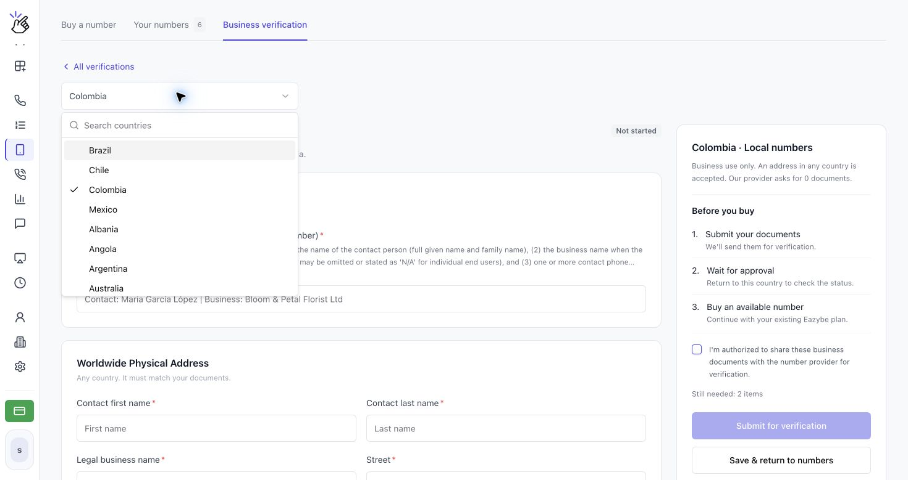
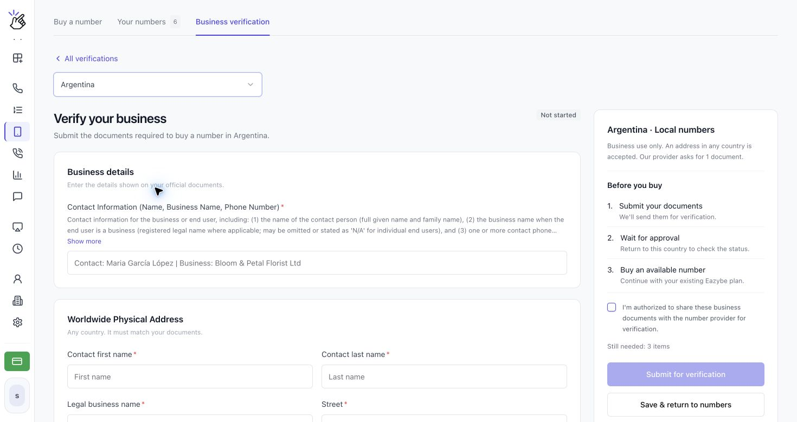
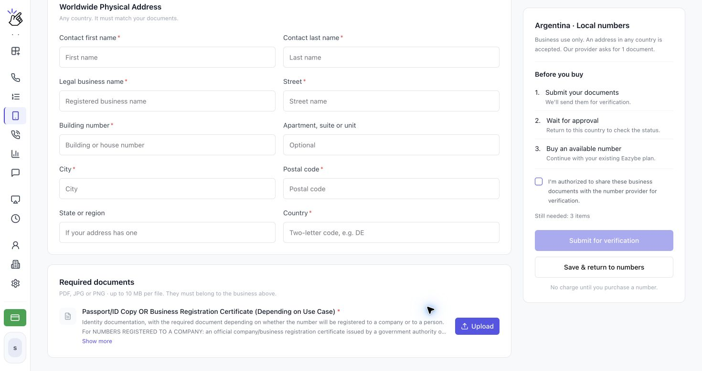
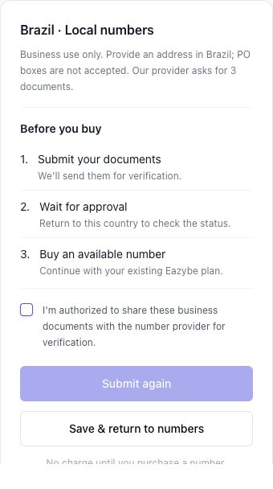
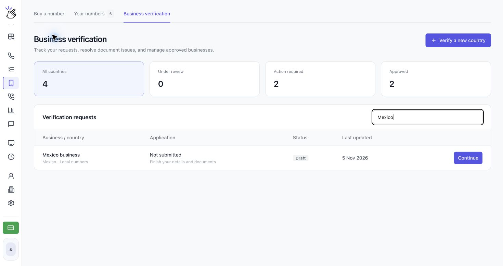
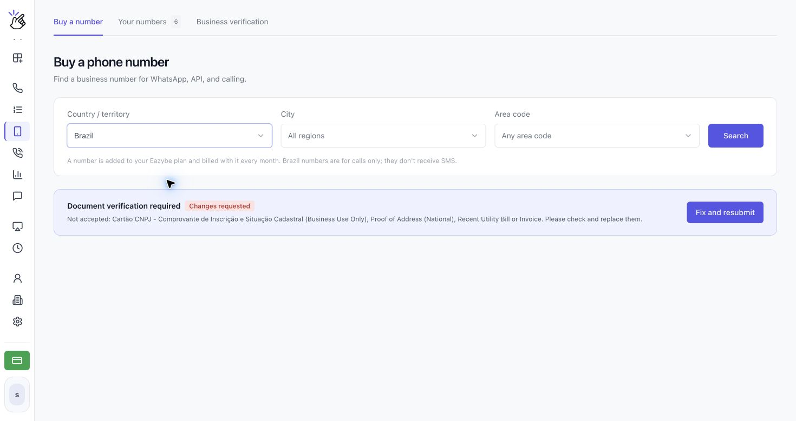

Brezilya dahil doğrulama gerektiren bir ülkede numara satın almadan önce **Business verification** işlemini tamamlayın. Numara satın almak istediğiniz her ülke için ayrı bir doğrulama gönderin.

<Note>Form ülkeye göre değişir. Ekran görüntüleri akışı anlatmak için farklı ülkeleri gösterir; seçtiğiniz ülkenin alanlarını ve belge gereksinimlerini izleyin. Örnek adları kendi bilgilerinizle değiştirin.</Note>

## Doğrulamanızı gönderme

<Steps>
  <Step title="Business verification bölümünü açın">
    **CALLS → Phone Numbers → Business verification** yolunu açın. **Verify a new country** düğmesine tıklayıp seçiciden ülkeyi seçin. **Buy a number** altındaki **Document verification required** bildiriminden **Verify business** düğmesine de tıklayabilirsiniz.

    

    <Note>Sayfa, kimlik kontrolü burada sunulamadığı için ülkenin henüz kullanılamadığını belirtiyorsa o ülkenin doğrulamasını Eazybe'de henüz tamamlayamazsınız. Kullanılabilir başka bir ülke seçin.</Note>
  </Step>
  <Step title="İşletme bilgilerinizi girin">
    **Verify your business** ekranında, resmi belgelerinizdeki bilgilerle **Business details** altındaki zorunlu alanları doldurun. Bir gereksinimin tüm yönergelerini okumak için altındaki **Show more** düğmesine tıklayın. Yıldız işaretli alanlar zorunludur.

    

    Brezilya için formda **Contact Information (Name, Business Name, Phone Number)** ve **Brazilian CPF Tax Number (Personal Use Only)** istenir. Kişisel kullanım gereksinimleri için yetkili temsilcinin kişisel bilgilerini, işletme kullanımı gereksinimleri için işletmenin bilgilerini kullanın. İşletmenin CNPJ kimlik numarası, CPF yerine kullanılamaz.
  </Step>
  <Step title="Adresi ekleyin ve gerekli belgeleri yükleyin">
    Adres bölümünü doldurun. Form numaranın ülkesinde bir adres gerektiriyorsa belgelerle eşleşen yerel bir adres kullanın; Brezilya, Brezilya'da bir adres gerektirir ve posta kutusu adreslerini kabul etmez. **Worldwide Physical Address** gösterildiğinde belgelerinizle eşleşen herhangi bir ülkedeki adres kabul edilir.

    **Required documents** altında her gereksinimi okuyup yanındaki **Upload** düğmesine tıklayın. Okunaklı **PDF, JPG veya PNG** dosyaları kullanın; sınır **dosya başına 10 MB**'tır. Yükledikten sonra dosyayı kontrol etmek için **View**, düzeltmek için **Replace** seçeneğini kullanın.

    

    <Note>Bazı ülkeler dosya yüklemeden yalnızca bilgi ve adres ister. Her ülke için aynı belgeleri yüklemek yerine seçtiğiniz ülkenin formunu izleyin.</Note>
  </Step>
  <Step title="Doğrulamanızı inceleyip gönderin">
    **Before you buy** bölümünü ve **Still needed** öğelerini kontrol edin. Gerekli alanlar ve belgeler tamamlandığında **I'm authorized to share these business documents with the number provider for verification.** kutusunu işaretleyin ve **Submit for verification** düğmesine tıklayın. Reddedilen bir başvuruyu düzeltiyorsanız düğmede **Submit again** yazar.

    

    <Tip>Taslak kaydedip daha sonra tamamlamak için **Save & return to numbers** seçeneğini kullanın. Taslak kaydetmek, başvuruyu incelemeye göndermez.</Tip>

    <Warning>Yalnızca numara sağlayıcısıyla paylaşmaya yetkili olduğunuz belgeleri gönderin. Gönderim belgeleri doğrulamaya iletir; numara satın almaz ve ücret oluşturmaz.</Warning>
  </Step>
  <Step title="Başvuruyu takip edin ve onaydan sonra geri dönün">
    **Verification requests** listesini görmek için **Business verification** bölümünü açın. **All countries**, **Under review**, **Action required** veya **Approved** ile filtreleyin ya da **Search business, country or ID** alanını kullanın. Başvuruyu ilgili işlem düğmesiyle açın.

    

    İnceleme birkaç iş günü sürebilir. Başvuru incelendiğinde Eazybe e-posta gönderir. Durum **Approved** olduğunda **Buy a number** bölümüne dönün, aynı ülkeyi seçin ve kullanılabilir numara arayın.
  </Step>
</Steps>

## Brezilya için belgeleri hazırlama

Brezilya formu şu anda aşağıdakileri ister. Yüklemeden önce kabul edilen belgelerle ilgili güncel ayrıntıları **Show more** bölümünden okuyun.

| Gereksinim | Sağlanacak bilgi veya belge |
| --- | --- |
| İletişim bilgileri | İletişim kişisinin tam adı, işletmenin yasal adı ve iletişim telefon numarası. |
| Brezilya CPF numarası | Yetkili temsilcinin kişisel bilgileriyle eşleşen CPF numarası. |
| Brezilya'da fiziksel adres | Destekleyici belgelerle eşleşen işletme adresi; posta kutusu adresi kabul edilmez. |
| Proof of Address (National), Recent Utility Bill or Invoice | Adı ve Brezilya'daki tam adresi gösteren kabul edilebilir belge. Devlet tarafından düzenlenmeyen belgeler son üç ay içinde düzenlenmiş olmalıdır; resmi kimlik belgelerinin son kullanma tarihi varsa geçerlilik süresi dolmamış olmalıdır. |
| Cartão CNPJ - Comprovante de Inscrição e Situação Cadastral (Business Use Only) | İşletmenin aktif kaydını gösteren resmi CNPJ kayıt belgesi. Pasaport bunun yerine geçmez. |
| ID/Passport Copy (Personal Use Only) | Yetkili temsilcinin geçerli, süresi dolmamış resmi kimlik belgesinin veya pasaportunun okunaklı kopyası. |

## Başvuru durumunu anlama

| Durum | Sonraki adım |
| --- | --- |
| **Not started** | Ülkeye özel formu doldurun. |
| **Draft** | Başvuru listesinde **Continue** düğmesine tıklayın, eksikleri tamamlayın ve gönderin. |
| **Under review** | İncelemeyi bekleyin. İnceleme sırasında bilgiler değiştirilemez. Başvuruyu açıp güncelleme için **Check status** seçeneğini kullanın. |
| **Changes requested** | **Fix and resubmit** düğmesine tıklayın, nedeni okuyun, bilgileri düzeltin veya ilgili dosyalarda **Replace** kullanın ve **Submit again** düğmesine tıklayın. |
| **Approved** | O ülkede kullanılabilir bir numara satın alın. Gösteriliyorsa son geçerlilik tarihini kontrol edin. |
| **Expired** | Daha fazla numara satın almadan önce **Update documents** düğmesine tıklayıp yeniden gönderin. Mevcut numaralarınız çalışmaya devam eder. |

<Warning>Onaylanmış doğrulama bilgilerini değiştirmek, o ülkede daha fazla numara satın almadan önce yeni bir inceleme gerektirir.</Warning>

**Buy a number** ekranı da ülkenin güncel doğrulama durumunu ve sonraki işlemi gösterir.

## Gönderme düğmesi neden devre dışı?

**Still needed** öğelerini kontrol edin, tüm zorunlu alanları doldurun, gerekli belgelerin her birini yükleyin ve yetkilendirme kutusunu işaretleyin. Kaydedilen taslak veya yüklenen dosya tek başına doğrulamanın gönderildiği anlamına gelmez.

## Neden hâlâ numara satın alamıyorum?

Seçilen ülkenin doğrulama durumunun **Approved** olduğundan emin olun. Başka bir ülkedeki onay, taslak veya inceleme aşamasındaki başvuru satın almayı açmaz. Onay numara da ayırmaz: kullanılabilir numara yoksa başka bir alan kodu deneyin veya tüm bölgelerde arayın.

Onaydan sonra [Telefon numarası satın alma ve yönetme](/tr/voice-number/phone-numbers) kılavuzuyla devam edin. Brezilya numaraları ve yalnızca arama destekleyen diğer numaralar, WhatsApp doğrulaması için SMS yerine telefon araması kullanır.
