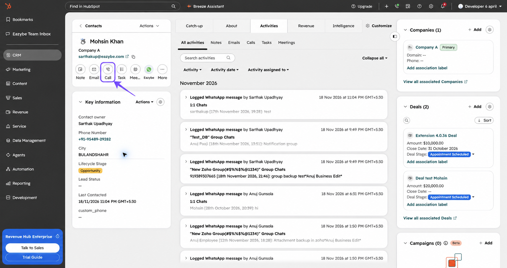
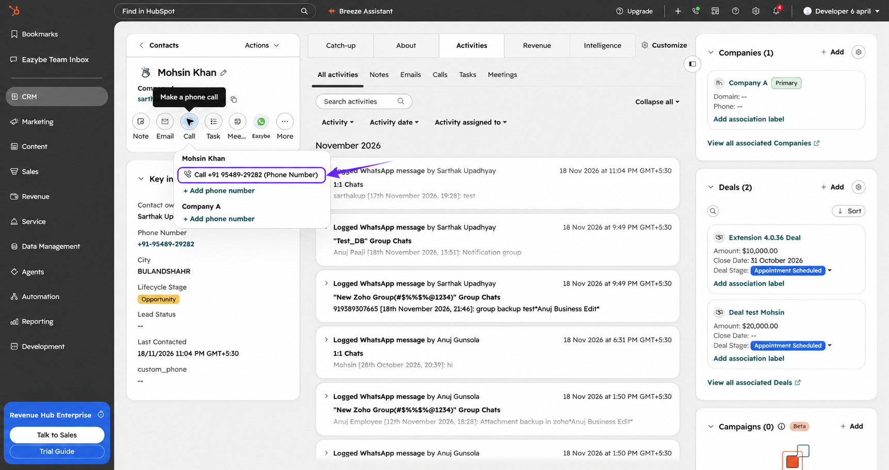
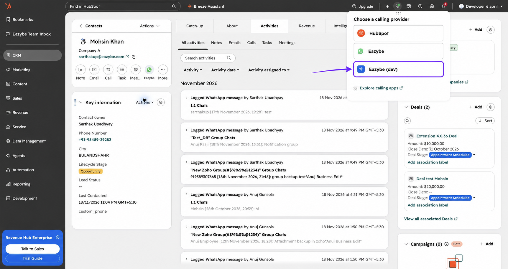
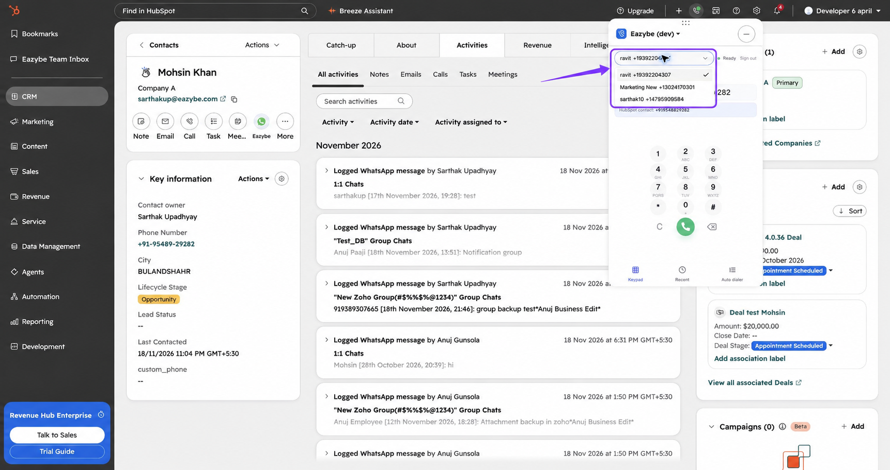
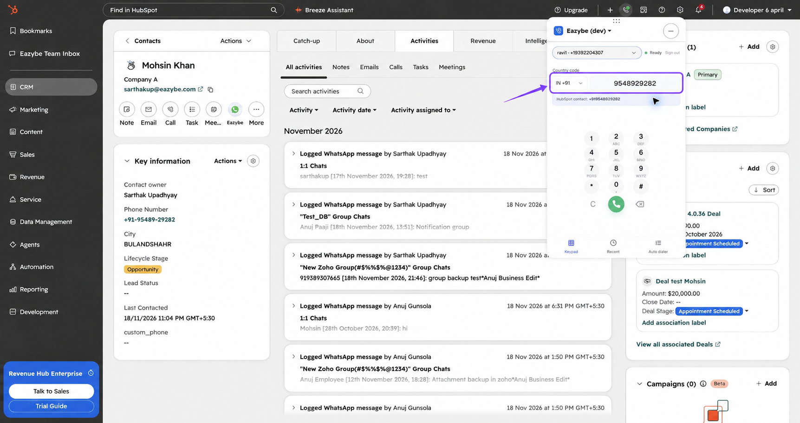
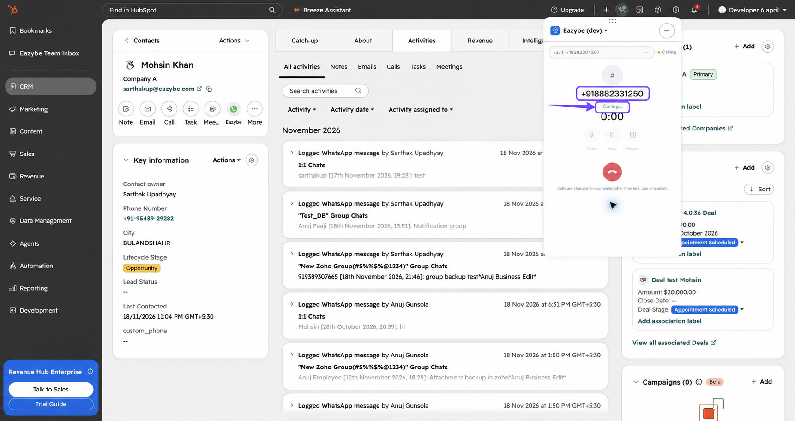
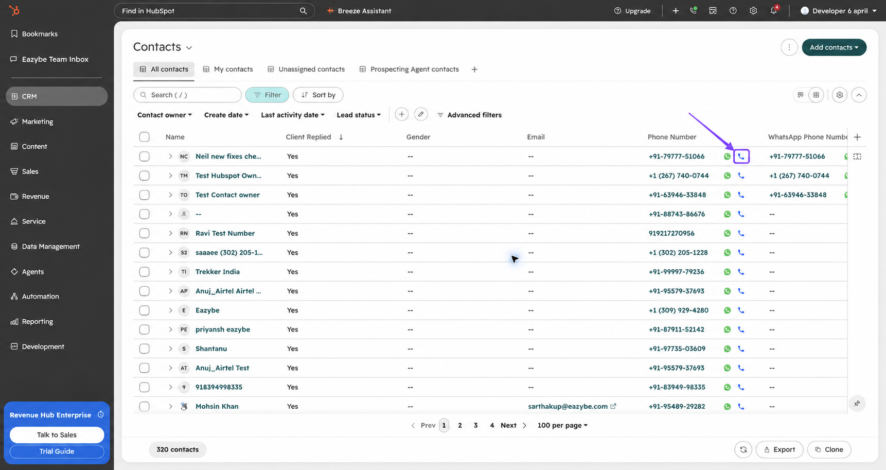
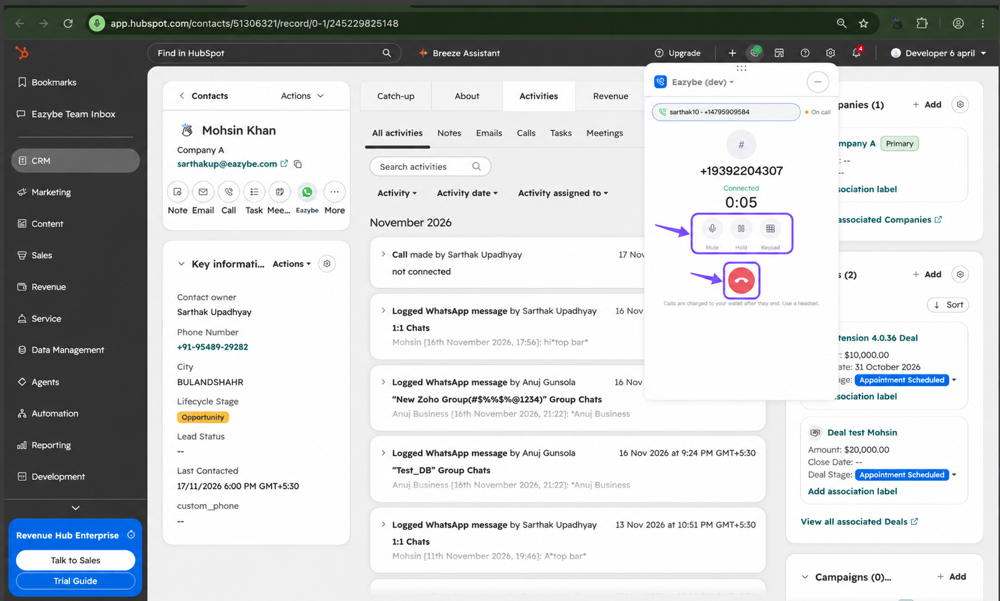
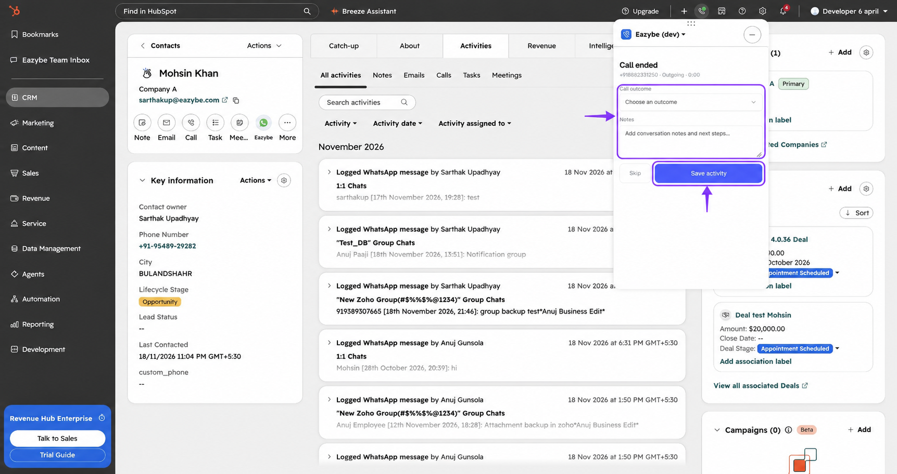

HubSpot'tan çıkmadan bir kişiyi aramak için Eazybe arama ekranını kullanın. İş numaranızı seçin, kişinin numarasını kontrol edin ve aramayı aynı pencereden yönetin.

## Başlamadan önce

- HubSpot hesabınızı Eazybe'ye bağlayın ve Eazybe'de oturum açın.
- Kullanabileceğiniz etkin bir Eazybe sesli arama numaranız, arama özelliği içeren bir planınız ve cüzdanınızda yeterli bakiye olduğundan emin olun.
- Kulaklık kullanın ve tarayıcı istediğinde mikrofon erişimine izin verin.

<Note>
HubSpot kişi listesindeki **Call with Eazybe** düğmesini kullanmak için **Eazybe uzantısını açık tutun**. Uzantı ve HubSpot aynı Chrome profilinde açık olmalıdır.
</Note>

<Note>
Ekran görüntülerinde örnek bir hesap ve İngilizce arayüz kullanılmıştır. Görsellerde kolayca bulabilmeniz için düğme adlarını İngilizce bıraktık. Bazı görüntülerde arama sağlayıcısı olarak **Eazybe (dev)** görünür; hesabınız için yapılandırılmış Eazybe sağlayıcısını seçin. Kişi adlarınız ve kullanabileceğiniz numaralar farklı olacaktır.
</Note>

## Kişi kaydından arama yapma

<Steps>
  <Step title="Kişiyi açın ve Call düğmesine tıklayın">
    HubSpot'ta bir kişiyi açın. Kişinin adının altında **Call** düğmesine (telefon simgesi) tıklayın. İmleci üzerine getirdiğinizde **Make a phone call** açıklaması görünür.

    
  </Step>

  <Step title="Kişinin telefon numarasını seçin">
    **Call** yazısının yanında aramak istediğiniz numaranın bulunduğu seçeneğe tıklayın. Eazybe arama ekranı açılır veya HubSpot bir arama sağlayıcısı seçmenizi ister.

    

    <Note>
    Kayıtlı numara yoksa devam etmeden önce kişinin adının altındaki **+ Add phone number** seçeneğini kullanın.
    </Note>
  </Step>

  <Step title="Arama sağlayıcısı olarak Eazybe'yi seçin">
    **Choose a calling provider** ekranı görünürse Eazybe sağlayıcınızı seçin. Eazybe arama ekranı doğrudan açılıyorsa bu adımı atlayabilirsiniz.

    
  </Step>

  <Step title="Arama yapacağınız iş numarasını seçin">
    Arama ekranının üst kısmındaki numara listesini açın ve arama yapmak için kullanacağınız Eazybe numarasını seçin. Durum **Ready** olana kadar bekleyin.

    

    <Note>
    Üstteki numara, arama yapmak için kullandığınız iş numarasıdır. **Country code** başlığının altındaki numara ise arayacağınız kişiye aittir.
    </Note>
  </Step>

  <Step title="Arayacağınız kişinin numarasını kontrol edin">
    **Country code** alanını ve yanındaki telefon numarasını kontrol edin. Telefon alanı boşsa ve **Use phone number** görünüyorsa bu düğmeye tıklayın. **HubSpot contact** yanında gösterilen numara alana eklenir.

    Farklı bir numara da yazabilirsiniz. Ülke kodunu seçin ve ülke kodunu tekrar yazmadan numaranın kalan rakamlarını girin.

    
  </Step>

  <Step title="Aramayı başlatın">
    Yeşil telefon düğmesine tıklayın. Arama başlarken ekranda aranan numara ve **Calling…** görünür. Karşı taraf yanıt verdiğinde **Connected** ve arama süresi gösterilir.

    

    <Warning>
    Yeşil telefon düğmesi gerçek bir arama başlatır. Önce arayacağınız numarayı kontrol edin. Arama ücretleri, arama bittikten sonra cüzdanınızdan düşülür.
    </Warning>
  </Step>
</Steps>

## Kişi listesinden arama yapma

Bu kısayolu kullanırken **Eazybe uzantısını açık tutun**.

<Steps>
  <Step title="Kişinin arama düğmesini bulun">
    **CRM → Contacts** bölümünü açın. Kişinin satırında, telefon numarasının yanındaki mavi telefon simgesini bulun. Bu düğmenin adı **Call with Eazybe** şeklindedir.

    
  </Step>

  <Step title="Arama ekranını açın ve numarayı kontrol edin">
    **Call with Eazybe** düğmesine tıklayın. Arama ekranında iş numaranızı, arayacağınız kişinin ülke kodunu ve telefon numarasını kontrol edin. Ardından aramayı başlatmak için yeşil telefon düğmesine tıklayın.

    

    <Note>
    Listedeki arama düğmesi görünmüyorsa veya yanıt vermiyorsa Eazybe uzantısının bu Chrome profilinde açık olduğunu kontrol edin. Kişi kaydını açıp oradaki **Call** düğmesini de kullanabilirsiniz.
    </Note>
  </Step>
</Steps>

## Arama sırasında

Arama bağlandıktan sonra ekrandaki kontrolleri kullanabilirsiniz:

| Kontrol | Yapabilecekleriniz |
| --- | --- |
| **Mute** | Karşı tarafın sizi duymaması için mikrofonu kapatın. |
| **Hold** | Bağlanan aramayı beklemeye alın. |
| **Keypad** | Arama sırasında telefon menüsü için rakam girin. |
| Kırmızı telefon düğmesi | Aramayı sonlandırın. |

## Gelen aramayı yanıtlama

Bir arama geldiğinde ekranda **Incoming call…** ve arayan kişinin numarası görünür. Yanıtlamak için yeşil, reddetmek için kırmızı telefon düğmesine tıklayın.

## Aramayı tamamlama

<Steps>
  <Step title="Arama sonucu ve not ekleyin">
    Arama bittikten sonra **Call ended** ekranında numara, arama yönü ve süre gösterilir. **Call outcome** alanından bir sonuç seçin, **Notes** alanına notlarınızı ekleyin ve **Save activity** düğmesine tıklayın. Bu bilgileri eklemek istemiyorsanız **Skip** düğmesini kullanın.

    
  </Step>
</Steps>

## Yardıma mı ihtiyacınız var?

### Kişinin numarası alana eklenmiyor

HubSpot kişi bilgilerinin yanında **Use phone number** görünüyorsa bu düğmeye tıklayın. Görünmüyorsa arayacağınız numarayı girin ve doğru **Country code** değerini seçin. Özellikle başka bir kişiye geçtikten sonra, aramadan önce telefon alanını mutlaka kontrol edin.

### İş numaram görünmüyor

Doğru Eazybe hesabında oturum açtığınızı kontrol edin. Yöneticinizden numaranın etkin ve kullanımınıza açık olduğunu doğrulamasını isteyin.

### Arama başlatamıyorum

**Ready** durumunu bekleyin, arama yapacağınız iş numarasını seçin ve karşı tarafın numarasını kontrol edin. Önce devam eden aramanızı sonlandırın. Eazybe abonelik veya bakiye uyarısı gösteriyorsa yöneticinizden arama planınızı kontrol etmesini ya da cüzdana bakiye yüklemesini isteyin.

### Karşı taraf beni duyamıyor

Tarayıcınızın mikrofon iznini ve kulaklık bağlantısını kontrol edin. Aramayı sessize aldıysanız aynı kontrolü kullanarak mikrofonu yeniden açın.
