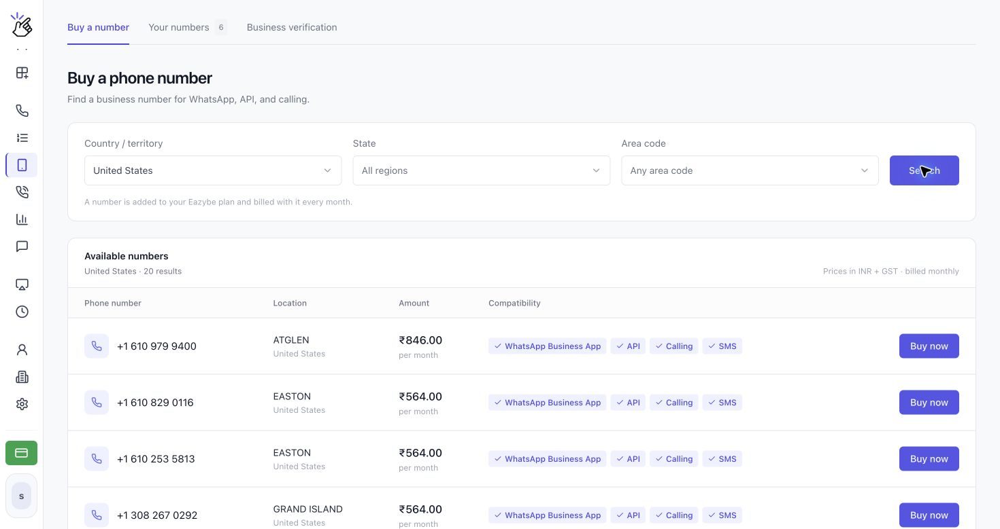
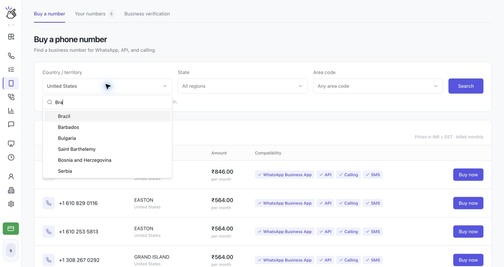
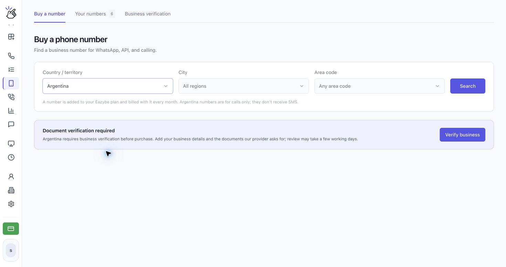
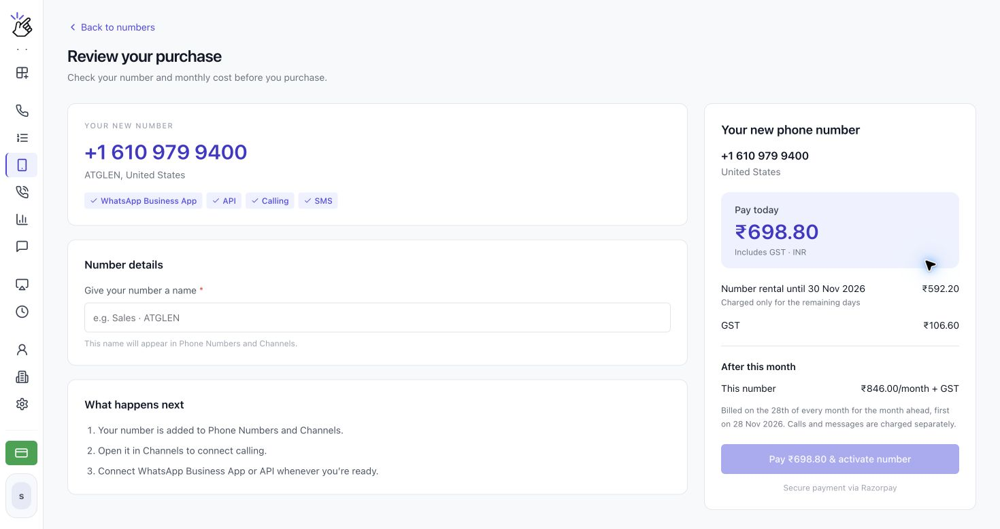

Brezilya ve diğer kullanılabilir ülkelerde işletmeniz için sesli arama numarası satın almak ve kuruluşunuzun numaralarını yönetmek için **Phone Numbers** bölümünü kullanın. İşletme doğrulaması gerektiren ülkelerde satın almadan önce onay almanız gerekir.

## Ülke seçme

**Country / territory** seçicisinde artık Amerika Birleşik Devletleri, Kanada, Porto Riko ve ABD Virjin Adaları'nın yanı sıra Brezilya, Şili, Kolombiya, Meksika, Arjantin ve birçok başka ülke bulunur. Güncel seçenekleri görmek için seçicide ülkenizi arayın.

<Note>Bir ülkenin seçicide bulunması, kullanılabilir numara olduğu anlamına gelmez. Doğrulama gereksinimleri ve numara bulunabilirliği ülkeye göre değişir. Seçiminiz için gösterilen gereksinimleri izleyin.</Note>

## Numara satın alma

<Steps>
  <Step title="Phone Numbers bölümünü açın">
    **CALLS** altında **Phone Numbers** bölümünü açın ve **Buy a number** sekmesini seçin. Diğer sekmeler **Your numbers** ve **Business verification** şeklindedir.

    
  </Step>
  <Step title="Ülkenizi ve konumu seçin">
    **Country / territory** seçicisini açın ve **Brazil** gibi bir ülke arayın. Kullanılabiliyorsa **City** veya **State** ile **Area code** seçin, ardından **Search** düğmesine tıklayın. Daha geniş arama yapmak için **All regions** ve **Any area code** seçeneklerini koruyun.

    

    <Note>**No numbers available here today** mesajını görürseniz başka bir alan kodu deneyin veya tüm bölgelerde arayın. Bölgeler yüklenemese bile ülke genelinde arama yapabilirsiniz.</Note>
  </Step>
  <Step title="Gerekiyorsa işletme doğrulamasını tamamlayın">
    **Document verification required** görünürse **Verify business** düğmesine tıklayın. Bilgilerinizi girmek, istenen belgeleri yüklemek ve incelemeye göndermek için [İşletmenizi doğrulama](/tr/voice-number/business-verification) kılavuzunu izleyin. **Business verification → Verify a new country** yolundan da başlayabilirsiniz.

    İşleme daha önce başladıysanız düğmede **Continue verification**, **View details**, **Fix and resubmit** veya **Update documents** yazabilir. Onay aldıktan sonra numara satın almak için geri dönün.

    

    <Note>Doğrulama ülkeye özeldir. Bir ülke için verilen onay, işletmenizi diğer tüm ülkelerde doğrulamaz. Numara satın alana kadar ücret alınmaz.</Note>
  </Step>
  <Step title="Kullanılabilir numaraları karşılaştırın">
    Sonuçlarda **Phone number**, **Location**, **Amount** ve **Compatibility** gösterilir. İstediğiniz numaranın özelliklerini kontrol edin ve **Review your purchase** ekranını açmak için **Buy now** düğmesine tıklayın.

    

    <Warning>Brezilya numaraları ve yalnızca arama desteklediği belirtilen diğer ülke numaraları SMS almaz. Bu numaraları WhatsApp'ta doğrulamak için SMS kodu istemek yerine telefon aramasını kullanın.</Warning>
  </Step>
  <Step title="Fiyatı inceleyin ve numaranızı etkinleştirin">
    **Review your purchase** ekranında numarayı, ülkeyi ve uyumluluğu kontrol edin. **Number details** altında **Give your number a name** alanına bir ad girin. Bu ad Phone Numbers ve Channels bölümlerinde görünür.

    **Pay today**, **Number rental until**, varsa **GST** ve **After this month** bilgilerini inceleyin. Satın almaya hazır olduğunuzda toplam tutarı gösteren **Pay … & activate number** düğmesine tıklayın. Hesabınız için gösterilen ödeme akışını izleyin.

    

    <Warning>Numarayı etkinleştirmek, düzenli kira ücreti olan ücretli bir satın alma işlemidir. Ödeme kayıtlı kartınızdan alınabilir veya bir ödeme sağlayıcısı açılabilir. Devam etmeden önce toplam tutarı, kira dönemini ve yenileme takvimini doğrulayın. Aramalar ve mesajlar ayrıca ücretlendirilir; ekran görüntülerindeki fiyatlar örnektir, hesabınıza özel teklif değildir.</Warning>
  </Step>
  <Step title="Your numbers bölümünü inceleyin">
    Her numaranın adını, ülkesini, aylık tutarını, satın alma ve yenileme tarihlerini görmek için **Your numbers** bölümünü açın. Kanal ayarlarını açmak için **View in Channels** seçeneğini kullanın. **More actions** menüsünde **Verification code** ve yöneticiler için **Cancel subscription** bulunur.

    
  </Step>
</Steps>

<Warning>İptal edilen numara, ödenmiş dönem bitene kadar kullanılabilir; ardından serbest bırakılır ve geri alınamaz. Bir sonraki aylık ücretten kaçınmak için ayın 28'inden önce iptal edin.</Warning>

## Sesli arama numaranızı WhatsApp'a bağlama

Numaranın uyumluluk bilgileri bu seçeneği gösteriyorsa satın aldığınız numarayı **WhatsApp Business uygulaması** veya **WhatsApp API** ile kullanabilirsiniz. Doğrulama yöntemi, numaranın SMS alıp almadığına bağlıdır. Numara satın almak için yapılan işletme doğrulaması, numaranın WhatsApp'ta doğrulanmasından ayrıdır.

### WhatsApp Business uygulamasını bağlama

1. Telefonunuza **WhatsApp Business** uygulamasını yükleyip açın.
2. Hesap kurulumunu başlatın ve Eazybe'de gösterilen sesli arama numarasını ülke koduyla birlikte girin.
3. Numara SMS destekliyorsa SMS ile doğrulama kodu isteyin ve [**Eazybe'de SMS**](https://app.eazybe.com/calls/sms) bölümünde bulun. Brezilya numarası gibi yalnızca arama destekleyen numaralarda, WhatsApp sunduğunda **Call me** seçeneğini kullanın.
4. **Call me** kullanıyorsanız Eazybe telefonunu açık tutun, bu numaraya gelen WhatsApp aramasını yanıtlayın ve sesli okunan kodu not alın.
5. WhatsApp Business'a dönün ve doğrulamayı tamamlamak için kodu girin.

### WhatsApp API'yi bağlama

1. Eazybe'de **Channels** bölümünü açın ve **Add channel** seçeneğini seçin.
2. Meta'ya geçmek için **WhatsApp** seçeneğini seçin, giriş yapın ve kurulum yönergelerini izleyin.
3. Eazybe'de gösterilen sesli arama numarasını girin. Numara SMS destekliyorsa SMS doğrulaması, yalnızca arama destekliyorsa telefon aramasıyla doğrulama isteyin.
4. Kodu [**Eazybe'de SMS**](https://app.eazybe.com/calls/sms) bölümünde okuyun veya Eazybe telefonunu açık tutup doğrulama aramasını yanıtlayarak kodu dinleyin.
5. Meta'ya dönün, kodu girin ve bağlantıyı tamamlayın.

### WhatsApp “Login not available right now” mesajını gösterirse

WhatsApp güvenlik nedeniyle giriş yapmayı geçici olarak engelleyebilir. Bu mesaj görünürse VPN'inizi numarayı satın aldığınız ülkeye bağlayıp yeniden giriş yapmayı deneyin. Örneğin Hindistan'dan bağlanırken ABD numarası için ABD konumlu bir VPN kullanın. Tekrar denedikten sonra numaranın özelliklerine göre SMS veya arama yoluyla yeni bir kod isteyin ve WhatsApp Business ya da Meta'da girin.

<Warning>VPN konumu satın aldığınız numaranın ülkesiyle eşleşmelidir. Önceki kodun süresi dolabileceğinden bağlantıyı değiştirdikten sonra yeni bir kod isteyin.</Warning>
