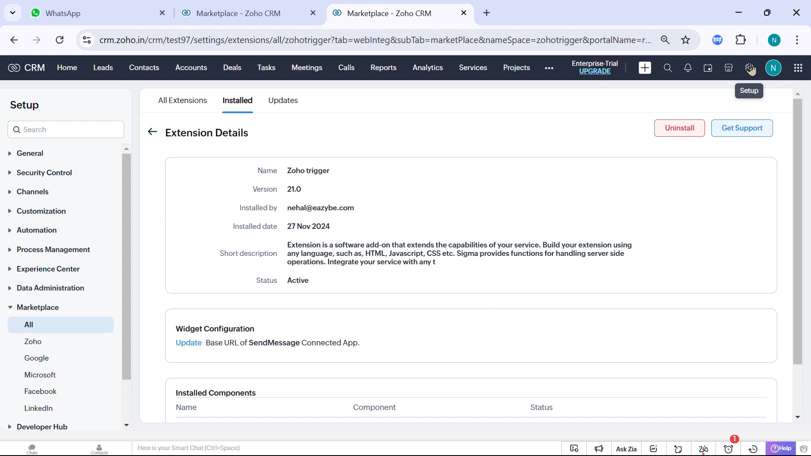
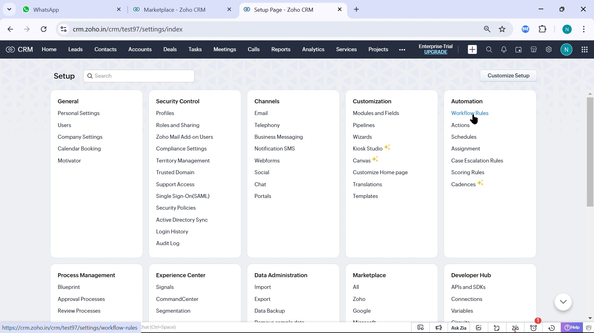
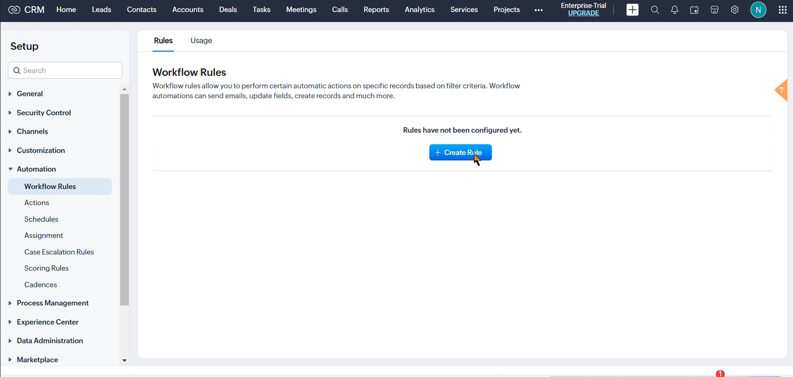
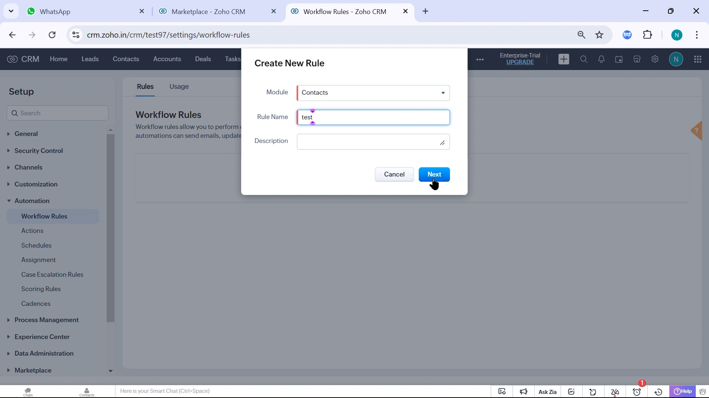
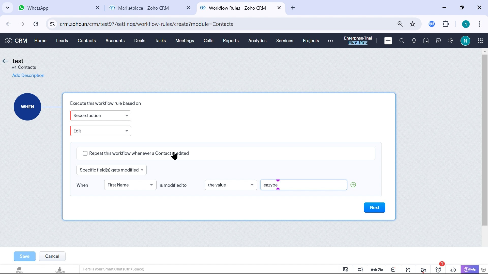
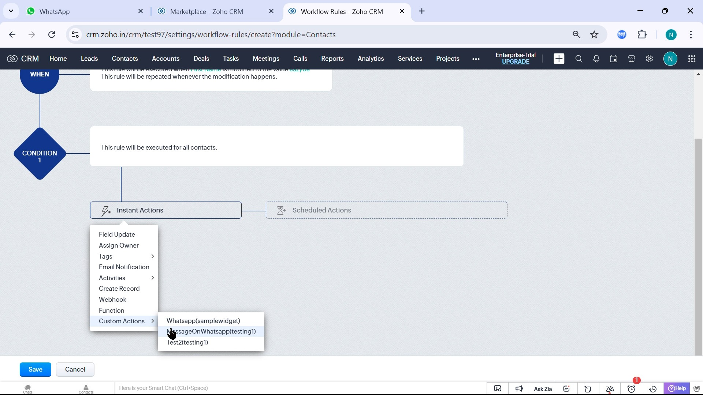
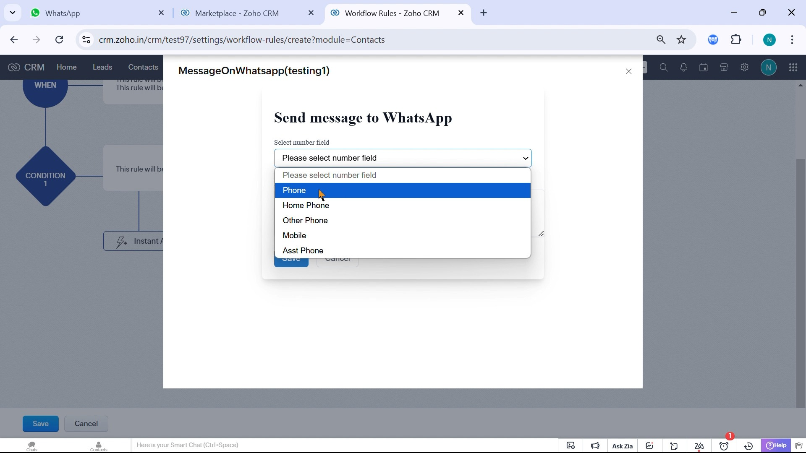

Bir kişi, potansiyel müşteri veya başka bir CRM kaydı belirlediğiniz koşulları karşıladığında mesaj gönderen bir iş akışı oluşturun.

## Başlamadan Önce

Kural oluşturma yetkisi, yüklü ve **Active** durumundaki **Zoho trigger**, Eazybe'ye bağlı Zoho hesabı ve uluslararası ülke koduyla kaydedilmiş alıcı numarası gerekir. Kayıt sahibinde Eazybe uzantısı veya uygulaması yüklü olmalı ve etkin bir WhatsApp bağlantısı bulunmalıdır.

<Warning>İş akışı entegrasyonu **Scalar Planı** kapsamında kullanılabilir. Mesajlar kişi veya potansiyel müşteri kaydının sahibinin WhatsApp numarasından gönderilir. Çalıştırmadan önce doğru kayıt sahibini atayın.</Warning>

<Steps>
  <Step title="Zoho trigger durumunu doğrulayın">
    **Setup → Marketplace → All → Installed** bölümünü açın. **Zoho trigger** seçeneğini açıp **Status: Active** durumunu doğrulayın.

    Gerekirse [Zoho trigger ve Team Inbox paketini yükleyin](https://crm.zoho.com/market/installPrivatePlugin.do?portalName=rajatverma&nameSpace=zohotrigger&versionIndex=4520363000000438001). Aynı paket iş akışı eylemini, Kişiler/Potansiyel Müşteriler gelen kutularını ve genel gelen kutusunu içerir. [Yükleme adımlarını](/tr/integrations/zoho/team-inbox) inceleyin.

    
  </Step>
  <Step title="İş akışı kurallarını açın">
    **Setup** içinde **Automation → Workflow Rules** bölümünü açın.

    
  </Step>
  <Step title="Bir kural oluşturun">
    **Create Rule** düğmesine tıklayarak **Create New Rule** ekranını açın.

    
  </Step>
  <Step title="Modülü seçip kurala ad verin">
    **Module** alanında **Contacts** veya **Leads** gibi bir modül seçin. **Rule Name** girin, gerekirse açıklama ekleyin ve **Next** düğmesine tıklayın. Telefon alanı ve kayıt sahibi bu modülden alınır.

    
  </Step>
  <Step title="Çalışma koşullarını belirleyin">
    **Execute this workflow rule based on** altında **Record action → Edit** gibi bir olay seçin. Alan ve değer koşullarını belirleyip **Next** düğmesine tıklayın.

    <Warning>Tekrarlı çalıştırmayı yalnızca kayıt koşulu yeniden karşıladığında tekrar mesaj gönderilmesini istiyorsanız açın. Aksi halde yinelenen mesajlar gönderilebilir.</Warning>

    
  </Step>
  <Step title="WhatsApp eylemini ekleyin">
    **Instant Actions → Custom Actions** menüsünü açıp Eazybe'nin **MessageOnWhatsapp** eylemini seçin. Zoho, uzantının ad alanını parantez içinde gösterebilir.

    
  </Step>
  <Step title="Alıcıyı seçip mesajı yazın">
    **Send message to WhatsApp** ekranında **Select number field** alanını açın. Alıcının numarasını içeren **Phone** veya **Mobile** gibi bir alan seçin. Mesajınızı yazıp **Save** düğmesine tıklayın. Yanlış alıcı veya teslimat hatalarını önlemek için numarayı ülke koduyla kaydedin.

    
  </Step>
</Steps>

## Etkinleştirin ve Doğrulayın

Olayı, koşulları ve eylemi inceleyin. **Save** ile kuralı etkinleştirip bir test kaydını koşulları karşılayacak şekilde güncelleyin. Mesajın doğru alıcıya kayıt sahibinin numarasından ulaştığını ve kuralın yalnızca belirlenen koşullarda çalıştığını doğrulayın.

<Info>Mesaja eklenen medya dosyaları **15 MB** boyutunu aşmamalıdır.</Info>

Eylem görünmüyorsa Zoho trigger kurulumunu ve bağlantısını kontrol edin. Mesaj ulaşmıyorsa kayıt sahibinin bağlantısını ve numara alanını inceleyin. Yinelenen mesajlar varsa tekrarlı çalıştırma ayarını kontrol edin. [İş akışı sorunlarını giderme](/tr/integrations/zoho/troubleshoot-workflow) kılavuzuna bakın.
