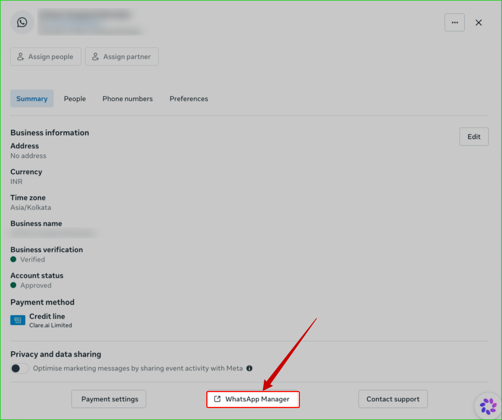
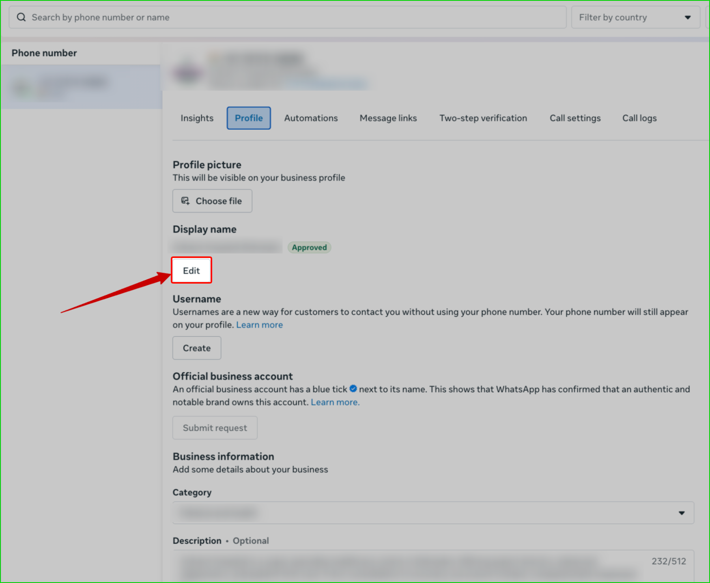
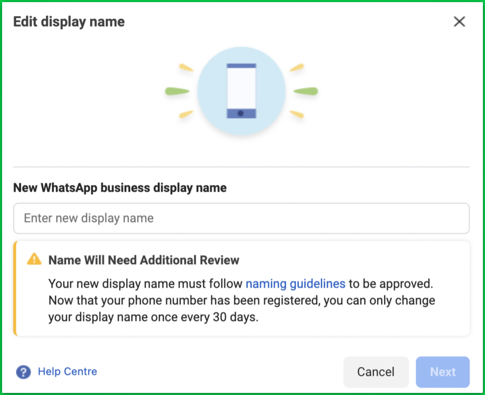
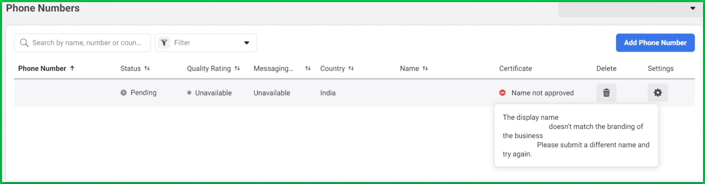
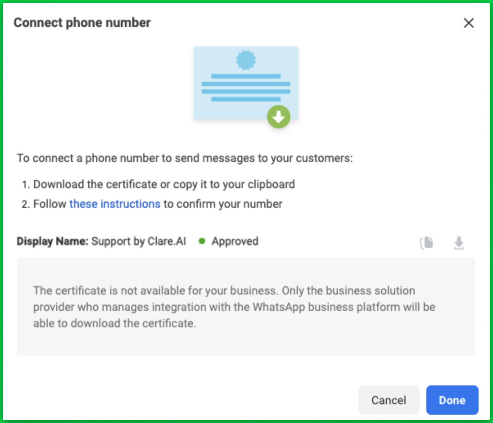

Eazybe’ye bağlı WhatsApp numaranız için yeni bir ad talep etmek üzere WhatsApp Manager’ı kullanın. Yeni adı kullanabilmeniz için Meta’nın talebi onaylaması gerekir.

<Note>
Ekran görüntülerinde Meta’nın İngilizce arayüzü gösterilmektedir. Arayüzünüz farklı olabilir; hesap bilgileri örnektir.
</Note>

<Steps>
  <Step title="WhatsApp Manager’ı açın">
    [Meta Business Manager](https://business.facebook.com/) hesabınıza giriş yapın, WhatsApp işletme hesabınızı seçin ve **WhatsApp Manager**’ı açın.

    
  </Step>
  <Step title="Telefon numaranızı seçin">
    **Phone numbers** (Telefon numaraları) bölümünde doğru numarayı bulun ve yanındaki ayarlar simgesini seçin.

    
  </Step>
  <Step title="Profil adını düzenleyin">
    **Profile** (Profil) sekmesini açın ve **Display name** (Görünen ad) altındaki **Edit** (Düzenle) düğmesini seçin.

    
  </Step>
  <Step title="Yeni adı gönderin">
    **New WhatsApp business display name** alanına yeni adı yazın, **Next** (İleri) düğmesini seçin ve incelemeye gönderme işlemini tamamlayın. Pencerede gösterilen adlandırma kurallarını ve değişiklik kısıtlamalarını okuyun.

    
  </Step>
</Steps>

## İnceleme sonucunu kontrol edin

Ad incelemesini kontrol etmek için WhatsApp Manager’da numaranın profiline dönün. Bekleyen bir inceleme henüz sonuçlanmamıştır. **Approved** (Onaylandı), Meta’nın adı kabul ettiğini; **Name not approved** (Ad onaylanmadı) ise adı düzeltmeniz gerektiğini belirtir.

## Adınız reddedilirse

Ret nedenini okuyun, adı düzeltin ve **Edit** düğmesiyle yeni bir talep gönderin. Örneğin, aşağıdaki ekran görüntüsünde işletmenin markasıyla eşleşmeyen bir ad gösterilmektedir. Yeni bir gönderim yeni bir inceleme başlatır.

## Onaydan sonra

Onaylanan adın bağlı numaranızda görünüp görünmediğini kontrol edin. Görünmüyorsa veya Meta bir sertifika ya da kayıt istemi gösteriyorsa, yardım almak için numaranız ve durum ekranının görüntüsüyle [Eazybe Destek](mailto:support@eazybe.com) ekibine başvurun.

## Sık sorulan sorular

### İnceleme ne kadar sürer?

Meta’nın talebi incelemesini bekleyin. En güncel sonucu WhatsApp Manager’dan kontrol edin; onay anında verilmez ve inceleme süresi değişebilir.

### Onayı nereden kontrol edebilirim?

WhatsApp Manager’daki görünen ad durumunu kullanın. Telefon numarasının bağlantı durumu, adın onay durumundan ayrıdır.

### Sertifika indirmem gerekiyor mu?

Bazı Meta arayüzlerinde yukarıdaki örnekte olduğu gibi bir sertifika penceresi gösterilir. Bu pencereyi görürseniz bağlantınız için hangi adımın geçerli olduğunu Eazybe Destek ekibine sorun.

## İlgili kılavuz

[Meta’da işletmenizi doğrulayın](/tr/waba/facebook-business-verification)
