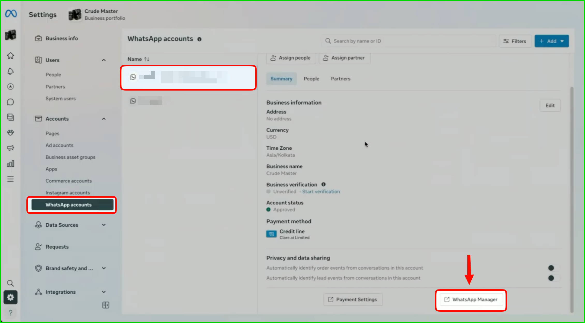

## Kalite Puanı Ne Anlama Gelir?

- Meta'nın telefon numarası kalite puanı, son yedi gündeki engellemeler ve şikayetler dahil müşteri geri bildirimlerini yansıtır.
- **High (yüksek, yeşil):** İlgili mesajlara odaklanmayı sürdürün.
- **Medium (orta, sarı):** Hedef kitlenizi, mesaj içeriğini ve sıklığı gözden geçirin.
- **Low (düşük, kırmızı):** Olumsuz geri bildirimleri hızla araştırın ve Meta uyarılarını inceleyin.

## Kalite Puanınızı Nasıl Kontrol Edebilirsiniz?

1. [Meta Business Suite](https://business.facebook.com/) sayfasını açın ve işletme portföyünüzü seçin.
2. **Settings > Accounts > WhatsApp accounts** yolunu izleyin ve hesabınızı seçin.
3. **WhatsApp Manager** düğmesine tıklayın. Hesaba erişemiyorsanız işletme yöneticinizden izinlerinizi kontrol etmesini isteyin.

4. **Phone numbers** bölümünü açın ve Eazybe toplu gönderimlerinde kullandığınız numarayı bulun.
5. **Status** yanındaki **Quality rating** değerini okuyun.

<Note>
  Bu ekran görüntüleri Meta arayüzünü gösterir. Hesap adları ve menü düzeni sizinkinden farklı olabilir.
</Note>

## Kalite Düşerse Ne Yapmalısınız?

1. **Son kampanyaları inceleyin:** Eazybe [toplu gönderim analizlerinde](/tr/broadcasts/view-analytics) hataları ve ayrılma taleplerini kontrol edin. Düşüşten önce kullanılan kitleyi ve şablonu not alın; bu araştırmaya yardımcı olur ancak nedeni kanıtlamaz.
2. **Alıcı iznini yeniden kontrol edin:** Mesaj almayı durduran müşterileri çıkarın ve güncellemelerinizi beklemeyen kişilere göndermeyin.
3. **İlgiyi artırın:** Hedef kitlenizi daraltın ve mesajı onların ilgi alanlarına göre uyarlayın.
4. **Aşırı sıklığı azaltın:** Kampanyaları koordine edin ve etkileşim kurmayan müşterilere ara verin.
5. **Meta uyarılarını inceleyin:** Hesap veya şablon sorunlarını çözün ve yaklaşımınızı değiştirdikten sonra puanı izleyin.

Daha kapsamlı kontrol listesi için [Toplu gönderimlerde teslimat oranını artırın](/tr/waba/improve-broadcast-deliverability) rehberine bakın.

## Bu Kontrolleri Ayrı Değerlendirin

- **Numara kalitesi:** Gönderici numaranızla ilişkili geri bildirimler.
- **Şablon durumu:** Şablonun onaylı ve kullanıma açık olup olmadığı. [Şablon kurallarını](/tr/waba/templates/guideline) inceleyin.
- **Bağlantı durumu:** Bağlı bir numarada da teslimat sorunları olabilir. Hataları ayrıca inceleyin.
- **Mesajlaşma sınırları:** Güncel kapasiteyi WhatsApp Manager'da kontrol edin. Sınırlar işletme portföyü düzeyinde uygulanır.

## Şablonunuzun Kalitesini de Kontrol Edin

- **Şablon kalitesi, telefon numarası kalitesinden ayrıdır.** Meta her şablonu kullanım, müşteri geri bildirimleri ve okunma oranları dahil etkileşim verileriyle değerlendirir.
- WhatsApp Manager'da göndermeyi planladığınız şablonu kontrol etmek için [Manage templates](https://business.facebook.com/latest/whatsapp_manager/message_templates) bölümünü açın.
- Onaylı şablonlarda **Quality pending** (kalite bekleniyor), **High quality** (yüksek), **Medium quality** (orta) veya **Low quality** (düşük) görünebilir. Yeni şablonlar bekleyen bir puanla başlar; Meta veri topladıkça puan güncellenir.
- Orta veya düşük kalite, şablonun duraklatılma ya da devre dışı bırakılma riskini artırabilir. Kullanımı genişletmeden önce geri bildirimleri inceleyin ve mesajı iyileştirin.
- Kalite, şablonun gönderim hızının düzenlenmesini ve duraklatılmasını etkileyebilir. Şablon **Approved** durumunu kaybederse bu durum geri yüklenene kadar gönderilemez.

**Resmî kaynak:** [Meta — Şablon kalite puanı](https://developers.facebook.com/documentation/business-messaging/whatsapp/templates/template-quality). Bu rehber tek tek mesaj şablonlarıyla ilgilidir; gönderici numaranızın kalitesini kontrol etmek için yukarıda açıklanan **Phone numbers** görünümünü kullanın.

## Sık Sorulan Sorular

### Yüksek kalite puanı teslimatı garanti eder mi?

Hayır. Puan yüksek olsa bile [toplu gönderim analizlerinde](/tr/broadcasts/view-analytics) alıcı düzeyindeki hataları inceleyin.

### Teklifimi artırmak düşük kalite puanını düzeltir mi?

Teklif üst sınırı maksimum teslimat fiyatını kontrol eder. Olumsuz müşteri geri bildirimlerini düzeltmenin bir yolu olarak görülmemelidir. Önce hedef kitlenin uygunluğunu ve gönderim sıklığını inceleyin; fiyatlandırma için [Maksimum teklif fiyatı](/tr/waba/templates/max-bidding-price) rehberine bakın.

### Destek ekibiyle ne paylaşmalıyım?

Gönderici numaranızı, güncel puanı, ilgili Meta uyarısını, kampanya adını ve hata nedenlerini [support@eazybe.com](mailto:support@eazybe.com) adresine gönderin. Puanın ekran görüntüsünü ekleyin ve ilgisiz hesap bilgilerini gizleyin.
