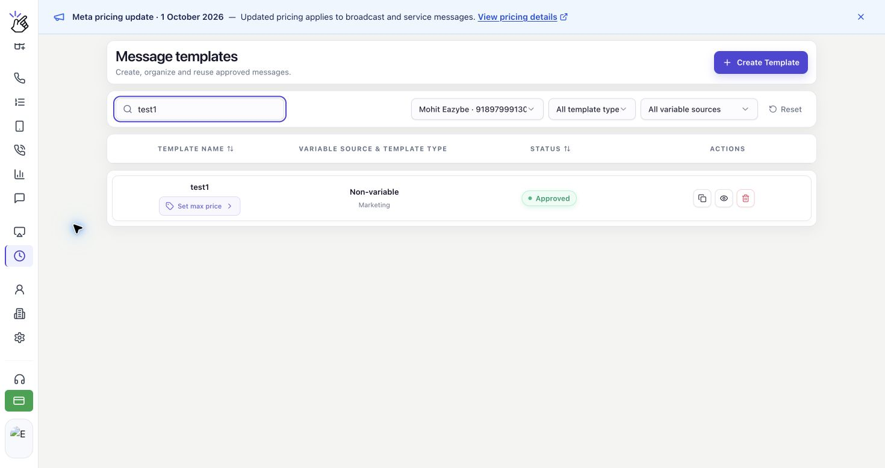
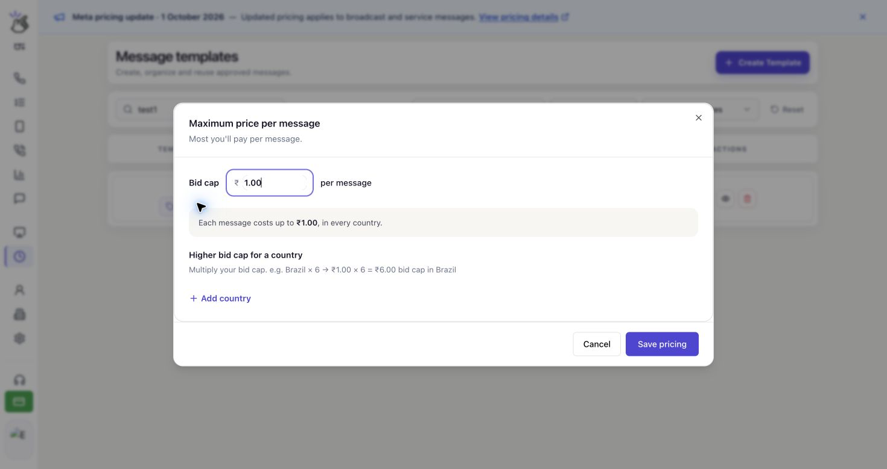
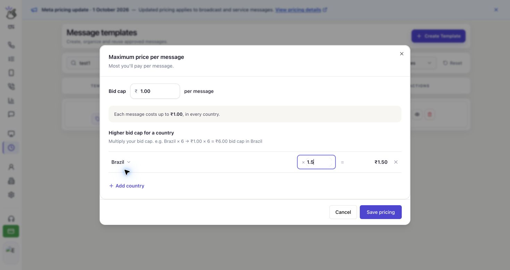

WhatsApp'ta teslim edilen her pazarlama mesajı için ödemeye razı olduğunuz en yüksek tutarı belirleyin. Bu teklif üst sınırını (**Bid cap**) mesaj şablonunuza kaydedin ve toplu gönderiminizde bu şablonu kullanın.

## Maksimum Fiyat Nasıl Çalışır?

Teklif üst sınırı, teslim edilen her mesaj için geçerlidir; toplam kampanya bütçesi veya sabit bir ücret değildir. Gerçek teslimat maliyeti daha düşük olabilir ve bir sınır belirlemek teslimatı garanti etmez.

Tüm ülkeler için aynı sınırı kullanabilir veya bir çarpanla ülkeye göre ayarlayabilirsiniz. Ayarlama yapılmayan ülkelerde temel sınır geçerli olur.

<Note>
  Maksimum fiyat, MM Lite'ın etkin olduğu uygun WhatsApp hesaplarındaki **Marketing** şablonları için kullanılabilir. Yalnızca **INR (Hindistan rupisi)** ve **USD (ABD doları)** desteklenir. Hizmet ve kimlik doğrulama şablonlarında bu ayar bulunmaz.
</Note>

## Şablonun Teklif Üst Sınırını Ayarlayın

<Warning>
  Aşağıda gösterilen ₹1.00 sınırı ve Brezilya çarpanı örnektir; önerilen fiyatlar değildir. Kampanyanıza uygun tutarları seçin ve hesabınızda gösterilen para birimini kontrol edin.
</Warning>

Ekran görüntülerinde arayüz İngilizcedir. Ekranda bulabilmeniz için kontrol adlarını İngilizce olarak koruduk.

<Steps>
  <Step title="Pazarlama şablonunuzun fiyat ayarlarını açın">
    Eazybe kenar çubuğunda **Templates** bölümünü açın. **Message templates** ekranında WhatsApp numaranızı seçin ve şablonu bulmak için **Search templates** alanını kullanın.

    Şablon adının altındaki **Set max price** düğmesine tıklayın. Şablonun zaten bir sınırı varsa incelemek veya değiştirmek için **Max … / delivery** düğmesine tıklayın.

    

    <Note>
      Şablonu toplu gönderimde kullanabilmeniz için durumunun **Approved** olması gerekir.
    </Note>
  </Step>

  <Step title="Teklif üst sınırınızı girin">
    **Maximum price per message** bölümündeki **Bid cap** alanına pozitif bir tutar girin. Bu, teslim edilen tek bir mesajın fiyatıdır. Alanın yanında gösterilen para birimini kullanın.

    - **INR:** Tutarı Hindistan rupisi olarak girin. Örneğin **1.00**, teslim edilen mesaj başına **INR 1.00** sınırı belirler.
    - **USD:** Tutarı ABD doları olarak girin. Örneğin **1.00**, teslim edilen mesaj başına **USD 1.00** sınırı belirler.

    Alanın altındaki özet, siz yazdıkça güncellenir.

    

    <Note>
      Alandaki **1.00** yer tutucusu kaydedilmiş bir fiyat değildir. Kaydetmeden önce kendi tutarınızı girin. Tutarı 1.000 mesaj başına fiyata dönüştürmeniz gerekmez.
    </Note>
  </Step>

  <Step title="Gerekirse sınırı ülkeye göre ayarlayın">
    Her ülkede aynı sınırı kullanmak için bu ayarlamayı atlayın. Bir ülke için farklı sınır belirlemek üzere **Higher bid cap for a country** başlığının altındaki **Add country** düğmesine tıklayın.

    Ülkeyi seçin ve **×** yanındaki alana bir çarpan girin. **=** işaretinden sonraki tutar, o ülke için hesaplanan üst sınırdır.

    

    Temel sınır ₹1.00 olduğunda **1.5** çarpanı Brezilya için ₹1.50 sınırı belirler. **1** çarpanı temel sınırı korur; **0.8** gibi **1**'den küçük bir değer sınırı düşürür.

    Çarpanlar **0**'dan büyük ve en fazla **10** olmalıdır. En fazla **50** ülke ekleyebilirsiniz. Bir ülkenin ayarlamasını kaldırıp temel sınıra dönmek için satırın sonundaki **×** kaldırma düğmesine tıklayın.

    <Warning>
      1'den büyük bir çarpan, o ülkeye yapılan her teslimat için izin verdiğiniz maksimum tutarı artırır. Kaydetmeden önce hesaplanan tutarı kontrol edin.
    </Warning>
  </Step>

  <Step title="Fiyatları inceleyin ve kaydedin">
    **Bid cap** değerini ve her ülkenin tutarını kontrol edin. **Save pricing** düğmesine tıklayın ve şu onayı bekleyin: **Pricing saved. Refresh before sending a campaign.**

    

    Değişiklikleri kaydetmeden kapatmak için **Cancel** düğmesine tıklayın. Fiyatları kaydetmek şablonu günceller; toplu gönderim başlatmaz.

    <Warning>
      Bu ayar şablona aittir ve onu kullanan toplu gönderimleri etkileyebilir. Bu şablonla mesajlar gönderilirken fiyatları değiştirmekten kaçının.
    </Warning>
  </Step>
</Steps>

## Toplu Gönderimden Önce

Gönderen numarayı, onaylı şablonu ve alıcıları seçmek için [Yeni toplu gönderim oluşturma](/tr/broadcasts/create-broadcast) kılavuzunu izleyin.

Maksimum fiyatı olan bir şablon için **Marketing delivery pricing** bölümünü inceleyin ve güncel ayarları yüklemek üzere **Refresh pricing** düğmesine tıklayın. Alıcılar seçildiğinde **Maximum Meta delivery cost**, bu kitle için maksimum teslimat maliyetini gösterir. Ülke bazındaki döküm; alıcı sayısını, teslimat başına maksimum fiyatı ve her ülkenin maksimum maliyetini gösterir.

<Warning>
  Maksimum maliyet veya tahmin, nihai ücret değildir. Maksimum fiyatlı mesajlarda cüzdan ücretleri, Meta teslimat maliyetini bildirdiğinde kesinleştirilir. Maliyet henüz gelmediyse beklemededir; bu, ücretsiz teslimat anlamına gelmez. **Estimated wallet deduction** ile **Maximum Meta delivery cost** tutarlarını toplamayın: bunlar ayrı görünümlerdir, toplanacak iki ayrı ücret değildir.
</Warning>

## Sık Sorulan Sorular

### Neden maksimum fiyat belirleyemiyorum?

Doğru WhatsApp numarasını ve bir **Marketing** şablonunu seçtiğinizden emin olun. Fiyat düzenleyicisi yalnızca hesabınız, sağlayıcınız ve para biriminiz maksimum fiyatı desteklediğinde kullanılabilir. **Maximum pricing changes are unavailable for this account, provider, or currency.** mesajı görünüyorsa bu seçim için sınırı değiştiremezsiniz.

**Pricing is unavailable.** mesajını görürseniz fiyat bilgilerini yeniden yüklemek için **Retry** düğmesine tıklayın.

### Tutarım neden kaydedilmiyor?

Alana para birimi simgesi olmadan pozitif bir ondalık sayı girin. Fiyat, hesabınızın desteklediğinden daha fazla ondalık basamak içeriyorsa daha az basamaklı bir tutar girip tekrar deneyin. Ülke çarpanları 0'dan büyük ve en fazla 10 olmalıdır.

### Toplu gönderimi hazırladıktan sonra fiyatlar değişirse ne olur?

Eazybe, göndermeden önce şablon fiyatlarını tekrar kontrol eder. Fiyatlar değiştiyse etkilenen mesajlar eski ayarlarla gönderilmez. Güncel fiyatı inceleyin ve Eazybe kampanyayı yeniden oluşturmanızı isterse yeni bir toplu gönderim oluşturun.

### Fiyat kaydedilir ancak senkronizasyon başarısız olursa ne olur?

**Saved at Meta. Local pricing synchronization failed; refresh before sending.** mesajı görünüyorsa fiyat Meta'da kaydedilmiştir. Toplu gönderim hazırlamadan önce şablon fiyatlarını yenileyin ve tutarları doğrulayın.

### Daha yüksek bir sınır daha fazla teslimatı garanti eder mi?

Hayır. Daha yüksek bir sınır, teslimat başına daha yüksek fiyata izin verir ancak her alıcının mesajı alacağını garanti etmez.
